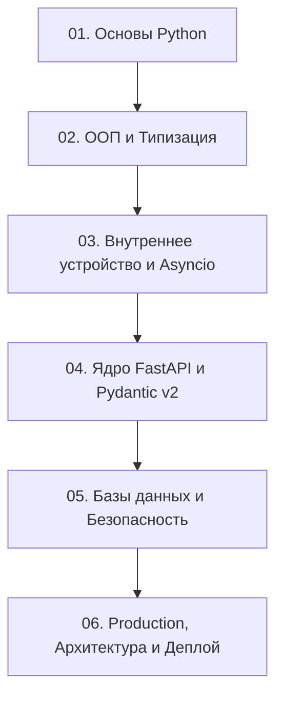

# Python & FastAPI: Полный интерактивный учебник от 0 до Pro

> [!IMPORTANT] Как работать с этим Obsidian Vault
> 1. Откройте папку `PythonLearn` как хранилище (Vault) в **Obsidian**.
> 2. Используйте граф знаний (`Cmd/Ctrl + G`) для визуализации связей между темами.
> 3. В конце каждой главы находится блок **«Практическое задание»** со ссылкой на `.py` файл в папке `exercises/`.
> 4. Каждый `.py` файл содержит описание задачи, заготовки с `# TODO` и встроенный авто-раннер тестов на `unittest` (совместимый также с `pytest`). Запускайте проверку прямо из терминала:
>    ```bash
>    python3 exercises/01_basics/ex_01_syntax_types.py
>    ```

---

## Архитектура курса



---

## Модуль 01: Основы Python (`01_Python_Basics`)
Карта модуля: [[00_Module_01_MOC|00. Индекс Модуля 01]] — Фундамент языка, модель памяти для базовых типов, структуры данных, функции и работа с ОС.

1. [[01_Syntax_Types_Variables|01. Синтаксис, переменные и динамическая типизация]] — Практика: [[ex_01_syntax_types.py]]
2. [[02_Control_Flow_Loops|02. Управляющие конструкции, сопоставление с образцом (match/case) и циклы]] — Практика: [[ex_02_control_flow.py]]
3. [[03_Data_Structures|03. Структуры данных: list, tuple, dict, set и их алгоритмическая сложность]] — Практика: [[ex_03_data_structures.py]]
4. [[04_Functions_Closures|04. Функции, области видимости (LEGB), замыкания и лямбды]] — Практика: [[ex_04_functions_closures.py]]
5. [[05_Exceptions_Files_Context|05. Исключения, работа с файлами и контекстные менеджеры]] — Практика: [[ex_05_exceptions_files.py]]

---

## Модуль 02: ООП, функциональное программирование и строгая типизация (`02_Python_OOP_Typing`)
Карта модуля: [[00_Module_02_MOC|00. Индекс Модуля 02]] — Переход от скриптов к инженерному коду: объектная модель Python, протоколы и статический анализ.

1. [[01_Classes_Magic_Methods|01. Классы, атрибуты, slots и магические (dunder) методы]] — Практика: [[ex_01_classes_magic.py]]
2. [[02_Inheritance_MRO_ABCs|02. Наследование, MRO (C3-линеаризация), миксины и абстрактные классы]] — Практика: [[ex_02_inheritance_abc.py]]
3. [[03_Decorators_Generators|03. Декораторы с параметрами, итераторы, генераторы и itertools]] — Практика: [[ex_03_decorators_generators.py]]
4. [[04_Dataclasses_Enums_Descriptors|04. Dataclasses, Enum и протокол дескрипторов]] — Практика: [[ex_04_dataclasses_descriptors.py]]
5. [[05_Type_Hints_Protocols_Generics|05. Продвинутая типизация: Generics, Protocol, TypeVar, Annotated]] — Практика: [[ex_05_typing_protocols.py]]

---

## Модуль 03: Внутреннее устройство Python, конкурентность и Asyncio (`03_Python_Internals_Async`)
Карта модуля: [[00_Module_03_MOC|00. Индекс Модуля 03]] — Глубокое погружение в CPython, многопоточность, многопроцессорность и событийный цикл `asyncio`, на котором работает FastAPI.

1. [[01_Memory_Model_GIL_GC|01. Модель памяти CPython, подсчет ссылок, Garbage Collector и GIL / Free-Threading]] — Практика: [[ex_01_memory_gc.py]]
2. [[02_Metaclasses_ContextManagers|02. Метаклассы, `__init_subclass__` и продвинутый `contextlib`]] — Практика: [[ex_02_metaclasses_context.py]]
3. [[03_Threading_Multiprocessing|03. Многопоточность (`threading`), многопроцессорность (`multiprocessing`) и `concurrent.futures`]] — Практика: [[ex_03_concurrency_sync.py]]
4. [[04_Asyncio_Event_Loop_Coroutines|04. Устройство Event Loop, корутины, Tasks, Futures и `TaskGroup`]] — Практика: [[ex_04_asyncio_coroutines.py]]
5. [[05_Async_Patterns_Queues_Streams|05. Асинхронные паттерны: очереди, семафоры, `contextvars` и стриминг]] — Практика: [[ex_05_async_patterns.py]]

---

## Модуль 04: Ядро FastAPI и Pydantic v2 (`04_FastAPI_Core`)
Карта модуля: [[00_Module_04_MOC|00. Индекс Модуля 04]] — Создание современных ASGI веб-сервисов, декларативная валидация данных и система внедрения зависимостей.

1. [[01_ASGI_Routing_Parameters|01. Стандарт ASGI, Uvicorn, маршрутизация (`APIRouter`), Path и Query параметры]] — Практика: [[ex_01_routing_params.py]]
2. [[02_Pydantic_v2_Models_Validation|02. Глубокое погружение в Pydantic v2: `BaseModel`, `Field`, `field_validator`, `model_validator`, `ConfigDict`]] — Практика: [[ex_02_pydantic_v2.py]]
3. [[03_Requests_Responses_Status_Errors|03. Обработка запросов, кастомные ответы, статус-коды и глобальный перехват ошибок (`HTTPException`)]] — Практика: [[ex_03_requests_errors.py]]
4. [[04_Dependency_Injection_System|04. Система Dependency Injection (`Depends`), зависимости с `yield`, иерархия и переопределение в тестах]] — Практика: [[ex_04_dependency_injection.py]]
5. [[05_Middleware_Lifespan_Background|05. ASGI Middleware, CORS, управление жизненным циклом (`lifespan`) и `BackgroundTasks`]] — Практика: [[ex_05_middleware_lifespan.py]]

---

## Модуль 05: Базы данных, Безопасность и Real-time (`05_FastAPI_Data_Auth`)
Карта модуля: [[00_Module_05_MOC|00. Индекс Модуля 05]] — Асинхронная работа с реляционными БД, паттерны доступа к данным, криптография, JWT и двунаправленные соединения.

1. [[01_SQLAlchemy2_Async_Sessions|01. SQLAlchemy 2.0 Async: `AsyncEngine`, `async_sessionmaker`, Declarative Mapping и связи]] — Практика: [[ex_01_sqlalchemy_async.py]]
2. [[02_Migrations_Alembic_Repositories|02. Миграции Alembic, паттерны Repository и Unit of Work (UoW), проблема N+1]] — Практика: [[ex_02_repositories_uow.py]]
3. [[03_Auth_OAuth2_JWT_Security|03. Безопасность: OAuth2 Password Flow, JWT (Access/Refresh), хеширование паролей и RBAC]] — Практика: [[ex_03_auth_jwt_rbac.py]]
4. [[04_Caching_Redis_RateLimiting|04. Кэширование с Redis, инвалидация кэша, идемпотентность и Rate Limiting (Token Bucket / Sliding Window)]] — Практика: [[ex_04_caching_ratelimit.py]]
5. [[05_WebSockets_SSE_Streaming|05. Real-time в FastAPI: WebSockets, Connection Manager, Server-Sent Events (SSE) и `StreamingResponse`]] — Практика: [[ex_05_websockets_sse.py]]

---

## Модуль 06: Production, Архитектура, Тестирование и Деплой (`06_FastAPI_Pro_Production`)
Карта модуля: [[00_Module_06_MOC|00. Индекс Модуля 06]] — Проектирование масштабируемых систем, фоновые воркеры, тестирование, наблюдаемость и контейнеризация.

1. [[01_Clean_Architecture_DDD|01. Чистая архитектура (Clean Architecture), гексагональные порты/адаптеры и тактический DDD]] — Практика: [[ex_01_clean_architecture.py]]
2. [[02_Async_Testing_Pytest_Mocks|02. Комплексное тестирование: `pytest`, фикстуры, изоляция БД, моки и тестирование асинхронных сервисов]] — Практика: [[ex_02_async_testing.py]]
3. [[03_Task_Queues_Celery_Taskiq_Broker|03. Фоновые очереди задач (Taskiq / Celery), паттерн Transactional Outbox и Event-Driven подход]] — Практика: [[ex_03_task_queues_outbox.py]]
4. [[04_Observability_Logging_Prometheus|04. Наблюдаемость (Observability): структурное логирование, `Correlation-ID`, метрики и OpenTelemetry]] — Практика: [[ex_04_observability_metrics.py]]
5. [[05_Docker_CI_CD_Performance_Pro|05. Multi-stage Docker, Gunicorn/Uvicorn воркеры, `pydantic-settings`, Graceful Shutdown и оптимизация]] — Практика: [[ex_05_production_config.py]]
