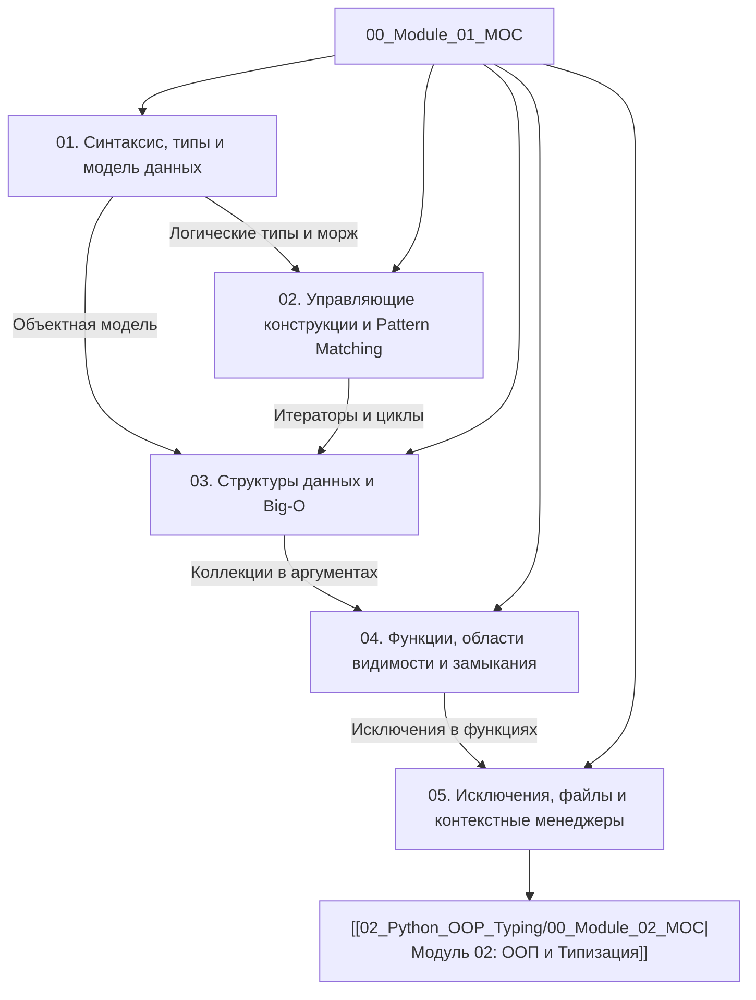

# Модуль 01: Фундаментальные основы Python

[[00_Index_MOC|← На главную карту знаний (Index MOC)]]

Добро пожаловать в первый модуль интерактивного руководства. Цель этого модуля — заложить глубокий, инженерный фундамент понимания языка **Python (3.12–3.14+)**. Мы не просто изучим синтаксис, а разберем, как Python устроен «под капотом»: объектную модель CPython, представление типов в оперативной памяти, внутреннее устройство хеш-таблиц и массивов, семантику ссылок, замыкания и надежную обработку исключений.

> [!IMPORTANT] Ключевой принцип модуля
> В Python **всё является объектом** (first-class citizen) — от чисел и строк до функций, классов и модулей. Понимание этого принципа избавляет от 90% скрытых багов, связанных с мутабельностью аргументов, потерей ссылок и неоптимальной алгоритмической сложностью.

---

## Архитектура и граф знаний Модуля 01



---

## Содержание модуля

### 1. [[01_Syntax_Types_Variables|Синтаксис, переменные, динамическая типизация и модель памяти]]
- Модель данных CPython: структура `PyObject`, подсчет ссылок (`ob_refcnt`) и указатель на тип (`ob_type`).
- Переменные как связывания (bindings) имен и объектов в куче (heap).
- Мутабельность (mutable) vs иммутабельность (immutable): физическое разделение памяти.
- Проверка идентичности (`is` / `id()`) vs проверка эквивалентности (`==`).
- Оптимизации CPython: интернирование малых целых чисел (`[-5, 256]`), интернирование строк и Constant Folding.
- Целые числа `int` произвольной разрядности и вещественные числа `float` (IEEE 754) vs `decimal.Decimal`.
- Строки `str` (представление PEP 393: 1, 2, 4 байта), кодировки UTF-8 и байты `bytes`.
- Оператор присваивания в выражениях (оператор моржа `:=`).
- Введение в аннотации типов (PEP 484, PEP 604).
- **Практика**: [[ex_01_syntax_types.py]]

---

### 2. [[02_Control_Flow_Loops|Управляющие конструкции, Pattern Matching и циклы]]
- Условные ветвления `if / elif / else` и понятие Truthy / Falsy значений (`__bool__`, `__len__`).
- Short-circuit evaluation в логических операторах `and` и `or`: возврат реального операнда.
- Structural Pattern Matching (`match / case` в Python 3.10+):
  - Сопоставление литералов, последовательностей (`*rest`) и словарей.
  - Деструктуризация экземпляров пользовательских классов.
  - Ограничители (guards `if`) и связывание через `as`.
- Циклы `for` и `while`: протокол итерации (`iter()`, `next()`, `StopIteration`).
- Редко используемый, но мощный блок `else` у циклов (выполнение без `break`).
- Идиоматичные вспомогательные функции: `enumerate()` и `zip(strict=True)`.
- **Практика**: [[ex_02_control_flow.py]]

---

### 3. [[03_Data_Structures|Структуры данных: list, tuple, dict, set и алгоритмическая сложность]]
- Внутреннее устройство и Big-O сложность стандартных коллекций:
  - `list`: динамический массив указателей, механизм over-allocation, амортизированное $O(1)$ для `append`.
  - `tuple`: неизменяемый кортеж, кэширование пулов кортежей в CPython, `NamedTuple`.
  - `dict`: компактная хеш-таблица (с Python 3.6), открытая адресация, разрешение коллизий, требования к `Hashable` (`__hash__` и `__eq__`).
  - `set` и `frozenset`: хеш-таблица ключей, теория множеств ($O(1)$ проверка вхождения).
- Срезы (`slice`): семантика поверхностного копирования, шаг, обратный срез `[::-1]`, присваивание в срез.
- Генераторы коллекций (Comprehensions) для списков, словарей и множеств.
- Модуль `collections`: `defaultdict`, `Counter`, `deque` (двусвязная очередь с $O(1)$ на обоих концах).
- **Практика**: [[ex_03_data_structures.py]]

---

### 4. [[04_Functions_Closures|Функции, области видимости (LEGB), замыкания и лямбды]]
- Функции как объекты первого класса (first-class citizens) в CPython.
- Сигнатуры функций: позиционные аргументы (`/`), именованные аргументы (`*`), `*args` и `**kwargs`.
- Фатальная ловушка изменяемых значений по умолчанию (`def func(items=[])`).
- Правило поиска имен LEGB (`Local` $\rightarrow$ `Enclosing` $\rightarrow$ `Global` $\rightarrow$ `Built-in`).
- Ключевые слова `global` и `nonlocal`.
- Замыкания (Closures): внутренняя анатомия `__closure__`, `cell`-объекты и время жизни переменных.
- Лямбда-функции (`lambda`), поздняя привязка в циклах (late-binding closure trap).
- Частичное применение с `functools.partial`.
- Рекурсия, глубина стека вызовов и предел `sys.getrecursionlimit()`.
- **Практика**: [[ex_04_functions_closures.py]]

---

### 5. [[05_Exceptions_Files_Context|Исключения, работа с файлами и контекстные менеджеры]]
- Дерево исключений: почему нельзя перехватывать `BaseException` вместо `Exception`.
- Полная конструкция `try / except / else / finally`.
- Проектирование чистых иерархий доменных ошибок.
- Цепочки исключений (Exception Chaining): явная (`from exc`), неявная (`__context__`) и подавление (`from None`).
- Группы исключений (`ExceptionGroup`) и синтаксис `except*` (Python 3.11+) для параллельных задач.
- Работа с файловой системой: преимущества `pathlib.Path` над `os.path`.
- Протокол контекстных менеджеров: методы `__enter__` и `__exit__`.
- Модуль `contextlib`: декоратор `@contextmanager`, `ExitStack` и `suppress`.
- **Практика**: [[ex_05_exceptions_files.py]]

---

## Таблица практических заданий модуля

| Файл с практикой | Тема | Кол-во задач | Запуск тестов |
| :--- | :--- | :---: | :--- |
| `exercises/01_basics/ex_01_syntax_types.py` | Типы, память, `Decimal`, морж | 4 | `python3 exercises/01_basics/ex_01_syntax_types.py` |
| `exercises/01_basics/ex_02_control_flow.py` | Match/case, short-circuit, zip | 4 | `python3 exercises/01_basics/ex_02_control_flow.py` |
| `exercises/01_basics/ex_03_data_structures.py` | Sliding window deque, Counter, set | 4 | `python3 exercises/01_basics/ex_03_data_structures.py` |
| `exercises/01_basics/ex_04_functions_closures.py` | Rate limiter, pipeline, kwargs | 4 | `python3 exercises/01_basics/ex_04_functions_closures.py` |
| `exercises/01_basics/ex_05_exceptions_files.py` | Atomic write, context manager, groups | 4 | `python3 exercises/01_basics/ex_05_exceptions_files.py` |

> [!TIP] Запуск всех тестов проекта
> Вы можете проверить корректность выполнения всех заданий одной командой из корня:
> ```bash
> python3 run_all_tests.py
> ```
