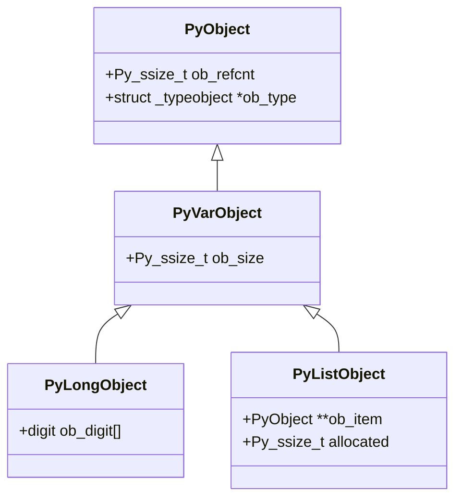
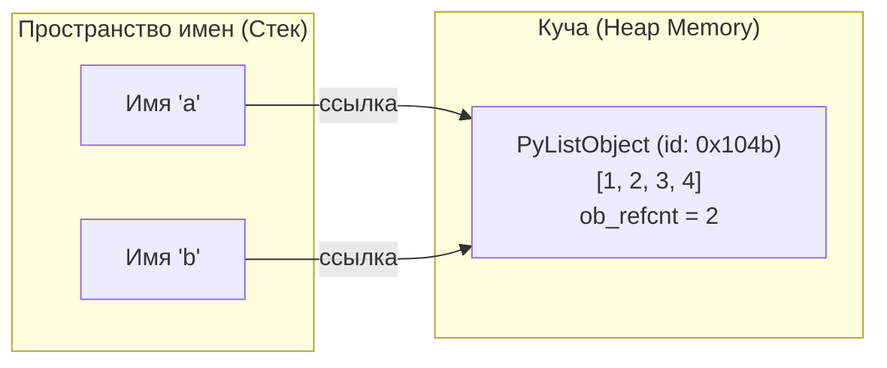
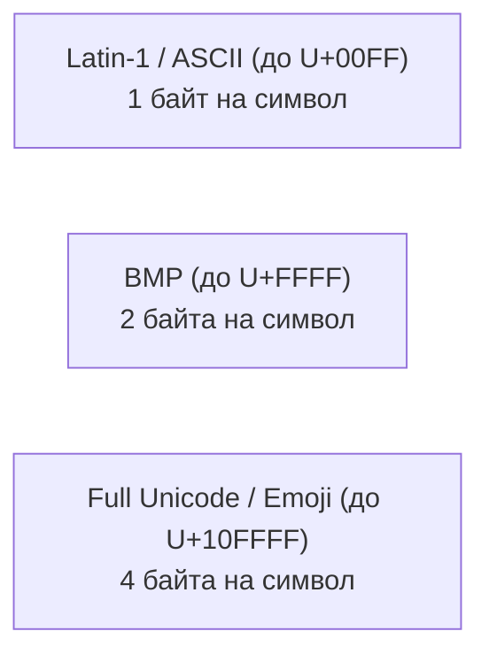

# 01. Синтаксис, переменные, динамическая типизация и модель памяти

[[00_Module_01_MOC|← К оглавлению модуля 01]] | [[02_Control_Flow_Loops|Следующая глава: Управляющие конструкции и циклы →]]

---

## 1. Модель данных Python: «Всё есть объект»

В Python любое значение — число, строка, список, функция, класс или модуль — представляет собой полноправный **объект** (First-class Object).

В эталонной реализации **CPython** каждый объект в памяти C представлен структурой, начинающейся с заголовочных полей `PyObject`:

```c
// Упрощенный вид заголовочной структуры PyObject из CPython (Include/object.h)
typedef struct _object {
    _PyObject_HEAD_EXTRA
    Py_ssize_t ob_refcnt;          // Счетчик ссылок для GC (Reference Counting)
    struct _typeobject *ob_type;   // Указатель на объект типа (класс)
} PyObject;

// Для объектов переменной длины (например, list, str, tuple, int):
typedef struct {
    PyObject ob_base;
    Py_ssize_t ob_size;            // Количество элементов
} PyVarObject;
```



Каждый объект имеет:
1. **Идентификатор (Identity)**: Уникальный адрес в виртуальной памяти (возвращается функцией `id()`).
2. **Тип (Type)**: Указывает, какие операции над объектом допустимы (возвращается функцией `type()`).
3. **Значение (Value)**: Содержимое объекта, хранящееся в куче (heap).

---

## 2. Переменные — это ссылки, а не контейнеры

В языках вроде C++ или Go переменная — это именованная ячейка памяти определенного размера, в которой лежит само значение:

```text
C++:  int a = 42;    [ Ячейка 0x7ffd98b0: 00000000 00000000 00000000 00101010 ]
```

В Python переменная — это лишь **метка (binding / reference)** в локальном пространстве имен (хеш-таблице `locals()` или `globals()`), указывающая на объект в куче:

```python
a = [1, 2, 3]
b = a  # b ссылается на ТОТ ЖЕ самый объект в памяти
b.append(4)

print(a)  # [1, 2, 3, 4] — изменился и 'a'!
print(a is b)  # True: идентичные адреса в памяти
```



> [!IMPORTANT] Передача аргументов: Call-by-Object-Sharing
> В Python аргументы в функцию передаются **по ссылке на объект (call-by-object-sharing)**. Передается не копия объекта и не адрес переменной, а ссылка на сам объект в куче. Если объект мутабельный и функция изменяет его на месте (`in-place`), эти изменения видны снаружи.

---

## 3. Мутабельность (Mutable) vs Иммутабельность (Immutable)

Все встроенные типы данных Python делятся на две фундаментальные категории:

| Категория | Типы | Поведение при изменении | Возможность быть ключом в `dict` |
| :--- | :--- | :--- | :---: |
| **Иммутабельные** | `int`, `float`, `complex`, `bool`, `str`, `tuple`, `frozenset`, `bytes`, `NoneType` | Любая операция порождает **новый объект** в памяти | Да (если элементы тоже hashable) |
| **Мутабельные** | `list`, `dict`, `set`, `bytearray` | Изменение происходит **на месте** без смены `id()` | Нет (TypeError: unhashable type) |

### Ловушка кортежа с изменяемым элементом

Кортеж (`tuple`) иммутабелен: его размер и ссылки на элементы зафиксированы навсегда. Однако если один из элементов — мутабельный объект (например, список), его содержимое можно изменить:

```python
t = (1, 2, [3, 4])
# t[0] = 10        # TypeError: 'tuple' object does not support item assignment
t[2].append(5)      # РАБОТАЕТ! Внутренний список изменился на месте
print(t)            # (1, 2, [3, 4, 5])
```

> [!WARNING] Опасный баг с оператором `+=` в кортеже
> Что произойдет при выполнении `t[2] += [6]`?
> 1. Сначала выполнится `t[2].extend([6])` — список успешно изменится.
> 2. Затем Python попытается присвоить результат обратно в `t[2]`.
> 3. Выбросится `TypeError: 'tuple' object does not support item assignment`!
> 4. При этом элемент `6` **останется добавленным** в список!

---

## 4. Идентичность (`is`) vs Эквивалентность (`==`)

- **`==` (`__eq__`)**: Проверяет **равенство значений** объектов.
- **`is`**: Проверяет **идентичность адресов в памяти** (`id(a) == id(b)`).

```python
list1 = [1, 2, 3]
list2 = [1, 2, 3]

print(list1 == list2)  # True  (содержимое одинаковое)
print(list1 is list2)  # False (два разных объекта в куче)
```

> [!TIP] Когда использовать `is`
> Всегда используйте `is` для сравнения с синглтонами:
> - `if val is None:` (и `if val is not None:`)
> - `if flag is True:` (или просто `if flag:`)
> - Сравнение `val == None` работает медленнее, так как вызывает метод `__eq__`, который может быть перегружен пользователем.

---

## 5. Оптимизации CPython: Интернирование и кэширование

CPython применяет механизмы кэширования для снижения фрагментации памяти и ускорения работы.

### Интернирование малых целых чисел (Small Integer Cache)
При инициализации интерпретатора CPython заранее создает синглтоны для чисел в диапазоне **от -5 до 256** включительно (массив `small_ints` в `Objects/longobject.c`):

```python
x = 256
y = 256
print(x is y)  # True (берутся из глобального кэша CPython)

x = 257
y = 257
# В REPL построчно: False (разные объекты)
# Внутри одного модуля/скрипта компилятор CPython может объединить их (Constant Folding): True
```

### Интернирование строк (String Interning)
CPython автоматически интернирует короткие строки, похожие на идентификаторы языка (состоящие из ASCII букв, цифр и знака подчеркивания). Вы также можете принудительно интернировать строку через `sys.intern()`:

```python
import sys

s1 = sys.intern("very_long_custom_identifier_string")
s2 = sys.intern("very_long_custom_identifier_string")
print(s1 is s2)  # True — мгновенное сравнение указателей O(1) вместо посимвольного O(N)!
```

---

## 6. Числовые типы: `int`, `float` и точные вычисления `decimal`

### `int` произвольной разрядности
В Python 3 тип `int` не имеет ограничений по разряду (кроме доступной RAM). Реализован как структура `_PyLongObject`, где число хранится как массив 30-битных «цифр» (`digits`) по основанию $2^{30}$.
Никаких переполнений `int` (overflow) в Python не бывает:

```python
huge = 10 ** 100  # Гугол — никаких проблем со знаком и переполнением!
print(huge.bit_length())  # 333 бита
```

### `float` и стандарт IEEE 754
`float` в CPython — это 64-битное число с плавающей точкой двойной точности (C `double`, 53 бита мантиссы, 11 бит экспоненты).

```python
print(0.1 + 0.2)  # 0.30000000000000004
print(0.1 + 0.2 == 0.3)  # False!
```

> [!CAUTION] Никогда не используйте `float` для денежных сумм
> Двоичное представление не может точно выразить дробь $1/10$ ($0.0001100110011..._2$).
> Для финансовых расчетов, цен и процентов используйте `decimal.Decimal`!

```python
from decimal import Decimal, ROUND_HALF_UP
import math

# Для float: проверка через math.isclose
print(math.isclose(0.1 + 0.2, 0.3))  # True

# Для финансов: строго Decimal из СТРОК!
price = Decimal("19.99")
tax_rate = Decimal("0.20")
total = (price * (1 + tax_rate)).quantize(Decimal("0.01"), rounding=ROUND_HALF_UP)
print(total)  # Decimal('23.99')
```

---

## 7. Строки (`str`), кодировки и `bytes`

### Представление строк в CPython (PEP 393)
В Python 3 строки `str` иммутабельны и хранят последовательность Unicode-символов. В CPython память выделяется гибко в зависимости от максимального code point в строке:



Если в строке появляется хотя бы один эмодзи `🐍` (U+1F40D), CPython переключает всю строку в 4 байта на символ!

### Преобразование: `str` vs `bytes`
- `str`: текстовые символы (Unicode code points).
- `bytes`: сырая последовательность октетов (0..255).

```python
text = "Привет, мир! 🚀"
encoded = text.encode("utf-8")  # str -> bytes
print(type(encoded), len(encoded))  # <class 'bytes'> 26 байт

decoded = encoded.decode("utf-8")  # bytes -> str
assert decoded == text
```

### Форматирование строк: f-strings (PEP 498 и PEP 701)
f-strings вычисляются во время выполнения быстрее, чем `str.format()` или `%`, так как парсятся в специальный байткод `FORMAT_VALUE`.

```python
value = 12345.6789
name = "Alice"

# Спецификаторы форматирования:
print(f"{name:>10}")            # Выравнивание вправо (ширина 10): '     Alice'
print(f"{value:,.2f}")          # Разделитель тысяч и 2 знака: '12,345.68'
print(f"{value=}")              # Отладочный вывод (Python 3.8+): 'value=12345.6789'
print(f"{255:#04x}")            # Шестнадцатеричный вид с префиксом: '0x00ff'
```

---

## 8. Типы `bool` и `None`

### `bool` — подкласс `int`
Исторически в Python `bool` унаследован от `int`:
```python
print(issubclass(bool, int))  # True
print(isinstance(True, int))  # True
print(True + True)            # 2
print(False * 42)             # 0
```
Синглтоны `True` и `False` существуют в единственном экземпляре.

### `None` и `NoneType`
`None` обозначает отсутствие значения. Это единственный экземпляр класса `NoneType`.
Всегда проверяется через оператор `is`:
```python
res = None
if res is None:
    print("Результат пуст")
```

---

## 9. Оператор присваивания в выражениях: «Морж» (`:=`)

Оператор `:=` (Walrus Operator, PEP 572, Python 3.8+) позволяет вычислить значение, присвоить его переменной и вернуть результат внутри одного выражения:

```python
# Без моржа:
line = input_stream.readline()
while line:
    process(line)
    line = input_stream.readline()

# С оператором моржа:
while (line := input_stream.readline()):
    process(line)
```

### Использование в фильтрации данных:
```python
data = ["  python  ", "", "   fastapi", "   "]

# Вычисляем strip() один раз и сразу проверяем на truthy:
cleaned = [clean for item in data if (clean := item.strip())]
print(cleaned)  # ['python', 'fastapi']
```

---

## 10. Базовые аннотации типов (Type Hints)

Начиная с Python 3.5 (PEP 484) и обновлений в Python 3.10+ (PEP 604), в язык встроена поддержка статической типизации:

```python
# Современный синтаксис (Python 3.10+):
def calculate_discount(price: float, discount: float | None = None) -> float:
    if discount is None:
        return price
    return price * (1.0 - discount)

users: list[str] = ["admin", "root"]
settings: dict[str, int | str] = {"timeout": 30, "host": "127.0.0.1"}
```

> [!NOTE] Влияние типов на рантайм
> Аннотации типов в Python **не проверяются во время выполнения** интерпретатором. Это метаданные, сохраняемые в словаре `__annotations__`, используемые IDE, линтерами (`mypy`, `pyright`, `ruff`) и фреймворками вроде **Pydantic** и **FastAPI**.

---

## Резюме

1. Все сущности в CPython — объекты в куче (`PyObject`), управляемые счетчиком ссылок.
2. Переменные — это имена-ссылки.
3. Иммутабельные типы защищают от непреднамеренных изменений; мутабельные меняются на месте.
4. `is` проверяет адреса памяти, `==` проверяет значения.
5. Для денег — только `decimal.Decimal` из строк, никогда не `float`.
6. Оператор моржа `:=` устраняет дублирование вычислений в условиях.

---

## Практическое задание

Перейдите к выполнению практического задания в файле:
[[ex_01_syntax_types.py]]

Команда для запуска проверочных тестов:
```bash
python3 exercises/01_basics/ex_01_syntax_types.py
```
