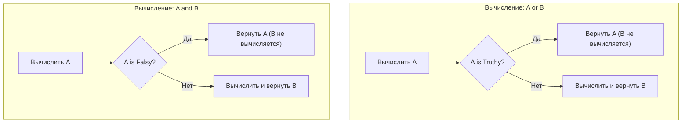

# 02. Управляющие конструкции, Structural Pattern Matching и циклы

[[01_Syntax_Types_Variables|← Предыдущая глава: Синтаксис, переменные и память]] | [[00_Module_01_MOC|Оглавление модуля 01]] | [[03_Data_Structures|Следующая глава: Структуры данных →]]

---

## 1. Ветвления и логика: Truthy и Falsy значения

В условных конструкциях (`if / elif / else`) Python оценивает любое выражение как истинное (`Truthy`) или ложное (`Falsy`) с помощью встроенной функции `bool()`.

Под капотом интерпретатор вызывает:
1. Магический метод `obj.__bool__()`.
2. Если `__bool__` не реализован, вызывается метод `obj.__len__()` (длина $0 \implies$ `False`).
3. Если ни один не определен, объект по умолчанию считается `True`.

### Сводная таблица Falsy значений

| Категория | Значения, эквивалентные `False` |
| :--- | :--- |
| **Синглтоны** | `None`, `False` |
| **Числовые нули** | `0`, `0.0`, `0j`, `Decimal(0)`, `Fraction(0, 1)` |
| **Пустые последовательности** | `""` (str), `b""` (bytes), `()` (tuple), `[]` (list) |
| **Пустые коллекции** | `{}` (dict), `set()`, `frozenset()` |
| **Пользовательские объекты** | Экземпляры с `def __bool__(self): return False` или `def __len__(self): return 0` |

> [!TIP] Идиоматичный Python (PEP 8)
> Никогда не пишите:
> ```python
> if len(items) > 0: ...  # Неидиоматично
> if items == True: ...    # Ошибка (items не равен True!)
> ```
> Пишите кратко и выразительно:
> ```python
> if items:
>     ...  # Список не пуст
> if not items:
>     ...  # Список пуст
> ```

---

## 2. Короткое замыкание (Short-Circuit Evaluation) в `and` и `or`

Логические операторы `and` и `or` в Python обладают двумя критически важными свойствами:
1. **Ленивое вычисление (Short-circuiting)**: Правый операнд не вычисляется, если результата левого достаточно для определения исхода.
2. **Возврат значения операнда**: Они возвращают **сам объект**, на котором завершилось вычисление, а не сухой `bool`!



### Паттерны использования:

```python
# 1. Значение по умолчанию (Defaulting):
raw_name = ""
user_name = raw_name or "Guest"  # "Guest" (так как "" ложно)

# 2. Безопасная цепочка проверок (Guard clause):
user = {"profile": {"age": 25}}
# Если user None или нет ключа, правая часть не упадет с ошибкой
age = user and user.get("profile") and user["profile"].get("age")
```

---

## 3. Structural Pattern Matching (`match / case`)

Начиная с Python 3.10 (PEP 634–636), в язык добавлено **структурное сопоставление с образцом**. Это не просто аналог `switch / case` из языков C/Go/Java, а мощный механизм деструктуризации и сопоставления формы (типа, длины, атрибутов) данных.

### 3.1. Литералы, Capture-переменные и Wildcard

```python
def handle_command(command: str) -> str:
    match command.split():
        case ["quit"]:
            return "Завершение программы"
        case ["load", filename]:  # захват переменной filename
            return f"Загрузка файла {filename}"
        case ["save", filename, ("--force" | "-f")]:  # OR-паттерн
            return f"Принудительное сохранение {filename}"
        case _:  # Wildcard (аналог default)
            return "Неизвестная команда"
```

### 3.2. Деструктуризация последовательностей со звездочкой (`*rest`)

```python
def parse_record(record: list[str]) -> str:
    match record:
        case [first, *middle, last]:
            return f"Первый: {first}, средних: {len(middle)}, последний: {last}"
        case [single]:
            return f"Одиночный элемент: {single}"
        case []:
            return "Пустая запись"
        case _:
            return "Не последовательность"
```

### 3.3. Сопоставление словарей (Mapping Patterns)

При сопоставлении словарей проверяется наличие указанных ключей (лишние ключи в исходном словаре игнорируются, если не указано иное):

```python
event = {"type": "click", "x": 120, "y": 450, "timestamp": 1700000000}

match event:
    case {"type": "click", "x": int(x), "y": int(y)}:
        print(f"Клик по координатам: ({x}, {y})")
    case {"type": "keypress", "key": str(k)}:
        print(f"Нажата клавиша: {k}")
    case _:
        print("Неизвестное событие")
```

### 3.4. Сопоставление классов и Guards (ограничители `if`)

```python
from dataclasses import dataclass

@dataclass
class Point:
    x: float
    y: float

def inspect_point(p: object) -> str:
    match p:
        case Point(x=0.0, y=0.0):
            return "Начало координат"
        case Point(x=x, y=y) if x == y:  # Guard clause
            return f"Точка на диагонали x=y ({x})"
        case Point(x=x, y=y):
            return f"Произвольная точка ({x}, {y})"
        case _:
            return "Не является Point"
```

---

## 4. Циклы: `for`, `while` и протокол итерации

### Как устроен цикл `for` под капотом

Цикл `for` в Python работает не по целочисленным индексам, а через **протокол итерации**:

```mermaid
sequenceDiagram
    participant Loop as Цикл for
    participant Iter as iter(iterable)
    participant Next as next(iterator)

    Loop->>Iter: Запрос итератора: __iter__()
    Iter-->>Loop: Возврат объекта-итератора
    loop Каждая итерация
        Loop->>Next: Вызов __next__()
        alt Есть элемент
            Next-->>Loop: Значение элемента
        else Коллекция исчерпана
            Next-->>Loop: Исключение StopIteration
            Note over Loop: Цикл завершается штатно
        end
    end
```

Эквивалентный код на `while`:
```python
iterator = iter(collection)
while True:
    try:
        item = next(iterator)
    except StopIteration:
        break
    process(item)
```

---

## 5. Блок `else` у циклов: малоизвестная суперсила

В Python у циклов `for` и `while` есть секция `else`.
Она выполняется **только в том случае, если цикл завершился естественным путем**, то есть не был прерван оператором `break`!

```python
def find_prime_in_range(numbers: list[int]) -> int | None:
    for n in numbers:
        if n < 2:
            continue
        for d in range(2, int(n ** 0.5) + 1):
            if n % d == 0:
                break  # Число составное, прерываем внутренний цикл
        else:
            # Выполняется, если внутренний цикл НЕ был прерван break
            return n  # Найдено первое простое число!
    return None
```

```python
# Паттерн: поиск с обработкой отсутствия
for user in users:
    if user["id"] == target_id:
        print(f"Найден: {user}")
        break
else:
    # Никаких дополнительных флагов типа is_found = False!
    print("Пользователь не найден")
```

---

## 6. Вспомогательные функции: `enumerate` и `zip(strict=True)`

### `enumerate`: нумерация без ручных счетчиков
```python
items = ["apple", "banana", "cherry"]

# start задает начальный индекс (по умолчанию 0)
for idx, fruit in enumerate(items, start=1):
    print(f"{idx}. {fruit}")
```

### `zip`: параллельная итерация
Функция `zip` объединяет элементы нескольких итерируемых объектов в кортежи.

> [!WARNING] Скрытая потеря данных при разной длине списков
> По умолчанию в `zip` итерация останавливается, как только закончится **самый короткий** список. Все остальные элементы отбрасываются без предупреждения!

В Python 3.10 добавлен флаг `strict=True` (PEP 618), который выбрасывает `ValueError`, если длины коллекций не равны:

```python
names = ["Alice", "Bob", "Charlie"]
scores = [95, 87]

# Опасно: 'Charlie' будет проигнорирован молча:
# list(zip(names, scores)) -> [('Alice', 95), ('Bob', 87)]

# Безопасно:
try:
    for name, score in zip(names, scores, strict=True):
        print(f"{name}: {score}")
except ValueError as e:
    print("Ошибка: длины списков не совпадают!")
```

---

## Резюме

1. Truthy/Falsy логика опирается на `__bool__` и `__len__`.
2. `and` и `or` возвращают сами операнды, а не просто `True/False`.
3. `match / case` предоставляет мощный инструмент деструктуризации данных, последовательностей, словарей и классов.
4. Цикл `for` работает через `iter()` и `next()`, перехватывая `StopIteration`.
5. Блок `else` у циклов срабатывает при отсутствии `break`.
6. Используйте `zip(..., strict=True)` для предотвращения потери данных.

---

## Практическое задание

Перейдите к выполнению практического задания в файле:
[[ex_02_control_flow.py]]

Команда для запуска проверочных тестов:
```bash
python3 exercises/01_basics/ex_02_control_flow.py
```
