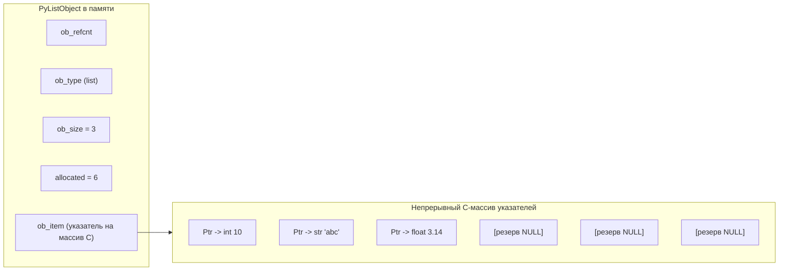
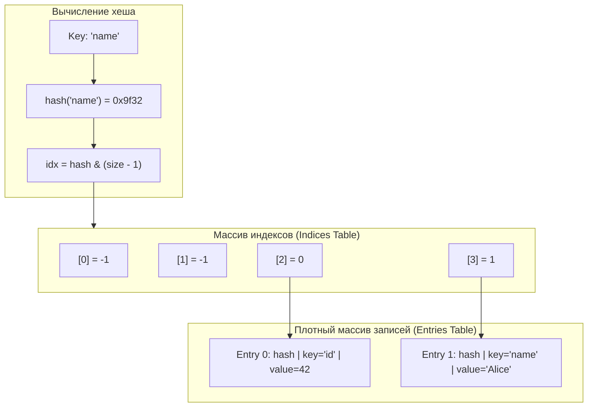

# 03. Внутреннее устройство структур данных и алгоритмическая сложность

[[02_Control_Flow_Loops|← Предыдущая глава: Управляющие конструкции и циклы]] | [[00_Module_01_MOC|Оглавление модуля 01]] | [[04_Functions_Closures|Следующая глава: Функции и замыкания →]]

---

## 1. Сводная матрица алгоритмической сложности (Big-O)

Выбор структуры данных определяет производительность всей системы (особенно при обработке сотен тысяч запросов в секунду в FastAPI).

| Структура | Доступ по индексу `[i]` | Поиск по значению `x in s` | Добавление в конец | Вставка в начало / середину | Удаление элемента |
| :--- | :---: | :---: | :---: | :---: | :---: |
| **`list`** | $O(1)$ | $O(N)$ | $O(1)$ amortized | $O(N)$ | $O(N)$ |
| **`tuple`** | $O(1)$ | $O(N)$ | — | — | — |
| **`dict`** | $O(1)$ avg / $O(N)$ worst | $O(1)$ avg (по ключу) | $O(1)$ avg | $O(1)$ avg | $O(1)$ avg |
| **`set`** | — | $O(1)$ avg / $O(N)$ worst | $O(1)$ avg (add) | — | $O(1)$ avg |
| **`deque`** | $O(N)$ | $O(N)$ | $O(1)$ (append) | $O(1)$ (appendleft) | $O(1)$ (pop/popleft) |

---

## 2. Динамический массив `list`: Механика Over-Allocation

В CPython список (`PyListObject`) — это **не связный список**, а динамический непрерывный массив указателей на объекты (`PyObject** ob_item`).



### Формула геометрического роста (Over-allocation)
Когда текущий буфер заполняется, CPython выделяет новый массив большего размера по следующей формуле (из `Objects/listobject.c`):
$$\text{new\_allocated} = \text{new\_size} + (\text{new\_size} \gg 3) + (\text{new\_size} < 9 \ ? \ 3 : 6)$$

Благодаря этому стоимость добавления в конец через `append()` является **амортизированной константой $O(1)$**: тяжелая операция реаллокации памяти и копирования указателей происходит экспоненциально редко.

> [!WARNING] Ошибка новичка: `list.insert(0, item)` и `list.pop(0)`
> Вставка или удаление в начале списка требует сдвига всех остальных $N-1$ указателей вправо или влево! Сложность составляет $O(N)$.
> Для очередей (FIFO) **всегда** используйте `collections.deque`.

---

## 3. Кортеж `tuple` и `NamedTuple`

Кортеж (`PyTupleObject`) — это неизменяемый массив указателей фиксированной длины.

### Преимущества перед `list`:
1. **Экономия памяти**: Отсутствует поле `allocated` (нет резервной памяти).
2. **Свободные списки CPython (Free Lists)**: Интерпретатор повторно использует освобожденные структуры кортежей размером до 20 элементов без обращения к системному аллокатору `malloc`.
3. **Хешируемость**: Может быть ключом в `dict` или элементом `set`, если все его элементы хешируемы.

### `collections.namedtuple` vs `typing.NamedTuple`
```python
from typing import NamedTuple

# Современный вариант со статической типизацией:
class UserRecord(NamedTuple):
    user_id: int
    username: str
    email: str

u = UserRecord(1, "alex", "alex@example.com")
print(u.username)  # Доступ по атрибуту
print(u[1])        # Совместимость с кортежем по индексу
```

---

## 4. Компактная хеш-таблица `dict` (Python 3.6+)

До Python 3.6 словарь представлял собой разреженную таблицу из 24-байтовых записей, расходуя до 70% памяти впустую на `NULL`-записи.
Начиная с Python 3.6 (PEP 468, идея Раймонда Хеттингера), словарь разделен на два массива:
1. **Разреженный плотный массив индексов (Indices Table)**.
2. **Плотный массив записей (Entries Table)**, заполняемый строго последовательно.



### Ключевые следствия этой архитектуры:
- **Сохранение порядка вставки (Insertion Order)**: Ключи гарантированно итерируются в порядке добавления.
- **Сокращение памяти**: На 30–40% компактнее старой реализации.
- **Разрешение коллизий**: Открытая адресация (Open Addressing) с псевдослучайным сдвигом (`perturb >>= 5`).

### Требования к ключам: протокол `Hashable`
Чтобы объект мог быть ключом в `dict`, он должен удовлетворять условиям:
1. Реализовывать метод `__hash__()` и возвращать целое число, постоянное на протяжении всей жизни объекта.
2. Реализовывать метод `__eq__()`.
3. Равные объекты обязаны иметь одинаковый хеш:
   $$a == b \implies \text{hash}(a) == \text{hash}(b)$$

```python
class BadKey:
    def __init__(self, val: int):
        self.val = val

    def __eq__(self, other: object) -> bool:
        return isinstance(other, BadKey) and self.val == other.val

    # Если __eq__ переопределен, а __hash__ нет — Python автоматически выставляет __hash__ = None!
```

---

## 5. Множества: `set` и `frozenset`

Множество — это хеш-таблица, содержащая только ключи без значений.
Обеспечивает математические операции над множествами за линейное от размера время:

```python
a = {1, 2, 3, 4}
b = {3, 4, 5, 6}

print(a | b)  # Объединение (Union): {1, 2, 3, 4, 5, 6}
print(a & b)  # Пересечение (Intersection): {3, 4}
print(a - b)  # Разность (Difference): {1, 2}
print(a ^ b)  # Симметрическая разность (XOR): {1, 2, 5, 6}
```

`frozenset` — иммутабельный аналог `set`. Так как он неизменяем, он имеет хеш и может быть элементом другого множества или ключом в словаре.

---

## 6. Срезы (`slice`)

Синтаксис: `sequence[start:stop:step]`
Под капотом создает объект `slice(start, stop, step)`.

```python
nums = [0, 1, 2, 3, 4, 5, 6, 7, 8, 9]

# Инверсия списка за O(N)
reversed_nums = nums[::-1]

# Срез создает НОВЫЙ поверхностный объект (Shallow Copy)
sub = nums[2:5]

# Присваивание в срез (мутация на месте!)
nums[1:4] = [10, 20]  # Заменяет элементы [1, 2, 3] на [10, 20]
print(nums)  # [0, 10, 20, 4, 5, 6, 7, 8, 9]
```

---

## 7. Генераторы коллекций (Comprehensions)

Comprehensions работают быстрее эквивалентного цикла `for` с `append`, потому что компилируются в оптимизированный байткод (байткод-инструкции `LIST_APPEND`, `MAP_ADD`, `SET_ADD` выполняются внутри виртуальной машины на уровне языка C).

```python
# List comprehension:
squares = [x * x for x in range(10) if x % 2 == 0]

# Dict comprehension:
user_map = {u["id"]: u["name"] for u in raw_users if "id" in u}

# Set comprehension:
unique_lengths = {len(w) for w in ["apple", "pear", "banana"]}
```

---

## 8. Модуль `collections`: Высокопроизводительные структуры

### 8.1. `defaultdict`
Автоматически инициализирует отсутствующие ключи с помощью фабричной функции:
```python
from collections import defaultdict

# Группировка элементов без проверок if key not in d:
grouped: defaultdict[str, list[int]] = defaultdict(list)
grouped["metrics"].append(42)
grouped["metrics"].append(99)
print(grouped["metrics"])  # [42, 99]
```

### 8.2. `Counter`
Мультимножество для быстрого подсчета частотности элементов:
```python
from collections import Counter

words = ["fastapi", "python", "fastapi", "pydantic", "fastapi", "python"]
cnt = Counter(words)

print(cnt.most_common(2))  # [('fastapi', 3), ('python', 2)]
```

### 8.3. `deque` (Double-ended Queue)
Реализован как двусвязный список блоков по 64 элемента. Обеспечивает строгие $O(1)$ для операций `append`, `appendleft`, `pop`, `popleft`.

```python
from collections import deque

# Скользящее окно постоянного размера (circular buffer):
window: deque[float] = deque(maxlen=3)
window.append(10.0)
window.append(20.0)
window.append(30.0)
window.append(40.0)  # 10.0 автоматически вытеснено слева!
print(list(window))  # [20.0, 30.0, 40.0]
```

---

## Резюме

1. `list` — динамический массив указателей с $O(1)$ амортизированным `append` и $O(N)$ вставкой в начало.
2. `tuple` эффективнее по памяти и кэшируется во фри-листах CPython.
3. `dict` начиная с Python 3.6 — компактная хеш-таблица, сохраняющая порядок вставки.
4. `set` незаменим для операций реляционной алгебры и поиска за $O(1)$.
5. `deque` — единственный правильный выбор для очередей FIFO и скользящих окон.

---

## Практическое задание

Перейдите к выполнению практического задания в файле:
[[ex_03_data_structures.py]]

Команда для запуска проверочных тестов:
```bash
python3 exercises/01_basics/ex_03_data_structures.py
```
