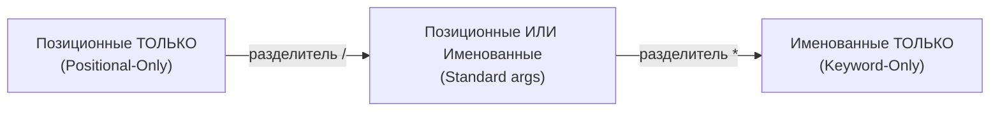
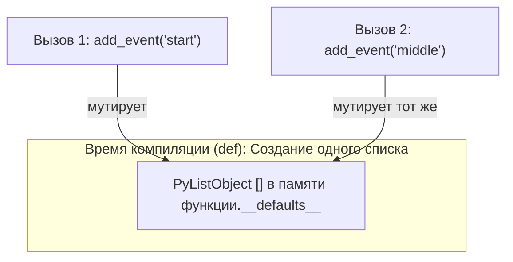
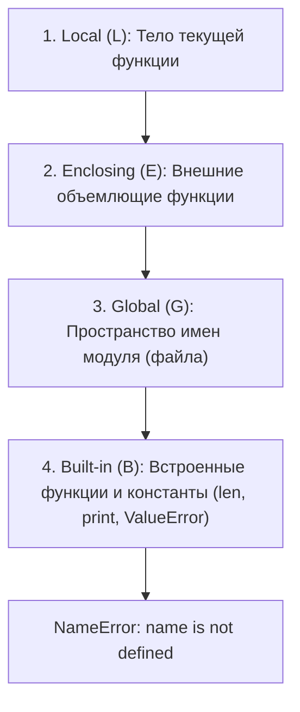
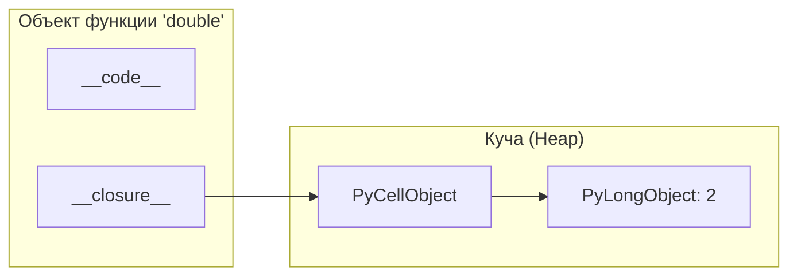

# 04. Функции, области видимости (LEGB), замыкания и лямбды

[[03_Data_Structures|← Предыдущая глава: Структуры данных]] | [[00_Module_01_MOC|Оглавление модуля 01]] | [[05_Exceptions_Files_Context|Следующая глава: Исключения и контекстные менеджеры →]]

---

## 1. Функции как объекты первого класса (First-Class Citizens)

В Python функции являются полноправными объектами:
- Могут быть сохранены в переменных или структурах данных.
- Могут передаваться как аргументы в другие функции (Higher-Order Functions).
- Могут возвращаться из функций.
- Обладают атрибутами: `__name__`, `__doc__`, `__code__`, `__annotations__`.

```python
def multiply(x: int, y: int) -> int:
    """Умножает два числа."""
    return x * y

# Функция — это объект:
print(type(multiply))         # <class 'function'>
print(multiply.__name__)      # 'multiply'
print(multiply.__doc__)       # 'Умножает два числа.'
print(multiply.__code__.co_varnames)  # ('x', 'y')
```

---

## 2. Сигнатуры функций: Позиционные, Именованные, `*args` и `**kwargs`

Современный Python (PEP 570) позволяет жестко разграничить способ передачи параметров с помощью специальных разделителей `/` и `*`.



```python
def create_endpoint(
    path: str,                  # Positional-only (до /)
    /,
    method: str = "GET",        # Обычный (можно позиционно или по имени)
    *,
    status_code: int = 200,     # Keyword-only (после *): только по имени!
    tags: list[str] | None = None,
    **extra_headers: str        # Произвольные именованные параметры
) -> dict[str, object]:
    return {
        "path": path,
        "method": method,
        "status_code": status_code,
        "headers": extra_headers,
    }

# Корректный вызов:
res = create_endpoint("/api/v1/users", "POST", status_code=201, Authorization="Bearer xxx")

# Некорректный вызов (TypeError):
# create_endpoint(path="/api/v1/users")  # Ошибка: path передан по имени, хотя он positional-only!
# create_endpoint("/api", "GET", 200)   # Ошибка: status_code передан позиционно, хотя он keyword-only!
```

---

## 3. Фатальная ловушка: Мутабельные аргументы по умолчанию

Одна из самых коварных ловушек в Python: **выражения аргументов по умолчанию вычисляются ровно один раз — в момент определения функции (def), а не в момент ее вызова!**

```python
# ОПАСНО:
def add_event(event: str, events: list[str] = []) -> list[str]:
    events.append(event)
    return events

print(add_event("start"))  # ['start']
print(add_event("middle")) # ['start', 'middle'] — второй вызов модифицировал тот же список!
```



### Идиоматичное решение: `None` как Sentinel
```python
def add_event(event: str, events: list[str] | None = None) -> list[str]:
    if events is None:
        events = []  # Новый список создается при КАЖДОМ вызове
    events.append(event)
    return events
```

---

## 4. Области видимости: Правило LEGB

Когда интерпретатор встречает имя переменной, он ищет его строго в 4 пространствах имен (в порядке приоритета):



### Модификация внешних областей: `global` и `nonlocal`
- `global`: Указывает, что переменная принадлежит глобальной области модуля.
- `nonlocal`: Указывает, что переменная принадлежит ближайшей внешней (Enclosing) функции (но не глобальной!).

```python
total_counter = 0

def outer():
    outer_val = 10

    def inner():
        nonlocal outer_val  # Модифицирует outer_val из outer()
        global total_counter # Модифицирует total_counter модуля

        outer_val += 5
        total_counter += 1

    inner()
    return outer_val
```

---

## 5. Замыкания (Closures) и `cell`-объекты

**Замыкание** — это функция, которая сохраняет доступ к свободным переменным (free variables) из своей лексической области видимости (Enclosing) даже после того, как внешняя функция завершила свое выполнение и вышла из стека.

```python
from typing import Callable

def make_multiplier(factor: int) -> Callable[[int], int]:
    def multiply(n: int) -> int:
        return n * factor  # 'factor' захвачен из внешней области
    return multiply

double = make_multiplier(2)
triple = make_multiplier(3)

print(double(10))  # 20
print(triple(10))  # 30
```

### Как устроено замыкание под капотом CPython
Когда компилятор видит, что внутренняя функция обращается к переменной внешней функции, он оборачивает эту переменную в специальный объект **`cell`** (`PyCellObject`).
Этот `cell` живет в куче, и на него ссылается как внешняя функция, так и внутренняя через кортеж `__closure__`:

```python
print(double.__closure__)
# (<cell at 0x104b3a880: int object at 0x104b2c120>,)
print(double.__closure__[0].cell_contents)  # 2
```



---

## 6. Лямбда-функции (`lambda`) и ловушка позднего связывания

Лямбда — это анонимная функция, ограниченная **одним выражением**:
```python
square = lambda x: x * x
```

### Ловушка позднего связывания (Late-Binding Trap)
В Python замыкания связываются по имени переменной, а не по ее значению в момент создания функции!

```python
# ОШИБКА:
handlers = [lambda x: x + i for i in range(4)]
print([h(10) for h in handlers])
# Результат: [13, 13, 13, 13]! Потому что i после цикла равен 3!
```

### Решение: фиксация значения через аргумент по умолчанию
```python
# ПРАВИЛЬНО:
handlers = [lambda x, i=i: x + i for i in range(4)]
print([h(10) for h in handlers])
# Результат: [10, 11, 12, 13]
```

---

## 7. Частичное применение функций: `functools.partial`

`functools.partial` позволяет «зафиксировать» часть позиционных или именованных аргументов функции, создавая новую вызываемую сущность:

```python
from functools import partial

def request(method: str, url: str, timeout: int = 10) -> str:
    return f"{method} {url} (timeout={timeout})"

# Создаем специализированную функцию:
get_request = partial(request, "GET", timeout=5)
print(get_request("https://api.example.com/items"))
# "GET https://api.example.com/items (timeout=5)"
```

---

## 8. Рекурсия и стек вызовов

В CPython каждый вызов функции порождает новый объект кадра стека (`PyFrameObject`).
Поскольку в Python **нет автоматической оптимизации хвостовой рекурсии (TCO)**, глубокая рекурсия приводит к переполнению стека:

```python
import sys

print(sys.getrecursionlimit())  # Обычно 1000

# Рекурсивный факториал:
def factorial(n: int) -> int:
    if n <= 1:
        return 1
    return n * factorial(n - 1)
```

> [!WARNING] Не злоупотребляйте `sys.setrecursionlimit()`
> Увеличение предела рекурсии до огромных значений может привести к аварийному завершению процесса CPython из-за физического переполнения системного стека операционной системы (Segmentation Fault). Для глубоких алгоритмов используйте явный стек на базе `list` или `deque`.

---

## Резюме

1. Разделители `/` и `*` задают жесткий контракт API для позиционных и именованных аргументов.
2. Никогда не используйте изменяемые объекты (`[]`, `{}`) в качестве аргументов по умолчанию; используйте `None`.
3. Поиск переменных подчиняется правилу LEGB.
4. Замыкания захватывают переменные через `cell`-объекты в куче.
5. Лямбды в циклах требуют фиксации переменной (`lambda x, i=i: ...`) во избежание late-binding бага.
6. `functools.partial` делает код модульным без нагромождения шаблонных оберток.

---

## Практическое задание

Перейдите к выполнению практического задания в файле:
[[ex_04_functions_closures.py]]

Команда для запуска проверочных тестов:
```bash
python3 exercises/01_basics/ex_04_functions_closures.py
```
