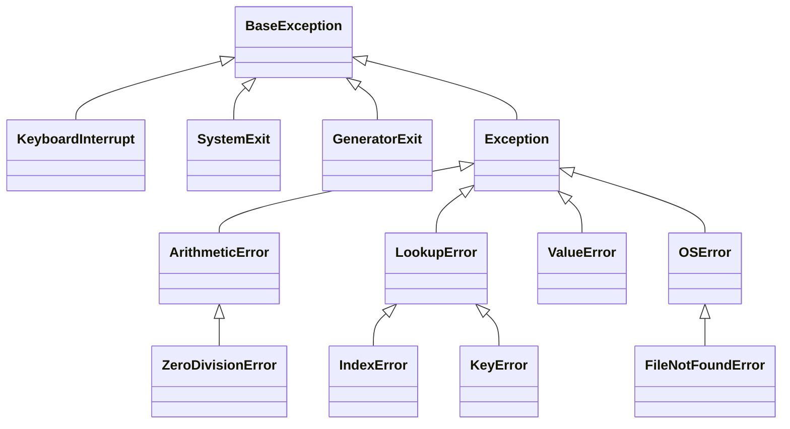
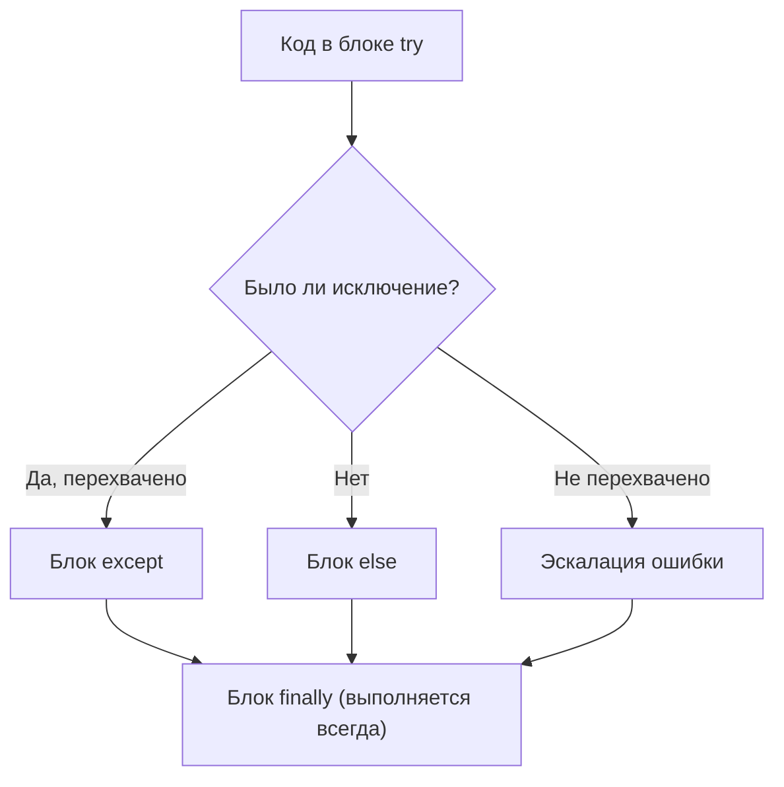
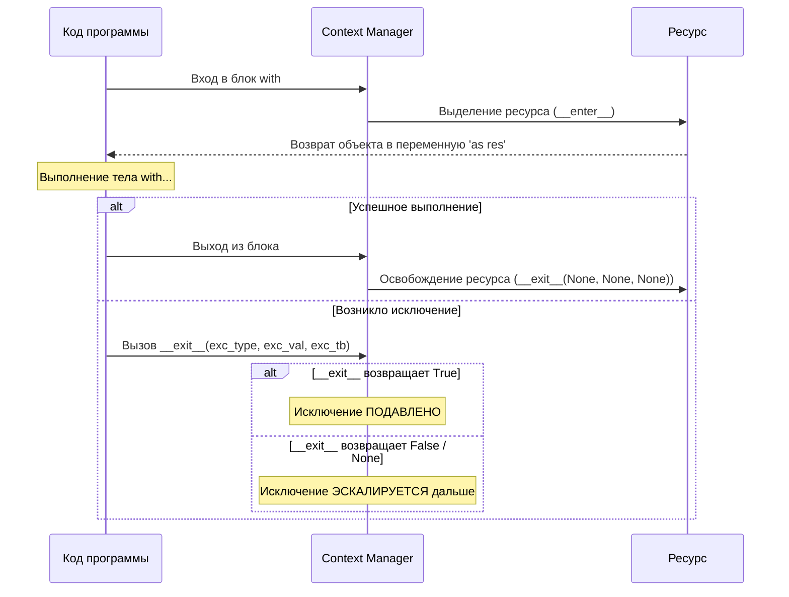

# 05. Исключения, файловая система и контекстные менеджеры

[[04_Functions_Closures|← Предыдущая глава: Функции и замыкания]] | [[00_Module_01_MOC|Оглавление модуля 01]] | [[02_Python_OOP_Typing/00_Module_02_MOC|Следующий модуль: ООП и Типизация →]]

---

## 1. Иерархия исключений: `BaseException` vs `Exception`

В Python все исключения образуют строгую иерархию классов, берущую начало от `BaseException`.



> [!CAUTION] Никогда не используйте «голый» `except:` или `except BaseException:`
> Если перехватить `BaseException`, программа перестанет реагировать на нажатие `Ctrl + C` (`KeyboardInterrupt`) и вызовы завершения `sys.exit()` (`SystemExit`).
> Всегда перехватывайте конкретные типы ошибок или базовый класс `Exception`:
> ```python
> try:
>     risky_operation()
> except Exception as err:  # Корректно
>     logger.error("Произошла ошибка: %s", err)
> ```

---

## 2. Полный анатомический цикл: `try / except / else / finally`

```python
try:
    # 1. Основной блок: код, способный выбросить исключение
    f = open("data.txt", "r", encoding="utf-8")
    data = f.read()
except FileNotFoundError as err:
    # 2. Выполняется ТОЛЬКО в случае выброса указанной ошибки
    print(f"Файл не найден: {err}")
    data = ""
else:
    # 3. Выполняется ТОЛЬКО если в блоке try НЕ возникло исключений!
    print(f"Успешно прочитано байт: {len(data)}")
finally:
    # 4. Выполняется ВСЕГДА, даже при return, break или необработанном исключении!
    print("Блок очистки ресурсов (Cleanup)")
```



---

## 3. Проектирование доменных иерархий исключений

В профессиональных приложениях и API (включая микросервисы FastAPI) категорически рекомендуется создавать собственные иерархии исключений:

```python
class AppError(Exception):
    """Базовый класс для всех ошибок приложения."""
    def __init__(self, message: str, code: str = "INTERNAL_ERROR"):
        super().__init__(message)
        self.message = message
        self.code = code

class EntityNotFoundError(AppError):
    """Сущность не найдена в хранилище."""
    def __init__(self, entity: str, entity_id: int | str):
        super().__init__(f"{entity} with id={entity_id} not found", code="NOT_FOUND")
        self.entity = entity
        self.entity_id = entity_id

class ValidationError(AppError):
    """Ошибка валидации входящих данных."""
    def __init__(self, field: str, detail: str):
        super().__init__(f"Invalid field '{field}': {detail}", code="VALIDATION_FAILED")
        self.field = field
```

---

## 4. Цепочки исключений (Exception Chaining): `from`

При обработке низкоуровневых ошибок часто необходимо обернуть их в высокоуровневую доменную ошибку, не теряя при этом исходный стек вызовов (Traceback).

### Явная цепочка (`raise ... from exc`)
Устанавливает атрибут `__cause__`:
```python
def fetch_user_avatar(user_id: int) -> bytes:
    try:
        with open(f"/avatars/{user_id}.png", "rb") as f:
            return f.read()
    except FileNotFoundError as err:
        # Сохраняем исходную ошибку в __cause__
        raise EntityNotFoundError("Avatar", user_id) from err
```

### Подавление контекста (`raise ... from None`)
Скрывает внутренние системные детали от конечного пользователя или клиента:
```python
try:
    val = int(raw_input)
except ValueError:
    raise ValidationError("age", "Must be a valid integer") from None
```

---

## 5. Группы исключений и синтаксис `except*` (Python 3.11+)

При конкурентном выполнении (например, в `asyncio.TaskGroup`) несколько независимых корутин могут упасть одновременно. Для их объединения введен класс `ExceptionGroup` и синтаксис `except*` (PEP 654):

```python
def run_concurrent_tasks():
    errors = [
        ValueError("Неверный формат ID"),
        FileNotFoundError("Конфиг отсутствует"),
        KeyError("Ключ token не найден"),
    ]
    raise ExceptionGroup("Ошибки пакетной обработки", errors)

try:
    run_concurrent_tasks()
except* ValueError as eg:
    # eg содержит ТОЛЬКО подгруппу ValueError!
    print(f"Перехвачены ошибки значений: {eg.exceptions}")
except* (FileNotFoundError, KeyError) as eg:
    # Перехват остальных типов
    print(f"Ресурсные ошибки: {eg.exceptions}")
```

---

## 6. Современная работа с файловой системой: `pathlib.Path`

Модуль `pathlib` предоставляет объектно-ориентированный интерфейс работы с путями, полностью вытеснивший устаревший `os.path`.

```python
from pathlib import Path

# Построение путей через оператор /:
base_dir = Path("/tmp") / "app_workspace"
target_file = base_dir / "logs" / "audit.log"

# Создание директорий:
target_file.parent.mkdir(parents=True, exist_ok=True)

# Атомарное или быстрое чтение и запись текста:
target_file.write_text("2026-11-03 INFO Service started\n", encoding="utf-8")
content = target_file.read_text(encoding="utf-8")

# Поиск файлов по маске (glob):
python_files = list(Path(".").glob("**/*.py"))
```

---

## 7. Протокол контекстных менеджеров (`with`)

Контекстный менеджер гарантирует корректное выделение и освобождение ресурсов (файловые дескрипторы, транзакции БД, сетевые сокеты, блокировки мьютексов).

### Протокол в CPython
Объект должен реализовать два метода:
1. `__enter__(self) -> Resource`: Подготавливает ресурс и возвращает объект, привязываемый к `as`.
2. `__exit__(self, exc_type, exc_val, exc_tb) -> bool | None`: Завершает работу ресурса.



### Пример реализации кастомного контекстного менеджера:

```python
import time
from types import TracebackType
from typing import Type

class PerformanceTimer:
    def __init__(self, operation_name: str, suppress_errors: bool = False):
        self.operation_name = operation_name
        self.suppress_errors = suppress_errors
        self.elapsed: float = 0.0
        self._start_time: float = 0.0

    def __enter__(self) -> "PerformanceTimer":
        self._start_time = time.perf_counter()
        return self

    def __exit__(
        self,
        exc_type: Type[BaseException] | None,
        exc_val: BaseException | None,
        exc_tb: TracebackType | None
    ) -> bool:
        self.elapsed = time.perf_counter() - self._start_time
        print(f"Операция '{self.operation_name}' заняла {self.elapsed:.6f} сек.")
        if exc_type is not None:
            print(f"Обнаружена ошибка: {exc_val}")
            # Если возвращаем True — исключение подавляется, если False — летит выше
            return self.suppress_errors
        return False
```

### Использование `contextlib.contextmanager`
Генераторный способ создания контекстных менеджеров:

```python
from contextlib import contextmanager
from typing import Generator

@contextmanager
def temporary_flag(state: dict[str, bool], key: str) -> Generator[None, None, None]:
    state[key] = True
    try:
        yield
    finally:
        state[key] = False
```

---

## Резюме

1. Никогда не перехватывайте `BaseException`; используйте конкретные исключения или `Exception`.
2. Блок `else` в `try` исполняется только при отсутствии ошибок, `finally` — всегда.
3. Проектируйте доменные исключения для разграничения слоев архитектуры.
4. Используйте `raise ... from ...` для сохранения цепочки причинности ошибок.
5. `pathlib.Path` — современный золотой стандарт работы с файловой системой.
6. Контекстные менеджеры гарантируют детерминированное освобождение ресурсов.

---

## Практическое задание

Перейдите к выполнению практического задания в файле:
[[ex_05_exceptions_files.py]]

Команда для запуска проверочных тестов:
```bash
python3 exercises/01_basics/ex_05_exceptions_files.py
```
