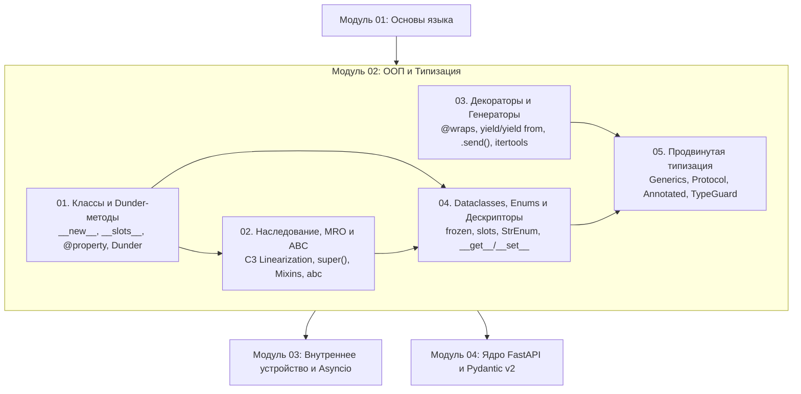

# Модуль 02: ООП, функциональные паттерны и строгая типизация

> [!IMPORTANT] Навигация по курсу
> - **Корневой индекс курса**: [[00_Index_MOC|Главная карта знаний]]
> - **Предыдущий модуль**: [[01_Syntax_Types_Variables|Модуль 01. Основы Python]]
> - **Следующий модуль**: [[01_Memory_Model_GIL_GC|Модуль 03. Внутреннее устройство и Asyncio]]

---

## 1. Обзор модуля

Модуль 02 переводит разработку на Python со скриптового уровня на уровень надежной промышленной инженерии. Здесь рассматриваются фундаментальные механизмы объектной модели CPython, метапрограммирование без магии, эффективная работа с памятью и инструментарий современной статической типизации (Python 3.12–3.14+).

Освоение этих тем является обязательным фундаментом для понимания внутреннего устройства **FastAPI**, **Pydantic v2** и **SQLAlchemy 2.0**:
- Дескрипторы объясняют, как работают `@property`, колонки ORM и валидаторы полей.
- Генераторы и итераторы лежат в основе потоковой передачи данных и механизма внедрения зависимостей (`Depends` с `yield`).
- Протоколы (`Protocol`) и `Annotated` определяют сигнатуры эндпоинтов и декларативное внедрение зависимостей в FastAPI.

---

## 2. Архитектура знаний модуля



---

## 3. Главы модуля и практические задания

| № | Глава (Теория и Архитектура) | Ключевые концепции | Практика и тесты |
|---|---|---|---|
| **01** | [[01_Classes_Magic_Methods\|01. Классы, атрибуты, slots и магические (dunder) методы]] | Жизненный цикл (`__new__` vs `__init__`), `__dict__`, `__slots__`, `@property`, `@classmethod`, `@staticmethod`, Name Mangling, сравнение, хеширование, контейнерные протоколы | [[ex_01_classes_magic.py\|Практика 01]] |
| **02** | [[02_Inheritance_MRO_ABCs\|02. Наследование, MRO (C3-линеаризация), миксины и ABC]] | Diamond Problem, C3-линеаризация, кооперативный `super()`, Mixin pattern, Composition over Inheritance, модуль `abc`, абстрактные методы и свойства | [[ex_02_inheritance_abc.py\|Практика 02]] |
| **03** | [[03_Decorators_Generators\|03. Декораторы с параметрами, итераторы, генераторы и itertools]] | Замыкания, сохранение метаданных с `@wraps`, фабрики декораторов, протокол итератора, `yield`, `yield from`, корутины генераторов (`.send()`, `.throw()`), конвейеры `itertools` | [[ex_03_decorators_generators.py\|Практика 03]] |
| **04** | [[04_Dataclasses_Enums_Descriptors\|04. Dataclasses, Enum и протокол дескрипторов]] | `@dataclass` (`slots=True`, `frozen=True`, `default_factory`, `__post_init__`), `StrEnum`, `Flag`, протокол дескрипторов (`__get__`, `__set__`, `__set_name__`), Data vs Non-data descriptors | [[ex_04_dataclasses_descriptors.py\|Практика 04]] |
| **05** | [[05_Type_Hints_Protocols_Generics\|05. Продвинутая типизация: Generics, Protocol, TypeVar, Annotated]] | PEP 695 (`class Box[T]`, `type Alias`), ковариантность/контравариантность, Duck Typing через `Protocol`, `Annotated`, `TypedDict`, `Literal`, `TypeGuard`/`TypeIs`, `ParamSpec` | [[ex_05_typing_protocols.py\|Практика 05]] |

---

## 4. Как проходить практику

Все практические задания расположены в директории `exercises/02_oop_typing/`. Каждое упражнение снабжено исчерпывающим набором модульных тестов на базе `unittest`.

Для запуска тестов конкретного упражнения:
```bash
python3 exercises/02_oop_typing/ex_01_classes_magic.py
```

Для пакетного запуска всех тестов проекта из корня репозитория:
```bash
python3 run_all_tests.py
```
