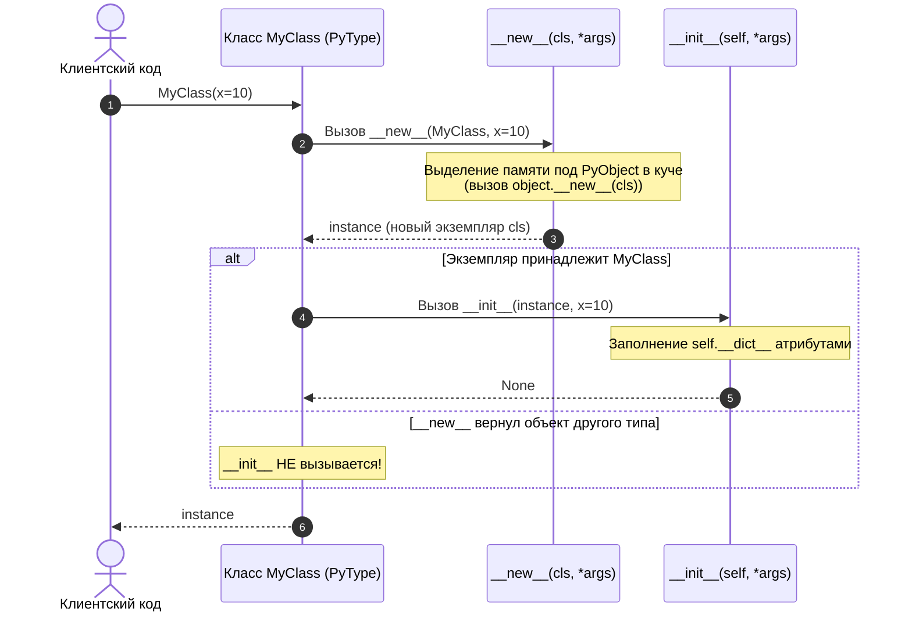
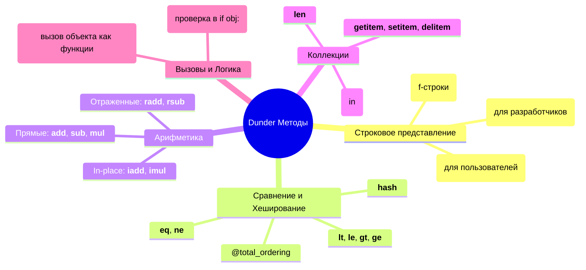

# 01. Классы, атрибуты, slots и магические (dunder) методы

> [!IMPORTANT] Навигация по модулю
> - **MOC модуля**: [[00_Module_02_MOC|Карта знаний модуля 02]]
> - **Следующая глава**: [[02_Inheritance_MRO_ABCs|02. Наследование, MRO (C3-линеаризация), миксины и ABC]]
> - **Практика к этой главе**: [[ex_01_classes_magic.py|Практическое задание 01]]

---

## 1. Введение: Объектная модель CPython

В Python «всё является объектом» — включая числа, строки, функции, модули и сами классы. На уровне CPython каждый объект представлен C-структурой `PyObject` (или `PyVarObject`), содержащей:
1. `ob_refcnt` — счетчик ссылок (для сборки мусора).
2. `ob_type` — указатель на объект типа (`PyTypeObject`), определяющий поведение сущности.

Когда мы вызываем метод `obj.method()`, Python не просто ищет функцию в пространстве имен экземпляра, а задействует строгий протокол дескрипторов и поиск по словарю атрибутов.

---

## 2. Жизненный цикл объекта: `__new__` против `__init__`

Многие разработчики ошибочно называют `__init__` «конструктором». На самом деле в Python разделены этапы **аллокации (выделения памяти)** и **инициализации (настройки состояния)**.



### 2.1. Метод `__new__(cls, *args, **kwargs)`
- **Роль**: статический метод (не требует явного декоратора `@staticmethod`), создающий и возвращающий *новый пустой экземпляр* класса `cls`.
- **Первый аргумент**: сам класс `cls`.
- **Возвращаемое значение**: обычно результат вызова `super().__new__(cls)` или `object.__new__(cls)`.

#### Паттерн 1: Singleton (Одиночка)
```python
from __future__ import annotations
from typing import Any


class DatabaseConnectionPool:
    _instance: DatabaseConnectionPool | None = None

    def __new__(cls, *args: Any, **kwargs: Any) -> DatabaseConnectionPool:
        if cls._instance is None:
            # Выделяем память один раз
            cls._instance = super().__new__(cls)
        return cls._instance

    def __init__(self, dsn: str = "postgresql://localhost:5432/db") -> None:
        # ВНИМАНИЕ: __init__ будет вызываться при КАЖДОМ обращении DatabaseConnectionPool()!
        # Поэтому инициализацию важно защитить флагом:
        if not hasattr(self, "_initialized"):
            self.dsn = dsn
            self._initialized = True


p1 = DatabaseConnectionPool()
p2 = DatabaseConnectionPool()
assert p1 is p2  # Тот же самый объект в памяти!
```

> [!WARNING] Осторожно с `__init__` в Singleton
> Если `__new__` возвращает существующий экземпляр `cls`, интерпретатор Python **всё равно вызовет `__init__`** для этого экземпляра. Если повторная инициализация нежелательна, используйте проверку `hasattr(self, "_initialized")` или перенесите создание экземпляра в метакласс `SingletonMeta`.

#### Паттерн 2: Наследование от неизменяемых типов (`str`, `int`, `tuple`)
Неизменяемые типы нельзя модифицировать внутри `__init__`, потому что к моменту вызова `__init__` объект уже сформирован и заморожен. Единственное место для настройки — `__new__`:

```python
class NormalizedUpperString(str):
    """Строка, которая всегда хранится в верхнем регистре и без концевых пробелов."""

    def __new__(cls, value: str) -> NormalizedUpperString:
        clean_value = value.strip().upper()
        # Значение неизменяемого типа передается именно в super().__new__
        return super().__new__(cls, clean_value)


code = NormalizedUpperString("  api_v2_auth  ")
print(code)  # "API_V2_AUTH"
```

### 2.2. Метод `__init__(self, *args, **kwargs)`
- Принимает уже созданный экземпляр `self`.
- Обязан возвращать `None` (возврат любого другого значения вызовет `TypeError: __init__() should return None`).

### 2.3. Финализатор `__del__(self)`
Вызывается сборщиком мусора, когда счетчик ссылок на объект падает до нуля (`ob_refcnt == 0`).
> [!CAUTION] Избегайте бизнес-логики в `__del__`
> Время вызова `__del__` не детерминировано. При аварийном завершении процесса или наличии циклических ссылок `__del__` может не вызваться вовсе. Для гарантированного освобождения ресурсов (сокеты, файлы, соединения с БД) используйте менеджеры контекста (`with`)!

---

## 3. Словарь атрибутов `__dict__` против `__slots__`

По умолчанию каждый экземпляр класса в Python хранит свои атрибуты в динамическом хеш-словаре `self.__dict__`.

```python
class User:
    def __init__(self, name: str, age: int) -> None:
        self.name = name
        self.age = age


u = User("Alice", 30)
print(u.__dict__)  # {'name': 'Alice', 'age': 30}
u.custom_dynamic_attr = 42  # Можно на лету добавлять любые поля!
```

### 3.1. Цена `__dict__` по памяти
Хеш-таблица в Python быстрая ($O(1)$ в среднем), но прожорливая. Словарь экземпляра, даже пустой или небольшой, занимает от 100 до 150 байт памяти накладных расходов. Если у вас сервис обрабатывает миллион записей в памяти (например, кэш, ORM-сущности, биржевые тики), затраты на `__dict__` составляют сотни мегабайт.

### 3.2. Спасение памяти: `__slots__`
Атрибут `__slots__` говорит интерпретатору: «Не создавай словарь `__dict__` и `__weakref__` для каждого экземпляра. Вместо этого зарезервируй фиксированный массив C-указателей смещения (`member_descriptor`)».

```python
import sys


class PointWithDict:
    def __init__(self, x: float, y: float, z: float) -> None:
        self.x = x
        self.y = y
        self.z = z


class PointWithSlots:
    __slots__ = ("x", "y", "z")

    def __init__(self, x: float, y: float, z: float) -> None:
        self.x = x
        self.y = y
        self.z = z


p_dict = PointWithDict(1.0, 2.0, 3.0)
p_slots = PointWithSlots(1.0, 2.0, 3.0)

print(hasattr(p_slots, "__dict__"))  # False!
```

| Параметр | Обычный класс с `__dict__` | Класс с `__slots__` |
|---|---|---|
| **Расход памяти на 1 экземпляр** | ~150–200 байт | ~48–56 байт (экономия в 3–4 раза!) |
| **Скорость доступа к атрибутам** | Быстро (хеш-поиск) | На 15–20% быстрее (прямой C struct offset) |
| **Динамическое добавление полей** | Разрешено в любой момент | Запрещено (`AttributeError`) |
| **Слабые ссылки (`weakref`)** | Поддерживаются из коробки | Требуют добавления `"__weakref__"` в `__slots__` |

> [!IMPORTANT] Тонкости наследования со `__slots__`
> 1. Если дочерний класс не объявил `__slots__ = ()`, у его экземпляров **снова появится `__dict__`**, и экономия памяти исчезнет!
> 2. Множественное наследование от двух классов с непустыми `__slots__` вызовет `TypeError: multiple bases have instance lay-out conflict`.

---

## 4. Свойства (`@property`): Инкапсуляция без ломки API

В других языках (Java, C#) поля прячут за парами `getX()` и `setX()`. В Python принят принцип: **«Начинай с публичного атрибута. Если потребуется валидация или кэширование — преврати его в `@property`, не меняя клиентский код»**.

```python
class BankAccount:
    def __init__(self, initial_balance: float = 0.0) -> None:
        self._balance = float(initial_balance)

    @property
    def balance(self) -> float:
        """Геттер баланса."""
        return self._balance

    @balance.setter
    def balance(self, value: float) -> None:
        """Сеттер с бизнес-валидацией."""
        if value < 0:
            raise ValueError("Баланс счета не может быть отрицательным!")
        self._balance = round(float(value), 2)

    @balance.deleter
    def balance(self) -> None:
        """Делитер при удалении del acc.balance."""
        raise PermissionError("Удаление баланса счета запрещено аудитом!")


account = BankAccount(100.0)
account.balance = 250.50  # Вызывает сеттер
# account.balance = -10   # Вызовет ValueError!
```

---

## 5. Методы: `@classmethod`, `@staticmethod` и обычные

```python
from datetime import date
from typing import Self


class Employee:
    standard_currency: str = "USD"  # Атрибут класса

    def __init__(self, name: str, salary: float, hire_year: int) -> None:
        self.name = name
        self.salary = salary
        self.hire_year = hire_year

    def get_annual_bonus(self) -> float:
        """Обычный метод экземпляра: первым аргументом получает self."""
        experience = date.today().year - self.hire_year
        return self.salary * (0.05 * experience)

    @classmethod
    def from_dict(cls, data: dict[str, Any]) -> Self:
        """
        Метод класса: первым аргументом получает сам класс cls.
        Идеален для альтернативных фабрик-конструкторов!
        """
        return cls(
            name=data["name"],
            salary=float(data["salary"]),
            hire_year=int(data["hire_year"]),
        )

    @staticmethod
    def is_valid_salary(amount: float) -> bool:
        """
        Статический метод: не получает ни self, ни cls.
        Простая утилитная функция, логически сгруппированная внутри пространства имен класса.
        """
        return amount > 0
```

---

## 6. Инкапсуляция и Name Mangling

В Python нет жестких модификаторов `private` / `public` на уровне виртуальной машины:

| Именование | Пример | Назначение | Поведение |
|---|---|---|---|
| **Public** | `self.name` | Открытый интерфейс класса | Доступен отовсюду без ограничений |
| **Protected** | `self._name` | Деталь реализации (соглашение) | Линтеры и IDE предупреждают, но доступ не блокируется |
| **Private (Name Mangling)** | `self.__secret` | Защита от коллизий в подклассах | Имя преобразуется в `_ClassName__secret` |

```python
class SecretVault:
    def __init__(self, key: str) -> None:
        self.__key = key  # Преобразуется в self._SecretVault__key


vault = SecretVault("super-secret")
# vault.__key  -> AttributeError: 'SecretVault' object has no attribute '__key'
# Однако физический доступ через искаженное имя сохраняется:
print(vault._SecretVault__key)  # "super-secret"
```

> [!TIP] Зачем нужен Name Mangling?
> Двойное подчеркивание создано не для «секретности» от программиста, а для того, чтобы подкласс случайно не перетер приватное поле родителя с тем же именем.

---

## 7. Полная система Магических (Dunder) Методов

Dunder-методы (от **D**ouble **Under**score) позволяют интегрировать пользовательские классы со встроенными механизмами языка: операторами `+`, `==`, циклами `for`, функциями `len()`, `str()`, `hash()`, `bool()`.



### 7.1. Строковое представление: `__repr__` vs `__str__`

- `__repr__(self) -> str`: однозначное техническое представление. Идеал — валидная Python-строка, по которой через `eval(repr(obj))` можно восстановить объект. Используется при отладке, в списках, в REPL.
- `__str__(self) -> str`: человекочитаемое представление для пользователей и логов (`print()`, `str()`). Если `__str__` не определен, Python откатывается к `__repr__`.

```python
class Currency:
    def __init__(self, code: str, symbol: str) -> None:
        self.code = code
        self.symbol = symbol

    def __repr__(self) -> str:
        return f"Currency(code={self.code!r}, symbol={self.symbol!r})"

    def __str__(self) -> str:
        return f"{self.symbol} ({self.code})"


usd = Currency("USD", "$")
print(str(usd))   # $ (USD)
print(repr(usd))  # Currency(code='USD', symbol='$')
print([usd])      # [Currency(code='USD', symbol='$')] — в списках всегда repr!
```

### 7.2. Сравнение и хеширование: `__eq__`, `__hash__`, `@total_ordering`

```python
from functools import total_ordering


@total_ordering  # Достаточно реализовать __eq__ и один из операторов (<, <=, >, >=)
class Money:
    __slots__ = ("_amount", "_currency")

    def __init__(self, amount: float, currency: str) -> None:
        self._amount = round(float(amount), 2)
        self._currency = currency.upper()

    @property
    def amount(self) -> float:
        return self._amount

    @property
    def currency(self) -> str:
        return self._currency

    def __eq__(self, other: object) -> bool:
        if not isinstance(other, Money):
            return NotImplemented
        return self._amount == other._amount and self._currency == other._currency

    def __lt__(self, other: object) -> bool:
        if not isinstance(other, Money):
            return NotImplemented
        if self._currency != other._currency:
            raise TypeError(f"Нельзя сравнивать валюты {self._currency} и {other._currency}")
        return self._amount < other._amount

    def __hash__(self) -> int:
        """
        Золотое правило: Если два объекта равны по __eq__, их хеши ОБЯЗАНЫ совпадать!
        Объект с __hash__ должен быть логически неизменяемым (immutable).
        """
        return hash((self._amount, self._currency))
```

> [!NOTE] Что возвращать при несовпадении типов: `NotImplemented`
> Если метод сравнения или арифметики встречает объект неизвестного типа, он должен возвращать синглтон `NotImplemented`, а не выбрасывать `TypeError`. Это дает интерпретатору шанс вызвать отраженный метод у второго операнда!

### 7.3. Арифметические операторы: Прямые, Отраженные и In-Place

Когда вы пишете `a + b`, Python выполняет следующий алгоритм:
1. Вызывает `a.__add__(b)`.
2. Если возвращен `NotImplemented`, пытается вызвать отраженный метод у правого операнда: `b.__radd__(a)`.
3. Если и `__radd__` вернул `NotImplemented`, выбрасывается `TypeError`.

```python
class Vector2D:
    __slots__ = ("x", "y")

    def __init__(self, x: float, y: float) -> None:
        self.x = float(x)
        self.y = float(y)

    def __add__(self, other: object) -> Vector2D:
        if isinstance(other, Vector2D):
            return Vector2D(self.x + other.x, self.y + other.y)
        return NotImplemented

    def __mul__(self, scalar: float | int) -> Vector2D:
        """Умножение вектора на скаляр: v * 3"""
        if isinstance(scalar, (int, float)):
            return Vector2D(self.x * scalar, self.y * scalar)
        return NotImplemented

    def __rmul__(self, scalar: float | int) -> Vector2D:
        """Отраженное умножение: 3 * v"""
        return self.__mul__(scalar)

    def __repr__(self) -> str:
        return f"Vector2D({self.x}, {self.y})"


v = Vector2D(1.0, 2.0)
print(v * 3)  # Vector2D(3.0, 6.0)
print(3 * v)  # Vector2D(3.0, 6.0) — сработал __rmul__!
```

### 7.4. Протоколы коллекций: `__len__`, `__getitem__`, `__setitem__`

Реализовав всего пару dunder-методов, можно сделать класс полноценной коллекцией, поддерживающей индексацию, срезы (`slice`) и оператор `in`:

```python
from collections.abc import Iterator


class TaskQueue:
    def __init__(self, tasks: list[str] | None = None) -> None:
        self._tasks: list[str] = list(tasks or [])

    def __len__(self) -> int:
        return len(self._tasks)

    def __getitem__(self, index: int | slice) -> str | list[str]:
        return self._tasks[index]

    def __setitem__(self, index: int, value: str) -> None:
        self._tasks[index] = value

    def __contains__(self, item: object) -> bool:
        return item in self._tasks

    def __iter__(self) -> Iterator[str]:
        return iter(self._tasks)


queue = TaskQueue(["task_1", "task_2", "task_3"])
print(len(queue))        # 3
print(queue[0])          # 'task_1'
print("task_2" in queue) # True
```

### 7.5. Вызываемые объекты: `__call__`
Метод `__call__` превращает экземпляр любого класса в функцию высшего порядка (функтор) с сохранением внутреннего состояния:

```python
class Multiplier:
    def __init__(self, factor: float) -> None:
        self.factor = factor

    def __call__(self, value: float) -> float:
        return value * self.factor


triple = Multiplier(3.0)
print(callable(triple))  # True
print(triple(10.0))      # 30.0
```

---

## 8. Практическое задание

Перейдите к выполнению практической работы в файле:
[[ex_01_classes_magic.py|exercises/02_oop_typing/ex_01_classes_magic.py]]

### Что предстоит реализовать:
1. Класс `Money`:
   - Оптимизация памяти через `__slots__ = ("_amount", "_currency")`.
   - Read-only свойства `amount` и `currency`.
   - Альтернативные фабрики `@classmethod`: `usd()`, `rub()`, `eur()`, `from_float()`.
   - Dunder-методы: `__repr__`, `__str__`, `__eq__`, `__hash__`, `__bool__`.
   - Упорядочивание через `@total_ordering` и оператор `<` (с проверкой совпадения валют).
   - Арифметика: сложение и вычитание денег одинаковой валюты, умножение и деление на числа.
2. Класс `ThreadSafeSingleton`:
   - Реализация потокобезопасного паттерна Singleton через переопределение `__new__` с блокировкой `threading.Lock`.
3. Модульные тесты на `unittest` для подтверждения отсутствия `__dict__`, корректности хеширования в `dict`/`set` и работы арифметики.
