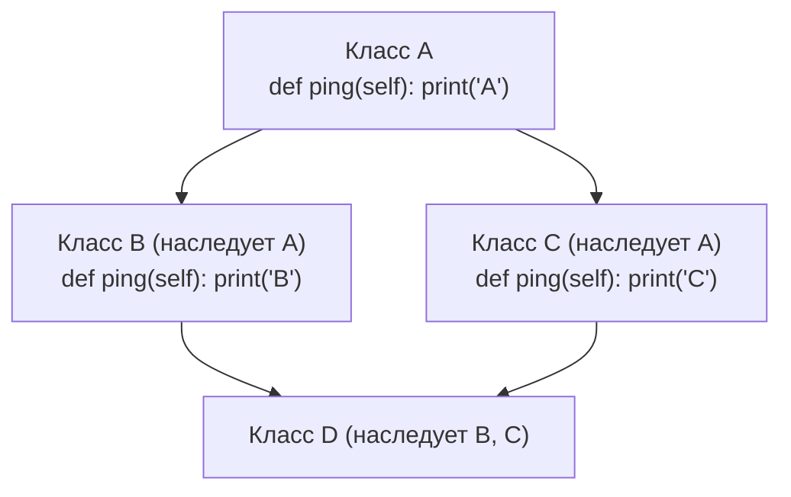

# 02. Наследование, MRO (C3-линеаризация), миксины и ABC

> [!IMPORTANT] Навигация по модулю
> - **MOC модуля**: [[00_Module_02_MOC|Карта знаний модуля 02]]
> - **Предыдущая глава**: [[01_Classes_Magic_Methods|01. Классы, атрибуты, slots и магические методы]]
> - **Следующая глава**: [[03_Decorators_Generators|03. Декораторы с параметрами, итераторы, генераторы и itertools]]
> - **Практика к этой главе**: [[ex_02_inheritance_abc.py|Практическое задание 02]]

---

## 1. Введение: Множественное наследование в Python

Python — один из немногих современных языков промышленной разработки с полной поддержкой множественного наследования классов. Вместе с мощью эта возможность несет архитектурные вызовы:
- В каком порядке искать переопределенные методы?
- Как избежать повторного выполнения конструкторов общих предков?
- Как организовать разделение ответственности с помощью легковесных примесей (Mixins)?

Ответом Python на эти вопросы является детерминированный алгоритм **C3-линеаризации (MRO)** и механизм **кооперативного `super()`**.

---

## 2. «Проблема ромба» (Diamond Problem)

Классическая проблема ромбовидного наследования возникает, когда класс `D` наследует одновременно от `B` и `C`, а те, в свою очередь, унаследованы от базового класса `A`:



Если мы вызовем `d.ping()`, какая реализация должна выполниться — `B` или `C`? И если оба подкласса вызывают реализацию родителя, вызовется ли `A.ping()` дважды?

В наивных системах (старый Python 2.2 с depth-first search) обход в глубину приводил к тому, что класс `A` посещался раньше, чем ветка `C`, нарушая принцип монотонности. Начиная с Python 2.3 и во всех современных версиях Python используется алгоритм **C3-линеаризации**.

---

## 3. Алгоритм C3-линеаризации и порядок разрешения методов (`__mro__`)

Линеаризация класса `C` — это строго упорядоченный список классов, проверяемых при поиске атрибутов и методов. Доступ к нему можно получить через атрибут `Класс.__mro__` или метод `Класс.mro()`.

### 3.1. Три свойства алгоритма C3
1. **Сохранение локального порядка старшинства (Local Precedence Order)**: если класс объявлен как `class D(B, C):`, то `B` всегда проверяется раньше, чем `C`.
2. **Монотонность (Monotonicity)**: если класс `X` предшествует классу `Y` в MRO любого родителя, то `X` обязан предшествовать `Y` в MRO любого их общего потомка.
3. **Строгое посещение родителя после всех его потомков**: базовый класс `A` не может появиться в MRO раньше, чем будут разрешены все его подклассы `B` и `C`.

### 3.2. Математическая формула слияния списков (`merge`)

Линеаризация класса `C`, наследующего от родителей $B_1, B_2, \dots, B_n$:

$$L[C(B_1 \dots B_n)] = [C] + \text{merge}(L[B_1], L[B_2], \dots, L[B_n], [B_1, B_2, \dots, B_n])$$

Правило `merge`:
1. Смотрим на голову (первый элемент) первого списка.
2. Если этот элемент **не встречается в хвосте** (всех элементах, кроме первого) ни одного из оставшихся списков, то:
   - Добавляем его в результирующий MRO.
   - Удаляем его отовсюду из списков аргументов `merge`.
3. Иначе переходим к голове следующего списка и повторяем проверку.
4. Если ни одна голова не подходит, линеаризация невозможна — Python выбрасывает:
   `TypeError: Cannot create a consistent method resolution order (MRO)`.

#### Пошаговый расчет для ромба:
Пусть:
- $L[O] = [O]$ (где $O$ — `object`)
- $L[A] = [A, O]$
- $L[B] = [B, A, O]$
- $L[C] = [C, A, O]$

Вычисляем $L[D(B, C)]$:
$$L[D] = [D] + \text{merge}([B, A, O], [C, A, O], [B, C])$$
- Шаг 1: Голова `B` не в хвостах $\to$ выбираем `B`.
  Остаток: $\text{merge}([A, O], [C, A, O], [C])$
- Шаг 2: Голова `A` есть в хвосте списка $[C, A, O]$! Переходим к следующему списку.
- Шаг 3: Голова `C` не в хвостах $\to$ выбираем `C`.
  Остаток: $\text{merge}([A, O], [A, O])$
- Шаг 4: Голова `A` не в хвостах $\to$ выбираем `A`.
  Остаток: $\text{merge}([O], [O])$
- Шаг 5: Выбираем `O`.

**Итоговый MRO**: `[D, B, C, A, object]`.

```python
class A:
    pass

class B(A):
    pass

class C(A):
    pass

class D(B, C):
    pass

print([cls.__name__ for cls in D.__mro__])
# ['D', 'B', 'C', 'A', 'object']
```

---

## 4. Кооперативный `super()`

Главное заблуждение начинающих разработчиков: *«`super()` вызывает метод непосредственного родителя»*.
В Python это **НЕ ТАК**.

> [!IMPORTANT] Что такое `super()` на самом деле?
> `super()` возвращает специальный прокси-объект, который ищет следующий метод **в цепочке MRO того объекта (`self`), от имени которого был начат вызов**, начиная со следующего класса после текущего!

### 4.1. Почему прямой вызов `BaseClass.__init__(self)` — грубейшая ошибка в ромбе
Если в ромбовидном наследовании вызвать `A.__init__(self)` вручную из `B` и `C`, конструктор `A` выполнится **дважды**, перезаписав инициализацию ресурсов или нарушив инварианты.

### 4.2. Правильный кооперативный цепочечный вызов
Чтобы `super()` работал кооперативно:
1. Каждый класс в иерархии должен вызывать `super().method(*args, **kwargs)`.
2. Сигнатуры должны передавать переменные именованные аргументы `**kwargs`, так как класс не знает заранее, кто окажется следующим в реальном MRO!

```python
from typing import Any


class BaseService:
    def __init__(self, **kwargs: Any) -> None:
        # object.__init__ не принимает произвольных аргументов
        super().__init__()
        print("1. [BaseService] Инициализирован базовый сервис")


class AuthMixin(BaseService):
    def __init__(self, auth_token: str, **kwargs: Any) -> None:
        super().__init__(**kwargs)  # Передаем kwargs дальше по цепочке MRO!
        self.auth_token = auth_token
        print(f"2. [AuthMixin] Токен авторизации установлен: {self.auth_token}")


class LoggingMixin(BaseService):
    def __init__(self, log_level: str = "INFO", **kwargs: Any) -> None:
        super().__init__(**kwargs)  # Передаем kwargs дальше!
        self.log_level = log_level
        print(f"3. [LoggingMixin] Уровень логирования: {self.log_level}")


class ApplicationService(AuthMixin, LoggingMixin):
    def __init__(self, app_name: str, **kwargs: Any) -> None:
        super().__init__(**kwargs)
        self.app_name = app_name
        print(f"4. [ApplicationService] Приложение {self.app_name} готово")


# Порядок MRO: ApplicationService -> AuthMixin -> LoggingMixin -> BaseService -> object
app = ApplicationService(
    app_name="BillingService",
    auth_token="jwt-secret-xyz",
    log_level="DEBUG",
)
```

Вывод терминала:
```text
1. [BaseService] Инициализирован базовый сервис
3. [LoggingMixin] Уровень логирования: DEBUG
2. [AuthMixin] Токен авторизации установлен: jwt-secret-xyz
4. [ApplicationService] Приложение BillingService готово
```

Обратите внимание: `AuthMixin` через `super()` передал управление в `LoggingMixin`, хотя они даже не знают о существовании друг друга! Это и есть **кооперативная диспетчеризация**.

---

## 5. Паттерн Mixin (Примеси)

**Миксин (Mixin)** — это специализированный класс, созданный исключительно для добавления дискретной функциональности (поведения) другим классам через множественное наследование.

### 5.1. Правила проектирования миксинов
- **Никакого собственного постоянного состояния**: миксины не должны иметь сложного независимого `__init__` (или должны строго делегировать аргументы через `super()`).
- **Ортогональность**: один миксин решает ровно одну задачу (сериализация в JSON, отправка метрик, хэширование пароля).
- **Порядок в объявлении**: в кортеже наследования миксины перечисляются **слева**, а главный базовый класс — **самым правым**:
  ```python
  class UserEndpoint(AuditLogMixin, RateLimitMixin, BaseAPIView):
      pass
  ```

### 5.2. Практический пример: `JsonSerializableMixin` и `DictExportMixin`

```python
import json
from typing import Any


class DictExportMixin:
    """Миксин для экспорта публичных атрибутов объекта в словарь."""

    def to_dict(self) -> dict[str, Any]:
        result: dict[str, Any] = {}
        for key, val in self.__dict__.items():
            if not key.startswith("_"):
                result[key] = val
        return result


class JsonSerializableMixin(DictExportMixin):
    """Миксин для JSON-сериализации на базе to_dict()."""

    def to_json(self, indent: int = 2) -> str:
        return json.dumps(self.to_dict(), indent=indent, default=str)


class UserProfile(JsonSerializableMixin):
    def __init__(self, username: str, email: str, age: int) -> None:
        self.username = username
        self.email = email
        self.age = age
        self._internal_session_id = "temp-987"  # Не попадет в экспорт


user = UserProfile("alex_pro", "alex@example.com", 29)
print(user.to_json())
```

---

## 6. Композиция против наследования («Composition over Inheritance»)

Классический принцип банды четырех (GoF) гласит: *«Отдавайте предпочтение композиции перед наследованием»*.

| Критерий | Наследование (is-a) | Композиция (has-a) |
|---|---|---|
| **Связность (Coupling)** | Очень высокая (изменение родителя ломает потомков) | Низкая (слабое зацепление через интерфейсы) |
| **Гибкость в рантайме** | Жесткая (нельзя сменить родителя на лету) | Динамическая (компонент можно подменить) |
| **Принцип LSP** | Легко нарушить (Liskov Substitution Principle) | Защищен инкапсуляцией |

```python
# АНТИПАТТЕРН: Наследование от встроенного списка ради пары методов
class BadUserQueue(list):
    def push_user(self, user: str) -> None:
        self.append(user)
    # Ошибка: пользователю доступны append, pop, sort, insert, extend и т.д.,
    # которые могут нарушить инварианты очереди!


# ПРАВИЛЬНО: Композиция и делегирование
class GoodUserQueue:
    def __init__(self) -> None:
        self._storage: list[str] = []

    def push(self, user: str) -> None:
        self._storage.append(user)

    def pop(self) -> str:
        if not self._storage:
            raise IndexError("Очередь пуста")
        return self._storage.pop(0)

    def __len__(self) -> int:
        return len(self._storage)
```

---

## 7. Модуль `abc`: Абстрактные Базовые Классы (Abstract Base Classes)

Абстрактные классы фиксируют контракт интерфейса для группы подклассов. Если разработчик забудет реализовать хотя бы один абстрактный метод, создание экземпляра класса будет пресечено интерпретатором на этапе инстанцирования:

```python
from abc import ABC, abstractmethod
from typing import Any


class BaseRepository(ABC):
    """Абстрактный контракт для репозитория данных."""

    @abstractmethod
    def get_by_id(self, entity_id: int) -> dict[str, Any] | None:
        """Получить запись по идентификатору."""
        pass

    @abstractmethod
    def save(self, entity: dict[str, Any]) -> int:
        """Сохранить сущность и вернуть сгенерированный ID."""
        pass

    @property
    @abstractmethod
    def table_name(self) -> str:
        """Абстрактное свойство: имя таблицы в базе."""
        pass


class BrokenUserRepository(BaseRepository):
    # Не реализовали table_name и save
    def get_by_id(self, entity_id: int) -> dict[str, Any] | None:
        return {"id": entity_id, "name": "Test"}


# BrokenUserRepository()
# TypeError: Can't instantiate abstract class BrokenUserRepository
# without an implementation for abstract methods 'save', 'table_name'
```

### 7.1. Виртуальные подклассы и `__subclasshook__`
Модуль `abc` позволяет объявлять класс подклассом **без явного наследования** в коде. Встроенные протоколы (например, `collections.abc.Iterable`, `Sized`) работают именно так:

```python
from abc import ABCMeta, abstractmethod


class SizedProtocol(metaclass=ABCMeta):
    @classmethod
    def __subclasshook__(cls, subclass: type) -> bool:
        """Если у класса есть метод __len__, считаем его подклассом SizedProtocol!"""
        if cls is SizedProtocol:
            if any("__len__" in B.__dict__ for B in subclass.__mro__):
                return True
        return NotImplemented


class CustomContainer:
    def __len__(self) -> int:
        return 42


print(issubclass(CustomContainer, SizedProtocol))  # True!
print(isinstance(CustomContainer(), SizedProtocol))  # True!
```

---

## 8. Практическое задание

Перейдите к выполнению практической работы в файле:
[[ex_02_inheritance_abc.py|exercises/02_oop_typing/ex_02_inheritance_abc.py]]

### Что предстоит реализовать:
1. Абстрактный базовый класс `BaseRepository[T]`:
   - С абстрактными методами `get(id)`, `add(entity)`, `delete(id)` и абстрактным свойством `entity_name`.
2. Миксины:
   - `AuditLogMixin` — ведет потокобезопасный аудит-лог операций (`audit_log: list[str]`), используя кооперативный `super()`.
   - `JsonExportMixin` — экспортирует внутренние записи репозитория в сериализованную JSON-строку.
3. Разрешение ромбовидного наследования:
   - Иерархия `BasePlugin`, `AuthPlugin`, `CachePlugin`, `FullAppPlugin` с кооперативными методами `bootstrap()` для подтверждения MRO.
4. Конкретный класс `InMemoryUserRepository`:
   - Наследует `AuditLogMixin`, `JsonExportMixin` и `BaseRepository[dict]`.
5. Тесты на `unittest`:
   - Проверка блокировки инстанцирования неполных классов.
   - Проверка строгого совпадения `__mro__` с алгоритмом C3.
   - Проверка кооперативного вызова всех звеньев цепочки без пропусков.
