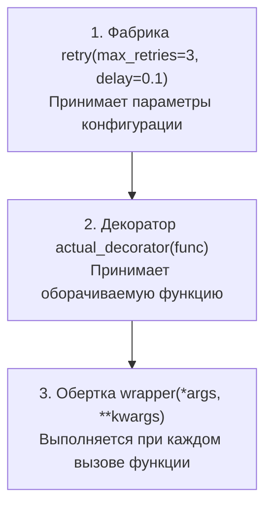
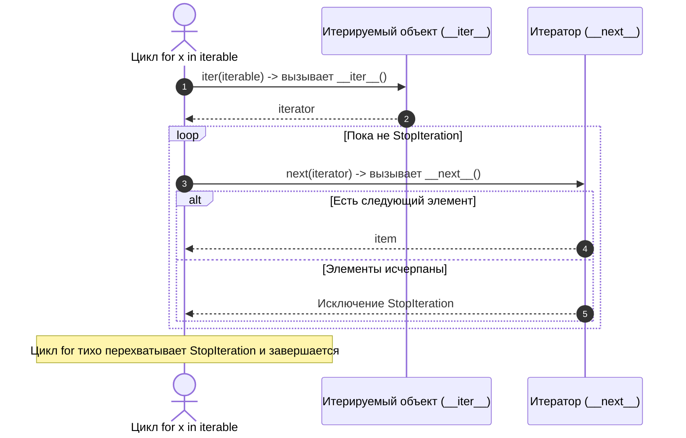
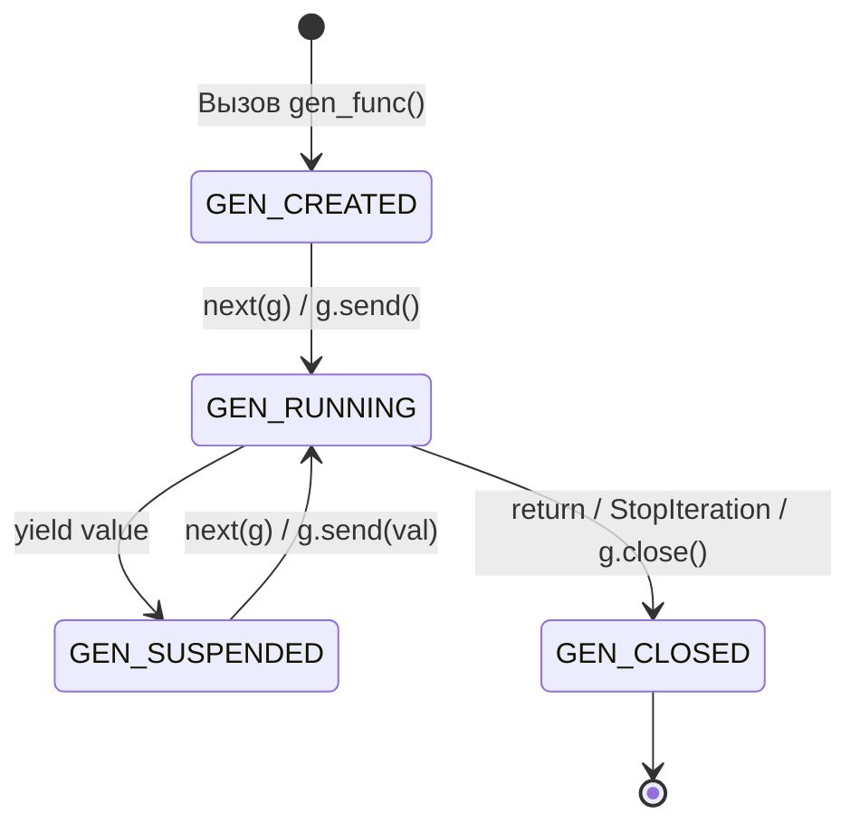

# 03. Декораторы с параметрами, итераторы, генераторы и itertools

> [!IMPORTANT] Навигация по модулю
> - **MOC модуля**: [[00_Module_02_MOC|Карта знаний модуля 02]]
> - **Предыдущая глава**: [[02_Inheritance_MRO_ABCs|02. Наследование, MRO (C3-линеаризация), миксины и ABC]]
> - **Следующая глава**: [[04_Dataclasses_Enums_Descriptors|04. Dataclasses, Enum и протокол дескрипторов]]
> - **Практика к этой главе**: [[ex_03_decorators_generators.py|Практическое задание 03]]

---

## 1. Введение: Функциональные паттерны в Python

Декораторы и генераторы — два мощнейших выразительных инструмента Python:
- **Декораторы** позволяют декларативно расширять поведение функций и классов, соблюдая принцип открытости/закрытости (OCP). Именно на них построены роутинг FastAPI (`@app.get()`), валидаторы Pydantic и кэширование.
- **Генераторы** реализуют ленивые вычисления (lazy evaluation), позволяя обрабатывать гигабайтные массивы данных и бесконечные потоки событий с константным расходом памяти $O(1)$.

---

## 2. Замыкания: фундамент декораторов

В Python функции являются объектами первого класса (First-Class Citizens). Функция может возвращать другую функцию, а внутренняя функция «захватывает» переменные из внешней области видимости:

```python
from collections.abc import Callable


def make_counter(start: int = 0) -> Callable[[], int]:
    count = start  # Свободная переменная (free variable)

    def counter() -> int:
        nonlocal count  # Разрешает модификацию переменной внешнего скоупа
        count += 1
        return count

    return counter


c = make_counter(10)
print(c())  # 11
print(c())  # 12
# Инспекция замыкания в CPython:
print(c.__closure__[0].cell_contents)  # 12
```

---

## 3. Декораторы функций и сохранение метаданных (`@functools.wraps`)

Декоратор — это синтаксический сахар для вызова функции высшего порядка:
```python
@my_decorator
def target():
    pass

# Эквивалентно:
target = my_decorator(target)
```

### 3.1. Проблема потери метаданных
Когда мы оборачиваем функцию во `wrapper`, без специальных мер теряются имя `__name__`, документация `__doc__`, сигнатура и типизация `__annotations__`. Это ломает генерацию документации OpenAPI в FastAPI, интроспекцию и отладку!

Решение — стандартный декоратор `@functools.wraps`:

```python
import functools
import time
from collections.abc import Callable
from typing import Any, TypeVar

R = TypeVar("R")


def execution_timer(func: Callable[..., R]) -> Callable[..., R]:
    """Декоратор для замера времени выполнения функции."""

    @functools.wraps(func)  # Копирует __name__, __doc__, __module__, __annotations__
    def wrapper(*args: Any, **kwargs: Any) -> R:
        start_ts = time.perf_counter()
        try:
            result = func(*args, **kwargs)
            return result
        finally:
            elapsed = time.perf_counter() - start_ts
            print(f"[TIMER] {func.__name__} выполнена за {elapsed * 1000:.2f} ms")

    return wrapper


@execution_timer
def fetch_user_data(user_id: int) -> dict[str, Any]:
    """Получает профиль пользователя из БД."""
    time.sleep(0.05)
    return {"id": user_id, "name": "Elena"}


# Проверка сохранения метаданных:
print(fetch_user_data.__name__)  # 'fetch_user_data' (а НЕ 'wrapper'!)
print(fetch_user_data.__doc__)   # 'Получает профиль пользователя из БД.'
```

---

## 4. Фабрики декораторов (декораторы с параметрами)

Если декоратор должен принимать аргументы (например, `@retry(max_retries=3)` или `@app.get("/users")`), создается трехуровневая функция — **фабрика декораторов**:



```python
import functools
import time
from collections.abc import Callable
from typing import Any, TypeVar

T = TypeVar("T")


def retry(
    max_retries: int = 3,
    exceptions: tuple[type[Exception], ...] = (Exception,),
    delay: float = 0.05,
) -> Callable[[Callable[..., T]], Callable[..., T]]:
    """Фабрика параметризованного декоратора повторных попыток при сбоях."""

    def decorator(func: Callable[..., T]) -> Callable[..., T]:
        @functools.wraps(func)
        def wrapper(*args: Any, **kwargs: Any) -> T:
            attempts = 0
            while True:
                try:
                    return func(*args, **kwargs)
                except exceptions as err:
                    attempts += 1
                    if attempts >= max_retries:
                        raise RuntimeError(
                            f"Функция {func.__name__} провалилась после {attempts} попыток"
                        ) from err
                    time.sleep(delay)

        return wrapper

    return decorator


@retry(max_retries=3, exceptions=(ConnectionError, TimeoutError))
def send_webhook(url: str, payload: dict[str, Any]) -> bool:
    print(f"Отправка запроса на {url}...")
    # Имитируем сетевую ошибку
    raise ConnectionError("Gateway Timeout")
```

---

## 5. Класс как декоратор и декорирование классов

### 5.1. Класс в роли декоратора
Класс с методом `__call__` отлично подходит для сложных декораторов с сохранением состояния (например, счетчик вызовов или кэш с TTL):

```python
class CallCounter:
    def __init__(self, func: Callable[..., Any]) -> None:
        self.func = func
        self.calls_count = 0
        functools.update_wrapper(self, func)

    def __call__(self, *args: Any, **kwargs: Any) -> Any:
        self.calls_count += 1
        print(f"Функция {self.func.__name__} вызвана {self.calls_count}-й раз")
        return self.func(*args, **kwargs)


@CallCounter
def process_order(order_id: int) -> str:
    return f"Order #{order_id} processed"
```

### 5.2. Декораторы целых классов
Декоратор класса принимает класс `cls`, модифицирует его атрибуты или регистрирует в глобальном реестре и возвращает обратно (именно так работает `@dataclass`):

```python
REGISTRY: dict[str, type] = {}


def register_handler(command_name: str) -> Callable[[type], type]:
    def class_decorator(cls: type) -> type:
        REGISTRY[command_name] = cls
        return cls

    return class_decorator


@register_handler("create_user")
class CreateUserHandler:
    pass


print(REGISTRY)  # {'create_user': <class '__main__.CreateUserHandler'>}
```

---

## 6. Протокол Итератора в CPython



- **Итерируемый объект (Iterable)**: объект с методом `__iter__()`, возвращающим итератор.
- **Итератор (Iterator)**: объект с методами `__iter__()` (возвращает `self`) и `__next__()` (возвращает очередной элемент или выбрасывает `StopIteration`).

---

## 7. Генераторы: `yield` и жизненный цикл корутины

Генератор — это специальная функция, которая при вызове не выполняет тело немедленно, а возвращает объект-генератор (`generator`).



### 7.1. Потоковая обработка без расхода памяти
Чтение 10-гигабайтного лог-файла со строками:

```python
from collections.abc import Generator


def stream_error_logs(filepath: str) -> Generator[str, None, None]:
    """Читает файл построчно, не загружая его целиком в RAM."""
    with open(filepath, "r", encoding="utf-8") as f:
        for line in f:
            if "ERROR" in line:
                yield line.strip()


# Память: константа ~8 Кб для буфера чтения, сколько бы гигабайт ни весил файл!
```

### 7.2. Делегирование через `yield from`
Конструкция `yield from <iterable>`:
1. Автоматически разворачивает вложенный итератор/генератор.
2. Прозрачно связывает внешний вызывающий код с внутренним подгенератором, напрямую пересылая вызовы `.send()`, `.throw()` и возвращая значение из `return`.

```python
def flatten_nested(nested_list: list[Any]) -> Generator[Any, None, None]:
    for item in nested_list:
        if isinstance(item, list):
            yield from flatten_nested(item)  # Рекурсивное разворачивание любой глубины
        else:
            yield item


data = [1, [2, [3, 4], 5], [6, 7]]
print(list(flatten_nested(data)))  # [1, 2, 3, 4, 5, 6, 7]
```

### 7.3. Двусторонний обмен через `.send()`
Генератор может не только отдавать данные, но и принимать их извне, работая как потребитель или фильтр:

```python
def running_average() -> Generator[float, float, None]:
    total = 0.0
    count = 0
    average = 0.0

    while True:
        # yield average отдает текущее среднее,
        # а присваивание val = yield ... принимает новое число через send!
        val = yield average
        if val is None:
            break
        total += val
        count += 1
        average = total / count


avg = running_average()
next(avg)  # Первичная инициализация (до первого yield): отдает 0.0
print(avg.send(10.0))  # 10.0
print(avg.send(20.0))  # 15.0
print(avg.send(30.0))  # 20.0
avg.close()            # Завершение генератора
```

---

## 8. Модуль `itertools`: Ленивые конвейеры данных

Модуль `itertools` предоставляет высокопроизводительные C-реализации базовых итерационных примитивов:

| Функция | Описание | Пример |
|---|---|---|
| `itertools.islice(it, start, stop)` | Ленивый срез любого итератора | `islice(count(), 5, 10)` |
| `itertools.chain(*iterables)` | Объединение потоков последовательно | `chain([1, 2], [3, 4])` |
| `itertools.count(start, step)` | Бесконечный счетчик чисел | `count(1, 2) -> 1, 3, 5...` |
| `itertools.cycle(it)` | Бесконечное повторение последовательности | `cycle(["A", "B"])` |
| `itertools.batched(it, n)` | Разбиение на пачки по `n` элементов *(Python 3.12+)* | `batched(range(7), 3) -> (0,1,2), (3,4,5), (6,)` |
| `itertools.groupby(it, key)` | Группировка подряд идущих элементов | Группировка отсортированных логов по дате |

```python
import itertools

# Конвейер: берем четные квадраты чисел из бесконечного потока пачками по 3
infinite_nums = itertools.count(1)
squares = (x * x for x in infinite_nums)
even_squares = (x for x in squares if x % 2 == 0)
first_batches = itertools.batched(itertools.islice(even_squares, 9), 3)

for batch in first_batches:
    print(batch)
# (4, 16, 36)
# (64, 100, 144)
# (196, 256, 324)
```

---

## 9. Практическое задание

Перейдите к выполнению практической работы в файле:
[[ex_03_decorators_generators.py|exercises/02_oop_typing/ex_03_decorators_generators.py]]

### Что предстоит реализовать:
1. Параметризованный декоратор `@retry(max_retries=3, exceptions=(Exception,), delay=0.0)` с сохранением метаданных через `@functools.wraps`.
2. Декоратор `@cached_with_ttl(ttl_seconds=1.0)` для кэширования результатов вызова с ограничением по времени жизни.
3. Генератор разбивки на пакеты `chunked_pipeline(iterable, chunk_size)` на базе `yield` и `itertools.islice`.
4. Двусторонний генератор `moving_average()` на базе `.send()` для вычисления скользящей средней.
5. Рекурсивный генератор `flatten_tree()` на базе `yield from`.
6. Модульные тесты `unittest` для проверки сохранения сигнатур, корректности работы retry и генераторных пайплайнов.
