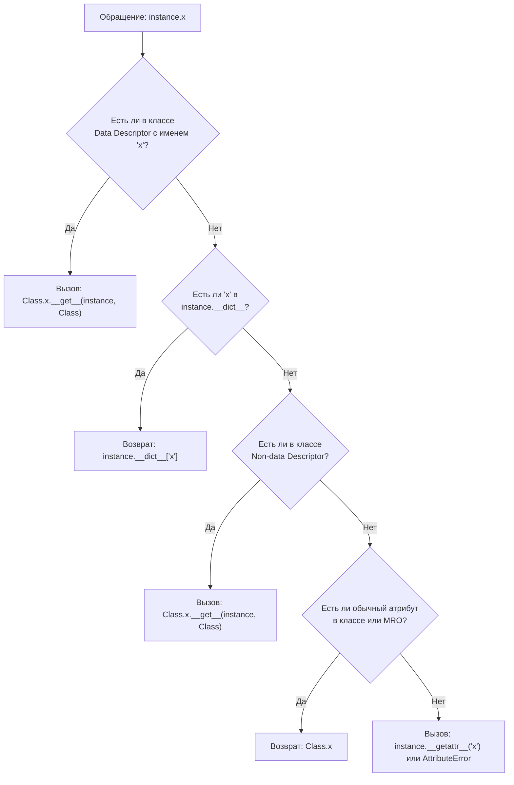

# 04. Dataclasses, Enum и протокол дескрипторов

> [!IMPORTANT] Навигация по модулю
> - **MOC модуля**: [[00_Module_02_MOC|Карта знаний модуля 02]]
> - **Предыдущая глава**: [[03_Decorators_Generators|03. Декораторы с параметрами, итераторы, генераторы и itertools]]
> - **Следующая глава**: [[05_Type_Hints_Protocols_Generics|05. Продвинутая типизация: Generics, Protocol, TypeVar, Annotated]]
> - **Практика к этой главе**: [[ex_04_dataclasses_descriptors.py|Практическое задание 04]]

---

## 1. Введение: Декларативное моделирование данных

В промышленном коде мы постоянно оперируем структурами данных: моделями конфигураций, сущностями домена (DDD Entity), DTO (Data Transfer Object) и валидируемыми полями.
В Python этот инструментарий эволюционировал от рутинного написания `__init__` и `__repr__` к элегантным декларативным механизмам:
- `@dataclass` устраняет шаблонный код (boilerplate).
- `enum` фиксирует закрытые множества допустимых вариантов.
- **Протокол дескрипторов** раскрывает глубинную механику доступа к полям, на которой построены `@property`, SQLAlchemy ORM и Pydantic v2.

---

## 2. Глубокое погружение в `@dataclass`

Декоратор `@dataclass` (введен в PEP 557) инспектирует аннотации типов класса и автоматически генерирует методы `__init__`, `__repr__`, `__eq__`, `__hash__` и операторы сравнения.

```python
from dataclasses import dataclass, field
from datetime import datetime
from typing import Any


@dataclass(
    frozen=True,    # Делает экземпляр неизменяемым и генерирует __hash__
    slots=True,     # Включает __slots__, уменьшая расход памяти в 3 раза
    kw_only=True,   # Заставляет передавать все аргументы по имени (Python 3.10+)
    order=True,     # Генерирует __lt__, __gt__, сортируя по порядку полей
)
class ServerConfig:
    host: str
    port: int = 8000
    # Изменяемые значения по умолчанию требуют default_factory!
    allowed_ips: tuple[str, ...] = field(default_factory=tuple)
    tags: dict[str, str] = field(default_factory=dict, compare=False, repr=False)
    created_at: datetime = field(default_factory=datetime.utcnow, compare=False)
```

### 2.1. Опасность изменяемых значений по умолчанию: `default_factory`
Если написать `tags: list[str] = []`, Python выбросит `ValueError: mutable default <class 'list'> for field tags is not allowed: use default_factory`.
Причина: список был бы создан **один раз на уровне класса** и разделялся бы между всеми экземплярами! `default_factory=list` гарантирует создание свежего списка для каждого нового объекта.

### 2.2. Метод `__post_init__` и переменные `InitVar`
Метод `__post_init__` вызывается сразу после сгенерированного `__init__`. В нем выполняют валидацию инвариантов и инициализацию зависимых вычисляемых полей:

```python
from dataclasses import InitVar, dataclass


@dataclass
class UserAccount:
    username: str
    raw_password: InitVar[str]  # Передается только в __init__ и __post_init__, не становится полем!
    hashed_password: str = ""

    def __post_init__(self, raw_password: str) -> None:
        if len(self.username) < 3:
            raise ValueError("Имя пользователя слишком короткое!")
        # Имитируем хеширование
        self.hashed_password = f"hash_{raw_password}_secret"


u = UserAccount("alexander", raw_password="qwerty123password")
print(u.hashed_password)       # 'hash_qwerty123password_secret'
print(hasattr(u, "raw_password"))  # False!
```

### 2.3. Сравнительный анализ моделей данных

| Характеристика | Кортеж / `dict` | `typing.NamedTuple` | `@dataclass` | Pydantic v2 `BaseModel` |
|---|---|---|---|---|
| **Мутабельность** | Мутабелен (`dict`) / Нет (`tuple`) | Неизменяем | По выбору (`frozen=True`) | По выбору (`frozen=True`) |
| **Расход памяти** | Средний / Высокий | Минимальный | Минимальный (`slots=True`) | Выше среднего |
| **Парсинг и коэрциция типов** | Нет | Нет | Нет | Да (строки $\to$ int, ISO $\to$ datetime) |
| **Быстродействие создания** | Очень быстро | Очень быстро | Быстро | Сверхбыстро (ядро на Rust / `pydantic-core`) |
| **Когда применять** | Внутренние утилиты | Легковесные DTO | Бизнес-логика, доменные модели | Входные API DTO в FastAPI |

---

## 3. Модуль `enum`: Строгие перечисления

Перечисления исключают «магические строки» и «магические числа», защищая код от опечаток и гарантируя типобезопасность.

```python
from enum import Enum, Flag, IntEnum, StrEnum, auto, unique


# 1. StrEnum (Python 3.11+) — значения строго строки, идеален для роутов FastAPI
class OrderStatus(StrEnum):
    PENDING = auto()       # "pending"
    PROCESSING = auto()    # "processing"
    COMPLETED = auto()     # "completed"
    CANCELLED = auto()     # "cancelled"


# 2. @unique гарантирует уникальность значений
@unique
class HTTPMethod(StrEnum):
    GET = "GET"
    POST = "POST"
    PUT = "PUT"
    DELETE = "DELETE"
    # PATCH = "GET"  # Вызовет ValueError: duplicate values found in <enum 'HTTPMethod'>: PATCH -> GET


# 3. Flag — битовые маски для прав доступа
class Permission(Flag):
    NONE = 0
    READ = auto()      # 1
    WRITE = auto()     # 2
    EXECUTE = auto()   # 4
    ADMIN = READ | WRITE | EXECUTE  # 7


# Комбинации прав через побитовые операторы |, &
user_perms = Permission.READ | Permission.WRITE
print(Permission.READ in user_perms)    # True
print(Permission.EXECUTE in user_perms) # False
```

---

## 4. Протокол Дескрипторов (Descriptors)

**Дескриптор** — это атрибут класса, чье поведение при обращении (`obj.attr`), присваивании (`obj.attr = val`) или удалении (`del obj.attr`) переопределено с помощью специальных методов:
- `__get__(self, instance, owner=None)`
- `__set__(self, instance, value)`
- `__delete__(self, instance)`
- `__set_name__(self, owner, name)` *(Python 3.6+ — избавляет от ручного прописывания имени поля!)*



### 4.1. Data Descriptors против Non-Data Descriptors
- **Data Descriptor**: реализует `__set__` или `__delete__`. Он имеет **абсолютный приоритет** над словарем экземпляра `instance.__dict__`!
- **Non-Data Descriptor**: реализует только `__get__` (например, обычные методы класса). Запись в `instance.__dict__` перекрывает его поведение.

### 4.2. Как устроены методы и `@property` под капотом
1. **Обычные методы**: любая функция в Python является non-data дескриптором. При обращении `u.get_name` метод `function.__get__` связывает функцию с `self`, возвращая связанный метод (`bound method`).
2. **`@property`**: это встроенный data-дескриптор в CPython (`PyProperty_Type`).

### 4.3. Создание кастомного валидирующего дескриптора

Разработаем переиспользуемые дескрипторы для валидации полей сущностей, подобные полям ORM:

```python
from typing import Any


class ValidatedString:
    """Дескриптор валидации строки с проверкой минимальной и максимальной длины."""

    def __init__(self, min_length: int = 1, max_length: int = 255) -> None:
        self.min_length = min_length
        self.max_length = max_length
        self.storage_name = ""

    def __set_name__(self, owner: type, name: str) -> None:
        # Автоматически вызывается при создании класса!
        self.storage_name = f"_{name}"

    def __get__(self, instance: Any, owner: type | None = None) -> Any:
        if instance is None:
            return self  # Обращение через класс Product.title вернет сам дескриптор
        return getattr(instance, self.storage_name, None)

    def __set__(self, instance: Any, value: Any) -> None:
        if not isinstance(value, str):
            raise TypeError(f"Значение поля должно быть str, получено {type(value).__name__}")
        clean_val = value.strip()
        if not (self.min_length <= len(clean_val) <= self.max_length):
            raise ValueError(
                f"Длина строки должна быть от {self.min_length} до {self.max_length} символов"
            )
        setattr(instance, self.storage_name, clean_val)


class PositiveNumber:
    """Дескриптор валидации положительного вещественного числа."""

    def __set_name__(self, owner: type, name: str) -> None:
        self.storage_name = f"_{name}"

    def __get__(self, instance: Any, owner: type | None = None) -> Any:
        if instance is None:
            return self
        return getattr(instance, self.storage_name, None)

    def __set__(self, instance: Any, value: Any) -> None:
        if not isinstance(value, (int, float)):
            raise TypeError("Цена должна быть числом")
        if value <= 0:
            raise ValueError("Число должно быть строго положительным")
        setattr(instance, self.storage_name, float(value))


class ProductModel:
    title = ValidatedString(min_length=3, max_length=50)
    price = PositiveNumber()

    def __init__(self, title: str, price: float) -> None:
        self.title = title
        self.price = price


item = ProductModel("Ноутбук Apple Pro", 1999.99)
print(item.title)  # "Ноутбук Apple Pro"
# item.title = "A"   # Вызовет ValueError: Длина строки должна быть от 3 до 50
# item.price = -100  # Вызовет ValueError: Число должно быть строго положительным
```

---

## 5. Практическое задание

Перейдите к выполнению практической работы в файле:
[[ex_04_dataclasses_descriptors.py|exercises/02_oop_typing/ex_04_dataclasses_descriptors.py]]

### Что предстоит реализовать:
1. Валидирующие дескрипторы данных:
   - `ValidatedString(min_length, max_length)` с `__set_name__`, `__get__`, `__set__`.
   - `BoundedNumber(min_val, max_val)`.
2. Перечисления:
   - `UserRole(StrEnum)`: `ADMIN`, `MODERATOR`, `USER`.
   - `Permission(Flag)`: битовые флаги с поддержкой операций `|` и `in`.
3. Защищенный датакласс:
   - `@dataclass(frozen=True, slots=True, kw_only=True)` `UserProfile` с валидацией инвариантов в `__post_init__`.
4. Модель сущности:
   - `ProductEntity` с валидацией через дескрипторы `title` и `price`.
5. Модульные тесты `unittest`:
   - Тестирование неизменяемости dataclass (`FrozenInstanceError`).
   - Изоляция данных в дескрипторах между разными экземплярами объектов.
   - Тестирование битовых масок прав `Flag`.
