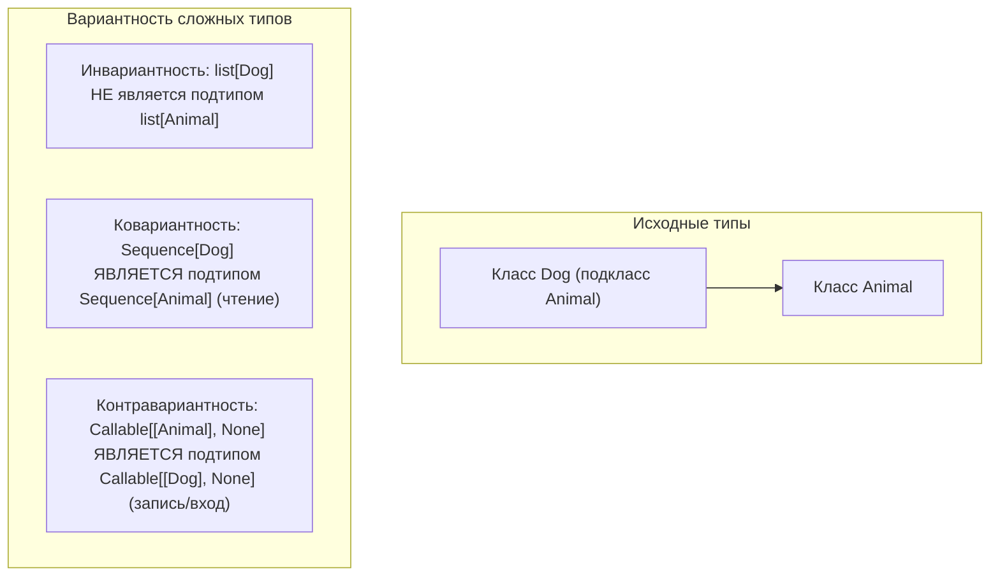
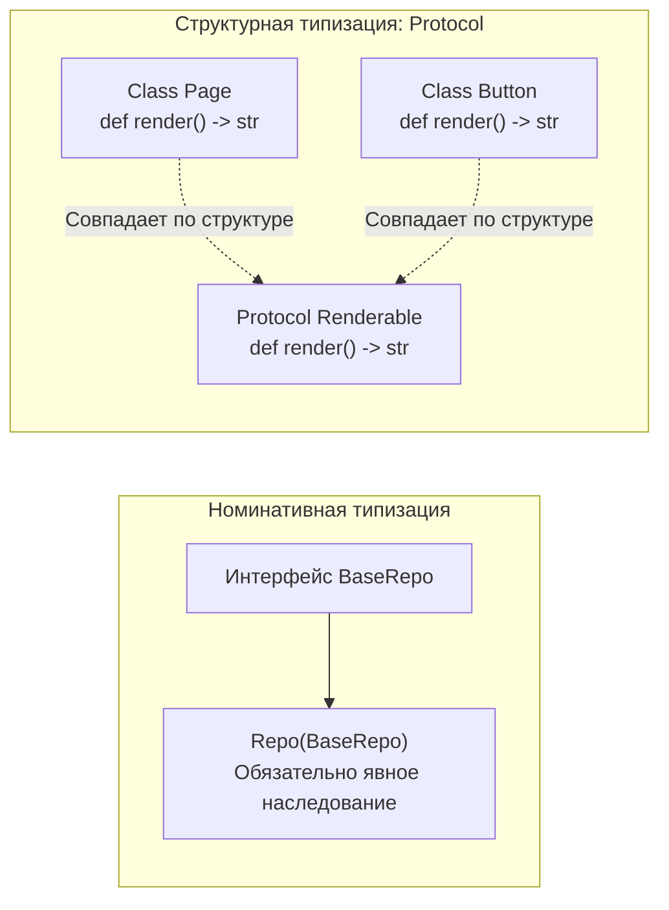

# 05. Продвинутая типизация: Generics, Protocol, TypeVar, Annotated

> [!IMPORTANT] Навигация по модулю
> - **MOC модуля**: [[00_Module_02_MOC|Карта знаний модуля 02]]
> - **Предыдущая глава**: [[04_Dataclasses_Enums_Descriptors|04. Dataclasses, Enum и протокол дескрипторов]]
> - **Следующий модуль**: [[01_Memory_Model_GIL_GC|Модуль 03. Внутреннее устройство и Asyncio]]
> - **Практика к этой главе**: [[ex_05_typing_protocols.py|Практическое задание 05]]

---

## 1. Введение: Эволюция типизации в Python

Python остается языком с динамической типизацией во время исполнения (в рантайме типы не форсируются виртуальной машиной). Однако благодаря **статическому анализу** (Mypy, Pyright, Ruff) и подсказкам типов (Type Hints) современный Python 3.12–3.14+ стал одним из самых безопасных и выразительных инструментов backend-разработки.

Фреймворк **FastAPI** целиком построен на использовании аннотаций типов: они управляют валидацией запросов, сериализацией ответов, генерацией документации OpenAPI/Swagger и внедрением зависимостей (`Depends`).

---

## 2. Современный синтаксис Generics (PEP 695 в Python 3.12+)

До Python 3.12 обобщенные типы требовали громоздкого импорта `TypeVar` и наследования от `Generic[T]`. Начиная с Python 3.12 введен компактный нативный синтаксис generic-параметров:

```python
# Современный PEP 695 синтаксис (Python 3.12+):
class Stack[T]:
    """Обобщенный стек элементов типа T."""

    def __init__(self) -> None:
        self._items: list[T] = []

    def push(self, item: T) -> None:
        self._items.append(item)

    def pop(self) -> T:
        if not self._items:
            raise IndexError("Стек пуст")
        return self._items.pop()


# Обобщенная функция:
def first_or_default[T](items: list[T], default: T) -> T:
    return items[0] if items else default


# Новый синтаксис алиасов типов через ключевое слово type:
type Matrix[T] = list[list[T]]
type UserID = int | str
```

### 2.1. Классический синтаксис `TypeVar` (для обратной совместимости)
В библиотеках с поддержкой версий Python ниже 3.12 вы встретите:
```python
from typing import Generic, TypeVar

T = TypeVar("T")  # Неограниченный тип
T_num = TypeVar("T_num", int, float)  # Ограниченный типами int или float
```

---

## 3. Вариантность: Инвариантность, Ковариантность, Контравариантность

Вариантность описывает, как отношение подтипов между исходными типами переносится на построенные из них сложные типы (коллекции, интерфейсы, функции).



### 3.1. Инвариантность (Invariance)
По умолчанию все мутабельные коллекции в Python **инвариантны**.
Почему `list[Dog]` нельзя считать подтипом `list[Animal]`?
Если бы это было разрешено, функция `add_cat(animals: list[Animal])` могла бы положить `Cat` в ваш исходный список собак!

### 3.2. Ковариантность (Covariance, `covariant=True`)
Если `Dog` — подтип `Animal`, то `ReadOnlyContainer[Dog]` — подтип `ReadOnlyContainer[Animal]`.
Ковариантность безопасна для типов, которые **только отдают данные (производители / read-only)**:
```python
from collections.abc import Sequence


def process_animals(animals: Sequence[Animal]) -> None:
    for a in animals:
        print(a.name)


dogs: list[Dog] = [Dog("Rex"), Dog("Sharik")]
process_animals(dogs)  # Безопасно! Sequence ковариантна, так как не имеет методов append/insert
```

### 3.3. Контравариантность (Contravariance, `contravariant=True`)
Отношение наследования разворачивается в противоположную сторону. Безопасно для типов, которые **только принимают данные (потребители / write-only)**.
Если функция умеет обрабатывать любого `Animal`, она гарантированно справится и с `Dog`!
Поэтому `Callable[[Animal], None]` является подтипом `Callable[[Dog], None]`.

---

## 4. Структурная типизация: `typing.Protocol` (PEP 544)

В классическом ООП (Java/C#) используется **номинативная типизация**: класс реализует интерфейс, только если явно написал `implements Interface`.
В Python исторически правит «утиная типизация» (*Duck Typing*: «Если это крякает как утка — это утка»).
`typing.Protocol` дает лучшее из двух миров: **статическую утиную типизацию (Structural Subtyping)**!



```python
from typing import Any, Protocol, runtime_checkable


@runtime_checkable  # Позволяет использовать isinstance(obj, Renderable) в рантайме!
class Renderable(Protocol):
    def render(self) -> str:
        """Любой объект с методом render() -> str удовлетворяет протоколу!"""
        ...


class MarkdownArticle:
    # Заметьте: НЕТ явного наследования от Renderable!
    def __init__(self, text: str) -> None:
        self.text = text

    def render(self) -> str:
        return f"# {self.text}"


doc = MarkdownArticle("Введение в архитектуру")
# Проверка в рантайме:
print(isinstance(doc, Renderable))  # True!


def publish(page: Renderable) -> None:
    print(page.render())


publish(doc)  # Статический тайпчекер Mypy/Pyright полностью доволен!
```

---

## 5. Специализированные инструменты типизации

### 5.1. `TypedDict`
Типизация словарей с фиксированной структурой ключей (часто используется для JSON payload):

```python
from typing import NotRequired, TypedDict


class UserPayload(TypedDict):
    id: int
    username: str
    email: NotRequired[str]  # Поле необязательно при total=True
```

### 5.2. `Literal` и `Final`
- `Literal["admin", "user"]` — ограничивает переменную конкретным набором допустимых констант.
- `Final` / `@final` — константа, которую нельзя переопределить, или метод/класс, который нельзя перегрузить/унаследовать.

```python
from typing import Final, Literal, final

MAX_CONNECTIONS: Final[int] = 100
SortOrder = Literal["asc", "desc"]


@final
class SecurityEngine:
    """Класс закрыт для наследования."""
    pass
```

### 5.3. `Annotated` (PEP 593): Метаданные типов и фундамент FastAPI
`Annotated[T, Metadata]` позволяет прикреплять к типу произвольные метаданные, не меняя сам базовый тип для тайпчекера:

```python
from typing import Annotated


# Создаем спецификацию поля: целое число, которое в базе должно быть положительным
type PositiveInt = Annotated[int, "constraint: val > 0"]
```

#### Как это работает в FastAPI:
```python
from fastapi import Depends, FastAPI, Query
from typing import Annotated

app = FastAPI()


async def get_db_session():
    return "session"


# Вся декларативная магия FastAPI строится на Annotated:
@app.get("/items")
async def get_items(
    page: Annotated[int, Query(ge=1, le=100)] = 1,
    db: Annotated[str, Depends(get_db_session)] = ...,
):
    return {"page": page}
```

---

## 6. Сужение типов: `TypeGuard` и `TypeIs`

Иногда встроенного `isinstance()` недостаточно для сложных проверок (например, проверка элементов списка).
Для обучения тайпчекера пользовательским предикатам используются `TypeGuard` (PEP 647) и `TypeIs` (PEP 742 в Python 3.13+):

```python
from typing import Any, TypeGuard


def is_string_list(items: list[Any]) -> TypeGuard[list[str]]:
    """Предикат: возвращает True, если все элементы списка - строки."""
    return all(isinstance(item, str) for item in items)


raw_data: list[Any] = ["apple", "banana", "cherry"]

if is_string_list(raw_data):
    # Внутри этого блока Mypy знает, что raw_data имеет тип list[str]!
    raw_data.append("mango")
    print(", ".join(raw_data))
```

---

## 7. Типобезопасные декораторы: `Callable` и `ParamSpec` (PEP 612)

Обычный `Callable[..., R]` стирает аргументы оборачиваемой функции.
`ParamSpec` (в Python 3.12+ через `**P`) захватывает аргументы функции целиком (`args`, `kwargs`) и переносит их на обертку:

```python
import functools
import time
from collections.abc import Callable


# Новый синтаксис PEP 695: [**P, R]
def audit_logged[**P, R](func: Callable[P, R]) -> Callable[P, R]:
    @functools.wraps(func)
    def wrapper(*args: P.args, **kwargs: P.kwargs) -> R:
        print(f"[AUDIT] Вызов {func.__name__}")
        return func(*args, **kwargs)

    return wrapper


@audit_logged
def calculate_vat(price: float, rate: float = 0.20) -> float:
    return price * rate


# Автокомплит в IDE сохраняет точные имена и типы аргументов: (price: float, rate: float = 0.20)!
vat = calculate_vat(100.0, rate=0.18)
```

---

## 8. Практическое задание

Перейдите к выполнению практической работы в файле:
[[ex_05_typing_protocols.py|exercises/02_oop_typing/ex_05_typing_protocols.py]]

### Что предстоит реализовать:
1. Протокол `Serializable(Protocol)` с `@runtime_checkable` и методом `serialize() -> dict[str, Any]`.
2. Обобщенный типобезопасный `Stack[T]` с методами `push`, `pop`, `peek`, `__len__`, `is_empty`.
3. Предикат сужения типа `is_valid_user_dict(val: dict[str, Any]) -> TypeGuard[UserDict]`.
4. Модель `TypedDict` для параметров фильтрации и пагинации.
5. Использование `Annotated` для эмуляции декларативных ограничений параметров API.
6. Типобезопасный декоратор с `ParamSpec` для замера метрик без потери сигнатуры функции.
7. Модульные тесты `unittest`, проверяющие поведение протоколов, generic-контейнера и type-guard функций.
