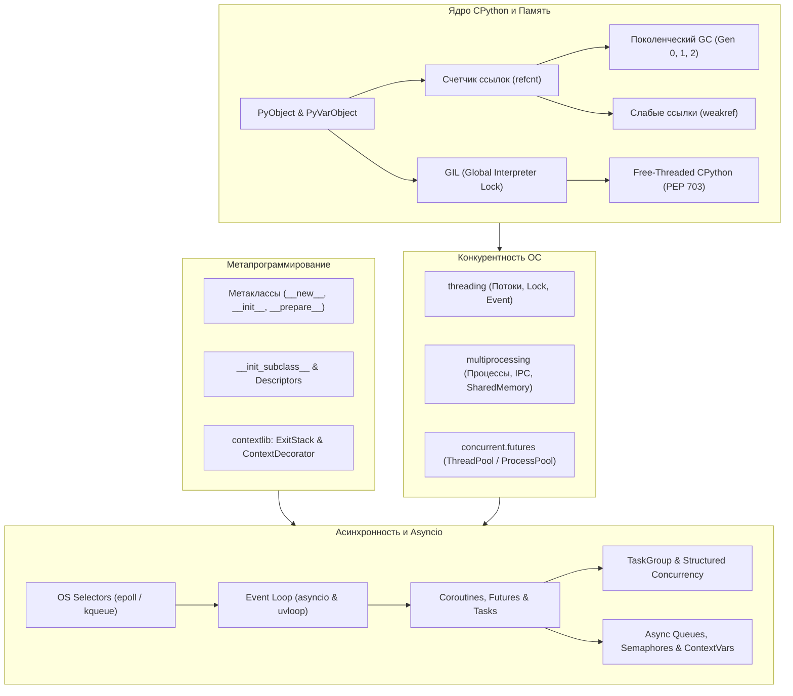

# Модуль 03: Внутреннее устройство Python, конкурентность и Asyncio (MOC)

[[00_Index_MOC|← Вернуться к главной карте знаний]]

Добро пожаловать в модуль, разделяющий базовых разработчиков и Senior-инженеров! Здесь вы перейдете от написания простого прикладного кода к глубокому пониманию того, **как CPython выполняет ваш код в памяти**, почему существует GIL, как правильно масштабировать CPU-bound и I/O-bound нагрузки и как устроена событийно-ориентированная архитектура **FastAPI** и **asyncio**.

---

## Концептуальная карта модуля

---

## Главы модуля

### 1. [[01_Memory_Model_GIL_GC|01. Модель памяти CPython, подсчет ссылок, Garbage Collector и GIL / Free-Threading]]
- Анатомия `PyObject` и `PyVarObject` на уровне C: `ob_refcnt`, `ob_type`, `ob_size`.
- Выделение памяти в CPython: `pymalloc`, арены, пулы, блоки и кэширование малых чисел.
- Детерминированный подсчет ссылок (`sys.getrefcount`) и механизм `tp_dealloc`.
- Циклические ссылки, структура `PyGC_Head` и трехпоколенческий Garbage Collector (`gc`).
- Слабые ссылки (`weakref`), `WeakValueDictionary` и безопасное кэширование.
- Архитектура GIL (Global Interpreter Lock): переключение потоков (`switchinterval`), разница между CPU-bound и I/O-bound.
- Революция Free-Threaded Python (PEP 703 в Python 3.13–3.14+): Biased Reference Counting, Immortal Objects и будущее без GIL.
- **Практическое задание**: [[ex_01_memory_gc.py]]

---

### 2. [[02_Metaclasses_ContextManagers|02. Метаклассы, __init_subclass__ и продвинутый contextlib]]
- Объектная модель CPython: `type` как метакласс всех классов, интроспекция метаклассов.
- Полный жизненный цикл создания класса: `__prepare__`, `__new__`, `__init__`, `__call__`.
- Практические паттерны: реестры плагинов (Registry Pattern), валидация контрактов и схем данных.
- Современная альтернатива без конфликтов метаклассов: `__init_subclass__` (PEP 487) и `__set_name__`.
- Продвинутое управление ресурсами с `contextlib`: `@contextmanager`, каскадный `ExitStack` и `AsyncExitStack`, `suppress`, `ContextDecorator`.
- **Практическое задание**: [[ex_02_metaclasses_context.py]]

---

### 3. [[03_Threading_Multiprocessing|03. Многопоточность (threading), многопроцессорность (multiprocessing) и concurrent.futures]]
- Разница между параллелизмом и конкурентностью (Concurrency vs Parallelism).
- Потоки ОС (`threading.Thread`), потоки-демоны (`daemon=True`) и состояния гонки (Race Conditions) на уровне байткода.
- Примитивы синхронизации: `Lock`, рекурсивный `RLock`, `Semaphore`, `Event`, `Condition` и потокобезопасная `queue.Queue`.
- Взаимные блокировки (Deadlocks): условия возникновения и алгоритмы предотвращения.
- Настоящий параллелизм с `multiprocessing`: методы запуска (`spawn`, `fork`), межпроцессное взаимодействие (IPC: `Pipe`, `Queue`), `SharedMemory` (zero-copy передача массивов).
- Высокоуровневый пул исполнителей `concurrent.futures`: `ThreadPoolExecutor`, `ProcessPoolExecutor`, управление через `as_completed`.
- Сравнительная матрица выбора инструмента под архитектурные требования.
- **Практическое задание**: [[ex_03_concurrency_sync.py]]

---

### 4. [[04_Asyncio_Event_Loop_Coroutines|04. Устройство Event Loop, корутины, Tasks, Futures и TaskGroup]]
- Кооперативная многозадачность vs вытесняющая многозадачность: почему 100 000 соединений не ломают память.
- Неблокирующие сокеты и мультиплексирование ввода-вывода ядра ОС (`epoll`, `kqueue`, `selectors`).
- Анатомия Event Loop: очередь готовых колбэков, таймерная куча, интеграция высокопроизводительного `uvloop`.
- Эволюция корутин: от `yield from` к `async def` и `await`, протокол `Awaitable` (`__await__`).
- Триада асинхронности: в чем разница между `Coroutine`, `asyncio.Future` и `asyncio.Task`.
- Структурная конкурентность (Structured Concurrency): современный `asyncio.TaskGroup` против устаревшего `asyncio.gather`.
- Отмена задач, распространение `CancelledError`, `asyncio.shield` и таймауты с `asyncio.timeout` (Python 3.11+).
- Запуск блокирующего синхронного кода без заморозки цикла событий через `asyncio.to_thread`.
- **Практическое задание**: [[ex_04_asyncio_coroutines.py]]

---

### 5. [[05_Async_Patterns_Queues_Streams|05. Асинхронные паттерны: очереди, семафоры, contextvars и стриминг]]
- Асинхронные протоколы: `__aiter__` / `__anext__` (`async for`) и `__aenter__` / `__aexit__` (`async with`).
- Примитивы синхронизации в корутинах: `asyncio.Lock`, `asyncio.Semaphore`, `asyncio.Event`.
- Паттерн Producer–Consumer: организация конвейеров на `asyncio.Queue`, концепция Backpressure (противодавление), graceful shutdown с sentinel-значениями.
- Контекстные переменные `contextvars.ContextVar`: почему `threading.local` не работает в асинхронном коде, передача `request_id`, трассировка и аутентификация в цепочках вызовов FastAPI.
- Асинхронные сетевые потоки данных (`asyncio.StreamReader` / `asyncio.StreamWriter`), важность `await writer.drain()`.
- **Практическое задание**: [[ex_05_async_patterns.py]]

---

## Связь с соседними модулями

- **Предыдущий шаг**: [[02_Python_OOP_Typing/00_Module_02_MOC|Модуль 02: ООП, функциональное программирование и строгая типизация]] — дескрипторы, dunder-методы и протоколы являются фундаментом для понимания метаклассов и корутин.
- **Следующий шаг**: [[04_FastAPI_Core/00_Module_04_MOC|Модуль 04: Ядро FastAPI и Pydantic v2]] — FastAPI построен полностью на `asyncio`, ASGI-архитектуре, `contextvars` и Pydantic-метапрограммировании.
