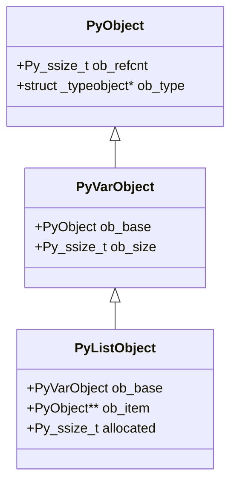
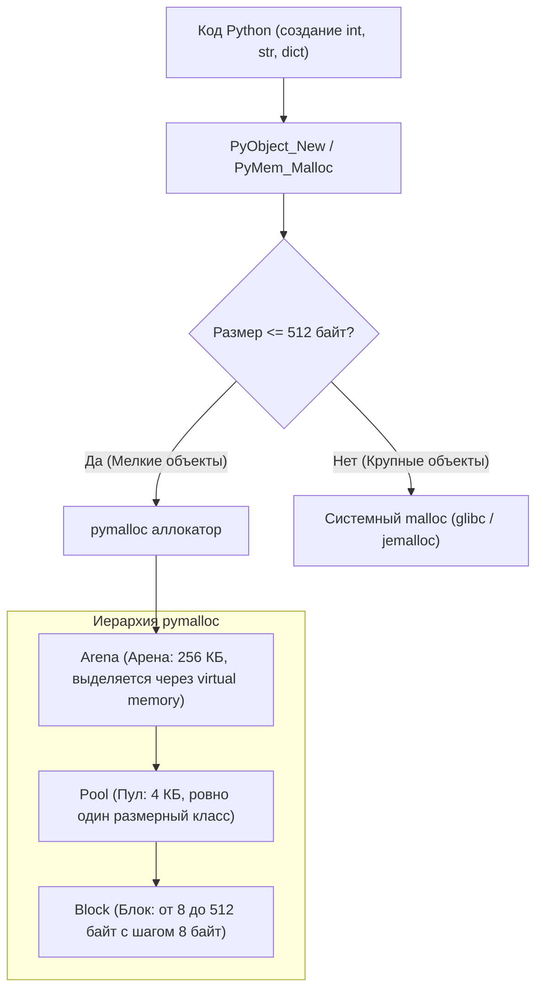
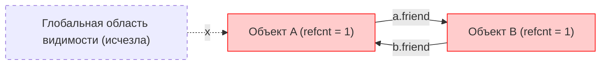
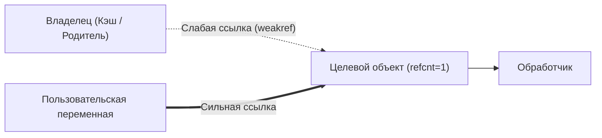

# 01. Модель памяти CPython, подсчет ссылок, Garbage Collector и GIL / Free-Threading

[[00_Module_03_MOC|← К оглавлению модуля 03]] | [[00_Index_MOC|На главную]]

В Python разработчик избавлен от ручного выделения памяти через `malloc` и ее освобождения через `free`, как в C/C++. Однако высоконагруженные backend-сервисы (включая приложения на **FastAPI**) часто сталкиваются с утечками памяти, неожиданными задержками из-за сборщика мусора и «стеклянным потолком» многопоточности из-за **GIL**.

В этой главе мы разберем внутреннюю кухню эталонной реализации **CPython**: как устроен каждый объект на уровне C-структур, как работает подсчет ссылок, как циклический Garbage Collector спасает память, почему существует GIL и как революция **Free-Threaded Python (PEP 703)** меняет будущее языка.

---

## 1. Анатомия объекта в CPython: `PyObject` и `PyVarObject`

В CPython **абсолютно всё является объектом**: числа, строки, функции, модули и даже сами классы. На уровне C-исходников (`Include/object.h`) все объекты начинаются с базового заголовка `PyObject`.

### Структура `PyObject`
```c
// Упрощенная структура из CPython Include/object.h
typedef struct _object {
    _PyObject_HEAD_EXTRA // Указатели для отладочных двусвязных списков всех объектов
    Py_ssize_t ob_refcnt; // Счетчик ссылок (64-битное целое число)
    struct _typeobject *ob_type; // Указатель на объект типа (например, &PyLong_Type)
} PyObject;
```

Каждый объект Python в памяти обязательно содержит минимум два поля:
1. `ob_refcnt` — количество активных ссылок на данный объект.
2. `ob_type` — указатель на структуру типа, которая определяет поведение объекта, его методы и размер.



### Объекты переменной длины: `PyVarObject`
Для объектов с переменным числом элементов (списки, кортежи, строки, словари) используется расширение `PyVarObject`:

```c
typedef struct {
    PyObject ob_base;
    Py_ssize_t ob_size; // Количество элементов в контейнере
} PyVarObject;
```

Например, для списка `list` в CPython структура `PyListObject` хранит указатель на массив указателей `PyObject** ob_item`, размер выделенного буфера `allocated` и поле `ob_size`, отражающее текущую длину `len(lst)`. Поэтому операция `len()` в Python выполняется за $O(1)$ — это просто чтение поля `ob_size`.

### Архитектура аллокатора памяти: `pymalloc`
CPython не обращается к системному `malloc` ядра ОС для каждого мелкого объекта. Системные вызовы дороги, а фрагментация памяти быстро исчерпала бы ресурсы. Вместо этого в CPython работает многоуровневый аллокатор `pymalloc`:



- **Блоки (Blocks)**: минимальная единица памяти фиксированного размера (8, 16, 24, ..., 512 байт).
- **Пулы (Pools)**: размер 4 КБ (размер страницы памяти ОС). Каждый пул содержит блоки только *одного* размерного класса.
- **Арены (Arenas)**: непрерывные куски памяти размером 256 КБ, объединяющие пулы.

> [!NOTE] Кэш малых целых чисел (Small Int Cache) и интернирование строк
> CPython заранее статически аллоцирует целые числа в диапазоне от **-5 до 256**. При выполнении `a = 100` и `b = 100` оба идентификатора ссылаются на один и тот же адрес в памяти (`a is b == True`).
> Строки, похожие на идентификаторы языка (буквы, цифры, подчеркивания), автоматически **интернируются** (interning) — для одинаковых строковых литералов создается единственный объект, а сравнение строк `s1 == s2` ускоряется до сравнения указателей `s1 is s2`. Принудительно интернировать строку можно через `sys.intern(s)`.

---

## 2. Механизм подсчета ссылок (Reference Counting)

Основным механизмом управления памятью в CPython является **Reference Counting** (подсчет ссылок).

Каждый раз, когда объект связывается с новым именем, помещается в список, передается в функцию как аргумент — вызывается макрос C `Py_INCREF(op)`, который инкрементирует `ob_refcnt`. Когда переменная выходит из области видимости, удаляется через `del` или перезаписывается — вызывается `Py_DECREF(op)`.

Как только `ob_refcnt` достигает **0**, объект немедленно уничтожается: вызывается функция деаллокации `tp_dealloc`, освобождаются вложенные ресурсы и память возвращается в пул `pymalloc`.

### Проверка счетчика ссылок: `sys.getrefcount`
```python
import sys

x = [1, 2, 3]
print(sys.getrefcount(x))  # Выведет 2!
```

> [!WARNING] Почему `sys.getrefcount(x)` возвращает 2, а не 1?
> Функция `sys.getrefcount(x)` принимает `x` в качестве аргумента. В момент передачи аргумента в функцию создается временная ссылка на объект внутри фрейма вызова, увеличивая `ob_refcnt` на 1 на время выполнения функции.

```python
import sys

a = ["data"]
print("Создан a:", sys.getrefcount(a) - 1)  # 1

b = a
print("Привязали b = a:", sys.getrefcount(a) - 1)  # 2

container = [a, a]
print("Добавили дважды в список:", sys.getrefcount(a) - 1)  # 4

del b
print("Удалили b:", sys.getrefcount(a) - 1)  # 3

del container
print("Удалили список:", sys.getrefcount(a) - 1)  # 1
```

### Преимущества и фундаментальный изъян Reference Counting
- **Преимущества**:
  1. **Детерминизм и мгновенность**: память освобождается сразу же, как только исчезает последняя ссылка.
  2. Ресурсы (дескрипторы файлов, сетевые сокеты) закрываются немедленно в методе `__del__` без пауз «Stop-the-world».
- **Фундаментальный изъян**:
  - **Циклические ссылки (Reference Cycles)**: если объект `A` ссылается на `B`, а объект `B` ссылается на `A`, то даже если на них больше нет внешних ссылок из программы, их `ob_refcnt` никогда не станет равен 0!



Для решения проблемы циклических ссылок в CPython встроен дополнительный компонент — **циклический поколенческий сборщик мусора (Garbage Collector)**.

---

## 3. Циклические ссылки и Garbage Collector (`gc`)

Сборщик мусора в CPython отвечает исключительно за поиск и уничтожение циклических ссылок между составными объектами (контейнерами).

> [!NOTE] Какие объекты отслеживаются GC?
> Объекты простых скалярных типов (`int`, `float`, `str`, `bytes`) не могут содержать ссылок на другие объекты, поэтому флаг `Py_TPFLAGS_HAVE_GC` у них выключен, и они **не отслеживаются GC**. Сборщик следит только за контейнерами: `list`, `dict`, `set`, `tuple` (если содержит изменяемые типы) и экземплярами пользовательских классов.

Каждый отслеживаемый объект предваряется в памяти скрытым служебным заголовком `PyGC_Head`:
```c
typedef struct {
    uintptr_t _gc_next;
    uintptr_t _gc_prev;
    Py_ssize_t gc_refs;
} PyGC_Head;
```
Эти заголовки связывают все контейнерные объекты в двусвязные списки поколений.

### Трехпоколенческая модель (Generational Hypothesis)
GC CPython разделяет объекты на 3 поколения (0, 1 и 2):
1. **Поколение 0 (Gen 0)**: сюда попадают все новые созданные контейнеры. Проверяется сборщиком чаще всего.
2. **Поколение 1 (Gen 1)**: объекты, пережившие хотя бы одну сборку поколения 0.
3. **Поколение 2 (Gen 2)**: долгоживущие объекты (пережившие сборку поколения 1). Проверяется реже всего.

Логика опирается на **слабую гипотезу о поколениях**: *большинство объектов в программах живут недолго (временные переменные в функциях), а объекты, пережившие несколько сборок, скорее всего, проживут до конца работы приложения.*

```python
import gc

# Получить пороги срабатывания сборщика
print(gc.get_threshold())  # По умолчанию: (700, 10, 10)
```

Что значат пороги `(700, 10, 10)`:
- `700`: сборка Gen 0 запускается, когда разница между количеством созданных и уничтоженных контейнеров превышает 700.
- `10`: после каждых 10 сборок Gen 0 запускается сборка Gen 1.
- `10`: после каждых 10 сборок Gen 1 запускается полная сборка Gen 2.

### Алгоритм поиска циклических ссылок
Когда GC запускает проверку поколения, он выполняет следующий алгоритм:
1. Копирует значение `ob_refcnt` каждого объекта в поле `gc_refs` заголовка `PyGC_Head`.
2. Обходит все контейнеры в списке поколения и для каждого внутреннего объекта, на который ссылается контейнер, делает пробный декремент: `target->gc_refs--`.
3. После этого все объекты, у которых `gc_refs == 0`, являются кандидатами на удаление — все их ссылки исходят исключительно изнутри замкнутого цикла!
4. Объекты с `gc_refs > 0` признаются живыми (на них есть внешние ссылки). Они и все объекты, достижимые из них по ссылкам, возвращаются в список живых.
5. Оставшиеся изолированные кольца циклических ссылок признаются мусором и удаляются.

```python
import gc

class Node:
    def __init__(self, name: str) -> None:
        self.name = name
        self.cycle = None

# Отключим автоматический GC для демонстрации
gc.disable()

# Создаем изолированный цикл
n1 = Node("A")
n2 = Node("B")
n1.cycle = n2
n2.cycle = n1

# Удаляем ссылки из стека программы
del n1
del n2

print("Объекты в мусоре до сборки (не собраны refcnt):", gc.collect())  # Вернет количество уничтоженных объектов (>= 2)
gc.enable()
```

---

## 4. Слабые ссылки (Weak References)

Чтобы ссылаться на объект, не удерживая его в памяти и не создавая циклических ссылок, используют модуль `weakref`.

Слабая ссылка (Weak Reference) указывает на объект, но не увеличивает его счетчик `ob_refcnt`. Если все сильные ссылки на объект уничтожены, объект удаляется, а слабая ссылка возвращает `None` или вызывает зарегистрированный колбэк.



### Практическое использование `weakref`

```python
import weakref

class HeavyResource:
    def __init__(self, name: str) -> None:
        self.name = name

    def __repr__(self) -> str:
        return f"<HeavyResource {self.name}>"

res = HeavyResource("PostgreSQL_Pool")
# Создаем слабую ссылку
wref = weakref.ref(res)

print("Ресурс доступен:", wref())  # <HeavyResource PostgreSQL_Pool>

# Удаляем единственную сильную ссылку
del res

# Слабая ссылка теперь возвращает None
print("После del res:", wref())  # None
```

### Коллекции со слабыми ссылками
Модуль `weakref` предоставляет готовые специализированные структуры:
- `WeakValueDictionary`: словарь, значения которого являются слабыми ссылками. Идеально подходит для реализации **In-Memory Cache**: как только объект перестает использоваться в приложении, он автоматически исчезает из кэша!
- `WeakKeyDictionary`: словарь со слабыми ключами. Удобен для привязки метаданных к объектам без изменения их исходного кода.
- `WeakSet`: множество, автоматически удаляющее элементы при их деаллокации.

```python
import weakref

class UserSession:
    def __init__(self, user_id: int) -> None:
        self.user_id = user_id

# Реестр активных сессий
active_sessions: weakref.WeakValueDictionary[int, UserSession] = weakref.WeakValueDictionary()

s1 = UserSession(101)
active_sessions[s1.user_id] = s1

print("Сессия в кэше:", active_sessions.get(101))  # Объект существует

del s1
print("Сессия после del:", active_sessions.get(101))  # None! Запись удалена автоматически
```

> [!IMPORTANT] Слот `__weakref__` и оптимизация `__slots__`
> По умолчанию в пользовательских классах создается скрытый атрибут `__weakref__`. Но если класс объявляет `__slots__` для экономии памяти, возможность создания слабых ссылок на него исчезает! Чтобы вернуть поддержку weakref, нужно явно добавить строку `'__weakref__'` в кортеж `__slots__`.

---

## 5. Global Interpreter Lock (GIL): природа и ограничения

**Global Interpreter Lock (GIL)** — это глобальный мьютекс процесса CPython, который гарантирует, что в любой момент времени только один поток операционной системы исполняет байткод Python.

```mermaid
flowchart TD
    subgraph OSThreads["Потоки ОС (CPython Process)"]
        T1["Поток 1 (HTTP Request)"]
        T2["Поток 2 (Image Resize)"]
        T3["Поток 3 (Logging Worker)"]
    end

    GIL{{"GIL (Global Interpreter Lock)"}}
    CPUEngine["Ядро исполнения CPython Bytecode"]

    T1 -->|Захватил GIL| GIL
    T2 -.->|Ждет GIL (блокирован)| GIL
    T3 -.->|Ждет GIL (блокирован)| GIL
    GIL --> CPUEngine
```

### Почему GIL был внедрен?
1. **Потокобезопасность `ob_refcnt`**: если несколько потоков будут одновременно инкрементировать и декрементировать счетчики ссылок общих объектов без блокировок, возникнут гонки данных (data race), повреждение памяти и аварийное падение виртуальной машины (segfault).
2. **Простота интеграции C-библиотек**: миллионы C-расширений (включая NumPy, OpenSSL) смогли работать с CPython без необходимости делать весь свой внутренний C-код потокобезопасным.
3. **Высокая скорость однопоточного кода**: взятие мелких мьютексов на каждый объект замедлило бы обычный однопоточный код Python на 30–50%.

### Механизм переключения потоков
В CPython поток удерживает GIL, пока не выполнит определенное количество работы или не вызовет операцию ожидания ввода-вывода (I/O).
Интервал переключения регулируется параметром `sys.getswitchinterval()` (по умолчанию 5 миллисекунд):

```python
import sys
print(sys.getswitchinterval())  # 0.005 секунды (5 мс)
```

Каждые 5 миллисекунд интерпретатор проверяет, есть ли ожидающие потоки. Если есть, текущий поток временно отпускает GIL, давая возможность ОС переключить контекст на другой поток.

### CPU-bound vs I/O-bound задачи

| Тип задачи | Поведение потоков и GIL | Эффективность `threading` | Рекомендуемое решение |
| :--- | :--- | :--- | :--- |
| **I/O-bound** (сеть, файлы, БД, HTTP-запросы) | Системные вызовы ввода-вывода (чтение сокета, ожидание ответа БД) **автоматически отпускают GIL** в C-коде (`Py_BEGIN_ALLOW_THREADS`). Другие потоки работают свободно. | **Высокая**. Потоки эффективно утилизируют время ожидания сокетов. | `asyncio` или `concurrent.futures.ThreadPoolExecutor` |
| **CPU-bound** (математика, хэширование, парсинг больших JSON) | Потоки непрерывно выполняют байткод и борются за GIL. Переключения контекста создают паразитные накладные расходы (конвойный эффект). | **Отрицательная**. Многопоточный расчет на 4 ядрах может работать медленнее однопоточного! | `multiprocessing` или `concurrent.futures.ProcessPoolExecutor` |

---

## 6. Революция Free-Threaded Python (PEP 703, Python 3.13–3.14+)

Исторически GIL считался неизлечимым архитектурным ограничением Python. Однако в **Python 3.13** была представлена экспериментальная поддержка **Free-Threaded CPython** (PEP 703 — *Making the Global Interpreter Lock Optional*), развивающаяся в качестве официального направления в Python 3.14+.

### Как устроен Python без GIL?
Чтобы убрать GIL и не уронить производительность, команда разработки CPython внедрила три ключевые технологии:

1. **Бессмертные объекты (Immortal Objects, PEP 683)**:
   - Объекты вроде `None`, `True`, `False`, малые числа и встроенные типы никогда не деаллоцируются.
   - Их `ob_refcnt` инициализируется специальным битовым флагом, и вызовы `Py_INCREF`/`Py_DECREF` на них являются no-op (не выполняют инструкций записи), исключая гонки между потоками.
2. **Biased Reference Counting (BRC)**:
   - Объект «помнит» поток, который его создал.
   - Когда владеющий поток увеличивает или уменьшает счетчик ссылок, используется быстрая неатомарная C-инструкция.
   - Если же к объекту обращается чужой поток, используется атомарная инструкция (atomic compare-and-swap) либо ссылка помещается в локальную очередь потока.
3. **Потокобезопасные коллекции и mimalloc**:
   - Словари (`dict`) и списки (`list`) получили внутренние мелкогранулярные блокировки (fine-grained locks) и алгоритмы на базе QSBR (Quiescent State Based Reclamation).
   - В качестве аллокатора по умолчанию интегрирован высокопроизводительный потокобезопасный **mimalloc** от Microsoft.

### Проверка режима Free-Threaded в коде
```python
import sys

# Проверка, активен ли GIL в текущем интерпретаторе
if hasattr(sys, "_is_gil_enabled"):
    gil_active = sys._is_gil_enabled()
    print(f"GIL активен: {gil_active}")
else:
    print("Стандартная сборка CPython с GIL")
```

При запуске на специальной сборке интерпретатора (`python3.13t` или `python3.14t`) с флагом `PYTHON_GIL=0` код на чистых потоках `threading.Thread` задействует **все физические ядра CPU на 100%**, устраняя необходимость порождения тяжелых процессов для многих вычислительных задач!

---

## Резюме главы

1. Все сущности в CPython основаны на `PyObject` (`ob_refcnt` и `ob_type`), а объекты переменного размера расширяют `PyVarObject` (`ob_size`).
2. Механизм **Reference Counting** мгновенно и детерминированно освобождает память при `ob_refcnt == 0`, но бессилен против циклических ссылок.
3. **Garbage Collector (`gc`)** использует трехпоколенческую эвристику (Gen 0, 1, 2) и алгоритм пробного вычитания внутренних ссылок для удаления недостижимых замкнутых колец памяти.
4. **`weakref`** позволяет организовывать кэши и деревья объектов без утечек памяти и без создания паразитных сильных ссылок.
5. **GIL** защищает структуры CPython от race condition, позволяя потокам эффективно работать только в I/O-bound задачах.
6. В **Python 3.13–3.14+ (PEP 703)** режим Free-Threading позволяет исполнять CPU-bound потоки параллельно на всех ядрах процессора благодаря Immortal Objects и Biased Reference Counting.

---

## Практическое задание

Перейдите к практическому заданию в файле:
[[ex_01_memory_gc.py]]

Вам предстоит реализовать:
1. `RefCycleDetector` — утилиту обнаружения и безопасного разрыва изолированных циклических ссылок без ожидания плановой сборки GC.
2. `WeakCache[K, V]` — структуру данных безопасного In-Memory кэша с автоматической очисткой деаллоцированных объектов на базе `WeakValueDictionary`.
3. `inspect_pyobject(obj)` — глубокий интроспектор `PyObject`, вычисляющий чистый счетчик ссылок, размер объекта в памяти, статус отслеживания в GC и количество прямых референтов.
