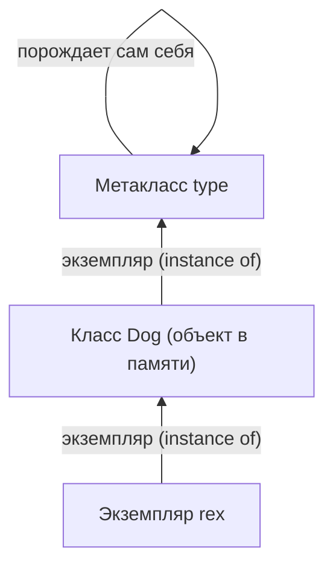
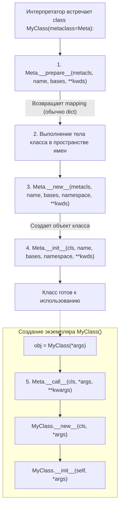
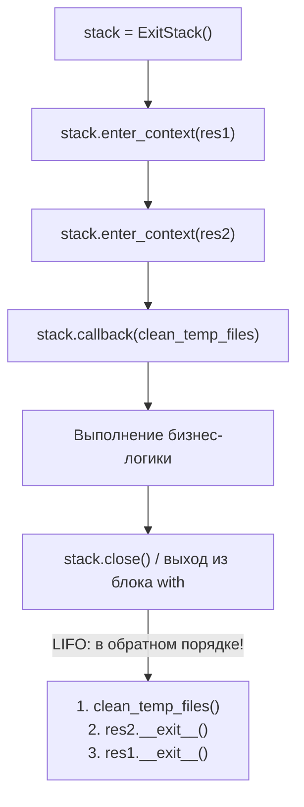

# 02. Метаклассы, `__init_subclass__` и продвинутый `contextlib`

[[00_Module_03_MOC|← К оглавлению модуля 03]] | [[00_Index_MOC|На главную]]

Когда вы объявляете модель в **Pydantic** (`class User(BaseModel): ...`) или таблицу в **SQLAlchemy** (`class Product(Base): ...`), под капотом происходит магия: атрибуты превращаются в поля валидации, регистрируются связи внешних ключей и строятся схемы. Эта «магия» называется **метапрограммированием** — кодом, который создает, модифицирует и валидирует другой код во время его определения.

В этой главе мы разберем фундамент метапрограммирования в Python: как устроена фабрика классов `type`, жизненный цикл создания класса через метаклассы, современный декларативный подход через `__init_subclass__`, а также профессиональное управление ресурсами с помощью продвинутых возможностей `contextlib` (`ExitStack`, `AsyncExitStack`).

---

## 1. Всё есть объект, а класс — экземпляр метакласса

В объектно-ориентированных языках вроде Java или C++ класс — это статическая сущность компилятора, существующая отдельно от объектов в рантайме. В Python **класс сам является живым объектом** в оперативной памяти.

Если класс — это объект, то у него должен быть собственный класс (то есть создатель). Этот «класс классов» называется **метаклассом**. По умолчанию метаклассом всех классов в Python является встроенный класс **`type`**.

```python
class Dog:
    pass

rex = Dog()

print(type(rex))       # <class '__main__.Dog'>
print(type(Dog))       # <class 'type'>
print(type(type))      # <class 'type'> — type порождает сам себя!
print(isinstance(Dog, type))  # True
```



### Динамическое создание классов через `type()`
Функция `type()` имеет две формы вызова:
1. `type(obj)` — возвращает тип объекта.
2. `type(name, bases, namespace)` — **динамически конструирует и возвращает новый класс в рантайме**!

Аргументы конструктора `type`:
- `name` (`str`) — имя создаваемого класса.
- `bases` (`tuple`) — кортеж базовых родительских классов.
- `namespace` (`dict`) — словарь атрибутов, методов и свойств класса.

```python
# Создаем метод для будущего класса
def bark(self: object) -> str:
    return "Гав-гав!"

# Динамическое создание класса Dog без ключевого слова 'class':
DynamicDog = type("DynamicDog", (object,), {"species": "Canis lupus", "bark": bark})

d = DynamicDog()
print(d.species)      # Canis lupus
print(d.bark())         # Гав-гав!
print(type(d))        # <class '__main__.DynamicDog'>
```

Ключевое слово `class` в Python — это просто синтаксический сахар для выполнения тела класса и передачи полученного пространства имен в метакласс `type`.

---

## 2. Анатомия метакласса: полный жизненный цикл создания класса

Кастомный метакласс — это класс, унаследованный от `type`. Он позволяет перехватывать и изменять определение других классов в момент их импорта или парсинга интерпретатором.

При создании класса Python последовательно выполняет специальную цепочку методов метакласса:



### Разбор методов метакласса

1. **`__prepare__(metacls, name, bases, **kwargs) -> dict | Mapping`**:
   - Вызывается **до** того, как выполнится тело класса.
   - Возвращает словарь или словарь-подобный объект, который будет служить пространством имен при исполнении инструкций класса.
   - С его помощью можно проверять отсутствие дублирования имен атрибутов или сохранять порядок определения полей.
2. **`__new__(metacls, name, bases, namespace, **kwargs) -> type`**:
   - Вызывается, когда тело класса выполнилось и сформирован словарь `namespace`.
   - Создает и возвращает сам объект класса в памяти (через вызов `super().__new__`). Здесь можно модифицировать методы, добавлять новые поля, инспектировать аннотации типов.
3. **`__init__(cls, name, bases, namespace, **kwargs) -> None`**:
   - Вызывается сразу после `__new__` для инициализации уже созданного объекта класса `cls`.
4. **`__call__(cls, *args, **kwargs) -> object`**:
   - Вызывается, когда пользователь создает **экземпляр** класса: `obj = MyClass()`.
   - Позволяет реализовать паттерны **Singleton**, пулинг объектов или валидацию конструкторов.

### Пример реализации метакласса Singleton

```python
from typing import Any, Dict

class SingletonMeta(type):
    """Метакласс, гарантирующий наличие ровно одного экземпляра класса."""
    _instances: Dict[type, Any] = {}

    def __call__(cls, *args: Any, **kwargs: Any) -> Any:
        if cls not in cls._instances:
            instance = super().__call__(*args, **kwargs)
            cls._instances[cls] = instance
        return cls._instances[cls]

class DatabaseConnection(metaclass=SingletonMeta):
    def __init__(self, dsn: str = "sqlite:///:memory:") -> None:
        self.dsn = dsn

db1 = DatabaseConnection()
db2 = DatabaseConnection("postgres://localhost")

print(db1 is db2)  # True! Второй вызов вернул первый экземпляр
```

---

## 3. Практические паттерны с метаклассами

### Паттерн Registry (Автоматическая регистрация плагинов)
В масштабируемых микросервисах часто требуется автоматически регистрировать обработчики сообщений, парсеры форматов или стратегии оплаты без явного добавления их в списки вручную:

```python
from typing import Dict, Type

class PluginRegistryMeta(type):
    registry: Dict[str, Type["BasePlugin"]] = {}

    def __new__(
        mcs, name: str, bases: tuple[type, ...], namespace: dict[str, Any]
    ) -> Type["BasePlugin"]:
        new_cls = super().__new__(mcs, name, bases, namespace)
        
        # Не регистрируем сам базовый класс
        plugin_name = namespace.get("plugin_name")
        if plugin_name:
            mcs.registry[str(plugin_name)] = new_cls
        return new_cls

class BasePlugin(metaclass=PluginRegistryMeta):
    plugin_name: str = ""

    def process(self, payload: dict[str, Any]) -> str:
        raise NotImplementedError

class JsonPlugin(BasePlugin):
    plugin_name = "json"

    def process(self, payload: dict[str, Any]) -> str:
        return f"JSON: {payload}"

class XmlPlugin(BasePlugin):
    plugin_name = "xml"

    def process(self, payload: dict[str, Any]) -> str:
        return f"XML: {payload}"

# Все наследники зарегистрированы автоматически при импорте модуля!
print(PluginRegistryMeta.registry)
# {'json': <class '__main__.JsonPlugin'>, 'xml': <class '__main__.XmlPlugin'>}
```

> [!WARNING] Проблема «Конфликта метаклассов» (Metaclass Conflict)
> Если класс наследуется от двух базовых классов с разными метаклассами, Python выбросит исключение:
> `TypeError: metaclass conflict: the metaclass of a derived class must be a (non-strict) subclass of the metaclasses of all its bases`.
> Чтобы разрешить конфликт, приходится создавать единый композитный метакласс, наследующий оба конфликтных метакласса. Именно из-за этой сложности в современном Python появился более элегантный механизм.

---

## 4. Современная альтернатива: `__init_subclass__` (PEP 487)

Начиная с Python 3.6, в 90% сценариев, где раньше требовались метаклассы, рекомендуется использовать встроенный хук **`__init_subclass__`**.

### Преимущества `__init_subclass__`
1. Нет конфликтов метаклассов.
2. Простой и понятный синтаксис: обычный метод внутри класса с декоратором `@classmethod` (декоратор можно опускать, Python трактует его неявно).
3. Возможность принимать произвольные именованные аргументы прямо в заголовке `class Child(Base, key="val"):`.

```python
from typing import Any, Dict, Type

class BaseHandler:
    registry: Dict[str, Type["BaseHandler"]] = {}

    def __init_subclass__(cls, route: str, version: int = 1, **kwargs: Any) -> None:
        super().__init_subclass__(**kwargs)
        if route in cls.registry:
            raise ValueError(f"Маршрут '{route}' уже зарегистрирован!")
        cls.route = route
        cls.version = version
        cls.registry[route] = cls

class HealthCheckHandler(BaseHandler, route="/health", version=1):
    def handle(self) -> dict[str, str]:
        return {"status": "ok"}

class UsersHandler(BaseHandler, route="/users", version=2):
    def handle(self) -> dict[str, str]:
        return {"users": "[]"}

print(BaseHandler.registry)
# {'/health': <class '__main__.HealthCheckHandler'>, '/users': <class '__main__.UsersHandler'>}
```

### Сравнение метаклассов и `__init_subclass__`

| Критерий | Метакласс (`type`) | `__init_subclass__` |
| :--- | :--- | :--- |
| **Кастомизация `__prepare__`** (пространство имен) | **Да** (единственный способ) | Нет |
| **Перехват `__call__`** (создание экземпляров) | **Да** (Singleton, Factory) | Нет |
| **Регистрация подклассов и валидация** | Да, но сложно | **Да, лаконично и безопасно** |
| **Сложность понимания и отладки** | Высокая | Низкая |
| **Риск конфликта при наследовании** | Высокий (`TypeError`) | **Отсутствует** |

---

## 5. Продвинутое управление контекстом: модуль `contextlib`

Контекстные менеджеры гарантируют правильное выделение и освобождение ресурсов (файлы, блокировки, транзакции базы данных) по принципу RAII (Resource Acquisition Is Initialization).

Классический протокол требует реализации двух dunder-методов:
- `__enter__(self) -> T`
- `__exit__(self, exc_type, exc_val, exc_tb) -> bool | None` (возврат `True` подавляет исключение).

Однако библиотека `contextlib` предоставляет гораздо более мощные и выразительные инструменты.

### `@contextmanager` и генераторы
Декоратор превращает генераторную функцию с одним `yield` в полноценный контекстный менеджер:

```python
import time
from contextlib import contextmanager
from typing import Generator

@contextmanager
def execution_timer(label: str) -> Generator[None, None, None]:
    start = time.perf_counter()
    try:
        yield
    finally:
        elapsed = time.perf_counter() - start
        print(f"[{label}] Время выполнения: {elapsed:.4f} сек")

with execution_timer("Подсчет суммы"):
    _ = sum(range(10_000_000))
```

### `contextlib.ExitStack`: динамический мульти-менеджер
Что делать, если список открываемых ресурсов неизвестен заранее или зависит от конфигурации (например, нужно одновременно открыть 10 файлов или каскадно захватить несколько блокировок)?

Лестница вложенных `with` неприменима. Для этого создан **`ExitStack`**:



```python
from contextlib import ExitStack
from pathlib import Path
from typing import List

def merge_logs(output_file: Path, input_files: List[Path]) -> None:
    with ExitStack() as stack:
        # Динамически открываем все файлы в едином безопасном контексте:
        out_f = stack.enter_context(open(output_file, "w", encoding="utf-8"))
        in_handles = [
            stack.enter_context(open(file_path, "r", encoding="utf-8"))
            for file_path in input_files
        ]
        
        # Регистрируем произвольный колбэк на случай непредвиденных сбоев
        stack.callback(print, "Все файловые дескрипторы гарантированно закрыты!")

        for handle in in_handles:
            out_f.write(handle.read())
```

Если открытие пятого файла вызовет `FileNotFoundError`, `ExitStack` корректно вызовет `__exit__` для четырех уже открытых файлов в обратном порядке (LIFO)!

### `contextlib.AsyncExitStack`
Для асинхронного кода (включая управление жизненным циклом `lifespan` в FastAPI) существует `AsyncExitStack`:

```python
import asyncio
from contextlib import AsyncExitStack

async def init_application_resources() -> AsyncExitStack:
    stack = AsyncExitStack()
    # async with stack:
    #     await stack.enter_async_context(database.connection_pool())
    #     await stack.enter_async_context(redis.client())
    return stack
```

### Дополнительные утилиты `contextlib`
- **`suppress(*exceptions)`**: лаконичное подавление известных безопасных ошибок:
  ```python
  from contextlib import suppress
  import os

  with suppress(FileNotFoundError):
      os.remove("temp.lock")  # Не упадет, если файла нет
  ```
- **`ContextDecorator`**: позволяет использовать контекстный менеджер еще и как декоратор функций:
  ```python
  from contextlib import ContextDecorator

  class LogCall(ContextDecorator):
      def __enter__(self):
          print("Старт функции")
          return self

      def __exit__(self, *args):
          print("Конец функции")

  @LogCall()
  def process_task():
      print("Работаем...")
  ```

---

## Резюме главы

1. **`type`** — метакласс всех классов. Функция `type(name, bases, dict)` позволяет создавать новые классы динамически.
2. Жизненный цикл создания класса состоит из фаз: `__prepare__` (создание namespace) $\rightarrow$ выполнение тела $\rightarrow$ `__new__` (аллокация класса) $\rightarrow$ `__init__` (настройка класса).
3. Метакласс позволяет перехватывать инстанцирование через `__call__` (паттерн Singleton).
4. В большинстве архитектурных задач (регистрация плагинов, валидация сигнатур) предпочтительнее **`__init_subclass__`**, так как он не порождает конфликтов множественного наследования.
5. **`contextlib.ExitStack`** и **`AsyncExitStack`** — надежный индустриальный стандарт управления динамическим числом контекстов и транзакций по принципу стека вызовов (LIFO).

---

## Практическое задание

Перейдите к практическому заданию в файле:
[[ex_02_metaclasses_context.py]]

Вам предстоит реализовать:
1. `ValidatedMeta` — метакласс с контролем дублирования атрибутов (`__prepare__`) и принудительной проверкой наличия обязательного docstring и метода `execute`.
2. `PluginRegistry` — модульную архитектуру плагинов на базе `__init_subclass__` с валидацией версий и защитой от перезаписи маршрутов.
3. `TransactionalContext` — транзакционный менеджер на базе `ExitStack`, поддерживающий цепочку компенсирующих откатных действий (`rollback`) при возникновении сбоев.
