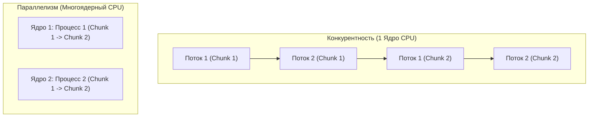
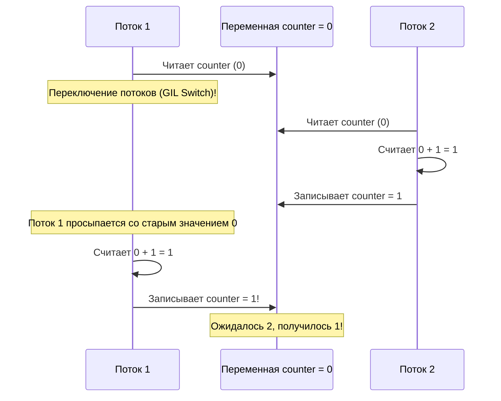
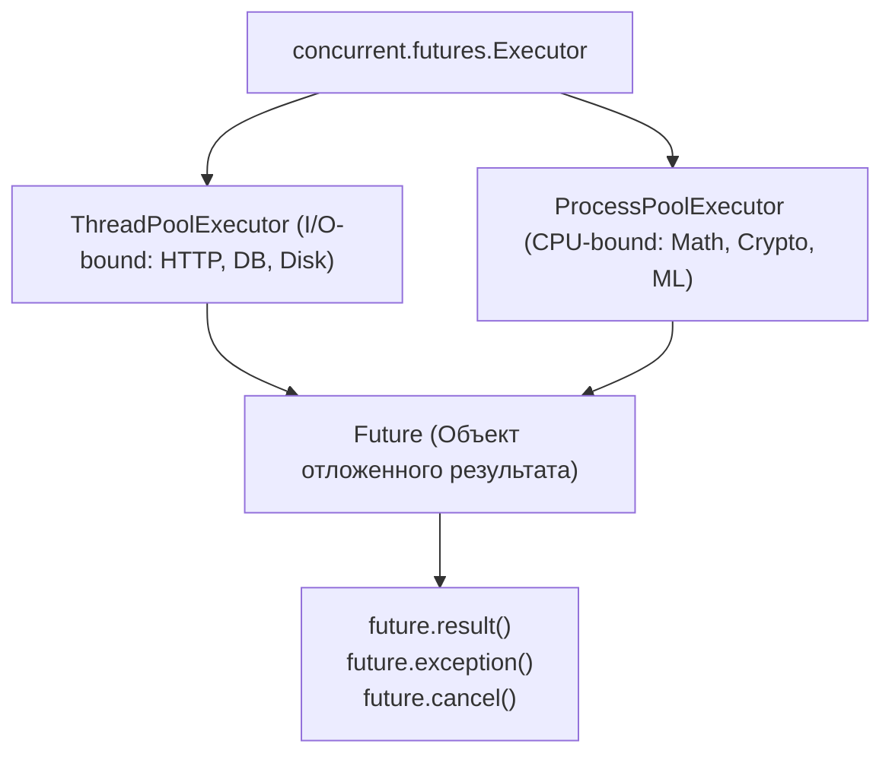

# 03. Многопоточность (`threading`), многопроцессорность (`multiprocessing`) и `concurrent.futures`

[[00_Module_03_MOC|← К оглавлению модуля 03]] | [[00_Index_MOC|На главную]]

При проектировании надежных бэкендов инженер неизбежно сталкивается с параллельными задачами: обработка входящих HTTP-запросов, фоновая отправка писем, расчет тяжелых аналитических отчетов и сжатие изображений. Чтобы система не зависала и не тратила ресурсы впустую, необходимо четко понимать, какой механизм конкурентности операционной системы подходит для конкретной задачи.

В этой главе мы подробно разберем работу с потоками (`threading`), межпоточную синхронизацию и состояния гонки, честный многоядерный параллелизм на процессах (`multiprocessing`), разделяемую память (`SharedMemory`) и промышленный стандарт пулов задач — `concurrent.futures`.

---

## 1. Конкурентность vs Параллелизм (Concurrency vs Parallelism)

Часто эти термины используют как синонимы, однако между ними есть фундаментальное архитектурное различие:

- **Конкурентность (Concurrency)**: свойство программы решать несколько задач одновременно путем быстрого переключения между ними (иллюзия одновременности). На одном физическом ядре CPU конкурентность достигается за счет квантования времени (Time-slicing).
- **Параллелизм (Parallelism)**: физически одновременное выполнение нескольких инструкций на нескольких независимых ядрах процессора в один и тот же момент времени.



### Потоки ОС vs Процессы ОС

| Характеристика | Потоки (`threading.Thread`) | Процессы (`multiprocessing.Process`) |
| :--- | :--- | :--- |
| **Адресное пространство** | **Общее** для всех потоков внутри процесса. | **Изолированное** у каждого процесса своя память. |
| **Стоимость создания** | Легковесные (килобайты стека). | Тяжеловесные (полная копия структур процесса ОС). |
| **Обмен данными (IPC)** | Мгновенно через общие переменные (требует блокировок!). | Через каналы (`Pipe`), очереди (`Queue`) или разделяемую память (`SharedMemory`). |
| **Влияние сбоев** | Падение одного потока (segfault) валит весь процесс. | Падение процесса не затрагивает другие процессы. |
| **Ограничение GIL в CPython** | Ограничены GIL: 1 поток выполняет байткод Python в момент времени. | **Обходят GIL**: каждый процесс имеет собственный независимый интерпретатор и GIL. |

---

## 2. Модуль `threading`: потоки в Python и Состояния гонки (Race Conditions)

Потоки создаются через класс `threading.Thread`:

```python
import threading
import time

def worker(task_id: int) -> None:
    print(f"Поток {task_id} запущен в потоке {threading.get_ident()}")
    time.sleep(0.5)
    print(f"Поток {task_id} завершен")

threads = [threading.Thread(target=worker, args=(i,)) for i in range(3)]
for t in threads:
    t.start()

# Ожидаем завершения всех потоков
for t in threads:
    t.join()
```

> [!NOTE] Демонические потоки (`daemon=True`)
> Если поток помечен как демон (`t.daemon = True` или `Thread(..., daemon=True)`), главный процесс Python не будет ждать его завершения при выходе. Как только все не-демонические потоки завершаются, интерпретатор экстренно останавливает демонов без выполнения блоков `finally`!

### Состояние гонки (Race Condition) на уровне байткода
Поскольку потоки делят общее адресное пространство, одновременный доступ к изменяемым данным без синхронизации приводит к повреждению состояния.

Казалось бы, простая операция `counter += 1` безопасна? **Нет!**
Посмотрим на дизассемблированный байткод этой строки через модуль `dis`:

```python
import dis

def increment(counter: int) -> int:
    counter += 1
    return counter

dis.dis(increment)
```
```text
  LOAD_FAST                0 (counter)     # 1. Загрузка значения из памяти в регистр
  LOAD_CONST               1 (1)           # 2. Загрузка константы 1
  BINARY_OP                0 (+)           # 3. Сложение
  STORE_FAST               0 (counter)     # 4. Запись результата обратно в память
```

Операция сложения состоит из **4 инструкций**. Если интерпретатор решит переключить поток между шагами 1 и 4, один поток перезапишет результат другого!



---

## 3. Примитивы синхронизации потоков

Для устранения состояний гонки модуль `threading` предоставляет набор инструментов синхронизации.

### 1. `threading.Lock` (Мьютекс)
Базовая взаимная блокировка. Только один поток может захватить лок:

```python
import threading

class SafeCounter:
    def __init__(self) -> None:
        self._value = 0
        self._lock = threading.Lock()

    def increment(self) -> None:
        with self._lock:  # Гарантированный acquire() и release()
            self._value += 1

    @property
    def value(self) -> int:
        with self._lock:
            return self._value
```

### 2. `threading.RLock` (Рекурсивная блокировка)
Обычный `Lock` нельзя захватить повторно тому же самому потоку — поток заблокирует сам себя навечно (Self-Deadlock).
`RLock` (Reentrant Lock) запоминает поток-владелец и внутренний счетчик вложенности. Тот же поток может вызывать `acquire()` сколько угодно раз, главное — освободить его такое же количество раз.

```python
import threading

class Account:
    def __init__(self, balance: float) -> None:
        self.balance = balance
        self.lock = threading.RLock()

    def withdraw(self, amount: float) -> None:
        with self.lock:
            self.balance -= amount

    def transfer(self, target: "Account", amount: float) -> None:
        with self.lock:
            self.withdraw(amount)  # RLock позволяет повторный захват в том же потоке!
            with target.lock:
                target.balance += amount
```

### 3. `threading.Semaphore` и `BoundedSemaphore`
Семафор управляет внутренним счетчиком разрешений. Каждый `acquire()` уменьшает счетчик, каждый `release()` увеличивает.
Идеален для пулов ресурсов (например, ограничение максимум 5 одновременных подключений к базе данных). `BoundedSemaphore` выбрасывает `ValueError`, если `release()` вызван больше раз, чем изначальный лимит.

### 4. `threading.Event`
Механизм сигнализации «один ко многим». Потоки могут уснуть на вызове `event.wait()`, а управляющий поток одним вызовом `event.set()` будит их всех.

### 5. `queue.Queue`
Вместо ручного жонглирования блокировками для передачи данных между потоками используется **потокобезопасная очередь** `queue.Queue`. Все методы `put()`, `get()`, `task_done()` и `join()` уже атомарны и защищены внутренними блокировками и условиями (`threading.Condition`).

### Взаимные блокировки (Deadlocks)
Дедлок возникает, когда два или более потока ждут освобождения ресурсов, удерживаемых друг другом.

```python
# КЛАССИЧЕСКИЙ ДЕДЛОК:
# Поток 1: lockA.acquire() -> ждет lockB.acquire()
# Поток 2: lockB.acquire() -> ждет lockA.acquire()
```

> [!IMPORTANT] Правило предотвращения дедлоков
> Всегда захватывайте несколько блокировок в **строго фиксированном глобальном порядке** (например, упорядочивая их по `id(lock)`), либо используйте таймаут: `lock.acquire(timeout=2.0)`.

---

## 4. Модуль `multiprocessing`: обход GIL и честный параллелизм

Для ускорения CPU-bound задач (машинное обучение, расчет хешей, обработка видео) потоки бесполезны из-за GIL. Здесь применяется **`multiprocessing`**, запускающий отдельные процессы операционной системы.

### Методы старта процессов: `spawn` vs `fork`
1. **`fork`** (исторический метод в Unix): процесс мгновенно клонируется через системный вызов ядра `fork()`.
   - *Опасность*: если родительский процесс уже создал потоки и удерживает блокировки, форкнутый дочерний процесс может скопировать лок в состоянии «захвачен», но удерживающий поток не скопируется! Это приводит к непредсказуемым зависаниям (Deadlocks).
2. **`spawn`** (по умолчанию в Windows, macOS и Python 3.14+): запускается совершенно чистый процесс Python, заново импортирующий стартовый модуль.
   - *Требование*: точка входа обязательно должна быть защищена проверкой `if __name__ == '__main__':`!

```python
import multiprocessing as mp

def compute_square(numbers: list[int], out_queue: mp.Queue) -> None:
    result = sum(x * x for x in numbers)
    out_queue.put(result)

if __name__ == "__main__":
    mp.set_start_method("spawn", force=True)
    q: mp.Queue = mp.Queue()
    
    p = mp.Process(target=compute_square, args=(list(range(100_000)), q))
    p.start()
    p.join()
    
    print("Результат из дочернего процесса:", q.get())
```

### Разделяемая память без накладных расходов: `SharedMemory` (Python 3.8+)
Стандартный `mp.Queue` сериализует объекты через `pickle`, что на гигабайтных массивах данных создает колоссальные накладные расходы на процессор и оперативную память.

Модуль `multiprocessing.shared_memory` выделяет сегмент общей виртуальной памяти на уровне ядра ОС. Процессы могут работать с одним и тем же буфером байтов **без копирования (Zero-Copy)**:

```python
from multiprocessing import shared_memory
import numpy as np  # или memoryview встроенных bytes/bytearray

# Выделение разделяемой памяти размером 1 МБ
shm = shared_memory.SharedMemory(create=True, size=1024 * 1024, name="app_shared_buffer")
buffer = shm.buf  # memoryview

# Записываем данные в буфер
buffer[:5] = b"HELLO"

# В другом процессе:
# existing_shm = shared_memory.SharedMemory(name="app_shared_buffer")
# print(bytes(existing_shm.buf[:5]))  # b"HELLO"

# Очистка ресурсов
shm.close()
shm.unlink()  # Удаляет именованный сегмент в ОС
```

---

## 5. Высокоуровневый модуль `concurrent.futures`

В реальной разработке редко создают сырые `Thread` или `Process`. Стандартом индустрии является модуль **`concurrent.futures`**, предоставляющий единый интерфейс исполнителей — **`Executor`**.



### Работа с `ThreadPoolExecutor` и `ProcessPoolExecutor`

```python
from concurrent.futures import ProcessPoolExecutor, as_completed
import math

def calculate_factorial(n: int) -> int:
    return math.factorial(n)

def run_heavy_calculations() -> dict[int, int]:
    inputs = [5000, 10000, 15000, 20000]
    results: dict[int, int] = {}

    with ProcessPoolExecutor(max_workers=4) as executor:
        # submit возвращает объект Future
        future_to_num = {
            executor.submit(calculate_factorial, n): n 
            for n in inputs
        }

        # as_completed возвращает результаты по мере их готовности (не по порядку запуска!)
        for future in as_completed(future_to_num):
            num = future_to_num[future]
            try:
                data = future.result()
                results[num] = len(str(data))  # Количество цифр в факториале
            except Exception as exc:
                print(f"Ошибка при вычислении {num}: {exc}")

    return results
```

### Обработка исключений в `Future`
Если функция в рабочем потоке/процессе выбросила исключение, оно не приводит к аварийной остановке программы сразу. Исключение сохраняется внутри объекта `Future`.
При вызове `future.result()` сохраненное исключение **выбрасывается повторно** в месте вызова, либо его можно безопасно проверить через `future.exception()`.

---

## 6. Сводная матрица выбора инструмента

| Критерий | `threading` | `multiprocessing` | `asyncio` |
| :--- | :--- | :--- | :--- |
| **Оптимальный тип задач** | Блокирующий I/O, работа с C-библиотеками | Тяжелый CPU-bound | Высоконагруженный неблокирующий I/O (Web, WebSockets) |
| **Расход памяти** | Низкий (~мегабайты) | Высокий (~десятки/сотни МБ на процесс) | Минимальный (~килобайты на корутину) |
| **Масштабируемость** | Сотни потоков | Десятки процессов (по числу ядер) | **Сотни тысяч** соединений на 1 процесс |
| **Сложность синхронизации** | Высокая (гонки, локи, дедлоки) | Средняя (изоляция, IPC) | Низкая (кооперативная, 1 поток) |
| **Отношение к GIL** | Ограничен GIL | **Полный обход GIL** | Работает в 1 потоке с GIL |

---

## Резюме главы

1. **Конкурентность** — это переключение между задачами, а **параллелизм** — физически одновременное выполнение на нескольких ядрах.
2. Потоки делят общую память процесса, из-за чего неатомарные операции вызывают **состояния гонки (Race Conditions)**.
3. Примитивы `Lock`, `RLock`, `Semaphore`, `Event` и потокобезопасная очередь `queue.Queue` решают задачи синхронизации, но требуют осторожности во избежание взаимных блокировок (**Deadlocks**).
4. **`multiprocessing`** запускает изолированные процессы со своим интерпретатором, обходя GIL для CPU-bound задач.
5. Для высокопроизводительного обмена большими данными между процессами используется **`SharedMemory`** (Zero-Copy).
6. **`concurrent.futures`** (`ThreadPoolExecutor` и `ProcessPoolExecutor`) — рекомендуемый индустриальный фасад для управления пулами воркеров.

---

## Практическое задание

Перейдите к практическому заданию в файле:
[[ex_03_concurrency_sync.py]]

Вам предстоит реализовать:
1. `ThreadSafeCounter` — потокобезопасный счетчик с защитой от race condition на базе `threading.Lock`.
2. `BoundedWorkerPool` — пул потоков с жестким ограничением параллелизма через `Semaphore` и корректным оповещением о завершении через `Event`.
3. `parallel_compute` — отказоустойчивую функцию параллельных вычислений через `ProcessPoolExecutor` с обработкой `as_completed`, сбором ошибок и fallback-стратегией.
