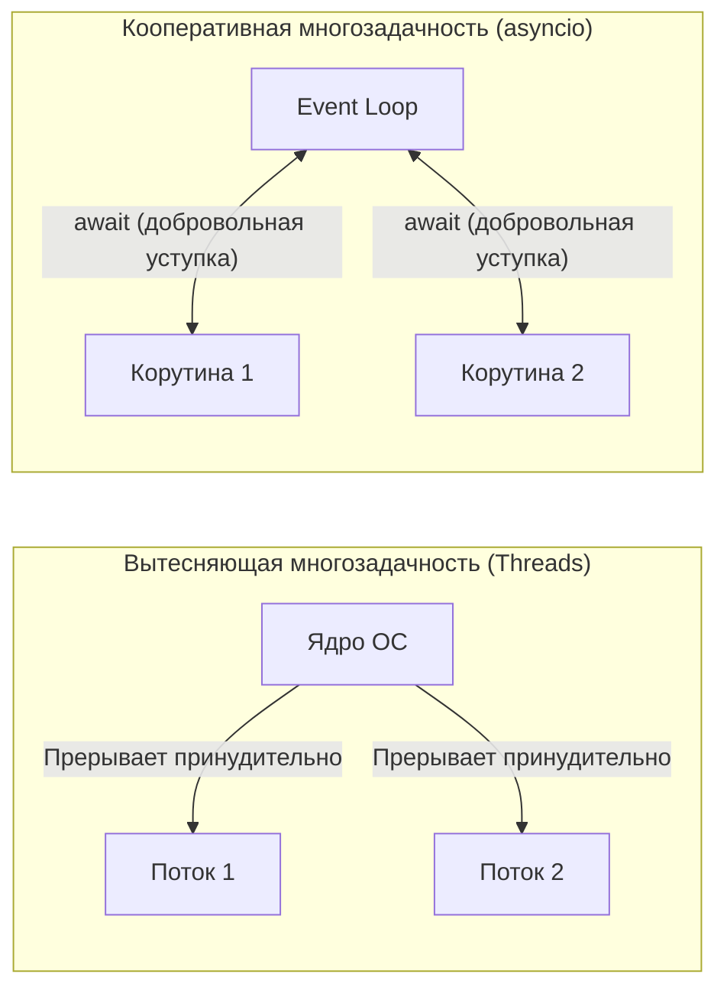
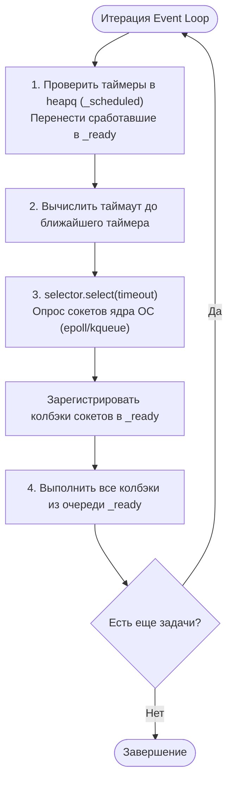
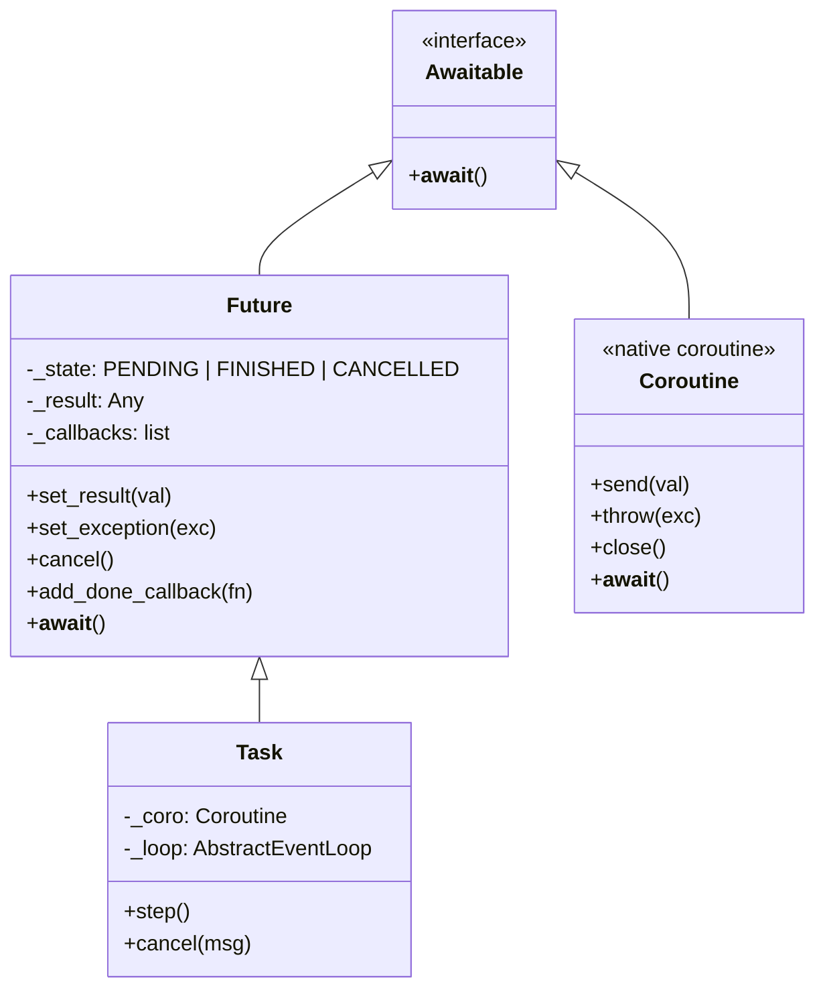
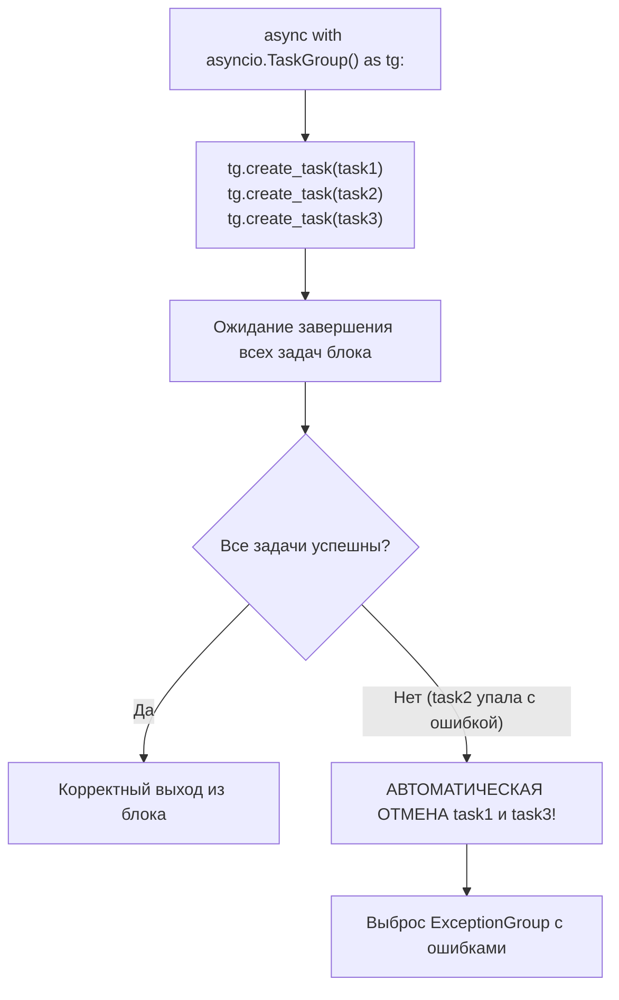

# 04. Устройство Event Loop, корутины, Tasks, Futures и `TaskGroup`

[[00_Module_03_MOC|← К оглавлению модуля 03]] | [[00_Index_MOC|На главную]]

Современный веб-разработчик на Python постоянно взаимодействует с асинхронностью: **FastAPI**, **Starlette**, **Uvicorn**, **HTTPX**, **asyncpg** — все эти инструменты построены на базе библиотеки **`asyncio`**.

Чтобы писать надежные асинхронные микросервисы и избегать фатальных зависаний сервиса в проде (Event Loop Starvation), необходимо понимать фундаментальные механизмы: как ядро ОС уведомляет Python о готовых сокетах, как устроен цикл событий (**Event Loop**), в чем глубинная разница между корутиной, `Future` и `Task`, и почему **структурная конкурентность с `TaskGroup`** вытеснила `asyncio.gather`.

---

## 1. Кооперативная многозадачность и неблокирующий I/O

В многопоточном программировании переключением потоков управляет планировщик ядра операционной системы (вытесняющая многозадачность — Preemptive Multitasking). Поток может быть прерван в любой момент. Создание 10 000 системных потоков требует гигабайтов оперативной памяти и перегружает процессор переключениями контекста (Context Switches).

В **`asyncio`** используется **кооперативная многозадачность (Cooperative Multitasking)**. Весь код выполняется в **одном потоке**, а задачи **добровольно передают управление** обратно диспетчеру в точках ожидания ввода-вывода (`await`).



### Неблокирующие сокеты и мультиплексоры ОС
Когда классический сокет ожидает данных из сети (`socket.recv()`), поток ОС «засыпает» и блокируется.

В неблокирующем режиме (`socket.setblocking(False)`) вызов системного метода возвращает управление немедленно:
- Если данные пришли — возвращаются байты.
- Если данных нет — выбрасывается ошибка `BlockingIOError` (код `EWOULDBLOCK` / `EAGAIN`).

Чтобы не опрашивать сокеты в бесконечном цикле (что сожгло бы 100% CPU), операционные системы предоставляют высокопроизводительные **мультиплексоры событий I/O**:
- **`epoll`** (Linux) — алгоритмическая сложность $O(1)$ относительно общего числа соединений.
- **`kqueue`** (macOS, FreeBSD) — аналогичный высокоскоростной интерфейс событий ядра.
- **`IOCP`** (Windows) — порты завершения ввода-вывода.

В стандартной библиотеке Python модуль `selectors` предоставляет унифицированный фасад поверх системных мультиплексоров.

---

## 2. Архитектура Event Loop (Событийного цикла)

**Event Loop (Цикл событий)** — это бесконечный цикл диспетчеризации, управляющий регистрацией сетевых событий, запуском таймеров и выполнением шагов корутин.

Внутреннее состояние Event Loop содержит три ключевые структуры данных:
1. `_ready` — двусторонняя очередь (`collections.deque`) колбэков, готовых к выполнению прямо сейчас.
2. `_scheduled` — куча с приоритетом (минимальная бинарная куча `heapq`) для отложенных вызовов (`call_later`, `call_at`).
3. `_selector` — системный мультиплексор (`epoll` или `kqueue`) для отслеживания готовности файловых дескрипторов и сокетов.



### Альтернативный движок: `uvloop`
В продакшене стандартный цикл `asyncio` часто заменяют на **`uvloop`** — высокопроизводительную реализацию Event Loop на языке Cython поверх библиотеки **`libuv`** (ядро Node.js).
- `uvloop` ускоряет работу цикла событий в 2–4 раза, приближая скорость сетевого стека Python к Go и Node.js.
- По умолчанию веб-сервер **Uvicorn** автоматически использует `uvloop`, если пакет установлен в окружении.

---

## 3. Эволюция от генераторов к нативным корутинам

Исторически асинхронность в Python строилась на обычных генераторах:
- **Python 3.4**: декоратор `@asyncio.coroutine` и оператор `yield from`.
- **Python 3.5 (PEP 492)**: введен специальный синтаксис нативных корутин — **`async def`** и **`await`**.

### Протокол Awaitable
Объект является «ожидаемым» (Awaitable), если он реализует магический метод `__await__()`.
Метод `__await__` обязан возвращать **итератор** (генератор).

Когда интерпретатор встречает конструкцию:
```python
result = await awaitable_object
```
происходит следующее:
1. Получается итератор через `iter = awaitable_object.__await__()`.
2. Интерпретатор делает шаг генератора `next(iter)` или `iter.send(None)`.
3. Текущая корутина **приостанавливается**, ее стек сохраняется в куче, а управление передается наверх в Event Loop.
4. Когда фоновая операция завершается, Event Loop возобновляет выполнение корутины вызовом `iter.send(result)`.

---

## 4. Триада асинхронности: Coroutine vs `Future` vs `Task`

Понимание различий между этими тремя сущностями критично для правильного проектирования архитектуры:



### 1. `Coroutine` (Корутина)
Функция, объявленная через `async def`. При вызове она **не начинает выполняться**, а возвращает объект корутины:
```python
async def fetch_data() -> str:
    return "ok"

coro = fetch_data()  # Функция НЕ выполнилась! Создан только объект корутины.
```
Если забыть написать `await` перед вызовом корутины, интерпретатор выдаст предупреждение `RuntimeWarning: coroutine 'fetch_data' was never awaited`.

### 2. `asyncio.Future` (Фьючер)
Низкоуровневый объект-обещание. Он представляет результат отложенной асинхронной операции, которого пока нет.
- Имеет состояния: `PENDING` (в ожидании), `FINISHED` (завершен), `CANCELLED` (отменен).
- Корутина может уснуть на `await future`.
- Внешний код (например, сетевой драйвер) при получении пакета байтов вызывает `future.set_result(data)`, и спящая корутина мгновенно просыпается.

### 3. `asyncio.Task` (Задача)
Наследник `Future`, связывающий корутину с циклом событий.
- Создается функцией **`task = asyncio.create_task(coro)`**.
- В момент создания `Task` немедленно **планирует** выполнение корутины в очереди `_ready` событийного цикла.
- Позволяет запускать корутины **конкурентно в фоновом режиме**!

```python
import asyncio

async def background_task(name: str) -> None:
    print(f"[{name}] Старт")
    await asyncio.sleep(1)
    print(f"[{name}] Завершено")

async def main() -> None:
    # ПОСЛЕДОВАТЕЛЬНО (займет 2 секунды):
    # await background_task("A")
    # await background_task("B")

    # КОНКУРЕНТНО (займет 1 секунду):
    t1 = asyncio.create_task(background_task("A"))
    t2 = asyncio.create_task(background_task("B"))
    
    await t1
    await t2

asyncio.run(main())
```

---

## 5. Структурная конкурентность и `asyncio.TaskGroup` (Python 3.11+)

Исторически для параллельного запуска задач использовался `asyncio.gather(*aws)`. Однако `gather` страдает серьезным архитектурным дефектом: **потерянные задачи (Orphaned Tasks)**.

Если в `asyncio.gather(task1, task2)` задача `task1` падает с ошибкой, `gather` немедленно пробрасывает исключение наверх. Но задача `task2` продолжает работать в фоне как зомби-процесс, потребляя ресурсы базы данных и памяти!

### Революция `TaskGroup` (PEP 654)
В **Python 3.11** была представлена концепция **структурной конкурентности (Structured Concurrency)** через менеджер контекста **`asyncio.TaskGroup`**:



```python
import asyncio

async def fetch_users() -> list[str]:
    await asyncio.sleep(0.5)
    return ["Alice", "Bob"]

async def fetch_orders() -> list[str]:
    await asyncio.sleep(0.3)
    return ["Order#1", "Order#2"]

async def main() -> None:
    async with asyncio.TaskGroup() as tg:
        task1 = tg.create_task(fetch_users())
        task2 = tg.create_task(fetch_orders())
        # tg гарантирует: выход из блока произойдет ТОЛЬКО когда обе задачи завершатся!

    users = task1.result()
    orders = task2.result()
    print("Данные успешно загружены:", users, orders)

asyncio.run(main())
```

### Обработка нескольких параллельных ошибок: `except*`
Если несколько задач в `TaskGroup` падают одновременно, Python объединяет их в **`ExceptionGroup`**.
Для избирательной обработки ошибок параллельных задач используется синтаксис **`except*`**:

```python
async def bad_task1():
    raise ValueError("Некорректный ID")

async def bad_task2():
    raise ConnectionError("БД недоступна")

async def run_failing_group():
    try:
        async with asyncio.TaskGroup() as tg:
            tg.create_task(bad_task1())
            tg.create_task(bad_task2())
    except* ValueError as eg:
        print("Перехвачены ошибки валидации:", eg.exceptions)
    except* ConnectionError as eg:
        print("Перехвачены сетевые ошибки:", eg.exceptions)
```

---

## 6. Отмена задач и таймауты

### Как устроена отмена задач (`task.cancel()`)
Когда вызывается `task.cancel(msg="timeout")`, Event Loop не «убивает» корутину мгновенно. Вместо этого в точку ближайшего `await` корутины внедряется специальное исключение — **`asyncio.CancelledError`**.

```python
import asyncio

async def long_poll():
    try:
        print("Слушаем сокет...")
        await asyncio.sleep(10)
    except asyncio.CancelledError:
        print("Получен сигнал отмены! Очищаем ресурсы...")
        raise  # ПРАВИЛО: CancelledError нужно пробросить дальше!
    finally:
        print("Финальная очистка сокета выполнена.")
```

> [!WARNING] Опасность подавления `CancelledError`
> Если вы перехватите `except Exception:`, это безопасно, так как `CancelledError` наследуется напрямую от `BaseException` (начиная с Python 3.8). Но если перехватить `BaseException` или явно `CancelledError` и не пробросить его через `raise`, задача откажется завершаться, ломая graceful shutdown сервиса!

### Защита критических секций: `asyncio.shield`
Если корутину нельзя прерывать (например, запись финансовой транзакции в аудит-лог), ее защищают оберткой `asyncio.shield`:
```python
await asyncio.shield(write_audit_log_to_db())
```

### Таймауты: `asyncio.timeout` (Python 3.11+)
Вместо небезопасного `asyncio.wait_for(coro, timeout)` в современном Python используется контекстный менеджер `asyncio.timeout`:

```python
import asyncio

async def fetch_external_api():
    try:
        async with asyncio.timeout(1.5):  # 1.5 секунды на выполнение блока
            await asyncio.sleep(2.0)
    except TimeoutError:
        print("Внешний сервис не ответил вовремя (Таймаут)!")
```

---

## 7. Интеграция блокирующего синхронного кода: `asyncio.to_thread`

Если в асинхронном коде вызвать блокирующую синхронную функцию (например, `time.sleep()`, синхронный клиент `requests.get()` или тяжелый CPU-расчет), **весь Event Loop заблокируется**, и ни один другой сетевой клиент не сможет получить ответ!

Чтобы безопасно запускать синхронные операции, их выносят в отдельный поток пула через **`asyncio.to_thread`** (Python 3.9+):

```python
import asyncio
import time

def blocking_io_operation(filename: str) -> str:
    # Блокирующее синхронное чтение с диска
    time.sleep(1.0)
    return f"Содержимое {filename}"

async def main() -> None:
    # Запускает блокирующую функцию в фоновом ThreadPoolExecutor
    # не замораживая цикл событий!
    data = await asyncio.to_thread(blocking_io_operation, "report.pdf")
    print(data)

asyncio.run(main())
```

---

## Резюме главы

1. `asyncio` реализует **кооперативную многозадачность**: корутины добровольно передают управление через `await`, а ОС мультиплексирует сокеты через `epoll`/`kqueue`.
2. **Event Loop** управляет таймерной кучей, очередью готовых колбэков и опросом системных селекторов. Для максимальной производительности в production используют **`uvloop`**.
3. **`Coroutine`** — определение асинхронной логики, **`Future`** — низкоуровневый контейнер результата, а **`Task`** — планируемая и управляемая единица конкурентного исполнения.
4. **`asyncio.TaskGroup`** (Python 3.11+) внедряет структурную конкурентность, предотвращая зависание потерянных задач-зомби при сбоях.
5. Отмена задач осуществляется через внедрение **`CancelledError`**, который обязательно должен быть обработан и проброшен дальше.
6. Таймауты элегантно управляются через **`asyncio.timeout()`**, а блокирующие функции выносятся в фоновые потоки через **`asyncio.to_thread()`**.

---

## Практическое задание

Перейдите к практическому заданию в файле:
[[ex_04_asyncio_coroutines.py]]

Вам предстоит реализовать:
1. `fetch_with_timeout` — устойчивую к отмене корутину с поддержкой жесткого лимита времени через `asyncio.timeout`.
2. `ConcurrentBatchProcessor` — батч-обработчик на базе `TaskGroup` со сбором результатов и обработкой `ExceptionGroup`.
3. `CustomDelayAwaitable` — собственный класс, реализующий протокол `__await__` без использования вспомогательных сторонних корутин.
