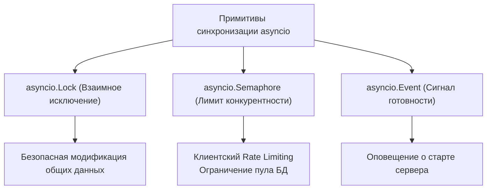
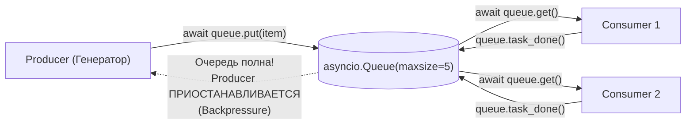
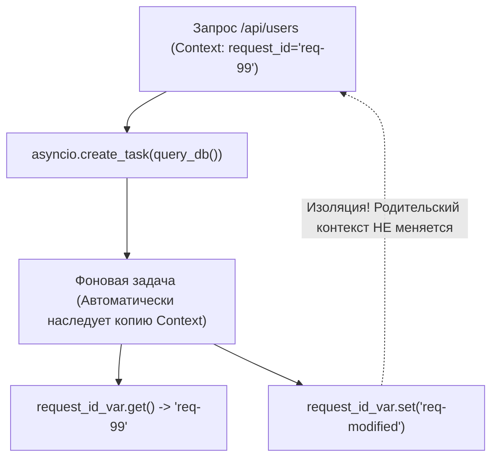

# 05. Асинхронные паттерны: очереди, семафоры, contextvars и стриминг

[[00_Module_03_MOC|← К оглавлению модуля 03]] | [[00_Index_MOC|На главную]]

При создании высоконагруженных серверных приложений на **FastAPI** недостаточно просто расставить ключевые слова `async` и `await`. В реальных системах возникают сложные архитектурные вызовы:
- Как защитить внешний платежный шлюз от лавины запросов (Rate Limiting)?
- Как организовать потоковую передачу терабайтных файлов или Server-Sent Events (SSE) без переполнения памяти?
- Как передавать `request_id` и данные пользователя через 15 уровней сервисных функций без загрязнения сигнатур аргументами?
- Как сбалансировать скорость генерации событий и скорость их сохранения в БД (Backpressure)?

В этой главе мы разберем профессиональные архитектурные паттерны асинхронного программирования в Python.

---

## 1. Асинхронные протоколы: Итераторы, Генераторы и Контекстные менеджеры

В Python асинхронность органично встроена в базовые протоколы языка.

### 1. Асинхронные итераторы (`async for`)
Чтобы объект можно было перебирать через цикл `async for`, он должен реализовать два dunder-метода:
- `__aiter__(self)` — возвращает сам объект асинхронного итератора.
- `__anext__(self)` — корутина, возвращающая следующий элемент либо выбрасывающая исключение `StopAsyncIteration`.

```python
import asyncio

class AsyncRange:
    """Асинхронный аналог range(), отдающий элементы с задержкой."""
    def __init__(self, stop: int, delay: float = 0.1) -> None:
        self.stop = stop
        self.delay = delay
        self.current = 0

    def __aiter__(self) -> "AsyncRange":
        return self

    async def __anext__(self) -> int:
        if self.current >= self.stop:
            raise StopAsyncIteration
        await asyncio.sleep(self.delay)
        val = self.current
        self.current += 1
        return val

async def main() -> None:
    async for num in AsyncRange(3):
        print("Получено число:", num)
```

### 2. Асинхронные генераторы
Функция с ключевыми словами `async def` и `yield` автоматически становится **асинхронным генератором**:
```python
async def stream_sensor_data(limit: int):
    for i in range(limit):
        await asyncio.sleep(0.05)
        yield {"sensor_id": 42, "temperature": 24.5 + i}
```

### 3. Асинхронные контекстные менеджеры (`async with`)
Требуют реализации методов `__aenter__` и `__aexit__`. Для быстрого создания используется декоратор `@contextlib.asynccontextmanager`:

```python
from contextlib import asynccontextmanager
import asyncio

@asynccontextmanager
async def database_transaction(session_name: str):
    print(f"[{session_name}] Начало транзакции BEGIN")
    try:
        yield
        print(f"[{session_name}] Фиксация COMMIT")
    except Exception as exc:
        print(f"[{session_name}] Откат ROLLBACK из-за ошибки: {exc}")
        raise
```

---

## 2. Примитивы синхронизации в `asyncio`

Хотя код в `asyncio` исполняется в одном потоке ОС, переключение между корутинами происходит в каждой точке `await`. Если две корутины обращаются к разделяемому ресурсу (файл на диске, структура в памяти) через несколько шагов `await`, возникает состояние гонки на уровне задач!

Модуль `asyncio` предоставляет неблокирующие аналоги классических примитивов:



### `asyncio.Semaphore` и ограничение нагрузки (Concurrency Throttling)
Семафор — один из важнейших паттернов в веб-сервисах. Он позволяет ограничить число одновременных сетевых запросов:

```python
import asyncio
from typing import List

async def call_external_payment_api(order_id: int, sem: asyncio.Semaphore) -> str:
    # Одновременно в этот блок могут зайти не более 3 корутин!
    async with sem:
        print(f"Обработка заказа {order_id}...")
        await asyncio.sleep(0.5)
        return f"Order-{order_id}: SUCCESS"

async def process_orders(order_ids: List[int]) -> list[str]:
    sem = asyncio.Semaphore(3)  # Лимит: максимум 3 одновременных вызова
    async with asyncio.TaskGroup() as tg:
        tasks = [tg.create_task(call_external_payment_api(oid, sem)) for oid in order_ids]
    return [t.result() for t in tasks]
```

---

## 3. Паттерн Producer–Consumer и организация очередей

В распределенных и микросервисных системах часто возникает ситуация, когда генератор задач (Producer) производит данные быстрее, чем потребитель (Consumer) успевает их обрабатывать.

Если складывать задачи в неограниченный список, приложение быстро исчерпает оперативную память и упадет с `OutOfMemoryError`. Для предотвращения этой проблемы используется концепция **Backpressure (Противодавление)** при помощи `asyncio.Queue(maxsize=N)`.



### Полный пример: Producer–Consumer с graceful shutdown
Для корректной остановки воркеров используется **Sentinel Value** (маркер завершения, например `None`):

```python
import asyncio
from typing import Optional

async def producer(queue: asyncio.Queue[Optional[str]], count: int) -> None:
    for i in range(count):
        item = f"task-{i}"
        await queue.put(item)  # Если maxsize достигнут, producer заснет здесь!
        print(f"-> Произведено: {item}")
        await asyncio.sleep(0.05)

async def consumer(consumer_id: int, queue: asyncio.Queue[Optional[str]]) -> None:
    while True:
        item = await queue.get()
        if item is None:  # Sentinel-значение: сигнал об остановке
            queue.task_done()
            print(f"<- Воркер {consumer_id} получил сигнал остановки.")
            break

        try:
            print(f"<- Воркер {consumer_id} обработал: {item}")
            await asyncio.sleep(0.1)
        finally:
            queue.task_done()

async def main() -> None:
    # maxsize=3 создает противодавление (Backpressure)
    queue: asyncio.Queue[Optional[str]] = asyncio.Queue(maxsize=3)
    num_consumers = 2

    # Запускаем консьюмеров
    consumers = [asyncio.create_task(consumer(i, queue)) for i in range(num_consumers)]

    # Производим данные
    await producer(queue, 6)

    # Ждем, пока все задачи в очереди будут обработаны
    await queue.join()

    # Отправляем Sentinel каждому воркеру для graceful shutdown
    for _ in range(num_consumers):
        await queue.put(None)

    await asyncio.gather(*consumers)
    print("Все задачи завершены, воркеры корректно остановлены.")

asyncio.run(main())
```

---

## 4. Изоляция контекста с `contextvars` (PEP 567)

В многопоточном программировании для хранения данных конкретного потока (например, ID текущего пользователя) используется `threading.local()`.

> [!CAUTION] Почему `threading.local` категорически неприменим в `asyncio`?
> В `asyncio` тысячи параллельных запросов выполняются в **одном общем системном потоке**. Если сохранить `threading.local().user_id = "Alice"` в одном запросе, при первом же `await` управление переключится на запрос от Боба, который увидит данные Алисы! Это приводит к критическим уязвимостям безопасности.

Для решения этой проблемы в Python 3.7 был принят **PEP 567 — `contextvars`** (Контекстные переменные).



### Использование `ContextVar` для сквозного `Request-ID` в логах

```python
import asyncio
from contextvars import ContextVar
import uuid

# Объявляем контекстную переменную
request_id_ctx: ContextVar[str] = ContextVar("request_id", default="system")

def log(message: str) -> None:
    """Логгер автоматически подмешивает текущий request_id без явной передачи в аргументах."""
    req_id = request_id_ctx.get()
    print(f"[{req_id}] {message}")

async def call_payment_gateway() -> None:
    log("Вызываем платежный шлюз")
    await asyncio.sleep(0.1)
    log("Платеж подтвержден")

async def handle_request(client_ip: str) -> None:
    # Устанавливаем уникальный идентификатор для данного контекста
    token = request_id_ctx.set(f"req-{uuid.uuid4().hex[:6]}")
    try:
        log(f"Входящий запрос от {client_ip}")
        await call_payment_gateway()
    finally:
        # Восстанавливаем предыдущее состояние
        request_id_ctx.reset(token)

async def main() -> None:
    # Запускаем два параллельных запроса
    await asyncio.gather(
        handle_request("192.168.1.10"),
        handle_request("10.0.0.5"),
    )

asyncio.run(main())
```

При создании фоновой задачи через `asyncio.create_task()` контекст копируется в новую задачу. Изменения контекста внутри дочерней задачи остаются изолированными и не затрагивают родительскую корутину.

---

## 5. Асинхронные потоки данных (Streams) и сокеты

Для потоковой передачи данных по сети (TCP, TLS, Unix Domain Sockets) `asyncio` предоставляет высокоуровневый API стримов: **`StreamReader`** и **`StreamWriter`**.

```python
import asyncio

async def tcp_echo_client(message: str) -> None:
    reader, writer = await asyncio.open_connection("127.0.0.1", 8888)

    print(f"Отправка: {message}")
    writer.write(message.encode())
    
    # КРИТИЧЕСКИ ВАЖНО:
    await writer.drain()

    data = await reader.read(100)
    print(f"Получено: {data.decode()}")

    writer.close()
    await writer.wait_closed()
```

### Зачем нужен `await writer.drain()`?
Метод `writer.write()` не отправляет данные в сеть немедленно — он просто помещает их в промежуточный буфер в памяти процесса.
Если писать в сокет без `drain()`, буфер может разрастись до сотен мегабайт, если клиент читает медленно.
Вызов **`await writer.drain()`** приостанавливает выполнение пишущей корутины до тех пор, пока сетевой стек ОС не освободит буфер, обеспечивая сетевой **Backpressure**.

---

## Резюме главы

1. **`async for`** и **`async with`** опираются на протоколы `__aiter__`/`__anext__` и `__aenter__`/`__aexit__`, позволяя лаконично работать с асинхронными ресурсами.
2. **`asyncio.Semaphore`** защищает инфраструктуру от лавинной нагрузки, строго контролируя максимальное число одновременных операций.
3. Очереди **`asyncio.Queue`** с фиксированным `maxsize` реализуют паттерн **Backpressure**, предотвращая переполнение оперативной памяти в конвейерах Producer–Consumer.
4. **`contextvars.ContextVar`** изолирует контекстные данные (Request ID, аутентификация) между асинхронными задачами, безопасно заменяя неработоспособный в `asyncio` модуль `threading.local`.
5. При работе с сетевыми стримами вызов **`await writer.drain()`** обязателен для сброса буферов и согласования скорости передачи данных.

---

## Практическое задание

Перейдите к практическому заданию в файле:
[[ex_05_async_patterns.py]]

Вам предстоит реализовать:
1. `AsyncRateLimiter` — контекстный менеджер ограничения скорости операций на базе `asyncio.Semaphore`.
2. `AsyncPipeline[T]` — масштабируемый конвейер Producer–Consumer на `asyncio.Queue` с фиксированным размером буфера и поддержкой Sentinel-остановки.
3. `RequestContextManager` — инструмент управления контекстом запроса на базе `contextvars.ContextVar` с поддержкой замера времени и авто-генерации сквозного `request_id`.
