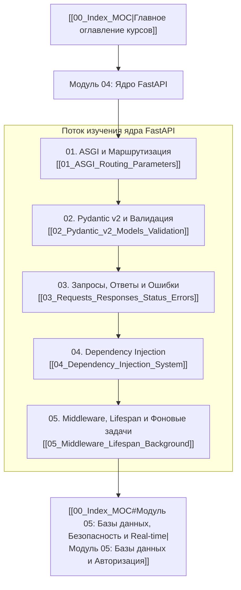

# Модуль 04: Ядро FastAPI и Pydantic v2

Добро пожаловать в модуль, посвященный ядру современного асинхронного веб-фреймворка **FastAPI**! 

В предыдущих модулях мы изучили фундаментальный синтаксис Python, объектно-ориентированную модель, протоколы, обобщенные типы (`Generics`, `Annotated`) в [[05_Type_Hints_Protocols_Generics]], а также устройство событийного цикла `asyncio` и асинхронное программирование в [[04_Asyncio_Event_Loop_Coroutines]]. 

Теперь мы объединим все эти знания для проектирования высокопроизводительных, типобезопасных и самодокументируемых веб-сервисов.

---

## Концептуальная карта модуля

---

## Содержание модуля

### 1. [[01_ASGI_Routing_Parameters|01. Стандарт ASGI, архитектура Uvicorn + Starlette + Pydantic, маршрутизация и параметры]]
- **Архитектурный фундамент**: Эволюция от синхронного WSGI к асинхронному протоколу ASGI. Сигнатура `async def app(scope, receive, send)` и низкоуровневые события протокола HTTP.
- **Связка Starlette + Pydantic + Uvicorn**: Роль каждого компонента в стеке FastAPI.
- **Модульная маршрутизация**: Организация эндпоинтов с помощью `APIRouter` (`prefix`, `tags`, `responses`, разделение по доменным контекстам).
- **Параметры эндпоинтов**: Валидация и извлечение `Path`, `Query`, `Header`, `Cookie` с использованием современного синтаксиса `Annotated[T, Query(...)]`.
- **Автоматическая документация**: Генерация схемы OpenAPI 3.1, интерактивный Swagger UI и ReDoc.
- 🧪 **Практика**: [[ex_01_routing_params.py]] — реализация низкоуровневого ASGI роутера с разбором типизированных параметров запроса и компиляцией OpenAPI спецификации.

---

### 2. [[02_Pydantic_v2_Models_Validation|02. Глубокое погружение в Pydantic v2: модели, валидация и сериализация]]
- **Архитектура Pydantic v2**: Революционный переход на движок `pydantic-core`, написанный на Rust, и прирост производительности до 20 раз.
- **Определение моделей `BaseModel` и настройка `Field`**: Ограничения чисел, длин строк, regex (`pattern`), псевдонимы (`alias`, `validation_alias`, `serialization_alias`) и `default_factory`.
- **Декларативные валидаторы**: Использование `@field_validator` в режимах `mode="before"` и `mode="after"`, комплексная кросс-полевая валидация с `@model_validator(mode="after")`.
- **Вычисляемые поля и кастомная сериализация**: Аннотации `@computed_field` и методы `@field_serializer`.
- **Конфигурация через `ConfigDict`**: Преобразование ORM-сущностей (`from_attributes=True`), запрет лишних полей (`extra="forbid"`), автоматический стрип пробелов (`str_strip_whitespace=True`).
- **Паттерны проектирования DTO**: Разделение схем на `Create`, `Update`, `Read` и Discriminated Unions для полиморфных моделей.
- 🧪 **Практика**: [[ex_02_pydantic_v2.py]] — написание декларативной схемы валидации данных на базе метаклассов, дескрипторов и типобезопасных DTO с полной защитой от инъекций некорректных типов.

---

### 3. [[03_Requests_Responses_Status_Errors|03. Обработка запросов, кастомные ответы, статус-коды и обработка ошибок]]
- **Тело запроса (Request Body)**: Извлечение одиночных и составных моделей, скалярных данных через `Body`, обработка `Form` и потоковая загрузка файлов через `UploadFile` (spool-буфер в памяти и на диске).
- **Фильтрация и проекция ответов**: `response_model`, сокрытие приватных полей через `response_model_exclude_unset` и `response_model_exclude`.
- **Классы ответов**: `JSONResponse`, сверхбыстрый `ORJSONResponse`, `HTMLResponse`, `StreamingResponse`, `RedirectResponse`.
- **Объект `Response`**: Ручная установка HTTP-заголовков, управление Cookie (`httponly`, `samesite`, `secure`, `max_age`).
- **Иерархия исключений и глобальный перехват**: `HTTPException`, регистрация кастомных обработчиков `@app.exception_handler`.
- **RFC 9457 (Problem Details for HTTP APIs)**: Форматирование ошибок валидации `RequestValidationError` в единый индустриальный стандарт.
- 🧪 **Практика**: [[ex_03_requests_errors.py]] — конвейер преобразования тела запроса, фильтрация моделей ответов и глобальный обработчик ошибок в формате RFC 9457.

---

### 4. [[04_Dependency_Injection_System|04. Система внедрения зависимостей (Dependency Injection)]]
- **Философия и устройство DI в FastAPI**: Инверсия управления (IoC) без перегруженных XML-конфигов. Как строится направленный ациклический граф (DAG) зависимостей.
- **Типы провайдеров**: Функции-зависимости, замыкания и параметризуемые классы со специальным методом `__call__`.
- **Иерархические подзависимости и кэширование**: Параметр `use_cache=True` и разделение одного экземпляра (например, сессии БД) между всеми потребителями в рамках одного HTTP-запроса.
- **Ресурсные зависимости с `yield`**: Гарантия выполнения очистки (`finally`) после отправки ответа клиенту — идеальный паттерн для транзакций и соединений с базами данных.
- **Области видимости (Scopes)**: Зависимости на уровне метода эндпоинта, маршрутизатора `APIRouter(dependencies=[...])` и глобально на уровне `app`.
- **Тестирование и подмена**: Переопределение зависимостей через `app.dependency_overrides` для юнит- и интеграционных тестов.
- 🧪 **Практика**: [[ex_04_dependency_injection.py]] — реализация собственного контейнера Dependency Injection с поддержкой графа подзависимостей, генераторов с финализацией (`yield`) и переопределением в тестах (`overrides`).

---

### 5. [[05_Middleware_Lifespan_Background|05. ASGI Middleware, жизненный цикл Lifespan и фоновые задачи]]
- **Конвейер Middleware**: Принцип луковичной архитектуры (Onion Architecture). Порядок выполнения прямого и обратного прохода.
- **Два способа создания Middleware**: Высокоуровневый `@app.middleware("http")` (`BaseHTTPMiddleware`) против нативного чистого ASGI Middleware. Почему чистый ASGI эффективнее и не ломает потоковую передачу данных.
- **Встроенные Middleware**: `CORSMiddleware` (разрешение кросс-доменных запросов), `TrustedHostMiddleware`, `GZipMiddleware`.
- **Управление жизненным циклом приложения**: Переход от устаревших событий `on_event("startup")` к современному контекстному менеджеру `lifespan` (`@asynccontextmanager`) и общему состоянию `app.state`.
- **Фоновые задачи после ответа**: Класс `BackgroundTasks` — выполнение отложенных легких операций (отправка писем, аудит-логи) без задержки клиента. Анализ границ применимости: когда оставаться на `BackgroundTasks`, а когда подключать полноценный брокер сообщений (Celery/Taskiq/RabbitMQ).
- 🧪 **Практика**: [[ex_05_middleware_lifespan.py]] — реализация полноценного стека чистых ASGI-middleware (логирование, добавление заголовков, CORS), асинхронного менеджера жизненного цикла `Lifespan` и очереди `BackgroundTasks`.

---

## Навигация
- ⬅️ Предыдущий модуль: [[03_Python_Internals_Async/00_Module_03_MOC|Модуль 03: Внутреннее устройство Python и Asyncio]]
- 🏠 Главное оглавление: [[00_Index_MOC]]
- ➡️ Следующий модуль: [[05_FastAPI_Data_Auth/00_Module_04_MOC|Модуль 05: Базы данных, Безопасность и Real-time]]
