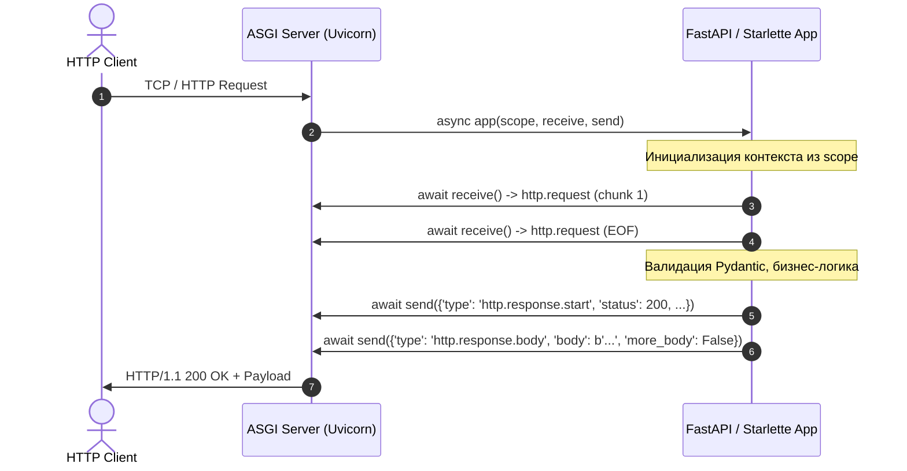
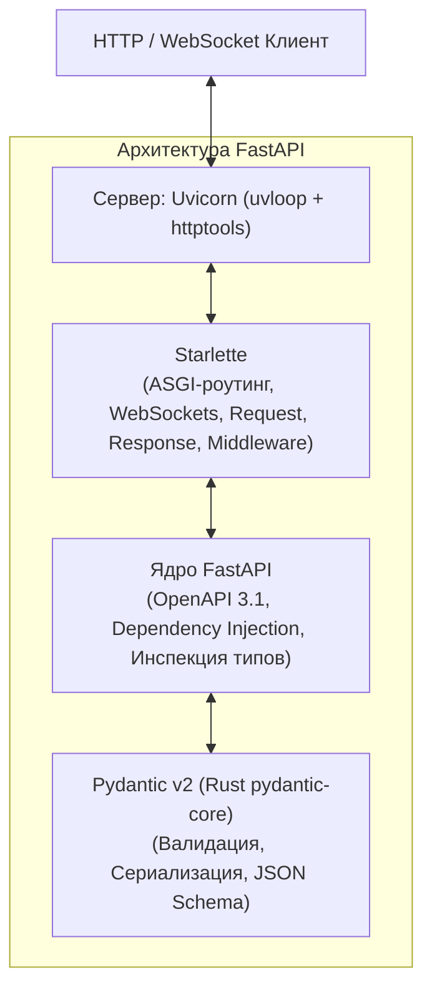
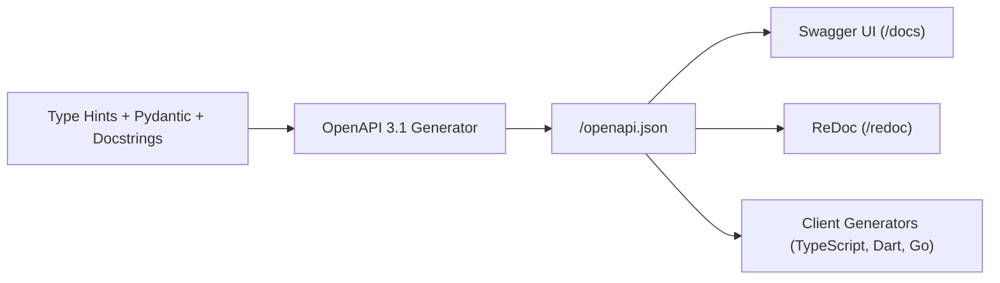

# 01. Стандарт ASGI, архитектура Uvicorn + Starlette + Pydantic, маршрутизация и параметры

**FastAPI** — один из самых быстрорастущих и производительных веб-фреймворков в экосистеме Python. Чтобы писать на нем эффективный, надежный и архитектурно чистый код, недостаточно просто копировать декораторы `@app.get`. Необходимо понимать фундаментальные протоколы, лежащие в основе современного асинхронного веба.

В этой главе мы разберем путь эволюции от классического синхронного протокола **WSGI** к асинхронному **ASGI**, изучим трехслойную архитектуру **Uvicorn + Starlette + Pydantic**, освоим модульную маршрутизацию через `APIRouter` и научимся декларативно валидировать параметры HTTP-запросов с помощью `Annotated`.

---

## 1. Эволюция веб-интерфейсов: от WSGI к ASGI

### Проблема синхронного WSGI (PEP 3333)
В 2003 году появился стандарт **WSGI (Web Server Gateway Interface)**, определивший синхронный контракт взаимодействия веб-сервера (Gunicorn, uWSGI) и Python-приложения (Django, Flask):

```python
# Классическая сигнатура синхронного WSGI-приложения
def simple_wsgi_app(environ: dict, start_response: callable):
    status = '200 OK'
    response_headers = [('Content-Type', 'text/plain; charset=utf-8')]
    start_response(status, response_headers)
    return [b"Hello, WSGI World!"]
```

Главная архитектурная проблема WSGI — **синхронная модель «один запрос — один поток/процесс» (Thread-per-Request)**:
1. **Блокирующий ввод/вывод (I/O)**: Если эндпоинт делает запрос к внешней базе данных или API на 500 мс, рабочий поток сервера полностью заблокирован. Сервер с 20 рабочими потоками способен обработать не более 40 запросов в секунду при задержке 500 мс.
2. **Невозможность работы с постоянными соединениями**: Протоколы WebSockets, Server-Sent Events (SSE), HTTP/2-мультиплексирование и длительный опрос (Long Polling) требуют тысяч одновременно открытых соединений в режиме ожидания событий, что приводило к исчерпанию пула потоков и системной памяти.

---

### Архитектура ASGI (Asynchronous Server Gateway Interface)
Стандарт **ASGI** решает проблему I/O-блокировок за счет интеграции с событийным циклом `asyncio` (см. [[04_Asyncio_Event_Loop_Coroutines]]).



ASGI-приложение представляет собой одну корутину со строгой сигнатурой:

```python
async def asgi_app(scope: dict, receive: callable, send: callable) -> None:
    """Стандартная сигнатура ASGI 3.0."""
    ...
```

#### Три кита сигнатуры ASGI:
1. **`scope` (словарь соединения)**:
   Содержит метаданные текущего подключения: тип протокола (`"http"`, `"websocket"`, `"lifespan"`), HTTP-метод, путь (`path`), заголовки (`headers`), строку запроса (`query_string`), клиентский IP-адрес. Этот словарь создается один раз на каждое подключение и сохраняется на протяжении всего сеанса.
2. **`receive` (асинхронная функция получения событий)**:
   Служит для чтения входящих данных от сервера. Вызов `event = await receive()` возвращает словарь события. Для HTTP это события с типом `"http.request"`, содержащие чанки тела запроса (`body`) и флаг `more_body`.
3. **`send` (асинхронная функция отправки событий)**:
   Служит для отправки данных клиенту. Ответ формируется минимум из двух сообщений:
   - Сообщение инициализации: `{'type': 'http.response.start', 'status': 200, 'headers': [...]}`
   - Сообщение передачи тела: `{'type': 'http.response.body', 'body': b'{"status": "ok"}', 'more_body': False}`

> [!NOTE] Минимальное жизнеспособное ASGI-приложение без фреймворков
> ```python
> async def raw_app(scope, receive, send):
>     assert scope["type"] == "http"
>     # Ожидаем чтение тела запроса
>     request = await receive()
>     
>     response_body = b'{"message": "Pure ASGI Power"}'
>     await send({
>         "type": "http.response.start",
>         "status": 200,
>         "headers": [
>             [b"content-type", b"application/json"],
>             [b"content-length", str(len(response_body)).encode("ascii")],
>         ],
>     })
>     await send({
>         "type": "http.response.body",
>         "body": response_body,
>         "more_body": False,
>     })
> ```

---

### Сравнительный анализ WSGI и ASGI

| Характеристика | WSGI (PEP 3333) | ASGI |
| :--- | :--- | :--- |
| **Парадигма** | Синхронная, блокирующая | Асинхронная на базе `asyncio` |
| **Сигнатура** | `app(environ, start_response)` | `async def app(scope, receive, send)` |
| **Поддержка протоколов** | Только HTTP/1.0 и HTTP/1.1 | HTTP/1.1, HTTP/2, WebSockets, Lifespan |
| **Модель масштабирования** | 1 поток на соединение (Thread-per-request) | Однопоточный Event Loop на тысячи соединений |
| **Потоковая передача (Streaming)** | Затруднена, блокирует воркер | Нативная через асинхронные генераторы |
| **Примеры серверов** | Gunicorn (sync), uWSGI | Uvicorn, Hypercorn, Granian |

---

## 2. Триада FastAPI: Starlette + Pydantic + Uvicorn

FastAPI не изобретал веб-сервер или валидатор с нуля. Он построен на фундаменте лучших специализированных инструментов:



1. **Uvicorn**:
   - Высокопроизводительный сервер ASGI на базе C-библиотек:
     - `uvloop` — быстрая замена стандартного цикла событий `asyncio`, написанная на C поверх `libuv` (используется в Node.js).
     - `httptools` — C-парсер HTTP-протокола, форкнутый из проекта Node.js.
2. **Starlette**:
   - Легковесный асинхронный ASGI-тулкит, созданный Томом Кристи (автором Django REST Framework).
   - Предоставляет абстракции `Request`, `Response`, маршрутизатор `Router`, систему `Middleware`, обработку фоновых задач `BackgroundTasks` и поддержку WebSockets.
3. **Pydantic (v2)**:
   - Движок валидации и сериализации данных.
   - Начиная со второй версии, ядро валидации (`pydantic-core`) переписано на **Rust**, что позволило поднять скорость валидации структур данных в 5–20 раз.
4. **FastAPI**:
   - «Связующий клей» (Glue framework).
   - Автоматически сопоставляет типы аргументов функций с моделями Pydantic.
   - Реализует систему инверсии зависимостей (**Dependency Injection**).
   - Генерирует спецификацию **OpenAPI 3.1** и документацию **Swagger UI / ReDoc** на лету на основе Python Type Hints.

---

## 3. Архитектура приложения и модульная маршрутизация (`APIRouter`)

В монолитных примерах код часто пишут прямо в объекте `app = FastAPI()`. В реальных корпоративных проектах эндпоинты разбиваются на изолированные модули с помощью `APIRouter`.

### Создание модульного роутера

Рассмотрим модуль управления заказами:

```python
# app/routers/orders.py
from typing import Annotated
from fastapi import APIRouter, HTTPException, status, Path, Query
from pydantic import BaseModel, Field

# Создаем экземпляр маршрутизатора
router = APIRouter(
    prefix="/orders",
    tags=["Заказы"],
    responses={
        status.HTTP_404_NOT_FOUND: {"description": "Заказ не найден"},
        status.HTTP_500_INTERNAL_SERVER_ERROR: {"description": "Критическая ошибка сервера"},
    },
)

class OrderCreate(BaseModel):
    item_id: int = Field(gt=0, description="Идентификатор товара")
    quantity: int = Field(default=1, gt=0, le=100, description="Количество позиций")

class OrderResponse(BaseModel):
    order_id: int
    item_id: int
    quantity: int
    status: str

# In-memory хранилище для примера
_ORDERS_DB: dict[int, OrderResponse] = {}

@router.post(
    "",
    response_model=OrderResponse,
    status_code=status.HTTP_201_CREATED,
    summary="Создать новый заказ",
    description="Принимает спецификацию заказа, валидирует поля и сохраняет заказ в базе.",
)
async def create_order(payload: OrderCreate) -> OrderResponse:
    new_id = len(_ORDERS_DB) + 1
    order = OrderResponse(
        order_id=new_id,
        item_id=payload.item_id,
        quantity=payload.quantity,
        status="pending",
    )
    _ORDERS_DB[new_id] = order
    return order

@router.get(
    "/{order_id}",
    response_model=OrderResponse,
    summary="Получить заказ по ID",
)
async def get_order_by_id(
    order_id: Annotated[int, Path(title="Идентификатор заказа", ge=1)],
) -> OrderResponse:
    if order_id not in _ORDERS_DB:
        raise HTTPException(
            status_code=status.HTTP_404_NOT_FOUND,
            detail=f"Заказ с ID {order_id} не найден",
        )
    return _ORDERS_DB[order_id]
```

### Подключение роутеров в корневое приложение

```python
# app/main.py
from fastapi import FastAPI
from app.routers import orders, users, auth

app = FastAPI(
    title="E-Commerce API",
    version="1.0.0",
    description="Производственный сервис электронной коммерции на базе FastAPI",
    docs_url="/docs",
    redoc_url="/redoc",
    openapi_url="/api/v1/openapi.json",
)

# Подключение модульных маршрутизаторов с общим версионированием
app.include_router(orders.router, prefix="/api/v1")
# app.include_router(users.router, prefix="/api/v1")
# app.include_router(auth.router, prefix="/api/v1")
```

---

## 4. Порядок сопоставления маршрутов (Route Matching Order)

> [!WARNING] Критическая ловушка: порядок объявления маршрутов в FastAPI
> FastAPI сопоставляет входящие HTTP-запросы с маршрутами **последовательно** в порядке их регистрации в коде!
> Если параметризованный маршрут (с параметром пути) объявлен **раньше** статического, статический маршрут никогда не будет вызван!

```python
router = APIRouter()

# ❌ НЕПРАВИЛЬНО: маршрут с {user_id} перехватит запрос к "/users/me"
@router.get("/users/{user_id}")
async def get_user_by_id(user_id: str):
    # Запрос GET /users/me попадет сюда с user_id="me"!
    return {"user_id": user_id}

@router.get("/users/me")
async def get_current_user():
    # Этот код НИКОГДА не выполнится
    return {"message": "Текущий пользователь"}
```

```python
# ✅ ПРАВИЛЬНО: сначала частные/статические пути, затем общие параметризованные
@router.get("/users/me")
async def get_current_user():
    return {"message": "Текущий пользователь"}

@router.get("/users/{user_id}")
async def get_user_by_id(user_id: int):
    return {"user_id": user_id}
```

---

## 5. Типизированные параметры запроса: `Path`, `Query`, `Header`, `Cookie`

В современном Python рекомендуется использовать синтаксис `Annotated` (введенный в PEP 593 и ставший стандартом в [[05_Type_Hints_Protocols_Generics]]).

### Преимущество `Annotated`
В старых версиях FastAPI метаданные указывались в значениях по умолчанию:
```python
# Устаревший стиль: ломает статические анализаторы типов и дефолтные значения
def old_style(q: str = Query("default", min_length=3)):
    pass
```
В современном стиле с `Annotated`:
```python
# Современный стиль: чистая сигнатура типа, поддержка дефолтных значений и переиспользуемость
def modern_style(q: Annotated[str, Query(min_length=3)] = "default"):
    pass
```

### Комплексный пример валидации параметров:

```python
from typing import Annotated
from fastapi import APIRouter, Cookie, Header, Path, Query, status
from pydantic import EmailStr

router = APIRouter(prefix="/catalog", tags=["Каталог"])

@router.get("/items/{category_id}/{item_id}")
async def search_items(
    # 1. Параметры пути (Path)
    category_id: Annotated[
        int,
        Path(
            title="Категория товара",
            description="Уникальный числовой ID категории в дереве каталога",
            ge=1,
            le=10_000,
            examples=[42],
        ),
    ],
    item_id: Annotated[
        str,
        Path(
            title="Артикул или UUID товара",
            pattern=r"^[A-Z]{3}-\d{4}$",  # Регулярное выражение (например, "ABC-1234")
            description="Формат: 3 заглавные буквы, дефис, 4 цифры",
        ),
    ],
    
    # 2. Параметры строки запроса (Query)
    limit: Annotated[
        int,
        Query(
            title="Лимит выборки",
            ge=1,
            le=100,
            description="Количество элементов на странице",
        ),
    ] = 20,
    offset: Annotated[
        int,
        Query(
            ge=0,
            description="Смещение выборки для пагинации",
        ),
    ] = 0,
    search: Annotated[
        str | None,
        Query(
            min_length=2,
            max_length=50,
            description="Текстовый фильтр для поиска",
        ),
    ] = None,
    sort_by: Annotated[
        list[str],
        Query(
            description="Список полей для сортировки (например: ?sort_by=price&sort_by=name)",
        ),
    ] = ["created_at"],
    
    # 3. HTTP-заголовки (Header)
    # FastAPI автоматически конвертирует snake_case в kebab-case (user_agent -> user-agent)
    user_agent: Annotated[
        str | None,
        Header(description="Идентификатор браузера или клиента"),
    ] = None,
    x_api_token: Annotated[
        str,
        Header(
            alias="X-API-Token",
            description="Секретный токен для доступа к каталогу",
        ),
    ] = ...,
    
    # 4. Файлы Cookie (Cookie)
    session_id: Annotated[
        str | None,
        Cookie(description="Идентификатор сессии пользователя из кук"),
    ] = None,
) -> dict:
    return {
        "path_params": {"category_id": category_id, "item_id": item_id},
        "query_params": {"limit": limit, "offset": offset, "search": search, "sort_by": sort_by},
        "headers": {"user_agent": user_agent, "x_api_token": x_api_token},
        "cookies": {"session_id": session_id},
    }
```

> [!TIP] Многоточие `...` или отсутствие дефолтного значения?
> Если параметр обязателен, достаточно **не указывать** значение по умолчанию в `Annotated`:
> ```python
> token: Annotated[str, Header()]  # Обязательный заголовок
> ```
> Использование литерала `...` (`Ellipsis`) поддерживается ради обратной совместимости, но в современном Python рекомендуется просто опускать `= ...`.

---

## 6. Автогенерация OpenAPI 3.1 и интерактивная документация

FastAPI строит спецификацию **OpenAPI 3.1** автоматически на основе:
1. Сигнатур функций-обработчиков (типы входных аргументов и возвращаемые значения).
2. Моделей данных Pydantic v2 (которые нативно соответствуют стандарту **JSON Schema 2020-12**).
3. Метаданных объектов `Path`, `Query`, `Header`, `Body` и декоратора `@router`.



### Настройка Swagger UI и метаданных документации

```python
from fastapi import FastAPI
from fastapi.openapi.utils import get_openapi

app = FastAPI(
    title="Корпоративный API логистики",
    description="""
    ## Возможности API
    * **Управление складом**: создание и учет товаров.
    * **Маршрутизация поставок**: расчет оптимального пути.
    
    ### Авторизация
    Все запросы требуют заголовок `X-API-Key` или Bearer токен.
    """,
    version="2.4.0",
    terms_of_service="https://example.com/terms/",
    contact={
        "name": "Команда платформы",
        "url": "https://example.com/support",
        "email": "support@example.com",
    },
    license_info={
        "name": "Apache 2.0",
        "url": "https://www.apache.org/licenses/LICENSE-2.0.html",
    },
    openapi_tags=[
        {
            "name": "Заказы",
            "description": "Операции оформления и отслеживания заказов клиентов.",
            "externalDocs": {
                "description": "Дополнительная документация по заказам",
                "url": "https://wiki.example.com/orders",
            },
        },
    ],
)
```

---

## Резюме

1. **ASGI** — это асинхронный стандарт интерфейса между веб-сервером и приложением, использующий модель `async def app(scope, receive, send)`.
2. **FastAPI** опирается на связку **Uvicorn** (HTTP-парсер и event loop) + **Starlette** (ASGI маршрутизация и контекст) + **Pydantic** (быстрая валидация на Rust).
3. **`APIRouter`** позволяет дробить приложение на независимые модули с собственными префиксами и тегами.
4. **Порядок сопоставления путей строго последовательный**: частные и статические маршруты должны идти перед динамическими параметрами `{id}`.
5. Для извлечения параметров запроса всегда используйте конструкцию **`Annotated[T, Path/Query/Header/Cookie(...)]`**.

---

## Практическое задание

В практическом файле [[ex_01_routing_params.py]] реализован полноценный механизм ASGI-роутера с разбором типизированных параметров запроса, проверкой очередности путей и генерацией OpenAPI схемы.

Запустите тесты для проверки реализации:
```bash
python3 exercises/04_fastapi_core/ex_01_routing_params.py
```
