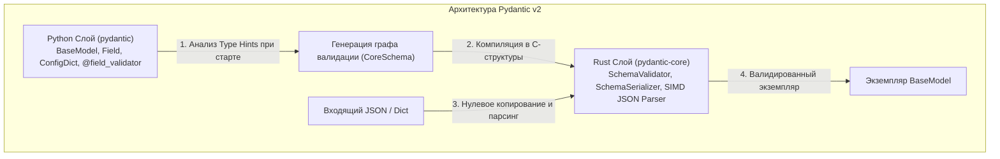
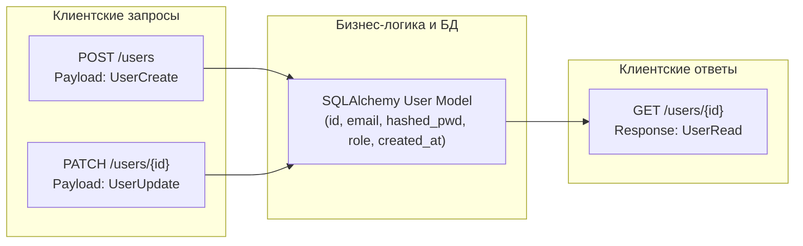

# 02. Глубокое погружение в Pydantic v2: модели, валидация и сериализация

В основе обработки данных в FastAPI лежит библиотека **Pydantic**. С выходом версии 2.0 Pydantic претерпел фундаментальную архитектурную переработку: ядро валидации было полностью переписано на языке **Rust** (`pydantic-core`), что увеличило скорость валидации и сериализации в 5–20 раз.

В этой главе мы разберем внутреннее устройство Pydantic v2, детально изучим декларативное описание схем с помощью `BaseModel` и `Field`, освоим валидаторы `@field_validator` и `@model_validator`, настроим поведение моделей через `ConfigDict`, научимся работать с полиморфными схемами (Discriminated Unions) и спроектируем архитектуру DTO для надежного API.

---

## 1. Архитектура Pydantic v2 и Rust-движок `pydantic-core`

В первой версии Pydantic валидация строилась на динамической инспекции Python-типов, метаклассах и рекурсивных вызовах функций интерпретатора. В условиях высокой нагрузки на веб-сервис сериализация сотен вложенных объектов создавала ощутимый CPU-overhead.



### Ключевые архитектурные изменения v2:
1. **Двухфазная модель (Build-time vs Run-time)**:
   - **Фаза сборки (Build-time)**: При импорте модуля Pydantic единожды инспектирует `type hints` и декораторы модели, строит дерево типов (`CoreSchema`) и компилирует его в оптимизированный граф валидации в Rust.
   - **Фаза исполнения (Run-time)**: Входящие сырые данные (`dict`, `str`, `bytes`) передаются напрямую в `SchemaValidator` на Rust. Вся базовая валидация (проверка типов, приведение строк к числам, парсинг дат) выполняется на уровне скомпилированного машинного кода без переключения в виртуальную машину CPython.
2. **Собственный парсер JSON**:
   Rust-библиотека `pydantic-core` включает встроенный парсер JSON, использующий SIMD-инструкции процессора. Метод `Model.model_validate_json(raw_bytes)` работает значительно быстрее, чем `Model.model_validate(json.loads(raw_bytes))`, за счет исключения промежуточного словаря Python.

---

## 2. Создание схем `BaseModel` и настройка `Field`

Модель `BaseModel` определяет контракт данных. Поля описываются строгими аннотациями типов, а их поведение детализируется с помощью объекта `Field`.

```python
from datetime import datetime, timezone
from decimal import Decimal
from uuid import UUID, uuid4
from pydantic import BaseModel, Field

class ProductDTO(BaseModel):
    # Уникальный идентификатор с динамической генерацией по умолчанию
    id: UUID = Field(
        default_factory=uuid4,
        description="Глобально уникальный идентификатор товара (UUIDv4)",
    )
    
    # Строковые ограничения и регулярные выражения
    sku: str = Field(
        pattern=r"^[A-Z]{3}-\d{5}$",
        description="Артикул товара: 3 заглавные буквы, дефис, 5 цифр",
        examples=["PRD-10293"],
    )
    title: str = Field(
        min_length=3,
        max_length=120,
        description="Наименование товара для витрины",
    )
    
    # Числовые ограничения
    price: Decimal = Field(
        gt=Decimal("0.00"),
        decimal_places=2,
        max_digits=10,
        description="Розничная цена (положительное число с 2 знаками после запятой)",
    )
    discount_percent: int = Field(
        default=0,
        ge=0,
        le=90,
        description="Процент скидки от 0 до 90%",
    )
    
    # Метаданные времени
    created_at: datetime = Field(
        default_factory=lambda: datetime.now(timezone.utc),
        description="Временная метка создания записи в UTC",
    )
```

> [!CAUTION] Фатальная ошибка: `default=datetime.now()`
> Никогда не используйте `default=datetime.now()`! Значение `datetime.now()` вычислится **один раз в момент запуска сервера (импорта файла)**, и все создаваемые объекты получат одну и ту же зафиксированную дату!
> Всегда используйте фабрику: `default_factory=lambda: datetime.now(timezone.utc)`.

---

### Псевдонимы полей: `alias`, `validation_alias` и `serialization_alias`

В REST API клиенты часто используют нотацию `camelCase`, в то время как стандартом Python является `snake_case`. В Pydantic v2 управление именованием разделено на три уровня:

```python
from pydantic import BaseModel, Field

class UserProfileSchema(BaseModel):
    # validation_alias: откуда брать при парсинге входного payload
    # serialization_alias: как называть ключ при экспорте в JSON
    user_id: int = Field(
        validation_alias="userId",
        serialization_alias="user_id",
    )
    first_name: str = Field(alias="firstName")  # alias действует и на чтение, и на запись
```

---

## 3. Валидаторы: `@field_validator` и `@model_validator`

В Pydantic v2 на смену устаревшим `@validator` и `@root_validator` пришли типизированные декораторы с явным указанием фазы выполнения (`mode`).

### Режимы `@field_validator`: `before` против `after`


```python
from pydantic import BaseModel, Field, field_validator

class AccountRegistration(BaseModel):
    username: str = Field(min_length=3, max_length=30)
    email: str
    age: int

    # Режим "before": вызывается ДО того, как Pydantic проверит типы
    @field_validator("username", mode="before")
    @classmethod
    def normalize_username(cls, raw_value: object) -> object:
        if isinstance(raw_value, str):
            # Удаляем крайние пробелы и приводим к нижнему регистру
            return raw_value.strip().lower()
        return raw_value

    # Режим "after": вызывается ПОСЛЕ успешной базовой валидации Pydantic
    @field_validator("email", mode="after")
    @classmethod
    def validate_corporate_domain(cls, value: str) -> str:
        prohibited_domains = ("mailinator.com", "tempmail.org", "10minutemail.com")
        domain = value.split("@")[-1].lower()
        if domain in prohibited_domains:
            raise ValueError(f"Регистрация с временных почтовых сервисов ({domain}) запрещена")
        return value
```

---

### Кросс-полевая валидация с `@model_validator`

Когда проверка одного поля зависит от значений других полей (например, дата окончания не может быть раньше даты начала, или пароль должен совпадать с подтверждением пароля), используется `@model_validator`.

```python
from datetime import date
from typing import Self
from pydantic import BaseModel, model_validator

class BookingRequest(BaseModel):
    room_id: int
    check_in: date
    check_out: date
    guests_count: int

    # mode="after": метод получает полностью провалидированный экземпляр self
    @model_validator(mode="after")
    def validate_booking_dates(self) -> Self:
        if self.check_out <= self.check_in:
            raise ValueError(
                f"Дата выезда ({self.check_out}) должна быть строго позже даты заезда ({self.check_in})"
            )
        delta_days = (self.check_out - self.check_in).days
        if delta_days > 30:
            raise ValueError("Максимальный срок бронирования номера — 30 календарных дней")
        return self
```

> [!NOTE] Режим `@model_validator(mode="before")`
> Метод с `mode="before"` принимает сырой словарь `data: Any` до создания экземпляра модели. Это полезно, если вам нужно нормализовать входящую структуру или перенести значения между ключами:
> ```python
> @model_validator(mode="before")
> @classmethod
> def unpack_nested_payload(cls, data: dict) -> dict:
>     if isinstance(data, dict) and "attributes" in data:
>         # Разворачиваем JSON:API формат
>         return {**data, **data["attributes"]}
>     return data
> ```

---

## 4. Вычисляемые поля (`@computed_field`) и сериализаторы (`@field_serializer`)

В Pydantic v1 вычисляемые свойства (`@property`) не попадали в результат `.dict()` и схему OpenAPI без сторонних плагинов. В Pydantic v2 декоратор `@computed_field` делает их полноправными членами модели.

```python
from decimal import Decimal
from pydantic import BaseModel, computed_field, field_serializer

class InvoiceItem(BaseModel):
    item_name: str
    unit_price: Decimal
    quantity: int
    tax_rate: Decimal = Decimal("0.20")  # 20% НДС

    # Поле отсутствует во входящих данных, но автоматически вычисляется и сериализуется
    @computed_field(return_type=Decimal)
    def total_with_tax(self) -> Decimal:
        subtotal = self.unit_price * self.quantity
        return (subtotal * (Decimal("1.00") + self.tax_rate)).quantize(Decimal("0.01"))

    # Кастомная сериализация цены для экспорта
    @field_serializer("unit_price", "total_with_tax")
    def serialize_currency(self, value: Decimal) -> str:
        return f"{value:.2f} ₽"
```

При экспорте `item.model_dump()` или `item.model_dump_json()` поле `total_with_tax` будет автоматически включено в результат и отражено в сгенерированной схеме OpenAPI.

---

## 5. Конфигурация модели через `ConfigDict`

В Pydantic v2 внутренняя `class Config:` объявлена устаревшей. Все параметры настраиваются через специальный типизированный словарь `model_config = ConfigDict(...)`:

```python
from pydantic import BaseModel, ConfigDict

class StrictImmutableEntity(BaseModel):
    model_config = ConfigDict(
        # 1. Запретить передачу лишних полей в JSON (защита от атак Parameter Tampering)
        extra="forbid",
        
        # 2. Автоматически обрезать пробелы в начале и конце всех строковых полей
        str_strip_whitespace=True,
        
        # 3. Разрешить создание модели из ORM-объектов по именам атрибутов (бывший orm_mode)
        from_attributes=True,
        
        # 4. Сделать объект неизменяемым (хешируемым, защита от мутаций)
        frozen=True,
        
        # 5. Разрешить заполнение полей как по alias, так и по оригинальному имени
        populate_by_name=True,
        
        # 6. Строгая валидация типов без автоматического приведения (например, не преобразовывать "123" в int)
        strict=False,
    )

    name: str
    code: int
```

---

## 6. Полиморфизм: Discriminated Unions (размеченные объединения)

Когда эндпоинт должен принимать или возвращать разные структуры данных в зависимости от поля-дискриминатора (например, разные методы оплаты), использование обычного `Union[A, B]` может приводить к ошибкам: Pydantic будет по очереди пытаться парсить каждую модель. 

**Discriminated Unions** работают за $O(1)$, обращаясь напрямую к тегу-дискриминатору:

```python
from typing import Annotated, Literal, Union
from pydantic import BaseModel, Field

class CreditCardPayment(BaseModel):
    payment_type: Literal["credit_card"] = "credit_card"
    card_number_masked: str = Field(pattern=r"^\*{12}\d{4}$")
    cvv: str = Field(min_length=3, max_length=4)

class CryptoPayment(BaseModel):
    payment_type: Literal["crypto"] = "crypto"
    wallet_address: str
    network: Literal["BTC", "ETH", "TON"]

class BankTransferPayment(BaseModel):
    payment_type: Literal["bank_transfer"] = "bank_transfer"
    bic: str = Field(min_length=9, max_length=9)
    account_number: str = Field(min_length=20, max_length=20)

# Полиморфный тип с дискриминатором по полю 'payment_type'
AnyPaymentMethod = Annotated[
    Union[CreditCardPayment, CryptoPayment, BankTransferPayment],
    Field(discriminator="payment_type"),
]

class OrderCheckout(BaseModel):
    order_id: int
    payment: AnyPaymentMethod
```

При валидации входящего JSON Pydantic сначала прочитает строковое значение поля `"payment_type"` и сразу передаст управление соответствующему валидатору без лишних попыток приведения типов.

---

## 7. Паттерн разделения DTO: `Create`, `Update`, `Read`

В продакшене одна и та же сущность предметной области в базе данных требует разных контрактов на разных стадиях своего жизненного цикла.



### Иерархия моделей DTO

```python
from datetime import datetime
from uuid import UUID
from pydantic import BaseModel, ConfigDict, EmailStr, Field

# 1. Базовые общие поля сущности
class UserBase(BaseModel):
    email: EmailStr
    full_name: str = Field(min_length=2, max_length=100)

# 2. DTO для создания пользователя (POST): содержит сырой пароль
class UserCreate(UserBase):
    password: str = Field(
        min_length=8,
        max_length=64,
        description="Сырой пароль пользователя (будет захеширован)",
    )

# 3. DTO для частичного обновления (PATCH): все поля опциональны
class UserUpdate(BaseModel):
    email: EmailStr | None = None
    full_name: str | None = Field(default=None, min_length=2, max_length=100)
    password: str | None = Field(default=None, min_length=8, max_length=64)

# 4. DTO для выдачи ответа клиенту (GET): никогда не отдает пароль, включает системные поля
class UserRead(UserBase):
    model_config = ConfigDict(from_attributes=True)

    id: UUID
    is_active: bool
    created_at: datetime
```

---

## Резюме

1. **Pydantic v2** перенес ядро валидации в Rust (`pydantic-core`), разделив сборку графа типов и непосредственное исполнение.
2. Для декларативного описания ограничений полей используйте **`Field(...)`** с `pattern`, `gt`/`lt`, `min_length`/`max_length` и фабриками `default_factory`.
3. Для валидации полей используйте **`@field_validator`** (`mode="before"` для очистки сырых данных, `mode="after"` для валидации бизнес-логики).
4. Для связывания нескольких полей применяйте **`@model_validator(mode="after")`**.
5. Используйте **`@computed_field`** для расчетных данных и **`model_config = ConfigDict(...)`** для тонкой настройки поведения модели.
6. Разделяйте схемы на **`Create`**, **`Update`** и **`Read`**, гарантируя безопасность чувствительных данных (паролей, внутренних токенов).

---

## Практическое задание

В практическом файле [[ex_02_pydantic_v2.py]] реализован декларативный движок строгой валидации моделей данных, полей и валидаторов, проверяющий корректность контрактов без сторонних зависимостей.

Запустите тесты для проверки реализации:
```bash
python3 exercises/04_fastapi_core/ex_02_pydantic_v2.py
```
