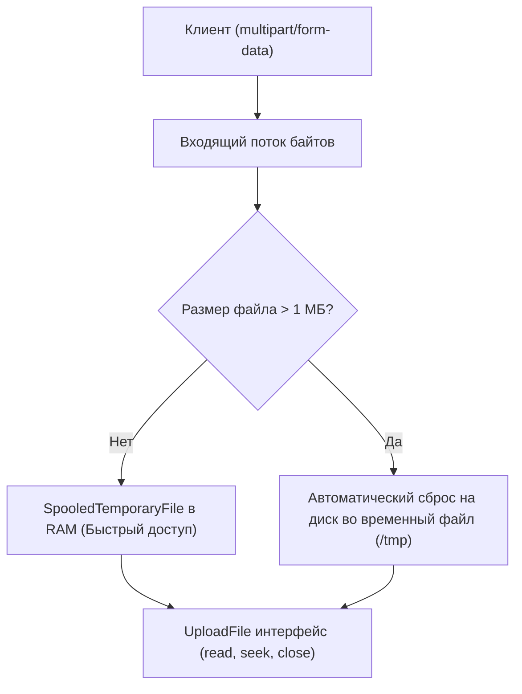
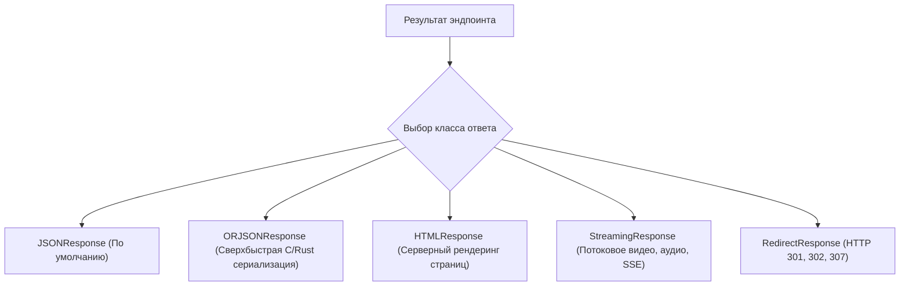
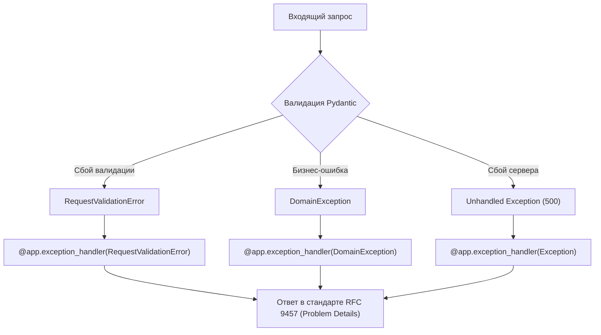

# 03. Обработка запросов, кастомные ответы, статус-коды и обработка ошибок

Качественный Web API определяется не только тем, как быстро он отдает успешные ответы, но и тем, насколько предсказуемо, безопасно и информативно он обрабатывает сложные входящие полезные нагрузки, файлы и непредвиденные ошибки.

В этой главе мы разберем продвинутую работу с телом запроса (`Body`, `Form`, `UploadFile`), фильтрацию и маскирование ответов через `response_model`, кастомные классы ответов (`ORJSONResponse`, `StreamingResponse`), манипуляцию заголовками и Cookie, а также построим стандартизированную систему обработки ошибок в соответствии с современным спецификацией **RFC 9457 (Problem Details for HTTP APIs)**.

---

## 1. Работа с телом запроса: `Body`, `Form` и `UploadFile`

### Множественные модели и скаляры в теле запроса

По умолчанию, если аргумент функции аннотирован моделью `BaseModel`, FastAPI ожидает, что весь JSON-корень тела запроса соответствует этой модели. Но что делать, если нужно передать две независимые сущности или добавить одиночное поле?

```python
from typing import Annotated
from fastapi import APIRouter, Body, status
from pydantic import BaseModel, Field

router = APIRouter(prefix="/orders", tags=["Заказы"])

class ItemPayload(BaseModel):
    sku: str
    price: float

class DeliveryAddress(BaseModel):
    city: str
    street: str
    zip_code: str

@router.post("/checkout")
async def checkout(
    # Две независимые Pydantic-модели в одном теле запроса
    item: ItemPayload,
    delivery: DeliveryAddress,
    # Скалярное значение, извлекаемое из тела запроса (а не из Query!)
    priority_delivery: Annotated[bool, Body(description="Флаг экспресс-доставки")] = False,
    # Встраивание одиночной модели внутрь ключа { "comment": { ... } }
    extra_notes: Annotated[str | None, Body(embed=True)] = None,
):
    """
    Ожидаемый JSON-запрос от клиента:
    {
        "item": {"sku": "A123", "price": 49.99},
        "delivery": {"city": "Москва", "street": "Ленина 1", "zip_code": "101000"},
        "priority_delivery": true,
        "extra_notes": "Позвонить курьеру за 30 минут"
    }
    """
    return {
        "item": item,
        "delivery": delivery,
        "priority": priority_delivery,
        "notes": extra_notes,
    }
```

---

### Формы и потоковая загрузка файлов (`UploadFile`)

Для загрузки файлов и HTML-форм клиенты отправляют запрос с заголовком `multipart/form-data`. В FastAPI для этого предусмотрены `Form`, `File` и `UploadFile`.



> [!WARNING] Разница между `bytes` и `UploadFile`
> - `file: bytes = File(...)`: считывает **весь файл целиком в оперативную память**. Если клиент загрузит файл размером 2 ГБ, сервер попытается аллоцировать 2 ГБ RAM, что легко приведет к Out-Of-Memory (OOM) и падению воркера.
> - `file: UploadFile`: использует объект `SpooledTemporaryFile`. Файлы до 1 МБ хранятся в памяти, а при превышении этого порога автоматически стримятся на диск. Это предотвращает переполнение памяти.

```python
import shutil
from pathlib import Path
from typing import Annotated
from fastapi import APIRouter, File, Form, HTTPException, UploadFile, status

router = APIRouter(prefix="/media", tags=["Медиа"])
UPLOAD_DIR = Path("/tmp/app_uploads")
UPLOAD_DIR.mkdir(parents=True, exist_ok=True)

ALLOWED_EXTENSIONS = {".png", ".jpg", ".jpeg", ".pdf"}
MAX_FILE_SIZE = 10 * 1024 * 1024  # 10 Мегабайт

@router.post("/upload")
async def upload_document(
    title: Annotated[str, Form(description="Название документа")],
    document_file: Annotated[
        UploadFile,
        File(description="Бинарный файл документа или изображения"),
    ],
):
    # 1. Проверка расширения файла
    file_ext = Path(document_file.filename or "").suffix.lower()
    if file_ext not in ALLOWED_EXTENSIONS:
        raise HTTPException(
            status_code=status.HTTP_415_UNSUPPORTED_MEDIA_TYPE,
            detail=f"Неподдерживаемый формат файла: {file_ext}. Разрешены: {ALLOWED_EXTENSIONS}",
        )

    destination_path = UPLOAD_DIR / f"upload_{document_file.filename}"
    
    # 2. Потоковое чтение чанками по 64 КБ с контролем размера
    total_bytes = 0
    chunk_size = 64 * 1024  # 64 KB
    
    with destination_path.open("wb") as buffer:
        while chunk := await document_file.read(chunk_size):
            total_bytes += len(chunk)
            if total_bytes > MAX_FILE_SIZE:
                # Очищаем не полностью записанный файл при превышении лимита
                destination_path.unlink(missing_ok=True)
                raise HTTPException(
                    status_code=status.HTTP_413_REQUEST_ENTITY_TOO_LARGE,
                    detail="Размер файла превышает допустимый лимит в 10 МБ",
                )
            buffer.write(chunk)

    # 3. Обязательно закрываем файл после обработки
    await document_file.close()

    return {
        "title": title,
        "filename": document_file.filename,
        "content_type": document_file.content_type,
        "saved_size_bytes": total_bytes,
        "path": str(destination_path),
    }
```

---

## 2. Фильтрация и проекция ответов (`response_model`)

Одной из самых мощных возможностей FastAPI является автоматическая фильтрация выходных данных с помощью аргумента `response_model` в декораторе маршрута.

```python
from datetime import datetime
from fastapi import APIRouter
from pydantic import BaseModel, ConfigDict, EmailStr

router = APIRouter(prefix="/users", tags=["Пользователи"])

# Внутренняя структура (например, сырой объект из базы данных)
class UserInDatabase:
    def __init__(self, user_id: int, email: str, hashed_pw: str, is_admin: bool):
        self.user_id = user_id
        self.email = email
        self.hashed_password = hashed_pw
        self.is_admin = is_admin
        self.secret_token = "ultra-secret-internal-hash"

# Публичная схема ответа клиенту
class UserPublic(BaseModel):
    model_config = ConfigDict(from_attributes=True)

    user_id: int
    email: EmailStr

@router.get(
    "/{user_id}",
    response_model=UserPublic,
    response_model_exclude_unset=True,  # Исключать поля со значениями по умолчанию
)
async def get_user_profile(user_id: int):
    # Допустим, мы получили из базы внутреннюю сущность с приватными данными
    internal_user = UserInDatabase(
        user_id=user_id,
        email="developer@example.com",
        hashed_pw="$2b$12$D8vW...bcrypt_hash...",
        is_admin=True,
    )
    # FastAPI автоматически преобразует internal_user в схему UserPublic.
    # Поля `hashed_password` и `secret_token` НИКОГДА не попадут в JSON-ответ!
    return internal_user
```

> [!IMPORTANT] Валидация выхода защищает от утечек безопасности
> Даже если в коде обработчика допущена ошибка и разработчик случайно вернул словарь `{"user_id": 1, "hashed_password": "..."}`, наличие `response_model=UserPublic` гарантирует, что поле `hashed_password` будет отфильтровано Pydantic перед отправкой клиенту.

---

## 3. Специализированные классы ответов (Response Classes)

По умолчанию FastAPI сериализует ответы в стандартный `JSONResponse`. Однако для специфических сценариев доступны специализированные классы:



```python
import asyncio
from typing import AsyncGenerator
from fastapi import APIRouter, status
from fastapi.responses import HTMLResponse, ORJSONResponse, RedirectResponse, StreamingResponse

router = APIRouter(prefix="/responses", tags=["Ответы"])

# 1. ORJSONResponse: ускорение сериализации больших объемов JSON в разы
@router.get("/fast-data", response_class=ORJSONResponse)
async def get_fast_dataset():
    # orjson нативно поддерживает типы datetime, UUID, Decimal, numpy без дополнительных кодеров
    return [{"id": i, "value": f"metric_{i}"} for i in range(10_000)]

# 2. HTMLResponse: отдача сформированного HTML
@router.get("/welcome", response_class=HTMLResponse)
async def get_welcome_page():
    return """
    <!DOCTYPE html>
    <html>
        <head><title>FastAPI Portal</title></head>
        <body>
            <h1 style="color: #009688;">Добро пожаловать в FastAPI Portal!</h1>
        </body>
    </html>
    """

# 3. StreamingResponse: потоковая отдача данных чанками
async def log_streamer() -> AsyncGenerator[bytes, None]:
    for i in range(1, 6):
        await asyncio.sleep(0.5)
        yield f"data: Событие #{i} сгенерировано сервером\n\n".encode("utf-8")

@router.get("/events/stream")
async def sse_event_feed():
    return StreamingResponse(
        log_streamer(),
        media_type="text/event-stream",
        headers={"Cache-Control": "no-cache", "Connection": "keep-alive"},
    )

# 4. RedirectResponse: перенаправление браузера
@router.get("/legacy-docs")
async def redirect_to_v2():
    return RedirectResponse(
        url="/docs",
        status_code=status.HTTP_308_PERMANENT_REDIRECT,
    )
```

---

## 4. Объект `Response`: установка заголовков и Cookie

Если вам требуется динамически модифицировать параметры ответа (заголовки пагинации, куки сессий), внедрите аргумент `response: Response`:

```python
from fastapi import APIRouter, Response, status

router = APIRouter(prefix="/auth-session", tags=["Сессии"])

@router.post("/login")
async def login(response: Response):
    # Установка безопасной Cookie с флагами httponly, secure и samesite
    response.set_cookie(
        key="session_token",
        value="secure_random_uuid_token_value",
        max_age=3600 * 24 * 7,  # 7 дней в секундах
        httponly=True,          # Защита от кражи через XSS в JavaScript
        secure=True,            # Передача только по протоколу HTTPS
        samesite="lax",         # Защита от атак CSRF
    )
    
    # Установка кастомных HTTP-заголовков
    response.headers["X-Request-Id"] = "trace-uuid-12345"
    response.headers["X-RateLimit-Remaining"] = "99"
    
    response.status_code = status.HTTP_200_OK
    return {"message": "Успешная авторизация, cookie установлена"}
```

---

## 5. Обработка ошибок: `HTTPException` и глобальные обработчики

### Использование `HTTPException`

Для прерывания цепочки выполнения и возврата ошибки клиенту используется `HTTPException`:

```python
from fastapi import APIRouter, HTTPException, status

router = APIRouter()

@router.get("/items/{item_id}")
async def get_item(item_id: int):
    if item_id == 0:
        raise HTTPException(
            status_code=status.HTTP_400_BAD_REQUEST,
            detail="Идентификатор товара не может быть нулевым",
            headers={"X-Error-Reason": "InvalidIdentifier"},
        )
    if item_id < 0:
        raise HTTPException(
            status_code=status.HTTP_404_NOT_FOUND,
            detail=f"Товар с id={item_id} не найден в каталоге",
        )
    return {"item_id": item_id, "title": "Товар в наличии"}
```

---

### Глобальный перехват ошибок и индустриальный стандарт RFC 9457

При разработке распределенных систем и микросервисов возвращать разношерстные форматы ошибок (где-то `{"error": "msg"}`, а где-то `{"detail": "msg"}`) считается антипаттерном.

Спецификация **RFC 9457 (Problem Details for HTTP APIs)** определяет стандартный формат JSON для сообщений об ошибках:
- `type`: URI-идентификатор типа проблемы (документация ошибки).
- `title`: Краткое человекочитаемое описание проблемы.
- `status`: Соответствующий числовой HTTP статус-код.
- `detail`: Подробное объяснение конкретной причины данной ошибки.
- `instance`: URI запроса, в котором возникла данная проблема.
- `invalid_params`: Список конкретных полей, не прошедших валидацию.



### Реализация обработчика в стандарте RFC 9457:

```python
from fastapi import FastAPI, Request, status
from fastapi.exceptions import RequestValidationError
from fastapi.responses import JSONResponse
from pydantic import BaseModel

app = FastAPI()

# Доменное исключение приложения
class BusinessLogicError(Exception):
    def __init__(self, title: str, detail: str, error_code: str):
        self.title = title
        self.detail = detail
        self.error_code = error_code

# 1. Глобальный перехватчик ошибок валидации входных данных (HTTP 422)
@app.exception_handler(RequestValidationError)
async def validation_exception_handler(request: Request, exc: RequestValidationError):
    errors = []
    for err in exc.errors():
        field_loc = " -> ".join(str(loc) for loc in err.get("loc", []))
        errors.append({
            "name": field_loc,
            "reason": err.get("msg", "Неверное значение"),
            "type": err.get("type", "value_error"),
        })

    problem_details = {
        "type": "https://api.example.com/errors/validation-error",
        "title": "Ошибка валидации параметров запроса",
        "status": status.HTTP_422_UNPROCESSABLE_ENTITY,
        "detail": "Один или несколько параметров запроса не соответствуют схеме спецификации",
        "instance": str(request.url),
        "invalid_params": errors,
    }
    return JSONResponse(
        status_code=status.HTTP_422_UNPROCESSABLE_ENTITY,
        content=problem_details,
        media_type="application/problem+json",
    )

# 2. Перехватчик доменных бизнес-ошибок
@app.exception_handler(BusinessLogicError)
async def business_error_handler(request: Request, exc: BusinessLogicError):
    problem_details = {
        "type": f"https://api.example.com/errors/{exc.error_code}",
        "title": exc.title,
        "status": status.HTTP_400_BAD_REQUEST,
        "detail": exc.detail,
        "instance": str(request.url),
    }
    return JSONResponse(
        status_code=status.HTTP_400_BAD_REQUEST,
        content=problem_details,
        media_type="application/problem+json",
    )
```

---

## Резюме

1. Для комплексного тела запроса используйте комбинирование моделей Pydantic, скаляров с **`Body()`** и встраивание с `embed=True`.
2. Для загрузки файлов всегда выбирайте **`UploadFile`** вместо `bytes`, чтобы исключить утечки оперативной памяти благодаря буферизации на диск.
3. Всегда объявляйте **`response_model`** в эндпоинтах: это гарантирует отсутствие утечек приватных полей и генерирует точную документацию Swagger UI.
4. Выбирайте оптимальный класс ответа: **`ORJSONResponse`** для высоких нагрузок на сериализацию, **`StreamingResponse`** для больших файлов и SSE.
5. Приводите все ответы об ошибках к единому индустриальному стандарту **RFC 9457 (Problem Details)** с помощью глобальных перехватчиков `@app.exception_handler`.

---

## Практическое задание

В практическом файле [[ex_03_requests_errors.py]] реализован конвейер парсинга тела запросов, фильтрации ответов моделями и форматирования исключений в стандарт RFC 9457 `application/problem+json`.

Запустите тесты для проверки реализации:
```bash
python3 exercises/04_fastapi_core/ex_03_requests_errors.py
```
