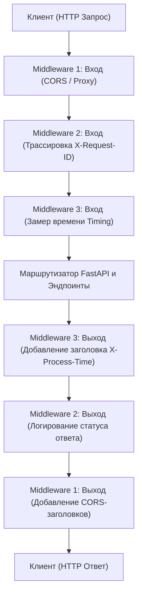
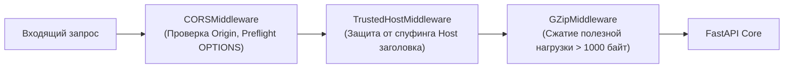
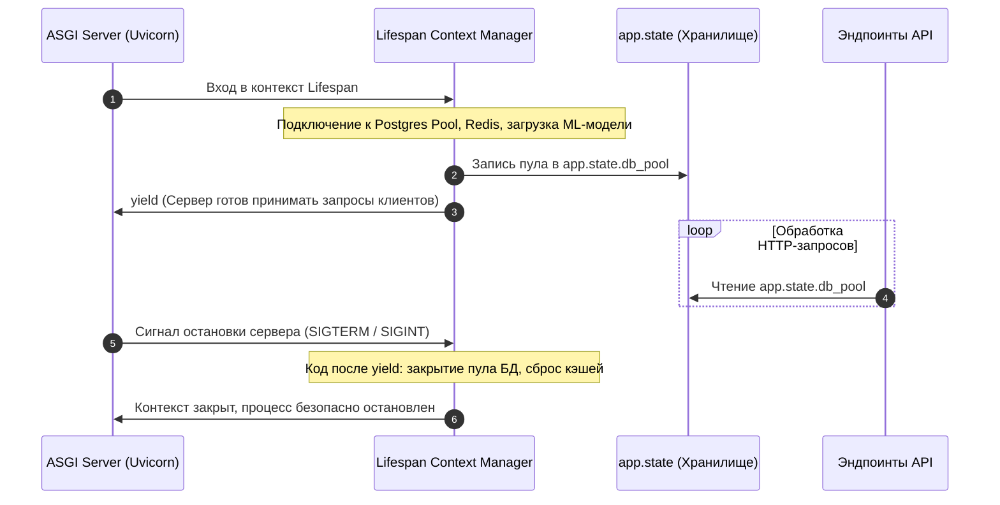
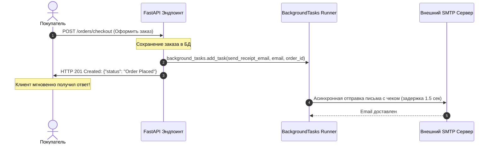

# 05. ASGI Middleware, жизненный цикл Lifespan и фоновые задачи

В завершающей главе модуля мы переходим к управлению глобальным окружением веб-сервиса. Высоконагруженные сервисы требуют надежной обработки сквозных задач (логирование задержек, добавление заголовков безопасности, ограничение CORS), корректного управления ресурсами при запуске и остановке сервера, а также выполнения отложенных фоновых операций без блокировки клиентов.

В этой главе мы разберем конвейер промежуточного слоя (**Middleware**) по принципу «луковицы», сопоставим высокоуровневый `BaseHTTPMiddleware` с нативным **чистым ASGI Middleware**, настроим стандартные middleware безопасности, освоим современный менеджер жизненного цикла **Lifespan** и разберем границы применимости встроенных **`BackgroundTasks`**.

---

## 1. Конвейер Middleware и луковичная архитектура (Onion Architecture)

**Middleware** (промежуточное ПО) — это компонент, который перехватывает каждый входящий запрос до того, как он попадет в маршрутизатор, и каждый исходящий ответ до отправки клиенту.

Конвейер middleware устроен по принципу слоев луковицы:



### Порядок выполнения:
- **Прямой ход (входящий запрос)**: middleware выполняются в порядке их добавления в приложение (сверху вниз / снаружи внутрь).
- **Обратный ход (исходящий ответ)**: middleware перехватывают готовый ответ в обратном порядке (снизу вверх / изнутри наружу).

---

## 2. Два подхода к созданию Middleware: HTTP Middleware vs Pure ASGI

В FastAPI существует два способа создания кастомных middleware. Понимание разницы между ними критично для производительности и корректной работы сервиса.

### А. Высокоуровневый `@app.middleware("http")` (`BaseHTTPMiddleware`)

Удобный декларативный способ, оборачивающий запрос в Starlette `Request` и `Response`:

```python
import time
from fastapi import FastAPI, Request

app = FastAPI()

@app.middleware("http")
async def add_process_time_header(request: Request, call_next):
    # 1. Прямой ход: до вызова эндпоинта
    start_time = time.perf_counter()
    
    # 2. Передача управления следующему слою или эндпоинту
    response = await call_next(request)
    
    # 3. Обратный ход: модификация ответа
    process_time = time.perf_counter() - start_time
    response.headers["X-Process-Time"] = f"{process_time:.6f}s"
    return response
```

> [!WARNING] Скрытые опасности `BaseHTTPMiddleware` в продакшене
> Класс `BaseHTTPMiddleware` имеет серьезные архитектурные ограничения:
> 1. **Буферизация потоков**: он считывает тело ответа во временную память целиком, что **ломает потоковую передачу данных (`StreamingResponse`, SSE)** и может приводить к утечкам RAM при отдаче больших файлов.
> 2. **Потеря низкоуровневых контекстов**: он запускает обработку запроса в отдельной фоновой `asyncio.Task`, из-за чего теряются изменения в `contextvars` и корректный перехват отмены соединения клиентом (Client Disconnect).
> 3. **Накладные расходы CPU**: создание промежуточных задач и структур снижает RPS сервиса.

---

### Б. Чистый ASGI Middleware (Pure ASGI)

Чистый ASGI middleware реализует низкоуровневый протокол `async def __call__(self, scope, receive, send)` без промежуточных оберток. Он работает с максимальной скоростью и полностью сохраняет потоковую передачу.

```python
import time
from typing import Callable

class PureASGITimingMiddleware:
    """Чистый ASGI Middleware для измерения времени обработки запроса."""
    def __init__(self, app: Callable):
        self.app = app

    async def __call__(self, scope: dict, receive: Callable, send: Callable) -> None:
        if scope["type"] != "http":
            # Пропускаем WebSocket и Lifespan без модификаций
            await self.app(scope, receive, send)
            return

        start_time = time.perf_counter()

        async def send_wrapper(message: dict) -> None:
            # Перехватываем событие начала формирования HTTP-ответа
            if message["type"] == "http.response.start":
                duration = time.perf_counter() - start_time
                headers = list(message.get("headers", []))
                # Добавляем наш кастомный заголовок в сыром байтовом формате
                headers.append(
                    (b"x-pure-asgi-time", f"{duration:.6f}s".encode("ascii"))
                )
                message["headers"] = headers

            await send(message)

        await self.app(scope, receive, send_wrapper)
```

### Подключение чистого ASGI Middleware:
```python
app = FastAPI()
app.add_middleware(PureASGITimingMiddleware)
```

---

## 3. Встроенные Middleware Starlette / FastAPI

В подавляющем большинстве проектов вам понадобятся стандартные готовые решения для безопасности и сжатия трафика:



```python
from fastapi import FastAPI
from fastapi.middleware.cors import CORSMiddleware
from fastapi.middleware.gzip import GZipMiddleware
from fastapi.middleware.trustedhost import TrustedHostMiddleware

app = FastAPI()

# 1. Защита от Cross-Origin Resource Sharing (CORS)
app.add_middleware(
    CORSMiddleware,
    # Список разрешенных веб-доменов фронтенда
    allow_origins=[
        "https://myapp.company.com",
        "http://localhost:3000",
    ],
    # Разрешить ли передачу кук и заголовка Authorization
    allow_credentials=True,
    # Разрешенные HTTP-методы
    allow_methods=["GET", "POST", "PUT", "PATCH", "DELETE", "OPTIONS"],
    # Разрешенные заголовки от клиента
    allow_headers=["*"],
    # Время кэширования Preflight OPTIONS-запросов браузером (в секундах)
    max_age=86400,
)

# 2. Защита от атак на заголовок Host (HTTP Host Header Poisoning)
app.add_middleware(
    TrustedHostMiddleware,
    allowed_hosts=["myapp.company.com", "api.company.com", "localhost"],
)

# 3. Автоматическое GZIP-сжатие ответов размером более 1 КБ
app.add_middleware(
    GZipMiddleware,
    minimum_size=1000,
)
```

---

## 4. Управление жизненным циклом: Контекстный менеджер `lifespan`

В старых версиях FastAPI инициализация ресурсов выполнялась через `@app.on_event("startup")` и `@app.on_event("shutdown")`. Сейчас эти декораторы признаны **устаревшими (deprecated)**.

Современный стандарт — контекстный менеджер `lifespan` на базе `@asynccontextmanager` (модуль `contextlib`, см. [[02_Metaclasses_ContextManagers]]).



### Реализация lifespan с сохранением состояния в `app.state`:

```python
from contextlib import asynccontextmanager
from typing import AsyncGenerator
from fastapi import FastAPI, Request

class DatabaseConnectionPool:
    async def connect(self):
        print("Подключение к пулу соединений базы данных...")

    async def disconnect(self):
        print("Корректное закрытие соединений с БД...")

    async def fetch_val(self):
        return 42

@asynccontextmanager
async def lifespan(app: FastAPI) -> AsyncGenerator[None, None]:
    # --- СТАРТ ПРИЛОЖЕНИЯ (STARTUP) ---
    pool = DatabaseConnectionPool()
    await pool.connect()
    
    # Сохраняем объект в синглтон-состоянии приложения
    app.state.db_pool = pool
    print("Приложение успешно инициализировано и готово к приему трафика.")

    yield  # В этой точке сервер обрабатывает запросы клиентов

    # --- ЗАВЕРШЕНИЕ РАБОТЫ (SHUTDOWN) ---
    print("Получен сигнал завершения. Начинается процедура Graceful Shutdown...")
    await app.state.db_pool.disconnect()
    print("Все ресурсы освобождены. Сервер остановлен.")

# Передаем lifespan в конструктор приложения
app = FastAPI(lifespan=lifespan)

@app.get("/db-check")
async def check_db(request: Request):
    # Доступ к синглтону пула из любого эндпоинта
    pool: DatabaseConnectionPool = request.app.state.db_pool
    val = await pool.fetch_val()
    return {"database_status": "connected", "value": val}
```

---

## 5. Выполнение фоновых задач после ответа: `BackgroundTasks`

Когда клиенту необходимо вернуть ответ мгновенно, не заставляя его ожидать завершения вспомогательных операций (отправка email-уведомлений, запись аудита, сбор аналитики), используется объект `BackgroundTasks`.



### Использование `BackgroundTasks`:

```python
import asyncio
from fastapi import APIRouter, BackgroundTasks, status
from pydantic import BaseModel, EmailStr

router = APIRouter(prefix="/notifications", tags=["Уведомления"])

async def send_welcome_email(email_to: str, username: str) -> None:
    """Имитация долгой отправки письма через внешний почтовый шлюз."""
    await asyncio.sleep(2.0)
    print(f"[EMAIL SERVICE] Приветственное письмо успешно отправлено пользователю {username} ({email_to})")

def append_to_audit_log(event: str) -> None:
    """Синхронная задача логирования (будет запущена в отдельном потоке worker thread)."""
    with open("/tmp/audit_events.log", "a", encoding="utf-8") as log_file:
        log_file.write(f"Событие: {event}\n")

class RegisterPayload(BaseModel):
    username: str
    email: EmailStr

@router.post("/register", status_code=status.HTTP_201_CREATED)
async def register_user(
    payload: RegisterPayload,
    background_tasks: BackgroundTasks,
):
    # Добавляем асинхронную задачу
    background_tasks.add_task(send_welcome_email, email_to=payload.email, username=payload.username)
    
    # Добавляем синхронную задачу
    background_tasks.add_task(append_to_audit_log, event=f"Регистрация пользователя {payload.username}")

    return {
        "message": "Пользователь успешно зарегистрирован",
        "username": payload.username,
        "notification": "Письмо с подтверждением будет отправлено в фоновом режиме",
    }
```

---

### Анализ архитектурных границ: `BackgroundTasks` против очередей задач (Celery / Taskiq)

> [!IMPORTANT] Когда встроенных `BackgroundTasks` недостаточно?
> `BackgroundTasks` выполняются **внутри того же процесса Python** в памяти сервера. 

| Критерий | `BackgroundTasks` (FastAPI) | Внешний брокер (Celery, Taskiq, RabbitMQ) |
| :--- | :--- | :--- |
| **Устойчивость к сбоям (Resilience)** | ❌ При падении или перезапуске воркера задачи в памяти теряются навсегда | ✅ Задачи сохраняются в персистентном брокере и перезапускаются |
| **Повторные попытки (Retries)** | ❌ Отсутствуют, нужно писать вручную | ✅ Из коробки (Exponential Backoff, Dead Letter Queue) |
| **CPU-нагрузка** | ❌ Тяжелые вычисления блокируют или замедляют основной Event Loop | ✅ Выполняются на отдельных выделенных воркер-машинах |
| **Мониторинг** | ❌ Нет готовых дашбордов | ✅ Богатые инструменты (Flower, Prometheus) |
| **Сложность инфраструктуры** | ✅ Нулевая (не требует Redis / RabbitMQ) | ⚠️ Требуется запуск брокера и отдельных воркеров |

---

## Резюме

1. **Middleware** образуют слои конвейера (Onion Architecture), перехватывая запрос по пути внутрь и ответ по пути наружу.
2. Для простых задач подходит `@app.middleware("http")`, однако для максимальной скорости и корректной потоковой передачи (streaming) используйте **чистый ASGI Middleware**.
3. Стандартные middleware (`CORSMiddleware`, `TrustedHostMiddleware`, `GZipMiddleware`) закрывают базовые требования сетевой безопасности и оптимизации.
4. Управление жизненным циклом приложения и инициализация тяжелых ресурсов (пулы БД, кэши) реализуется через **`lifespan`** и общее состояние **`app.state`**.
5. **`BackgroundTasks`** идеально подходят для легковесных задач, не требующих гарантированной персистентности, в то время как критические и тяжелые фоновые операции следует делегировать брокерам сообщений.

---

## Практическое задание

В практическом файле [[ex_05_middleware_lifespan.py]] реализован полный стек ASGI-middleware, асинхронный контекстный менеджер жизненного цикла `Lifespan` и система выполнения отложенных `BackgroundTasks`.

Запустите тесты для проверки реализации:
```bash
python3 exercises/04_fastapi_core/ex_05_middleware_lifespan.py
```
