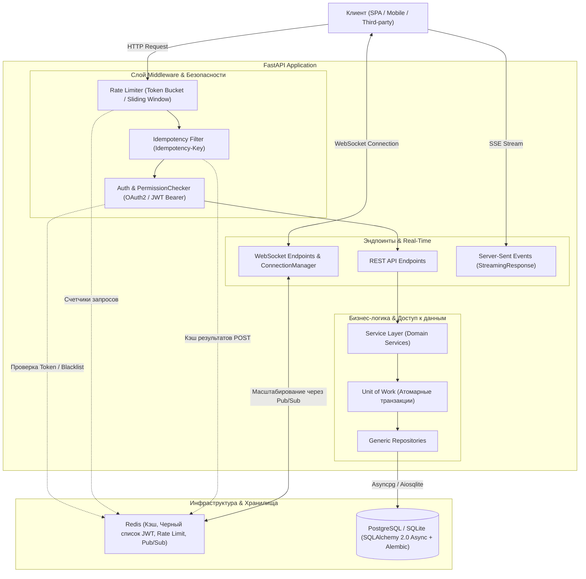

# Модуль 05: Базы данных, Безопасность и Real-time в FastAPI

Добро пожаловать в **Модуль 05** — один из самых технически насыщенных и ответственных блоков учебника. Здесь мы переходим от проектирования HTTP API и валидации схем к промышленному уровню работы с данными, криптографической защите приложений и построению двунаправленных real-time систем.

В современных распределенных системах недостаточно просто уметь сохранять данные в реляционную таблицу или отдавать JSON. Инженер бэкенда обязан понимать нюансы асинхронного взаимодействия с СУБД, гарантировать транзакционную целостность, проектировать отказоустойчивые механизмы аутентификации, защищать API от перегрузок и организовывать потоковую передачу данных.

---

## Архитектура взаимодействия компонентов

На диаграмме ниже представлена полная архитектура современного веб-сервиса на FastAPI, охватывающая все ключевые темы данного модуля:

---

## Навигация по главам модуля

Каждая глава модуля содержит фундаментальную теорию, разбор распространенных ошибок в продакшене, архитектурные диаграммы и практические примеры промышленного уровня:

| № | Глава | Ключевые концепции | Практика |
|---|---|---|---|
| **01** | [[01_SQLAlchemy2_Async_Sessions\|SQLAlchemy 2.0 Async, Драйверы и Сессии]] | Core vs ORM 2.0, `asyncpg`/`aiosqlite`, Connection Pooling, `Mapped[T]`, `expire_on_commit=False`, Loading Strategies (`selectinload`, `joinedload`, `raiseload`), запрет lazy loading | [[ex_01_sqlalchemy_async.py]] |
| **02** | [[02_Migrations_Alembic_Repositories\|Миграции Alembic, Repository и Unit of Work]] | Асинхронный `env.py`, `NamingConvention`, Zero-Downtime миграции, Generic Repository, Unit of Work, Keyset vs Offset пагинация, уровни изоляции, `SELECT FOR UPDATE`, версионирование | [[ex_02_repositories_uow.py]] |
| **03** | [[03_Auth_OAuth2_JWT_Security\|Безопасность: OAuth2, JWT, Хеширование и RBAC]] | Аутентификация vs Авторизация, Argon2id/bcrypt/PBKDF2, OAuth2 Password Bearer, устройство JWT (HS256 vs RS256), Refresh Token Rotation, Blacklist токенов, RBAC `PermissionChecker` | [[ex_03_auth_jwt_rbac.py]] |
| **04** | [[04_Caching_Redis_RateLimiting\|Кэширование с Redis, Идемпотентность и Rate Limiting]] | `redis.asyncio`, Cache-Aside, сериализация, Cache Stampede (распределенный лок / jitter), заголовок `Idempotency-Key`, Token Bucket, Sliding Window Log | [[ex_04_caching_ratelimit.py]] |
| **05** | [[05_WebSockets_SSE_Streaming\|WebSockets, SSE и Потоковая передача данных]] | WebSocket Handshake, `ConnectionManager`, распределенный Pub/Sub брокер на Redis, аутентификация в WS, Server-Sent Events (`text/event-stream`), `StreamingResponse` для LLM и CSV | [[ex_05_websockets_sse.py]] |

---

## Связь с другими модулями

- **Пререквизиты**:
  - [[03_Python_Internals_Async/04_Asyncio_Event_Loop_Coroutines|Модуль 03. Глава 04: Устройство Event Loop и корутины]] — необходимо для понимания неблокирующего I/O при работе с БД и сокетами.
  - [[04_FastAPI_Core/04_Dependency_Injection_System|Модуль 04. Глава 04: Система Dependency Injection в FastAPI]] — используется для внедрения сессий БД, аутентификации и репозиториев в маршруты.
  - [[04_FastAPI_Core/05_Middleware_Lifespan_Background|Модуль 04. Глава 05: Жизненный цикл (lifespan) и Middleware]] — необходимо для инициализации пулов соединений БД и Redis.
- **Следующий шаг**:
  - [[06_FastAPI_Pro_Production/01_Clean_Architecture_DDD|Модуль 06. Глава 01: Чистая архитектура и Domain-Driven Design]] — интеграция репозиториев и Unit of Work в полноценную чистую архитектуру уровня Enterprise.

---

> [!TIP] Напутствие перед изучением
> Не пропускайте практические задания! Концепции асинхронного управления транзакциями, криптографической ротации токенов и потокового ввода-вывода лучше всего усваиваются при написании и отладке тестов.

Вернуться к общему оглавлению: [[00_Index_MOC|Главная карта знаний]]
