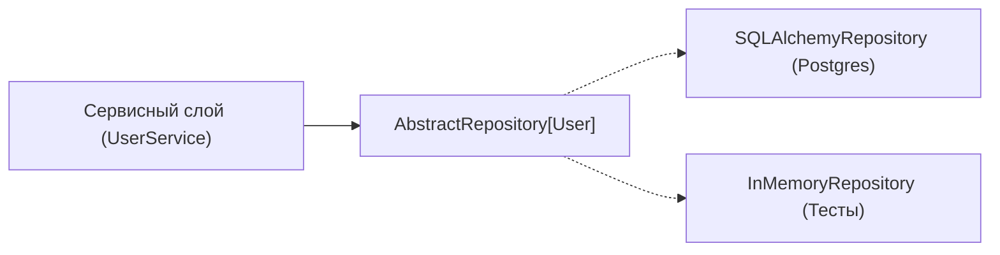

# 02. Миграции Alembic, Паттерны Repository и Unit of Work, Блокировки и Пагинация

[[01_SQLAlchemy2_Async_Sessions|← Предыдущая глава: SQLAlchemy 2.0 Async и Сессии]] | [[00_Module_05_MOC|Модуль 05 MOC]] | [[03_Auth_OAuth2_JWT_Security|Следующая глава: Безопасность и OAuth2/JWT →]]

В реальных приложениях схема данных непрерывно эволюционирует, а бизнес-логика требует согласованности данных при конкурентных запросах. Прямой вызов методов SQLAlchemy `session.add()` или `session.execute()` прямо внутри эндпоинтов FastAPI быстро превращает проект в труднотестируемую «спагетти-архитектуру».

В этой главе мы разберем:
1. Организацию миграций с помощью **Alembic** в асинхронном окружении.
2. Архитектурные паттерны **Generic Repository** и **Unit of Work (UoW)** для изоляции слоя хранения.
3. Эффективные стратегии пагинации (**Offset vs Keyset/Cursor**).
4. Методы защиты данных от гонок (Race Conditions): пессимистичные и оптимистичные блокировки.

---

## 1. Управление схемой БД с Alembic

**Alembic** — официальный инструмент миграций для SQLAlchemy. Он отслеживает изменения в классах моделей `DeclarativeBase` и генерирует ревизии в виде Python-скриптов с функциями `upgrade()` и `downgrade()`.

### Асинхронный `env.py`

Поскольку Alembic по своей природе разрабатывался для синхронного выполнения, для работы с `AsyncEngine` в файле `migrations/env.py` используется запуск синхронных функций внутри контекста асинхронного соединения через `connection.run_sync()`:

```python
import asyncio
from logging.config import fileConfig
from alembic import context
from sqlalchemy import pool
from sqlalchemy.engine import Connection
from sqlalchemy.ext.asyncio import async_engine_from_config

from my_app.core.config import settings
from my_app.db.models import Base  # Метаданные моделей для autogenerate

config = context.config
if config.config_file_name is not None:
    fileConfig(config.config_file_name)

target_metadata = Base.metadata

def do_run_migrations(connection: Connection) -> None:
    context.configure(
        connection=connection,
        target_metadata=target_metadata,
        compare_type=True,       # Отслеживать изменения типов колонок
        compare_server_default=True, # Отслеживать дефолтные значения сервера
    )
    with context.begin_transaction():
        context.run_migrations()

async def run_async_migrations() -> None:
    """Создает AsyncEngine и пробрасывает синхронный раннер миграций."""
    connectable = async_engine_from_config(
        config.get_section(config.config_ini_section, {}),
        prefix="sqlalchemy.",
        poolclass=pool.NullPool,
    )

    async with connectable.connect() as connection:
        await connection.run_sync(do_run_migrations)

    await connectable.dispose()

def run_migrations_online() -> None:
    asyncio.run(run_async_migrations())

if context.is_offline_mode():
    # Оффлайн генерация SQL-скрипта без подключения к БД
    context.configure(url=settings.DATABASE_URL, target_metadata=target_metadata)
    with context.begin_transaction():
        context.run_migrations()
else:
    run_migrations_online()
```

### Соглашения об именовании (NamingConvention)

По умолчанию многие СУБД (включая SQLite и старые версии PostgreSQL) присваивают анонимные имена индексам и ограничениям (Constraints). Это делает невозможным их удаление в `downgrade()`:
`alembic.util.exc.CommandError: Constraint must have a name to be dropped`.

Для решения этой проблемы в `Base.metadata` объявляют строгое соглашение:

```python
from sqlalchemy import MetaData
from sqlalchemy.orm import DeclarativeBase

POSTGRES_INDEXES_NAMING_CONVENTION = {
    "ix": "ix_%(column_0_label)s",
    "uq": "uq_%(table_name)s_%(column_0_name)s",
    "ck": "ck_%(table_name)s_`%(constraint_name)s`",
    "fk": "fk_%(table_name)s_%(column_0_name)s_%(referred_table_name)s",
    "pk": "pk_%(table_name)s",
}

class Base(DeclarativeBase):
    metadata = MetaData(naming_convention=POSTGRES_INDEXES_NAMING_CONVENTION)
```

### Границы возможностей `--autogenerate`

Команда `alembic revision --autogenerate -m "add status"` автоматически анализирует diff между базой и моделями. Однако важно помнить:

| Что Alembic отслеживает отлично | Что требует ручной доработки |
|---|---|
| Добавление и удаление таблиц | Изменение значений в типах `ENUM` (PostgreSQL требует `ALTER TYPE`) |
| Добавление и удаление колонок | Переименование таблиц или колонок (Alembic видит это как `drop` + `add` с потерей данных!) |
| Изменение `nullable` и типов колонок (при `compare_type=True`) | Кастомные серверные функции, триггеры и расширения (`pg_trgm`, `uuid-ossp`) |
| Добавление уникальных ключей и индексов | Изменение данных (Data Migrations — заполнение колонок дефолтными значениями) |

> [!IMPORTANT] Паттерн Zero-Downtime (Expand / Contract)
> При деплое новой версии сервиса без остановки трафика (Zero Downtime) никогда не удаляйте и не переименовывайте колонки за одну миграцию:
> 1. **Фаза Expand**: Создается новая колонка как `nullable`. Код начинает писать одновременно в старую и новую колонку (Dual Write).
> 2. **Фаза Миграции данных**: Фоновым скриптом старые данные переливаются в новую колонку.
> 3. **Фаза Переключения**: Код переключается на чтение только из новой колонки.
> 4. **Фаза Contract**: В следующем релизе старая колонка безопасно удаляется.

---

## 2. Паттерн Generic Repository

Паттерн **Repository** изолирует доменную логику приложения от деталей реализации конкретной базы данных или ORM. Он представляет коллекцию объектов в памяти и позволяет легко писать легковесные модульные тесты с моками.



### Определение абстрактного интерфейса

```python
from abc import ABC, abstractmethod
from typing import Generic, Sequence, TypeVar

T = TypeVar("T")
ID = TypeVar("ID")

class AbstractRepository(ABC, Generic[T, ID]):
    @abstractmethod
    async def get_by_id(self, entity_id: ID) -> T | None:
        raise NotImplementedError

    @abstractmethod
    async def list_all(self, limit: int = 100, offset: int = 0) -> Sequence[T]:
        raise NotImplementedError

    @abstractmethod
    async def add(self, entity: T) -> T:
        raise NotImplementedError

    @abstractmethod
    async def delete(self, entity_id: ID) -> bool:
        raise NotImplementedError
```

### Универсальная реализация для SQLAlchemy

```python
from typing import Generic, Sequence, Type, TypeVar
from sqlalchemy import select, delete
from sqlalchemy.ext.asyncio import AsyncSession

ModelType = TypeVar("ModelType")
IdType = TypeVar("IdType")

class SQLAlchemyRepository(AbstractRepository[ModelType, IdType], Generic[ModelType, IdType]):
    def __init__(self, session: AsyncSession, model: Type[ModelType]) -> None:
        self.session = session
        self.model = model

    async def get_by_id(self, entity_id: IdType) -> ModelType | None:
        return await self.session.get(self.model, entity_id)

    async def list_all(self, limit: int = 100, offset: int = 0) -> Sequence[ModelType]:
        stmt = select(self.model).limit(limit).offset(offset)
        result = await self.session.execute(stmt)
        return result.scalars().all()

    async def add(self, entity: ModelType) -> ModelType:
        self.session.add(entity)
        await self.session.flush()  # Получаем автоинкрементный ID, но транзакция не завершена
        return entity

    async def delete(self, entity_id: IdType) -> bool:
        entity = await self.get_by_id(entity_id)
        if entity is None:
            return False
        await self.session.delete(entity)
        return True
```

---

## 3. Паттерн Unit of Work (Единица Работы)

Если репозитории отвечают за доступ к отдельным сущностям, то паттерн **Unit of Work (UoW)** отвечает за **транзакционную атомарность** бизнес-операции, затрагивающей несколько сущностей (например: списание баланса + создание чека + отправка уведомления).

Принципы Unit of Work:
1. Гарантирует единую точку коммита: либо сохраняется вся пачка изменений, либо откатывается всё.
2. Предоставляет доступ ко всем репозиториям через один контекст.
3. Управляет открытием и закрытием сессии с помощью контекстного менеджера `async with`.

```python
from abc import ABC, abstractmethod
from types import TracebackType
from typing import Self
from sqlalchemy.ext.asyncio import AsyncSession, async_sessionmaker

class AbstractUnitOfWork(ABC):
    users: AbstractRepository
    orders: AbstractRepository

    async def __aenter__(self) -> Self:
        return self

    async def __aexit__(
        self,
        exc_type: type[BaseException] | None,
        exc_val: BaseException | None,
        exc_tb: TracebackType | None,
    ) -> None:
        if exc_type is not None:
            await self.rollback()
        else:
            await self.commit()

    @abstractmethod
    async def commit(self) -> None:
        raise NotImplementedError

    @abstractmethod
    async def rollback(self) -> None:
        raise NotImplementedError

class SQLAlchemyUnitOfWork(AbstractUnitOfWork):
    def __init__(self, session_factory: async_sessionmaker[AsyncSession]) -> None:
        self.session_factory = session_factory

    async def __aenter__(self) -> Self:
        self.session: AsyncSession = self.session_factory()
        self.users = SQLAlchemyRepository(self.session, User)
        self.orders = SQLAlchemyRepository(self.session, Order)
        return await super().__aenter__()

    async def __aexit__(self, exc_type, exc_val, exc_tb) -> None:
        try:
            await super().__aexit__(exc_type, exc_val, exc_tb)
        finally:
            await self.session.close()

    async def commit(self) -> None:
        await self.session.commit()

    async def rollback(self) -> None:
        await self.session.rollback()
```

### Использование UoW в сервисах FastAPI

```python
async def transfer_funds_service(
    sender_id: int,
    receiver_id: int,
    amount: float,
    uow: AbstractUnitOfWork,
) -> None:
    async with uow:
        sender = await uow.users.get_by_id(sender_id)
        receiver = await uow.users.get_by_id(receiver_id)
        if sender.balance < amount:
            raise ValueError("Недостаточно средств")
        sender.balance -= amount
        receiver.balance += amount
        # Если здесь произойдет ошибка, __aexit__ автоматически сделает rollback!
        await uow.commit()
```

---

## 4. Пагинация данных: Offset vs Keyset (Cursor)

При возврате списков сущностей из API выбор правильной стратегии пагинации определяет скорость ответа и стабильность базы:

### 1. Offset / Limit Пагинация
```sql
SELECT * FROM products ORDER BY id LIMIT 20 OFFSET 100000;
```
- **Плюсы**: Легко реализовать переход на любую страницу (`Page 5`, `Page 10`).
- **Минусы**: 
  - База данных вынуждена прочитать и отбросить первые 100 000 строк. Сложность $O(N)$ — на больших таблицах запрос зависает.
  - **Проблема сдвига данных (Page Drift)**: если во время просмотра пользователем добавляется новая запись, на следующей странице пользователь увидит дубликат.

### 2. Keyset / Cursor-based Пагинация
Вместо номера страницы клиент передает значение уникального курсора (обычно `(created_at, id)` последней увиденной записи):
```sql
SELECT * FROM products 
WHERE (created_at, id) < ('2026-11-03 10:00:00', 4242)
ORDER BY created_at DESC, id DESC 
LIMIT 20;
```
- **Плюсы**:
  - Использование B-Tree индекса: мгновенный поиск точки входа за $O(\log N)$.
  - Стабильный результат без дубликатов при вставке новых строк.
- **Минусы**: Нельзя произвольно прыгнуть на «страницу 77», только листать вперед («Бесконечный скролл» / лента новостей).

---

## 5. Уровни изоляции и конкурентные блокировки

При одновременном редактировании одной строки несколькими пользователями возникает классическая проблема **Lost Update** (потерянное обновление):
1. Пользователь А читает баланс: 100 руб.
2. Пользователь Б читает баланс: 100 руб.
3. А списывает 20 руб и пишет 80 руб.
4. Б списывает 30 руб и пишет 70 руб (перезаписав и потеряв списание А!).

### Пессимистичная блокировка (`SELECT ... FOR UPDATE`)

База блокирует выбранную строку на время транзакции. Другие транзакции ждут освобождения блокировки:

```python
from sqlalchemy import select

stmt = (
    select(Account)
    .where(Account.id == account_id)
    .with_for_update()  # Генерирует SELECT ... FOR UPDATE
)
result = await session.execute(stmt)
account = result.scalar_one()
account.balance -= amount
await session.commit()
```
> [!CAUTION] Deadlocks (Взаимные блокировки)
> Если транзакция 1 блокирует счет А, а затем пытается заблокировать счет Б, в то время как транзакция 2 блокирует счет Б, а затем пытается заблокировать счет А — возникает Deadlock. Всегда блокируйте связанные ресурсы в едином упорядоченном порядке (например, сортируя ID: `ORDER BY id`).

### Оптимистичная блокировка (Optimistic Locking)

Строка не блокируется в СУБД. В модель добавляется колонка версии `version: Mapped[int]`. При каждом обновлении версия инкрементируется, а в `WHERE` проверяется старая версия:

```python
class Product(Base):
    __tablename__ = "products"
    id: Mapped[int] = mapped_column(primary_key=True)
    stock: Mapped[int]
    version: Mapped[int] = mapped_column(default=1)

    __mapper_args__ = {"version_id_col": version}
```

При попытке сохранения строки, которая уже была изменена другой транзакцией, SQLAlchemy автоматически выбросит исключение `StaleDataError`. Это идеальный паттерн для сценариев, где конфликты редки, а удерживать блокировки дорого.

---

## Практическое задание

Для отработки паттернов Repository, Unit of Work, Keyset-пагинации и оптимистичной блокировки выполните:

👉 **[[ex_02_repositories_uow.py]]**

В задании реализованы:
- Полноценный интерфейс `AbstractRepository` и асинхронный `SQLiteRepository`.
- `UnitOfWork` с контекстным менеджером, гарантирующим откат при исключениях.
- Функция быстрой Keyset-пагинации по курсору.
- Оптимистичный контроль версий строк с генерацией ошибки конкурентного обновления.

Запуск тестов:
```bash
python3 exercises/05_fastapi_data_auth/ex_02_repositories_uow.py
```
