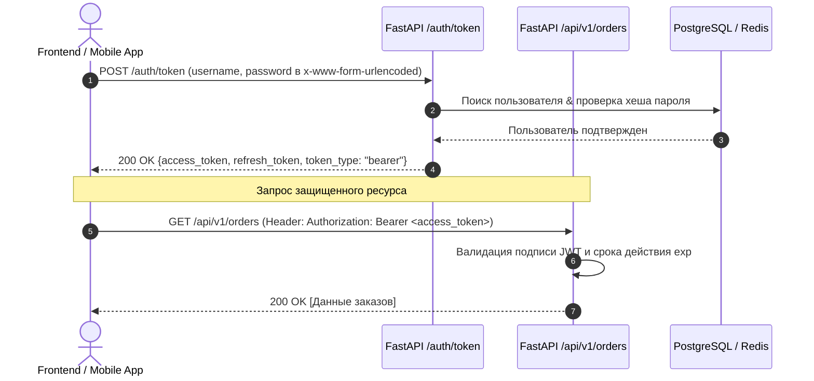
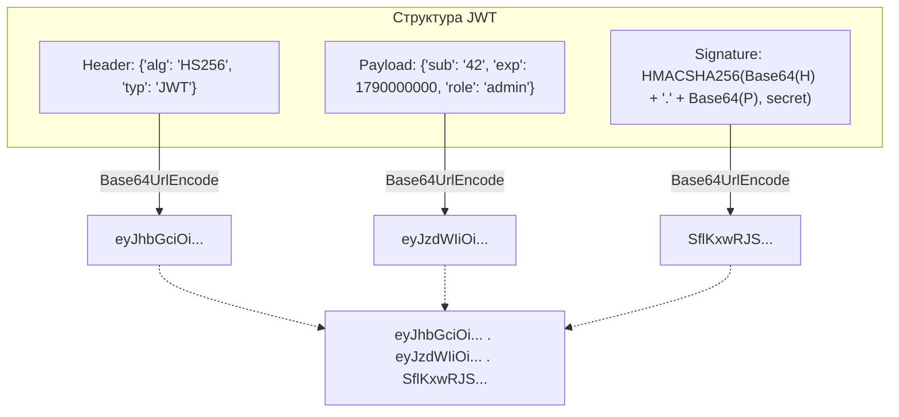
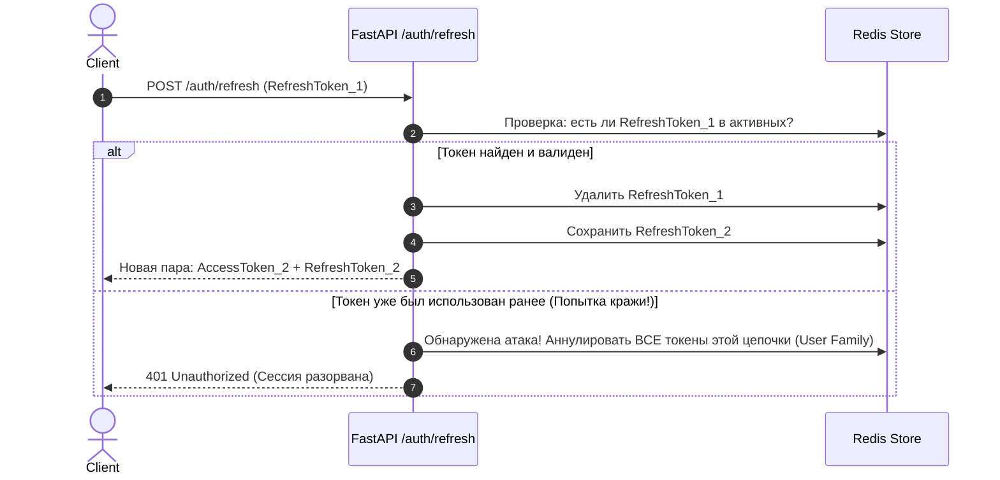

# 03. Безопасность: Хеширование паролей, OAuth2, JWT, Ротация Refresh-токенов и RBAC

[[02_Migrations_Alembic_Repositories|← Предыдущая глава: Alembic и Репозитории]] | [[00_Module_05_MOC|Модуль 05 MOC]] | [[04_Caching_Redis_RateLimiting|Следующая глава: Кэширование и Redis →]]

Безопасность веб-сервисов — это фундамент доверия пользователей и защита бизнеса от катастрофических утечек данных. Ошибки при проектировании авторизации входят в десятку наиболее опасных уязвимостей по классификации **OWASP Top 10** (Broken Access Control).

В этой главе мы разберем:
1. Разницу между аутентификацией и авторизацией.
2. Современные криптостойкие алгоритмы хеширования паролей (**Argon2id**, **bcrypt**, **PBKDF2**).
3. Спецификацию **OAuth2 Password Bearer Flow** в FastAPI.
4. Внутреннее устройство и уязвимости **JSON Web Token (JWT)**.
5. Защиту от угона сессий с помощью ротации **Refresh-токенов** и черных списков.
6. Полноценную ролевую модель доступа (**Role-Based Access Control / RBAC**) через систему Dependency Injection FastAPI.

---

## 1. Фундамент: Аутентификация vs Авторизация

Эти два термина часто путают, однако они решают принципиально разные задачи:

- **Аутентификация (Authentication / AuthN)** — *«Кто ты?»*  
  Процесс проверки подлинности субъекта. Пользователь предъявляет учетные данные (логин и пароль, OTP-код, биометрию или цифровой сертификат), а система сверяет их с эталоном. Результат успешной аутентификации — идентификатор пользователя (Identity).
- **Авторизация (Authorization / AuthZ)** — *«Что тебе разрешено делать?»*  
  Процесс проверки прав доступа идентифицированного пользователя к конкретному действию или ресурсу (например: *«Может ли менеджер Иванов удалить заказ №142?»*).

---

## 2. Криптографически безопасное хранение паролей

Ни при каких обстоятельствах пароли не должны храниться в открытом виде или шифроваться обратимым шифрованием. Пароли хешируются с использованием **односторонних математических функций**.

> [!CAUTION] Устаревшие алгоритмы
> Алгоритмы `MD5`, `SHA-1`, `SHA-256` и `SHA-512` **категорически запрещены** для хранения паролей! Они оптимизированы для сверхбыстрого вычисления контрольных сумм файлов. На современных видеокартах (GPU/ASIC) подбор пароля по SHA-256 выполняется со скоростью десятки миллиардов хешей в секунду.

### Современные стандарты: Argon2id, bcrypt, PBKDF2

Для защиты от перебора используются специализированные «медленные» адаптивные функции хеширования:

1. **Argon2id** (Победитель *Password Hashing Competition*, золотой стандарт 2020+):
   - Защищен как от параллельных атак на GPU/ASIC (Memory-hard), так и от атак по побочным каналам (Side-channel attacks).
   - Настраивается по параметрам: время (итерации), память (объем выделяемой RAM в МБ) и параллелизм (число потоков).
2. **bcrypt**:
   - Проверенный десятилетиями стандарт на базе шифра Blowfish.
   - Ограничен максимальной длиной пароля в 72 байта.
3. **PBKDF2 / scrypt**:
   - Рекомендованные стандарты NIST (PBKDF2 входит в стандартную библиотеку Python `hashlib.pbkdf2_hmac`).

### Роль криптографической соли (Salt) и защита от Timing-атак

- **Соль (Salt)**: Случайная криптографическая последовательность байт (минимум 16 байт), генерируемая для каждого пароля индивидуально. Соль делает хеши двух пользователей с одинаковыми паролями совершенно разными и сводит на нет эффективность радужных таблиц (Rainbow Tables).
- **Timing Attacks (Атаки по времени)**: Стандартное сравнение строк в Python `hash_a == hash_b` прерывается на первом несовпадающем символе. Злоумышленник, измеряя время ответа сервера с точностью до наносекунд, может посимвольно подобрать секретный хеш.
  Для безопасного сравнения необходимо использовать функцию с константным временем выполнения:
  ```python
  import hmac
  # Время проверки не зависит от позиции расхождения байтов
  is_valid = hmac.compare_digest(calculated_hash, stored_hash)
  ```

---

## 3. OAuth2 Password Bearer Flow в FastAPI

FastAPI предоставляет нативную поддержку протокола **OAuth2**. Наиболее популярный сценарий для взаимодействия SPA/Mobile с собственным бэкендом — **Resource Owner Password Credentials Grant**:



Реализация в FastAPI:
```python
from fastapi import Depends, FastAPI, HTTPException, status
from fastapi.security import OAuth2PasswordBearer, OAuth2PasswordRequestForm

app = FastAPI()

# Указывает Swagger UI, откуда запрашивать токен при нажатии кнопки "Authorize"
oauth2_scheme = OAuth2PasswordBearer(tokenUrl="/auth/token")

@app.post("/auth/token")
async def login_for_access_token(form_data: OAuth2PasswordRequestForm = Depends()):
    user = await authenticate_user(form_data.username, form_data.password)
    if not user:
        raise HTTPException(
            status_code=status.HTTP_401_UNAUTHORIZED,
            detail="Неверное имя пользователя или пароль",
            headers={"WWW-Authenticate": "Bearer"},
        )
    access_token = create_jwt_token(data={"sub": str(user.id), "role": user.role})
    return {"access_token": access_token, "token_type": "bearer"}
```

---

## 4. Внутреннее устройство JSON Web Token (JWT)

**JWT (RFC 7519)** — это компактный, URL-безопасный формат передачи утверждений (claims) между сторонами в виде строки из трех частей, разделенных точками:
`Header.Payload.Signature`



### Стандартные клеймы (Registered Claims) в Payload:
- `sub` (Subject): Уникальный идентификатор субъекта (ID пользователя).
- `exp` (Expiration Time): Unix-timestamp истечения срока годности. Обязателен!
- `iat` (Issued At): Время генерации токена.
- `nbf` (Not Before): Токен недействителен до этого времени.
- `jti` (JWT ID): Уникальный UUID токена для предотвращения атак повторного воспроизведения (Replay Attacks).

### Алгоритмы подписи: HS256 vs RS256

| Характеристика | **HS256 (HMAC with SHA-256)** | **RS256 (RSA Signature with SHA-256)** |
|---|---|---|
| **Тип ключей** | Симметричный (один и тот же секрет `SECRET_KEY` для подписи и проверки) | Асимметричная пара: Private Key (подпись) + Public Key (проверка) |
| **Сфера применения** | Монолиты или внутренние микросервисы одной команды | Микросервисы, SSO (Auth0, Keycloak), публичные API |
| **Безопасность** | Если любой микросервис скомпрометирован — злоумышленник может выпускать любые токены | Сервисы-валидаторы знают только публичный ключ и не могут подделать токен |

> [!WARNING] Критические уязвимости JWT
> 1. **Алгоритм `none`**: Если библиотека слепо доверяет заголовку `{"alg": "none"}`, токен без подписи считается валидным!
> 2. **Key Confusion (Подмена алгоритма)**: Сервер ждет RS256, но атакующий присылает токен с HS256, подписанный публичным ключом сервера как HMAC-паролем.
> 3. Всегда жестко фиксируйте разрешенный алгоритм при декодировании: `jwt.decode(token, key, algorithms=["HS256"])`.

---

## 5. Двухтокенная схема: Access + Refresh и их ротация

Хранение токена без состояния (stateless) порождает фундаментальную проблему: **JWT нельзя отозвать мгновенно** до истечения `exp`. Если токен украден, злоумышленник имеет доступ к системе все время его жизни.

Для минимизации ущерба используется двухтокенная схема:
1. **Access Token**:
   - Короткий срок жизни (10–15 минут).
   - Передается в заголовке `Authorization` при каждом запросе.
   - Проверяется локально в памяти без запросов к базе данных.
2. **Refresh Token**:
   - Долгий срок жизни (7–30 дней).
   - Используется **только** на специальном эндпоинте `/auth/refresh` для получения новой пары токенов.
   - Хранится в безопасных `HttpOnly, Secure, SameSite=Strict` Cookie или защищенном хранилище мобильного устройства.



### Ротация Refresh-токенов (Refresh Token Rotation)

При каждом обновлении токена старый Refresh Token немедленно сжигается, а клиенту выдается новый. Если злоумышленник перехватил старый токен и попытается им воспользоваться, сервер зафиксирует повторное использование (Reuse Detection) и мгновенно заблокирует всю сессию пользователя.

---

## 6. Ролевая модель доступа (RBAC) и PermissionChecker

Ролевая модель позволяет гибко разграничивать права. Вместо жесткой привязки к ролям (`if user.role == "admin"`) в чистой архитектуре проверяются конкретные **разрешения (Permissions / Scopes)**.

### Реализация кастомного класса-чекера зависимостей

```python
from collections.abc import Sequence
from fastapi import Depends, HTTPException, status
from pydantic import BaseModel

class UserSchema(BaseModel):
    id: int
    username: str
    role: str
    permissions: list[str]

async def get_current_user(token: str = Depends(oauth2_scheme)) -> UserSchema:
    payload = decode_jwt(token)
    return UserSchema(
        id=payload["sub"],
        username=payload["username"],
        role=payload["role"],
        permissions=payload.get("permissions", []),
    )

class PermissionChecker:
    """Callable-зависимость для проверки прав пользователя."""
    def __init__(self, required_permissions: Sequence[str]) -> None:
        self.required_permissions = set(required_permissions)

    def __call__(self, user: UserSchema = Depends(get_current_user)) -> UserSchema:
        user_permissions = set(user.permissions)
        # Суперадминистратор имеет доступ ко всему
        if user.role == "superadmin":
            return user

        missing = self.required_permissions - user_permissions
        if missing:
            raise HTTPException(
                status_code=status.HTTP_403_FORBIDDEN,
                detail=f"Недостаточно привилегий. Отсутствуют права: {sorted(missing)}",
            )
        return user
```

### Применение в эндпоинтах:

```python
@app.delete("/api/v1/articles/{article_id}", dependencies=[Depends(PermissionChecker(["articles:delete"]))])
async def delete_article(article_id: int):
    return {"status": "deleted", "article_id": article_id}
```

---

## Практическое задание

Для глубокого освоения криптографии, работы с JWT, ротации токенов и проверки прав доступа выполните:

👉 **[[ex_03_auth_jwt_rbac.py]]**

В практическом файле на чистом Python:
- Реализован безопасный PBKDF2-хешер с солью и защитой от тайминг-атак.
- Реализован полноценный кодировщик/декодировщик JWT по спецификации RFC 7519 (алгоритм HS256, подпись HMAC-SHA256, валидация `exp` и `nbf`).
- Реализована система выпуска токенов с ротацией Refresh-токена и выявлением кражи токенов (Token Reuse Detection).
- Построен и протестирован RBAC-чекер прав.

Запуск тестов:
```bash
python3 exercises/05_fastapi_data_auth/ex_03_auth_jwt_rbac.py
```
