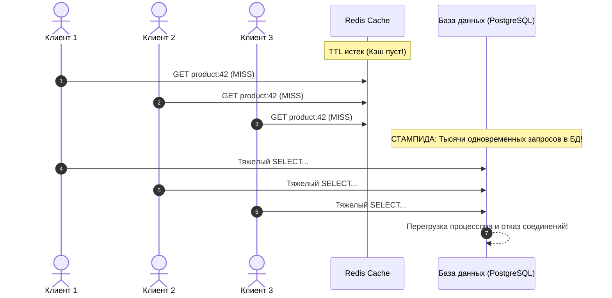
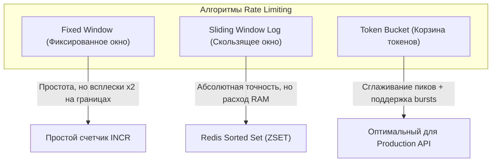

# 04. Кэширование с Redis, Защита от Stampede, Идемпотентность и Алгоритмы Rate Limiting

[[03_Auth_OAuth2_JWT_Security|← Предыдущая глава: Безопасность и JWT]] | [[00_Module_05_MOC|Модуль 05 MOC]] | [[05_WebSockets_SSE_Streaming|Следующая глава: WebSockets и Streaming →]]

Высоконагруженные API не могут полагаться исключительно на масштабирование базы данных. Чтение одних и тех же «горячих» данных из дискового хранилища приводит к исчерпанию ресурсов и задержкам ответа. В то же время открытые HTTP-эндпоинты уязвимы к спаму, DoS-атакам и дублированию финансовых транзакций при сетевых сбоях.

В этой главе мы разберем:
1. Интеграцию асинхронного клиента **Redis** в жизненный цикл FastAPI (`redis.asyncio`).
2. Архитектурные паттерны кэширования (**Cache-Aside**, **Write-Through**) и форматы сериализации.
3. Проблему **Cache Stampede** (эффект сбившейся толпы) и защиту через рандомизацию TTL (Jitter) и распределенные блокировки.
4. Гарантии надежности: обработку заголовка **Idempotency-Key** для POST/PATCH операций.
5. Математические алгоритмы **Rate Limiting** (**Fixed Window**, **Sliding Window Log**, **Token Bucket**) и их реализацию.

---

## 1. Асинхронный клиент Redis в FastAPI (`redis.asyncio`)

Пакет `redis` (начиная с версии 4.2+) включает нативную асинхронную поддержку, построенную поверх `asyncio`. Создание пула соединений и управление клиентом интегрируется в механизм **`lifespan`** приложения FastAPI:

```python
from collections.abc import AsyncGenerator
from contextlib import asynccontextmanager
from fastapi import Depends, FastAPI
import redis.asyncio as aioredis

class RedisClientHolder:
    redis: aioredis.Redis | None = None

redis_holder = RedisClientHolder()

@asynccontextmanager
async def lifespan(app: FastAPI) -> AsyncGenerator[None, None]:
    # Инициализация пула соединений при старте приложения
    redis_holder.redis = aioredis.from_url(
        "redis://localhost:6379/0",
        encoding="utf-8",
        decode_responses=True,
        max_connections=50,
        socket_timeout=5.0,
    )
    yield
    # Корректное закрытие соединений при завершении работы (Graceful Shutdown)
    if redis_holder.redis is not None:
        await redis_holder.redis.aclose()

app = FastAPI(lifespan=lifespan)

async def get_redis() -> aioredis.Redis:
    if redis_holder.redis is None:
        raise RuntimeError("Redis не инициализирован")
    return redis_holder.redis
```

---

## 2. Паттерны кэширования

Существует несколько фундаментальных стратегий взаимодействия сервиса с кэшем:

### 1. Cache-Aside (Lazy Loading / Ленивая загрузка)
Наиболее распространенная схема: приложение сначала ищет данные в кэше; при промахе (Cache Miss) читает из базы данных и сохраняет результат в кэш с TTL:

```mermaid
flowchart TD
    Client["Клиент"] --> App["FastAPI Handler"]
    App -->|1. GET key| Cache{"Redis Cache"}
    Cache -->|Cache Hit (Найден)| ReturnCached["Вернуть клиенту"]
    Cache -->|Cache Miss (Не найден)| DB[("PostgreSQL")]
    DB -->|2. Чтение данных| App
    App -->|3. SETEX key ttl value| Cache
    App -->|4. Ответ клиенту| Client
```

### 2. Write-Through и Write-Behind
- **Write-Through**: Сервис синхронно обновляет и кэш, и базу данных в рамках одной операции. Кэш всегда актуален, но запись медленнее.
- **Write-Behind (Write-Back)**: Сервис пишет только в Redis, а фоновый воркер асинхронно сбрасывает пачки изменений в реляционную базу данных. Экстремально быстрая запись, но риск потери данных при сбое Redis.

### Сериализация: JSON vs MessagePack vs Pickle
- **JSON**: Человекочитаемый, безопасный стандарт. Минусы: не поддерживает даты и бинарные типы из коробки без конвертации. Отлично работает в связке с Pydantic: `model.model_dump_json()` и `Model.model_validate_json()`.
- **MessagePack**: Бинарный компактный аналог JSON. В 1.5–2 раза компактнее и быстрее парсится.
- **Pickle**: Категорически запрещен в распределенных средах из-за риска исполнения произвольного вредоносного кода при десериализации (`RCE`).

---

## 3. Проблема Cache Stampede и методы защиты

### В чем суть эффекта Cache Stampede (Dog-piling)?
Представьте популярный товар на маркетплейсе, карточку которого просматривают 5000 пользователей в секунду. Ответ закэширован в Redis на 1 час. 
В момент, когда TTL истекает ($t = 3600$), кэш мгновенно пустеет. Все 5000 конкурентных входящих запросов одновременно фиксируют Cache Miss и одновременно отправляют тяжелый `SELECT` в базу данных. 

**Итог**: База данных захлебывается, CPU подскакивает до 100%, пул соединений исчерпывается, сервис падает в каскадный отказ (Cascading Failure).



### Защита 1: Cache Jitter (Рандомизация TTL)
Чтобы сотни ключей, записанные в одно время, не протухали в одну секунду, к базовому TTL добавляют случайное отклонение:
```python
import random

def get_ttl_with_jitter(base_ttl: int = 3600, jitter_pct: float = 0.1) -> int:
    delta = int(base_ttl * jitter_pct)
    return base_ttl + random.randint(-delta, delta)
```

### Защита 2: Блокировка (Distributed Mutex / Lock)
Только **один** рабочий поток, поймавший Cache Miss, получает право выполнить запрос в БД. Остальные потоки ждут появления результата в кэше:
```python
import asyncio
from redis.asyncio import Redis

async def get_with_lock(redis: Redis, key: str, db_fetch_fn, ttl: int = 600) -> str:
    val = await redis.get(key)
    if val is not None:
        return val

    lock_key = f"lock:{key}"
    # Пытаемся захватить атомарный распределенный лок на 10 секунд
    acquired = await redis.set(lock_key, "1", nx=True, ex=10)
    if acquired:
        try:
            # Только один воркер идет в базу данных
            val = await db_fetch_fn()
            await redis.set(key, val, ex=get_ttl_with_jitter(ttl))
            return val
        finally:
            await redis.delete(lock_key)
    else:
        # Остальные воркеры ждут заполнения кэша
        for _ in range(20):
            await asyncio.sleep(0.1)
            val = await redis.get(key)
            if val is not None:
                return val
        # Если таймаут ожидания превышен — фоллбек на прямое чтение
        return await db_fetch_fn()
```

---

## 4. Идемпотентность API (Idempotency-Key)

В распределенных системах сети ненадежны: запрос на перевод денег может успешно исполниться в БД, но ответ клиенту потеряется из-за тайм-аута соединения. Мобильное приложение повторяет попытку (Retry) — и без защиты происходит **повторное списание**.

Для предотвращения дубликатов RFC предписывает передавать уникальный заголовок `Idempotency-Key` (UUIDv4).

### Жизненный цикл идемпотентного запроса:
1. Клиент генерирует `Idempotency-Key: c9b2f6...` и отправляет `POST /api/v1/payments`.
2. Сервер атомарно выполняет `SET key "PENDING" NX EX 120`.
   - Если ключ **уже существует со статусом PENDING**: другой идентичный запрос уже в процессе обработки $\rightarrow$ возвращаем `409 Conflict`.
   - Если ключ **уже существует со статусом COMPLETED**: запрос уже был выполнен ранее $\rightarrow$ возвращаем сохраненный ответ из кэша с исходным статус-кодом без повторного исполнения бизнес-логики!
   - Если ключа **нет**: сервер захватывает ключ, выполняет транзакцию, кэширует финальный ответ (`status_code`, `body`) и обновляет статус на `COMPLETED`.

---

## 5. Алгоритмы ограничения частоты запросов (Rate Limiting)

Rate Limiter защищает API от перегрузок и злоупотреблений. Рассмотрим основные алгоритмы:



### 1. Fixed Window (Фиксированное окно)
Время делится на фиксированные интервалы (например, 1 минута: 12:00–12:01, 12:01–12:02).
- **Слабое место**: Граничный всплеск (Boundary Burst). Если лимит 100 запросов в минуту, клиент может отправить 100 запросов в 12:00:59 и еще 100 в 12:01:00. В окне длительностью 2 секунды сервер получит 200 запросов (двукратная перегрузка).

### 2. Sliding Window Log (Журнал скользящего окна)
В Redis используется упорядоченное множество (`ZSET`), где значением и скором является Unix-время каждого запроса в миллисекундах:
1. Очистить устаревшие записи: `ZREMRANGEBYSCORE key 0 (current_time - window_size)`.
2. Посчитать оставшиеся запросы: `ZCARD key`.
3. Если количество $< limit$ — добавить текущий запрос `ZADD key current_time current_time` и разрешить вызов.

### 3. Token Bucket (Корзина токенов)
В «корзину» с максимальной вместимостью $C$ непрерывно капают токены со скоростью $R$ токенов в секунду. Каждый запрос забирает 1 токен. Если корзина пуста — запрос отклоняется с кодом `429 Too Many Requests`.
- **Преимущество**: Позволяет клиентам делать короткие всплески трафика (до размера $C$), но ограничивает долговременную нагрузку скоростью $R$.

---

## Практическое задание

Для отработки кэширования, идемпотентности и алгоритмов ограничения частоты запросов выполните:

👉 **[[ex_04_caching_ratelimit.py]]**

В файле упражнения на чистом Python реализованы:
- Асинхронное хранилище с TTL и имитацией распределенной блокировки для защиты от Cache Stampede.
- Менеджер идемпотентности запросов с поддержкой состояний `PENDING`, `COMPLETED` и кэшированием результатов.
- Два алгоритма Rate Limiter: **Token Bucket** (с восполнением токенов по таймеру) и **Sliding Window Log**.

Запуск тестов:
```bash
python3 exercises/05_fastapi_data_auth/ex_04_caching_ratelimit.py
```
