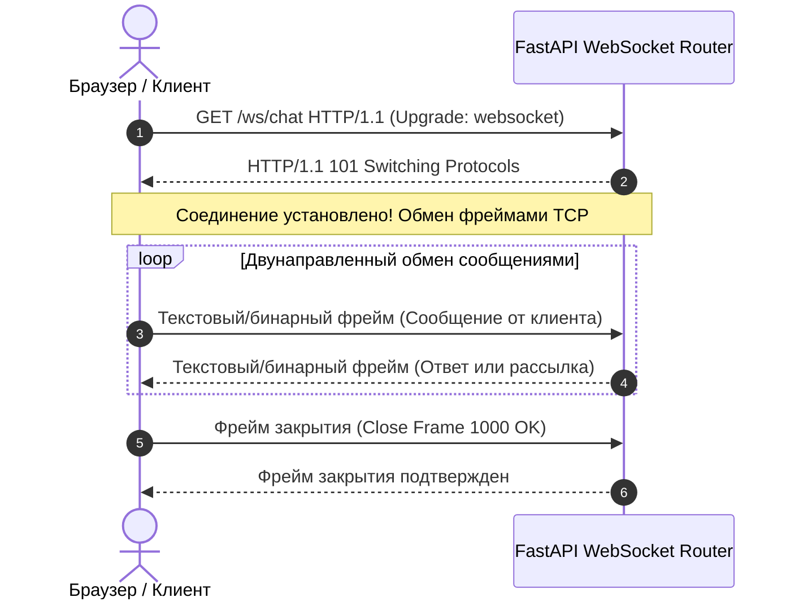
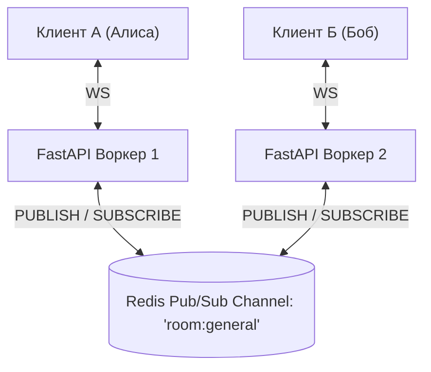

# 05. Real-time в FastAPI: WebSockets, Connection Manager, Server-Sent Events (SSE) и StreamingResponse

[[04_Caching_Redis_RateLimiting|← Предыдущая глава: Кэширование и Rate Limiting]] | [[00_Module_05_MOC|Модуль 05 MOC]] | [[06_FastAPI_Pro_Production/01_Clean_Architecture_DDD|Модуль 06: Чистая Архитектура и Продакшн →]]

Классическая модель HTTP «запрос-ответ» (Request-Response) ориентирована на инициативу клиента: сервер не может самостоятельно отправить данные в браузер без предварительного запроса. Для построения современных интерактивных приложений — чатов, биржевых котировок, дашбордов мониторинга и стриминга ответов больших языковых моделей (LLM) — требуются протоколы реального времени.

В этой главе мы разберем:
1. Сравнение подходов: **Polling**, **WebSockets** и **Server-Sent Events (SSE)**.
2. Протокол **WebSocket** в FastAPI: рукопожатие (Handshake), жизненный цикл и обработка разрывов связи.
3. Проектирование **ConnectionManager** для комнат и каналов.
4. Горизонтальное масштабирование WebSocket-кластера через **Redis Pub/Sub**.
5. Особенности безопасной аутентификации WebSocket-соединений.
6. Однонаправленный стриминг через **Server-Sent Events (SSE)** и **`StreamingResponse`** для генерации токенов LLM и выгрузки гигантских файлов без переполнения оперативной памяти.

---

## 1. Обзор технологий Real-Time передачи данных

| Критерий | Short / Long Polling | Server-Sent Events (SSE) | WebSockets (WS) |
|---|---|---|---|
| **Направление** | Полудуплекс (клиент опрашивает сервер) | Однонаправленный (Сервер $\rightarrow$ Клиент) | Полнодуплексный двунаправленный (Сервер $\leftrightarrow$ Клиент) |
| **Протокол** | Стандартный HTTP | HTTP/1.1 или HTTP/2 (`text/event-stream`) | Свой бинарный/текстовый фреймовый протокол (`ws://`, `wss://`) поверх TCP |
| **Накладные расходы** | Огромные (HTTP-заголовки, рукопожатие на каждый запрос) | Минимальные (одно постоянное HTTP-соединение) | Минимальные (фрейм от 2 до 10 байт оверхеда) |
| **Авто-переподключение** | Вручную | Нативно встроено в браузер (`EventSource`) | Вручную (в JS-коде клиента) |
| **Типичные кейсы** | Устаревшие системы | Стриминг LLM (ChatGPT), лента новостей, уведомления | Чаты, онлайн-игры, коллаборативные редакторы (Figma) |

---

## 2. Протокол WebSocket в FastAPI

Соединение начинается как обычный HTTP-запрос с заголовками `Upgrade: websocket` и `Connection: Upgrade` (HTTP Status `101 Switching Protocols`), после чего TCP-сокет переключается в полнодуплексный режим:



### Реализация эндпоинта в FastAPI

```python
from fastapi import FastAPI, WebSocket, WebSocketDisconnect

app = FastAPI()

@app.websocket("/ws/echo")
async def websocket_echo_endpoint(websocket: WebSocket):
    # Принимаем входящее рукопожатие
    await websocket.accept()
    try:
        while True:
            # Неблокирующее ожидание текстового сообщения
            data = await websocket.receive_text()
            # Отправка ответа клиенту
            await websocket.send_text(f"Эхо: {data}")
    except WebSocketDisconnect as exc:
        # Обработка штатного или аварийного разрыва соединения клиентом
        print(f"Клиент отключился, код: {exc.code}")
```

---

## 3. Архитектура ConnectionManager (Комнаты и Рассылка)

В реальных сервисах сообщения адресуются конкретным пользователям (Direct Message) или группам (Rooms / Channels). За управление списком активных сокетов отвечает сервис **`ConnectionManager`**:

```python
from collections import defaultdict
from fastapi import WebSocket

class ConnectionManager:
    def __init__(self) -> None:
        # Словарь: имя комнаты -> список активных WebSocket соединений
        self.active_rooms: dict[str, list[WebSocket]] = defaultdict(list)

    async def connect(self, room_id: str, websocket: WebSocket) -> None:
        await websocket.accept()
        self.active_rooms[room_id].append(websocket)

    def disconnect(self, room_id: str, websocket: WebSocket) -> None:
        if websocket in self.active_rooms[room_id]:
            self.active_rooms[room_id].remove(websocket)
        if not self.active_rooms[room_id]:
            del self.active_rooms[room_id]

    async def send_personal_message(self, message: dict, websocket: WebSocket) -> None:
        await websocket.send_json(message)

    async def broadcast_to_room(self, room_id: str, message: dict) -> None:
        """Рассылка сообщения всем участникам комнаты."""
        dead_connections: list[WebSocket] = []
        for connection in self.active_rooms.get(room_id, []):
            try:
                await connection.send_json(message)
            except Exception:
                dead_connections.append(connection)

        # Очистка "зависших" разорванных соединений
        for dead in dead_connections:
            self.disconnect(room_id, dead)

manager = ConnectionManager()
```

---

## 4. Масштабирование WebSockets через Redis Pub/Sub

Когда приложение масштабируется на несколько Uvicorn воркеров или контейнеров Kubernetes, `ConnectionManager` в оперативной памяти каждого процесса изолирован:
- Клиент А подключен к **Воркеру 1**.
- Клиент Б подключен к **Воркеру 2**.
Если Клиент А отправляет сообщение в комнату, Воркер 1 не знает о существовании Клиента Б на соседнем воркере.

### Решение: Архитектура шины сообщений Redis Pub/Sub



1. При подключении первого сокета к комнате на воркере запускается фоновая задача-слушатель Redis: `pubsub.subscribe(f"room:{room_id}")`.
2. Когда любой клиент шлет сообщение, сервер делает `PUBLISH room:{room_id} payload`.
3. Все серверы кластера моментально получают событие от Redis и рассылают его своим локально подключенным клиентам.

---

## 5. Аутентификация в WebSockets

> [!CAUTION] Ограничение браузерного API WebSocket
> Стандартный конструктор JavaScript `new WebSocket(url)` **не позволяет передавать кастомные HTTP-заголовки** (например, `Authorization: Bearer <token>`). 

Существует три безопасных способа аутентификации WebSocket:

1. **Query-параметр с токеном**:
   `wss://api.example.com/ws/chat?token=eyJhbGci...`
   - *Плюс*: Простота.
   - *Минус*: Токен может утекать в логи прокси-серверов (Nginx/Cloudflare access logs).
2. **Аутентификация через одноразовый билет (Ticket Pattern / Рекомендовано)**:
   - Клиент делает обычный HTTP POST с заголовком Authorization: `POST /api/v1/ws-ticket`.
   - Бэкенд генерирует короткоживущий (15-30 секунд) одноразовый UUID-тикет в Redis.
   - Клиент подключается по сокету: `wss://api.example.com/ws/chat?ticket=f3b2...`.
   - Бэкенд валидирует тикет, мгновенно удаляет его из Redis и принимает соединение.
3. **Subprotocol Authentication**:
   Передача токена вторым аргументом: `new WebSocket(url, ['bearer', token])`. Токен передается в заголовке `Sec-WebSocket-Protocol`.

---

## 6. Server-Sent Events (SSE) и `StreamingResponse`

Для сценариев, где данные идут исключительно от сервера к клиенту (генерация текста в ChatGPT, отслеживание статуса длительного фонового экспорта), WebSockets избыточны. На помощь приходят **Server-Sent Events (SSE)**.

### Формат протокола `text/event-stream` (W3C Standard)
Сообщения передаются в виде простого UTF-8 текста, разделенного двойным переводом строки `\n\n`:
```text
event: message_delta
id: 1042
retry: 5000
data: {"token": "Привет", "is_finished": false}

```

### Потоковая генерация ответов в FastAPI

FastAPI предоставляет класс **`StreamingResponse`**, принимающий асинхронный генератор:

```python
import asyncio
from collections.abc import AsyncGenerator
from fastapi import FastAPI
from fastapi.responses import StreamingResponse

app = FastAPI()

async def llm_token_generator(prompt: str) -> AsyncGenerator[str, None]:
    """Имитация посимвольного вывода ответа нейросети."""
    tokens = ["Добро ", "пожаловать ", "в ", "мир ", "FastAPI ", "и ", "Real-time!"]
    for i, token in enumerate(tokens):
        await asyncio.sleep(0.15)  # Имитация инференса модели
        # Формирование SSE фрейма
        yield f"event: token\nid: {i}\ndata: {token}\n\n"
    yield "event: done\ndata: [END]\n\n"

@app.get("/api/v1/generate")
async def stream_ai_response(prompt: str = "Hello"):
    return StreamingResponse(
        llm_token_generator(prompt),
        media_type="text/event-stream",
        headers={
            "Cache-Control": "no-cache",
            "Connection": "keep-alive",
            "X-Accel-Buffering": "no",  # Отключение буферизации в Nginx!
        },
    )
```

> [!IMPORTANT] Важно для Nginx / Прокси: `X-Accel-Buffering: no`
> По умолчанию реверс-прокси Nginx буферизует ответы до заполнения чанка (обычно 4-8 КБ). Без заголовка `X-Accel-Buffering: no` стриминг токенов превратится в рывки: пользователь увидит ответ не плавно слово за словом, а сразу огромным куском после паузы.

---

## Практическое задание

Для закрепления работы с WebSockets, комнатами, распределенной рассылкой сообщений и Server-Sent Events выполните:

👉 **[[ex_05_websockets_sse.py]]**

В файле упражнения реализованы:
- Асинхронный менеджер WebSocket-соединений с поддержкой комнат, широковещательной рассылки и точечных сообщений.
- Эмулятор распределенного Pub/Sub брокера для взаимодействия между воркерами.
- Валидатор и форматтер спецификации Server-Sent Events (`text/event-stream`).
- Потоковый сборщик асинхронных генераторов для тестирования потоковой отдачи без утечек памяти.

Запуск тестов:
```bash
python3 exercises/05_fastapi_data_auth/ex_05_websockets_sse.py
```
