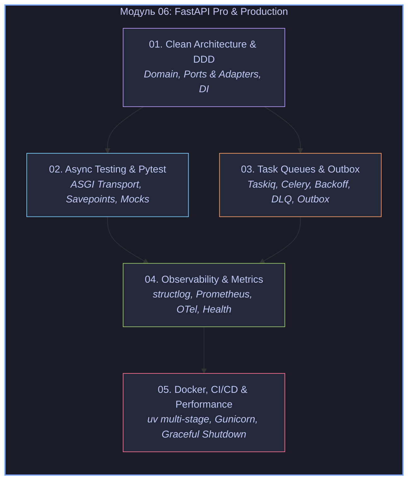

# Модуль 06: Production, Архитектура, Тестирование и Деплой

Добро пожаловать в завершающий, инженерный модуль учебника! Если предыдущие модули научили вас писать асинхронный код на Python, разрабатывать API на FastAPI и работать с базами данных, то цель шестого модуля — **трансформировать ваш сервис в отказоустойчивую, масштабируемую production-ready систему Enterprise-уровня**.

Здесь мы выходим за рамки простых CRUD-приложений и разбираем промышленную разработку: чистую архитектуру и тактический DDD, тестирование без боли и компромиссов, надежные распределенные очереди задач с защитой от потери данных, наблюдаемость (Observability) и современные практики контейнеризации и деплоя.

> [!IMPORTANT] Навигация по курсу
> - Возврат к главной карте знаний учебника: [[00_Index_MOC|Главная карта знаний (MOC)]]
> - Предыдущий модуль: [[05_FastAPI_Data_Auth/00_Module_05_MOC|Модуль 05: Базы данных, Безопасность и Real-time]]

---

## Архитектурный ландшафт модуля



---

## Содержание модуля

| № | Тема | Ключевые концепции | Практика |
|---|---|---|---|
| **01** | [[01_Clean_Architecture_DDD\|01. Чистая архитектура и тактический DDD]] | Clean Architecture, Hexagonal (Ports & Adapters), разделение на слои (Domain, Application, Infrastructure, Presentation), Value Objects, Entities, Aggregate Roots, Domain Events, Dependency Rule, Dishka / FastAPI DI | [[ex_01_clean_architecture.py]] |
| **02** | [[02_Async_Testing_Pytest_Mocks\|02. Асинхронное тестирование и Pytest]] | Пирамида тестов, `pytest-asyncio`, `httpx.AsyncClient` с `ASGITransport`, транзакционная изоляция БД через `SAVEPOINT`, фабрики `polyfactory`, мокирование с `respx` и `AsyncMock`, `dependency_overrides` | [[ex_02_async_testing.py]] |
| **03** | [[03_Task_Queues_Celery_Taskiq_Broker\|03. Распределенные очереди задач и Outbox]] | Ограничения `BackgroundTasks`, Taskiq vs Celery vs ARQ, RabbitMQ / Redis / Kafka, гарантии доставки, идемпотентность, Exponential Backoff + Jitter, Dead Letter Queue (DLQ), паттерн **Transactional Outbox** | [[ex_03_task_queues_outbox.py]] |
| **04** | [[04_Observability_Logging_Prometheus\|04. Observability: логи, метрики, трейсинг]] | Три столпа наблюдаемости, структурное JSON-логирование (`structlog`), сквозной `X-Correlation-ID` через `contextvars`, метрики Prometheus (Counter, Gauge, Histogram, квантили $p_{50}, p_{95}, p_{99}$, RED), OpenTelemetry, `/healthz` и `/readyz` | [[ex_04_observability_metrics.py]] |
| **05** | [[05_Docker_CI_CD_Performance_Pro\|05. Production-деплой, CI/CD и тюнинг]] | 12-Factor App конфигурация (`pydantic-settings`), multi-stage сборка Docker с `uv`, безопасность (non-root), Gunicorn + `UvicornWorker` vs Kubernetes, Graceful Shutdown (`SIGTERM`), профилирование (`py-spy`), `uvloop`, `orjson`, GitHub Actions | [[ex_05_production_config.py]] |

---

## Инженерные ориентиры модуля

> [!NOTE] Почему этот модуль критически важен?
> В учебных пособиях часто показывают код, где роутер FastAPI напрямую импортирует модель SQLAlchemy, делает `db.add(...)` и тут же отправляет email. В небольшом пет-проекте это работает. Но при росте команды и кодовой базы:
> 1. **Любое изменение схемы БД ломает бизнес-логику.**
> 2. **Тесты становятся медленными и хрупкими**, требуя поднятия десятка внешних сервисов.
> 3. **Фоновые задачи теряются** при перезагрузке подов Kubernetes.
> 4. **Ошибки в проде превращаются в детектив**, потому что логи представляют собой неструктурированный текст без сквозных идентификаторов.
>
> Главы этого модуля дают проверенные индустрией паттерны и готовые рецепты для устранения этих проблем.

Запускайте проверочные тесты упражнений модуля из корня репозитория:
```bash
python3 exercises/06_fastapi_pro/ex_01_clean_architecture.py
python3 exercises/06_fastapi_pro/ex_02_async_testing.py
python3 exercises/06_fastapi_pro/ex_03_task_queues_outbox.py
python3 exercises/06_fastapi_pro/ex_04_observability_metrics.py
python3 exercises/06_fastapi_pro/ex_05_production_config.py
```
Или все тесты разом:
```bash
python3 run_all_tests.py
```
