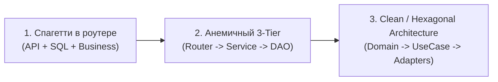
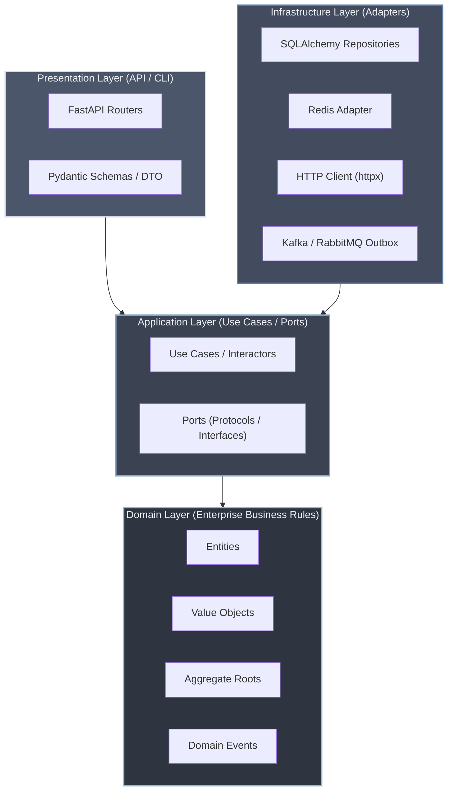
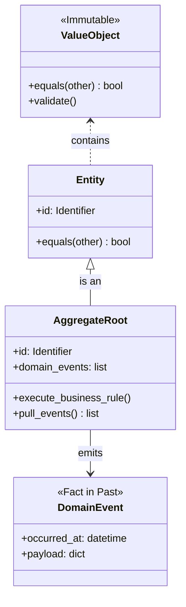
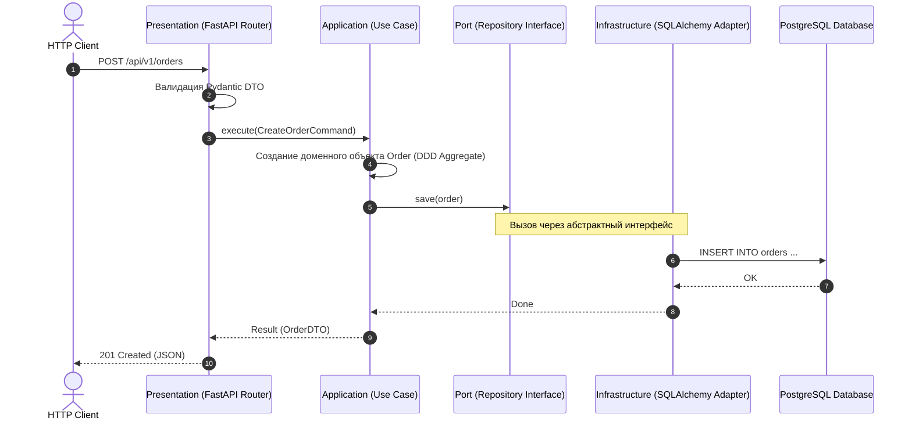
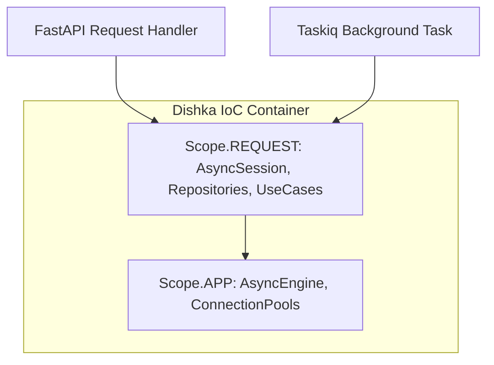

# 01. Чистая архитектура (Clean Architecture), Hexagonal и тактический DDD в FastAPI

В начале разработки любого веб-приложения на FastAPI разработчики стремятся к максимальной скорости: роутер принимает запрос, тут же вызывает методы ORM SQLAlchemy, выполняет расчеты и отправляет ответ клиенту. Такой подход называется **«Транзакционным сценарием» (Transaction Script)** или кодом в стиле «быстрого прототипа».

Однако по мере роста проекта (десятки разработчиков, сотни бизнес-правил, интеграции с внешними платежными шлюзами, CRM и брокерами сообщений) классический монолитный код превращается в трудноподдерживаемый «спагетти-клубок».

В этой главе мы разберем, как построить надежную, легко тестируемую и масштабируемую архитектуру на стыке **Clean Architecture (Роберт Мартин)**, **Hexagonal Architecture (Ports & Adapters, Алистер Кокберн)** и **Domain-Driven Design (DDD, Эрик Эванс)**.

---

## 1. Проблемы наивной архитектуры при росте проекта

Типичная эволюция структуры FastAPI-проекта проходит следующие этапы:



### Главные симптомы деградации кода

1. **Протекание инфраструктуры в бизнес-логику:**
   В моделях данных или сервисах появляются типы `fastapi.HTTPException`, `fastapi.UploadFile`, типы SQLAlchemy (`Session`, `select`) или Pydantic DTO. В итоге бизнес-правило невозможно запустить в консольной утилите, фоновом воркере Celery/Taskiq или в изолированном unit-тесте без эмуляции HTTP-контекста.
2. **Анемичная модель данных (Anemic Domain Model):**
   Сущности представляют собой простые «структуры данных» с публичными полями (Pydantic-модели или модели SQLAlchemy), а вся логика валидации и изменения состояния размазана по сервисам. Невозможно гарантировать инварианты: любой сервис может установить статус `Order.status = "PAID"` в обход проверки факта оплаты.
3. **Хрупкие тесты:**
   Чтобы протестировать бизнес-логику скидки на товар, приходится поднимать реальную тестовую базу данных PostgreSQL, запускать миграции Alembic и формировать реальные HTTP-запросы через TestClient. Время выполнения тестов вырастает с миллисекунд до десятков минут.

---

## 2. Гексагональная архитектура (Ports & Adapters) и Clean Architecture

### Луковая структура (Onion / Clean)

Главный закон чистой архитектуры — **The Dependency Rule (Правило направленности зависимостей)**:
> Зависимости в коде должны быть направлены строго внутрь — от внешних, изменчивых деталей (фреймворки, БД, UI) к стабильному бизнес-ядру (Use Cases и Domain). Внутренние слои ничего не знают о внешних.



### Назначение слоев

| Слой | Ответственность | Разрешенные зависимости | Запрещенные зависимости |
|---|---|---|---|
| **Domain** | Чистые бизнес-правила, инварианты, расчеты, терминология предметной области (Ubiquitous Language). | Только стандартная библиотека Python (dataclasses, typing, enum, math). | Никаких сторонних библиотек: нет FastAPI, SQLAlchemy, Pydantic, Redis! |
| **Application** | Сценарии использования системы (Use Cases). Оркестрирует вызовы доменных объектов, определяет контракты (Порты). | Domain, стандартная библиотека Python. | Конкретные реализации БД, веб-фреймворки, внешние API. |
| **Infrastructure** | Реализация портов (Вторичные/Driven адаптеры): работа с SQL, Redis, отправка писем, интеграции с внешними REST API. | Application (импортирует порты для реализации), сторонние библиотеки (SQLAlchemy, httpx, redis). | Presentation (роутеры). |
| **Presentation** | Первичные (Driving) адаптеры: HTTP API на FastAPI, CLI-команды, парсинг заголовков, Pydantic DTO валидация, DI-контейнер. | Application (вызывает Use Cases), Infrastructure (для сборки DI). | Прямой вызов доменной логики в обход Use Case. |

---

## 3. Тактические паттерны Domain-Driven Design (DDD)

Для моделирования богатого доменного слоя (Rich Domain Model) используются 4 ключевых строительных блока:



### 1. Value Objects (Объекты-значения)
- Не имеют уникального идентификатора.
- **Неизменяемы (immutable)**: при изменении порождается новый объект.
- Сравниваются по значениям атрибутов, а не по ссылке в памяти.
- Инкапсулируют собственную валидацию.

```python
from __future__ import annotations
from dataclasses import dataclass
from decimal import Decimal
import re

@dataclass(frozen=True, slots=True)
class Money:
    amount: Decimal
    currency: str

    def __post_init__(self) -> None:
        if self.amount < Decimal("0.00"):
            raise ValueError(f"Сумма денег не может быть отрицательной: {self.amount}")
        if len(self.currency) != 3 or not self.currency.isupper():
            raise ValueError(f"Некорректный ISO код валюты: {self.currency}")

    def add(self, other: Money) -> Money:
        if self.currency != other.currency:
            raise ValueError(f"Невозможно сложить валюты {self.currency} и {other.currency}")
        return Money(self.amount + other.amount, self.currency)

@dataclass(frozen=True, slots=True)
class Email:
    value: str

    def __post_init__(self) -> None:
        pattern = r"^[\w\.-]+@[\w\.-]+\.\w+$"
        if not re.match(pattern, self.value):
            raise ValueError(f"Некорректный email адрес: {self.value}")
```

### 2. Entities (Сущности)
- Имеют уникальный идентификатор (`id`), сохраняющийся на протяжении всей жизни объекта.
- Два объекта с одинаковыми атрибутами, но разными `id` — это разные сущности.
- Мутируют исключительно через явные методы, выражающие намерения бизнеса.

### 3. Aggregate Root (Корень агрегата)
- Агрегат — это кластер связанных сущностей и объектов-значений, рассматриваемый как единое целое с точки зрения изменения данных.
- **Инвариант** — бизнес-правило, которое должно соблюдаться ВСЕГДА.
- Внешний код может взаимодействовать с сущностями внутри агрегата ТОЛЬКО через Корень агрегата (Aggregate Root).

### 4. Domain Events (События домена)
- Запись о факте, произошедшем в предметной области (называется в прошедшем времени: `OrderCreated`, `PaymentCompleted`).
- Агрегат регистрирует события внутри себя при успешном изменении состояния. Use Case извлекает события и передает их в Outbox / Event Bus.

---

## 4. Порты и Адаптеры (Ports & Adapters)

Порт — это абстрактный контракт (в Python — `typing.Protocol` или `abc.ABC`), объявленный в слое **Application**.
Адаптер — это конкретная реализация порта в слое **Infrastructure**.



---

## 5. Полная реализация домена заказов (Production Example)

### Слой 1: Domain (`domain/order.py`)

```python
from __future__ import annotations
from dataclasses import dataclass, field
from datetime import datetime, timezone
from decimal import Decimal
from enum import Enum
from uuid import UUID, uuid4

# --- Value Objects ---
@dataclass(frozen=True, slots=True)
class OrderId:
    value: UUID = field(default_factory=uuid4)

@dataclass(frozen=True, slots=True)
class Money:
    amount: Decimal
    currency: str = "RUB"

    def __post_init__(self) -> None:
        if self.amount < Decimal("0.00"):
            raise ValueError("Сумма не может быть отрицательной")

    def __add__(self, other: Money) -> Money:
        if self.currency != other.currency:
            raise ValueError("Валюты не совпадают")
        return Money(self.amount + other.amount, self.currency)

class OrderStatus(str, Enum):
    DRAFT = "DRAFT"
    PAID = "PAID"
    CANCELLED = "CANCELLED"

# --- Domain Events ---
@dataclass(frozen=True, slots=True)
class OrderPaidEvent:
    order_id: UUID
    paid_at: datetime
    amount: Decimal
    currency: str

# --- Entity ---
@dataclass(slots=True)
class OrderItem:
    item_id: UUID
    title: str
    price: Money
    quantity: int

    def __post_init__(self) -> None:
        if self.quantity <= 0:
            raise ValueError("Количество должно быть положительным числом")

    @property
    def subtotal(self) -> Money:
        return Money(self.price.amount * self.quantity, self.price.currency)

# --- Aggregate Root ---
class Order:
    def __init__(
        self,
        order_id: OrderId,
        customer_email: str,
        items: list[OrderItem] | None = None,
        status: OrderStatus = OrderStatus.DRAFT,
    ) -> None:
        self.id = order_id
        self.customer_email = customer_email
        self._items: list[OrderItem] = items or []
        self._status = status
        self._events: list[object] = []

    @property
    def status(self) -> OrderStatus:
        return self._status

    @property
    def items(self) -> tuple[OrderItem, ...]:
        return tuple(self._items)

    @property
    def total_cost(self) -> Money:
        if not self._items:
            return Money(Decimal("0.00"))
        total = self._items[0].subtotal
        for item in self._items[1:]:
            total = total + item.subtotal
        return total

    def add_item(self, item: OrderItem) -> None:
        if self._status != OrderStatus.DRAFT:
            raise ValueError("Нельзя изменять состав заказа после оплаты или отмены")
        self._items.append(item)

    def pay(self) -> None:
        if self._status == OrderStatus.PAID:
            raise ValueError("Заказ уже оплачен")
        if self._status == OrderStatus.CANCELLED:
            raise ValueError("Нельзя оплатить отмененный заказ")
        if not self._items:
            raise ValueError("Невозможно оплатить пустой заказ")

        self._status = OrderStatus.PAID
        # Фиксация доменного события
        event = OrderPaidEvent(
            order_id=self.id.value,
            paid_at=datetime.now(timezone.utc),
            amount=self.total_cost.amount,
            currency=self.total_cost.currency,
        )
        self._events.append(event)

    def pull_events(self) -> list[object]:
        """Забирает накопленные события для публикации и очищает внутренний буфер."""
        events = self._events.copy()
        self._events.clear()
        return events
```

### Слой 2: Application (`application/ports.py` и `application/use_cases.py`)

```python
from typing import Protocol
from uuid import UUID

# --- Порты (Интерфейсы) ---
class OrderRepositoryPort(Protocol):
    async def get_by_id(self, order_id: UUID) -> Order | None:
        ...

    async def save(self, order: Order) -> None:
        ...

class NotificationServicePort(Protocol):
    async def send_order_receipt(self, email: str, order_id: UUID, amount: Decimal) -> None:
        ...

# --- Use Case (Сценарий оплаты заказа) ---
class PayOrderUseCase:
    def __init__(
        self,
        order_repo: OrderRepositoryPort,
        notifier: NotificationServicePort,
    ) -> None:
        self._order_repo = order_repo
        self._notifier = notifier

    async def execute(self, order_id: UUID) -> Order:
        order = await self._order_repo.get_by_id(order_id)
        if order is None:
            raise LookupError(f"Заказ с ID {order_id} не найден")

        # 1. Изменение состояния в доменной модели с проверкой инвариантов
        order.pay()

        # 2. Сохранение обновленного агрегата
        await self._order_repo.save(order)

        # 3. Обработка доменных событий
        for event in order.pull_events():
            if isinstance(event, OrderPaidEvent):
                await self._notifier.send_order_receipt(
                    email=order.customer_email,
                    order_id=event.order_id,
                    amount=event.amount,
                )

        return order
```

### Слой 3: Infrastructure (`infrastructure/adapters.py`)

```python
# InMemory адаптер для тестов и локальной разработки
class InMemoryOrderRepository(OrderRepositoryPort):
    def __init__(self) -> None:
        self._storage: dict[UUID, Order] = {}

    async def get_by_id(self, order_id: UUID) -> Order | None:
        return self._storage.get(order_id)

    async def save(self, order: Order) -> None:
        self._storage[order.id.value] = order

class LogNotificationAdapter(NotificationServicePort):
    async def send_order_receipt(self, email: str, order_id: UUID, amount: Decimal) -> None:
        print(f"[EMAIL] Отправлен чек клиенту {email} за заказ {order_id} на сумму {amount}")
```

### Слой 4: Presentation (`presentation/api.py`)

```python
from fastapi import APIRouter, Depends, HTTPException, status
from pydantic import BaseModel, ConfigDict
from uuid import UUID
from decimal import Decimal

router = APIRouter(prefix="/orders", tags=["Orders"])

# DTO (Pydantic) для API
class OrderResponseDTO(BaseModel):
    model_config = ConfigDict(from_attributes=True)
    id: UUID
    customer_email: str
    status: str
    total_amount: Decimal

# DI-провайдер сценария
def get_pay_order_use_case() -> PayOrderUseCase:
    # В проде здесь создается адаптер к SQLAlchemy / Dishka
    repo = InMemoryOrderRepository()
    notifier = LogNotificationAdapter()
    return PayOrderUseCase(order_repo=repo, notifier=notifier)

@router.post("/{order_id}/pay", response_model=OrderResponseDTO)
async def pay_order_endpoint(
    order_id: UUID,
    use_case: PayOrderUseCase = Depends(get_pay_order_use_case),
) -> OrderResponseDTO:
    try:
        updated_order = await use_case.execute(order_id)
        return OrderResponseDTO(
            id=updated_order.id.value,
            customer_email=updated_order.customer_email,
            status=updated_order.status.value,
            total_amount=updated_order.total_cost.amount,
        )
    except LookupError as err:
        raise HTTPException(status_code=status.HTTP_404_NOT_FOUND, detail=str(err))
    except ValueError as err:
        raise HTTPException(status_code=status.HTTP_400_BAD_REQUEST, detail=str(err))
```

---

## 6. Внедрение зависимостей: FastAPI Depends vs Dishka

Хотя механизм `Depends()` в FastAPI удобен для простых задач, у него есть ограничения при строгой чистой архитектуре:
- `Depends()` привязывает фабрику объектов к веб-фреймворку.
- Сложно организовывать контексты жизненного цикла (App scope vs Request scope) вне HTTP-хендлеров (например, в Taskiq или CLI).

Библиотека **Dishka** — современный стандарт IoC/DI контейнера в Python:
- Разделение на строгие скоупы: `Scope.APP` (синглтоны: Engine, HTTP-клиент), `Scope.REQUEST` (сессия БД, Unit of Work), `Scope.ACTION` (конкретная операция).
- Автоматическая интеграция с FastAPI, Aiohttp, Taskiq, Litestar, Aiogram.
- Use Cases не содержат ссылок на фреймворк и могут разрешаться в любых точках входа.



---

## Резюме

1. **Clean Architecture** защищает бизнес-логику от частых изменений библиотек, СУБД и веб-фреймворков.
2. **Domain** содержит сущности и бизнес-правила на чистом Python без внешних зависимостей.
3. **Ports & Adapters** изолируют работу с БД, шинами сообщений и HTTP-клиентами через абстрактные интерфейсы.
4. **Use Cases** инкапсулируют бизнес-сценарии приложения и легко покрываются быстрыми модульными тестами.

---

## Практическое задание

Реализуйте и протестируйте полноценный доменный слой интернет-магазина (Value Objects `Email` и `Money`, Aggregate Root `Order`, порты репозиториев и сценарии `CreateOrderUseCase` и `PayOrderUseCase`) в изолированном практическом модуле:

👉 **Файл с заданием и тестами:** [[ex_01_clean_architecture.py]]

Запуск проверки:
```bash
python3 exercises/06_fastapi_pro/ex_01_clean_architecture.py
```
