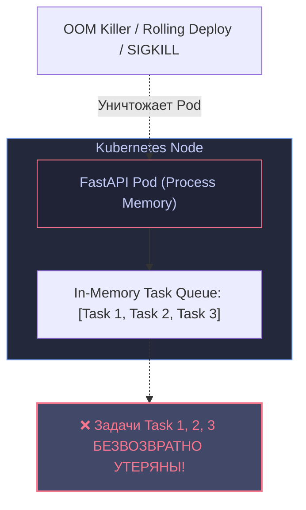
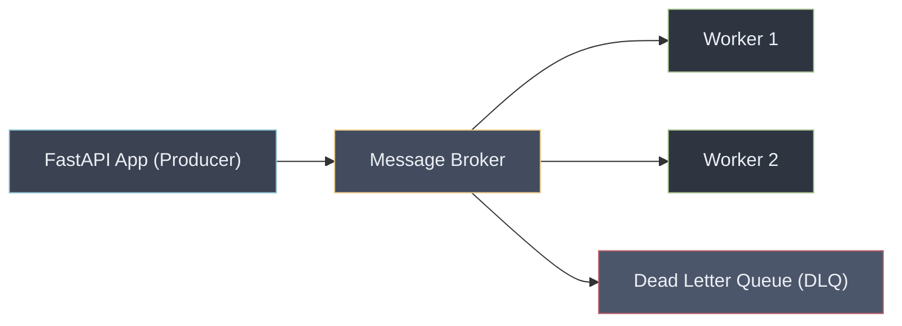
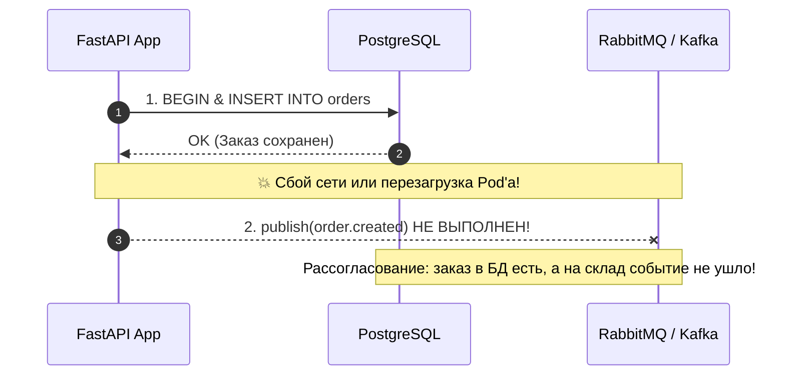
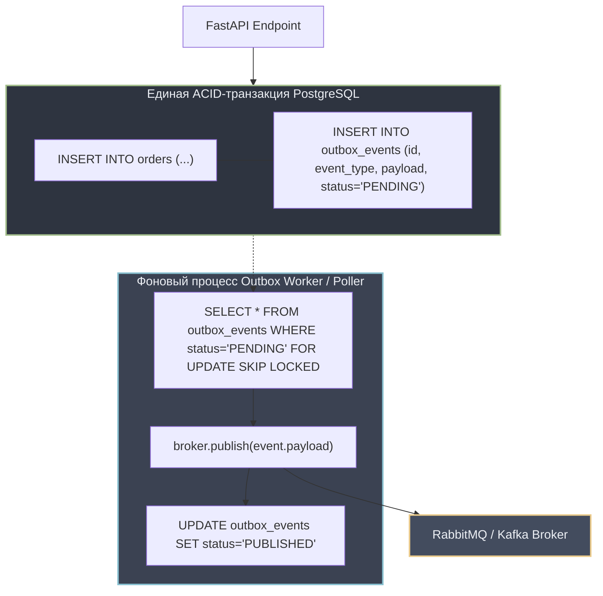

# 03. Распределенные очереди задач (Taskiq / Celery), паттерн Transactional Outbox и брокеры сообщений

В современных высоконагруженных веб-сервисах долгие операции (генерация PDF-отчетов, машинное обучение, отправка email, видеокодирование, синхронизация с платежными шлюзами) категорически запрещено выполнять синхронно внутри HTTP-запроса. Пользователь не должен ждать секунды или минуты ответа сервера, а HTTP-соединение может быть разорвано по таймауту.

В этой главе мы разберем архитектуру асинхронных очередей задач, ограничения стандартного `BackgroundTasks`, сравнение современных инструментов (`Taskiq` vs `Celery`), обеспечение надежности доставки (`at-least-once`), экспоненциальный откат (Exponential Backoff + Jitter), очереди недоставленных сообщений (DLQ) и архитектурный паттерн **Transactional Outbox**.

---

## 1. Почему `BackgroundTasks` в FastAPI непригоден для Production?

В документации FastAPI часто демонстрируется использование `starlette.background.BackgroundTasks`:

```python
# АНТИПАТТЕРН ДЛЯ КРИТИЧНЫХ ЗАДАЧ В ПРОДЕ!
@app.post("/orders")
async def create_order(order_data: OrderSchema, background_tasks: BackgroundTasks):
    order = save_order(order_data)
    # Выполняется в фоновом таске внутри того же процесса Python
    background_tasks.add_task(send_invoice_email, order.id)
    return {"order_id": order.id}
```

### Фатальные недостатки `BackgroundTasks`:



1. **Потеря задач при падении процесса:** Задачи хранятся в оперативной памяти инстанса. Если под перезагружается (OOM-killer, деплой новой версии, автоматическое масштабирование HPA), все накопленные задачи испаряются.
2. **Конкуренция за CPU и Event Loop:** Вычисления или блокирующие операции конкурируют за ресурсы с обработкой входящего сетевого трафика FastAPI.
3. **Отсутствие инфраструктурных механизмов:** Нет повторов при сбоях (retries), нет задержек по расписанию (scheduled tasks), нет распределения по нескольким независимым серверам-воркерам.

---

## 2. Сравнение современных асинхронных исполнителей задач

| Критерий | Taskiq | ARQ | Celery |
|---|---|---|---|
| **Модель выполнения** | Asyncio-first (нативная асинхронность) | Asyncio-first | Синхронные процессы (Prefork / Threads / Gevent) |
| **Интеграция с FastAPI** | Нативная поддержка DI (FastAPI `Depends` и Dishka) | Ручная передача контекста | Требует хаков и создания отдельных циклов событий |
| **Поддерживаемые брокеры** | Redis, RabbitMQ, NATS, Kafka, ZeroMQ, In-Memory | Только Redis | Redis, RabbitMQ, SQS |
| **Зрелость экосистемы** | Современная (быстрорастущий стандарт в Python 3.11+) | Средняя | 15+ лет (Flower, Celery Beat, огромный стек) |
| **Потребление ресурсов** | Минимальное (один процесс держит тысячи асинхронных задач) | Минимальное | Высокое (процесс на каждый воркер) |

> [!TIP] Выбор инструмента в 2026 году
> - Для новых микросервисов на **FastAPI / Python 3.12+** идеальным выбором является **`Taskiq`** благодаря его нативной асинхронности, чистой типизации и интеграции с Dependency Injection.
> - Если в проекте уже развернут legacy-стек с мониторингом **Flower** и синхронным кодом — используйте проверенный временем **`Celery`**.

---

## 3. Брокеры сообщений: RabbitMQ vs Redis vs Kafka



1. **RabbitMQ (AMQP 0-9-1):**
   - Умный брокер — глупый потребитель.
   - Сложная маршрутизация: Exchanges (`direct`, `topic`, `fanout`, `headers`).
   - Гарантированное подтверждение (`ack`/`nack`), персистентные очереди на диске.
2. **Redis (Streams / Lists):**
   - Сверхбыстрый брокер в оперативной памяти.
   - Минимальные накладные расходы при развертывании.
   - Ограничен объемом RAM; риск потери данных при экстремальных перезагрузках нод без fsync.
3. **Apache Kafka:**
   - Распределенный неизменяемый журнал событий (Append-only Log).
   - Огромная пропускная способность (миллионы сообщений в секунду), шардирование по партициям.
   - Порядок гарантирован строго внутри одной партиции.

---

## 4. Гарантии доставки и идемпотентность воркеров

В распределенных системах гарантировать строго однократную доставку (Exactly-Once Delivery) по сети математически невозможно из-за проблемы византийских генералов и сбоев TCP.

Поэтому стандарт индустрии — **At-Least-Once Delivery (доставка как минимум один раз)**:
- Воркер забирает задачу.
- Выполняет бизнес-логику.
- Отправляет брокеру подтверждение (`ACK`).
- Если воркер упал до отправки `ACK`, брокер отдаст задачу другому воркеру.

> [!IMPORTANT] Принцип идемпотентности воркеров
> Поскольку задача может прийти повторно, обработчик **ОБЯЗАН быть идемпотентным**.
> Повторное выполнение задачи с тем же `Idempotency-Key` или `Event-ID` не должно приводить к дублированию платежей или повторной отправке товаров!

### Шаблон идемпотентного обработчика:

```python
async def process_payment_task(event_id: str, order_id: str, amount: float):
    # 1. Атомарная проверка в БД: обработано ли уже данное событие?
    async with db.transaction():
        processed = await db.fetch_val(
            "SELECT 1 FROM processed_events WHERE event_id = :id FOR UPDATE",
            {"id": event_id},
        )
        if processed:
            logger.info("Событие %s уже обработано. Пропуск.", event_id)
            return

        # 2. Выполнение бизнес-логики
        await charge_credit_card(order_id, amount)

        # 3. Фиксация факта обработки события
        await db.execute(
            "INSERT INTO processed_events (event_id, processed_at) VALUES (:id, NOW())",
            {"id": event_id},
        )
```

---

## 5. Повторные попытки: Exponential Backoff, Jitter и DLQ

Если внешний сервис временно недоступен (503 Service Unavailable, таймаут сети), наивная немедленная повторная попытка вызовет эффект **«Лавины запросов» (Thundering Herd)** и окончательно обрушит упавший сервис.

### Формула экспоненциального отката со случайным шумом (Jitter):

$$T_{\text{wait}} = \min\left(T_{\max}, T_{\text{base}} \cdot 2^{\text{attempt}}\right) \pm \text{uniform}(0, \text{jitter})$$

- $T_{\text{base}}$: Базовый интервал (например, 1 секунда).
- $T_{\max}$: Максимальный лимит паузы (например, 60 секунд).
- $\text{jitter}$: Случайное смещение для рассинхронизации одновременных повторов сотен воркеров.

### Dead Letter Queue (DLQ — Очередь недоставленных сообщений)

Если задача превысила максимальное число повторных попыток (например, 5 раз), она считается «отравленным сообщением» (poison pill):
- Задача перемещается в изолированную очередь `DLQ`.
- Срабатывает алерт для дежурного инженера в Prometheus / PagerDuty.
- Очередь не блокирует обработку других входящих задач.
- После исправления бага сообщения из `DLQ` можно безопасно перезапустить вручную (Replay).

---

## 6. Проблема двойной записи и паттерн Transactional Outbox

### В чем заключается Dual-Write Problem?

Представьте следующий код оформления заказа:

```python
async def checkout(order_data: OrderDTO):
    # Шаг 1: Сохраняем заказ в PostgreSQL
    await db.execute("INSERT INTO orders ...")
    
    # Шаг 2: Публикуем событие в RabbitMQ / Kafka
    await broker.publish("order.created", payload)
```



База данных и брокер сообщений — это две разные распределенные системы. Локальная транзакция БД **не распространяется** на сетевой сокет брокера сообщений!

### Решение: Паттерн Transactional Outbox

Вместо прямой публикации в брокер событие сохраняется в **ту же самую реляционную базу данных** в специальную таблицу `outbox_events` внутри единой ACID-транзакции!



### Схема таблицы `outbox_events`:

```sql
CREATE TABLE outbox_events (
    id UUID PRIMARY KEY,
    event_type VARCHAR(100) NOT NULL,
    payload JSONB NOT NULL,
    status VARCHAR(20) NOT NULL DEFAULT 'PENDING',
    retry_count INT NOT NULL DEFAULT 0,
    created_at TIMESTAMP WITH TIME ZONE DEFAULT NOW(),
    processed_at TIMESTAMP WITH TIME ZONE NULL
);

CREATE INDEX idx_outbox_pending ON outbox_events(status, created_at)
WHERE status = 'PENDING';
```

### Асинхронный воркер Outbox Poller:

```python
import asyncio
import json
import logging

logger = logging.getLogger(__name__)

async def run_outbox_poller(db_pool, broker):
    while True:
        try:
            async with db_pool.acquire() as conn:
                async with conn.transaction():
                    # SKIP LOCKED гарантирует отсутствие конфликтов между несколькими параллельными воркерами
                    records = await conn.fetch(
                        """
                        SELECT id, event_type, payload
                        FROM outbox_events
                        WHERE status = 'PENDING'
                        ORDER BY created_at ASC
                        LIMIT 50
                        FOR UPDATE SKIP LOCKED
                        """
                    )
                    
                    for record in records:
                        event_id = record["id"]
                        event_type = record["event_type"]
                        payload = json.loads(record["payload"])
                        
                        # Публикация в реальный брокер
                        await broker.publish(
                            routing_key=event_type,
                            message=payload,
                        )
                        
                        # Обновление статуса
                        await conn.execute(
                            """
                            UPDATE outbox_events
                            SET status = 'PUBLISHED', processed_at = NOW()
                            WHERE id = $1
                            """,
                            event_id,
                        )
                        logger.info("Событие %s успешно опубликовано", event_id)
        except Exception as exc:
            logger.error("Ошибка при работе Outbox Poller: %s", exc)

        await asyncio.sleep(0.5)  # Интервал опроса
```

> [!NOTE] Change Data Capture (CDC) и Debezium
> В масштабных high-load системах вместо активного опроса БД (`polling`) используют чтение Write-Ahead Log (WAL) базы данных через инструменты класса **Debezium / Kafka Connect**. Это исключает накладные расходы на опрос `SELECT ... SKIP LOCKED`.

---

## Резюме

1. Не используйте `BackgroundTasks` для задач, потеря которых недопустима для бизнеса.
2. **Taskiq** — стандарт асинхронных фоновых задач в современной экосистеме FastAPI.
3. Проектируйте все обработчики очередей как **идемпотентные** для соблюдения гарантий At-Least-Once.
4. Предотвращайте шторм повторов с помощью **Exponential Backoff + Jitter** и изолируйте проблемные задачи в **DLQ**.
5. Паттерн **Transactional Outbox** гарантирует отсутствие рассогласования между базой данных и брокером сообщений.

---

## Практическое задание

Реализуйте и протестируйте архитектуру распределенного обработчика событий: персистентную очередь Transactional Outbox, алгоритм Exponential Backoff со случайным шумом, маршрутизацию в Dead Letter Queue (DLQ) и идемпотентный консьюмер:

👉 **Файл с заданием и тестами:** [[ex_03_task_queues_outbox.py]]

Запуск проверки:
```bash
python3 exercises/06_fastapi_pro/ex_03_task_queues_outbox.py
```
