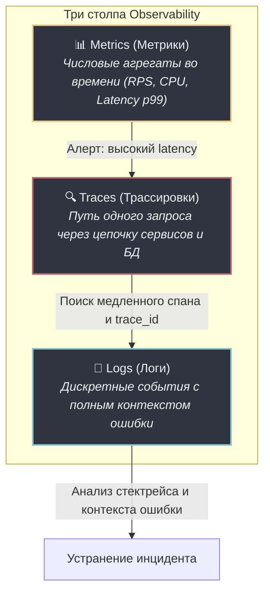
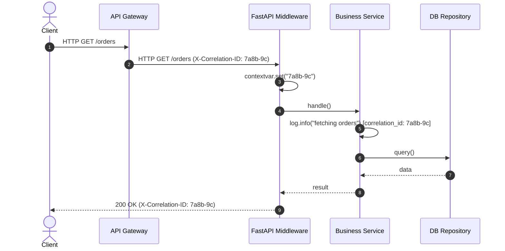
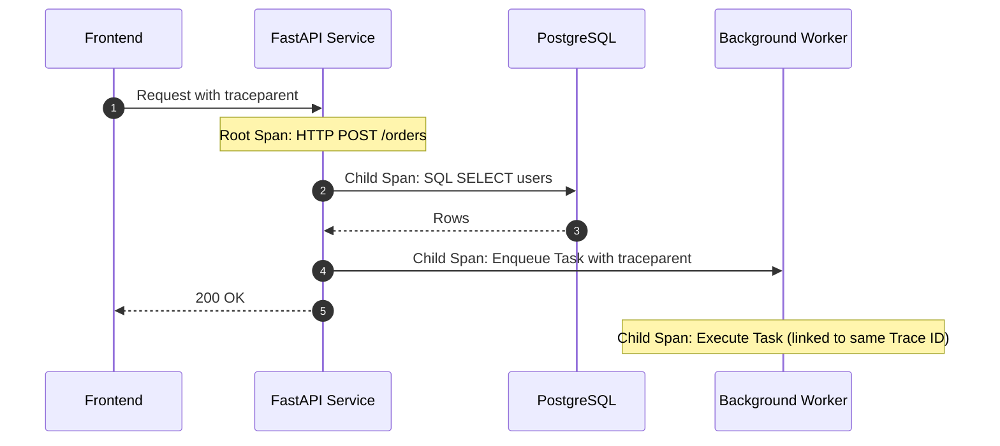

# 04. Наблюдаемость (Observability): структурированные логи (structlog), метрики Prometheus, OpenTelemetry и Health Checks

Когда ваше приложение развернуто в кластере Kubernetes на десятках серверов, невозможно зайти по SSH и «посмотреть, что там упало». В промышленной эксплуатации сервис должен быть прозрачным: любая проблема (рост задержек, сбои базы данных, ошибки внешних API) должна диагностироваться за секунды на основе телеметрии.

В этой главе мы разберем реализацию концепции **Observability (Наблюдаемости)**: три столпа (Logs, Metrics, Traces), структурированное JSON-логирование со `structlog`, сквозные идентификаторы запросов (`Correlation-ID`) через `contextvars`, сбор метрик Prometheus по методологии **RED**, распределенный трейсинг с OpenTelemetry и правильную архитектуру зондов работоспособности (`/healthz` и `/readyz`).

---

## 1. Три столпа наблюдаемости



- **Метрики** отвечают на вопрос: *«Когда и какая часть системы сломалась?»* (например: «ошибки 5xx выросли до 5% на эндпоинте `/orders`»).
- **Трассировки** отвечают на вопрос: *«Где именно произошла задержка или сбой?»* (например: «запрос завис на 3 секунды в вызове платежного шлюза»).
- **Логи** отвечают на вопрос: *«Почему это произошло?»* (например: «получен ответ от Stripe: Insufficient funds»).

---

## 2. Структурированное логирование: почему обычный текст — зло?

В старых проектах часто встречается вывод строк:
```python
# АНТИПАТТЕРН: неструктурированный текст
logger.error(f"Не удалось списать средства с пользователя {user_id} на сумму {amount}")
```

В системах агрегации (Grafana Loki, ELK, Datadog) такой лог невозможно эффективно отфильтровать по диапазону суммы или быстро построить график частоты ошибок по конкретным пользователям без тяжелых регулярных выражений.

### Решение: Библиотека `structlog` с JSON-форматом

`structlog` трансформирует логи в структурированные словари с валидным JSON:

```json
{
  "timestamp": "2026-11-03T11:45:12.345678Z",
  "level": "error",
  "event": "payment_failed",
  "correlation_id": "018b3d68-085e-7a2e-8a19-bf9fcf2b70f1",
  "user_id": 4210,
  "amount": 1500.50,
  "currency": "RUB",
  "error_code": "INSUFFICIENT_FUNDS",
  "duration_ms": 34.2
}
```

### Настройка процессоров `structlog`:

```python
import logging
import sys
import structlog

def setup_logging():
    shared_processors = [
        structlog.contextvars.merge_contextvars,
        structlog.processors.add_log_level,
        structlog.processors.TimeStamper(fmt="iso", utc=True),
        structlog.processors.StackInfoRenderer(),
        structlog.processors.format_exc_info,
    ]

    structlog.configure(
        processors=shared_processors + [
            structlog.processors.JSONRenderer() # В проде — чистый JSON
        ],
        wrapper_class=structlog.make_filtering_bound_logger(logging.INFO),
        context_class=dict,
        logger_factory=structlog.PrintLoggerFactory(sys.stdout),
        cache_logger_on_first_use=True,
    )
```

---

## 3. Сквозная трассировка запросов: `X-Correlation-ID` и `contextvars`

Каждый входящий HTTP-запрос должен получать уникальный сквозной идентификатор (`Correlation-ID` или `Request-ID`). Если клиент передал заголовок `X-Correlation-ID` (например, внешний шлюз API Gateway), мы используем его. Если нет — генерируем новый UUIDv7/UUIDv4.

В асинхронном коде Python переменные контекста потока (`threading.local`) не работают, так как десятки корутин выполняются в одном потоке. Для изоляции контекста используется модуль **`contextvars`**.



### Реализация Middleware сквозного Correlation-ID:

```python
from contextvars import ContextVar
from uuid import uuid4
from fastapi import FastAPI, Request, Response
from starlette.middleware.base import BaseHTTPMiddleware
import structlog

CORRELATION_ID_CTX: ContextVar[str] = ContextVar("correlation_id", default="")

class CorrelationIdMiddleware(BaseHTTPMiddleware):
    async def dispatch(self, request: Request, call_next) -> Response:
        # Извлекаем существующий ID или создаем новый
        correlation_id = request.headers.get("X-Correlation-ID") or str(uuid4())
        
        # Сохраняем в контекст текущей корутины
        token = CORRELATION_ID_CTX.set(correlation_id)
        
        # Привязываем ID к логгеру для всех логов внутри этого запроса
        structlog.contextvars.bind_contextvars(correlation_id=correlation_id)

        try:
            response: Response = await call_next(request)
            # Возвращаем заголовок клиенту
            response.headers["X-Correlation-ID"] = correlation_id
            return response
        finally:
            structlog.contextvars.clear_contextvars()
            CORRELATION_ID_CTX.reset(token)
```

---

## 4. Сбор метрик Prometheus и методология RED

Для веб-сервисов индустриальным стандартом мониторинга является методология **RED** (созданная Томом Уилкоксом):
1. **Rate (Частота):** Количество запросов в секунду (RPS).
2. **Errors (Ошибки):** Количество неудачных запросов (HTTP 5xx).
3. **Duration (Длительность):** Время выполнения запросов (распределение задержки).

### Типы метрик Prometheus

- **Counter:** Монотонно возрастающее число (сбрасывается только при рестарте сервиса). Пример: `http_requests_total`.
- **Gauge:** Значение, которое может как расти, так и падать. Пример: `active_db_connections`, `cpu_usage_percent`.
- **Histogram:** Разбивает измерения по интервалам (бакетам). Позволяет вычислять процентили ($p_{50}, p_{95}, p_{99}$).

### Почему нельзя ориентироваться на среднее время ответа (Average)?

> [!WARNING] Ловушка среднего арифметического
> Если из 100 запросов 99 выполнились за 5 миллисекунд, а один завис на 10 секунд:
> $$\text{Average} = \frac{99 \times 0.005 + 10}{100} \approx 0.105 \text{ сек (105 мс)}$$
> Среднее значение выглядит приемлемо (105 мс), но **1% ваших пользователей сталкивается с катастрофической задержкой в 10 секунд**!
> Перцентиль $p_{99} = 10 \text{ с}$ мгновенно вскроет эту аномалию.

### Интеграция с `prometheus_client`:

```python
import time
from prometheus_client import Counter, Histogram, generate_latest, CONTENT_TYPE_LATEST
from starlette.middleware.base import BaseHTTPMiddleware
from fastapi import Request, Response

HTTP_REQUESTS_TOTAL = Counter(
    "http_requests_total",
    "Total HTTP requests received",
    labelnames=["method", "path", "status_code"],
)

HTTP_REQUEST_DURATION_SECONDS = Histogram(
    "http_request_duration_seconds",
    "HTTP request latency in seconds",
    labelnames=["method", "path"],
    buckets=(0.005, 0.01, 0.025, 0.05, 0.1, 0.25, 0.5, 1.0, 2.5, 5.0),
)

class PrometheusMetricsMiddleware(BaseHTTPMiddleware):
    async def dispatch(self, request: Request, call_next) -> Response:
        if request.url.path in ("/metrics", "/healthz", "/readyz"):
            return await call_next(request)

        start_time = time.perf_counter()
        status_code = 500
        try:
            response = await call_next(request)
            status_code = response.status_code
            return response
        finally:
            duration = time.perf_counter() - start_time
            # Нормализация пути, чтобы избежать взрыва кардинальности метрик
            route_path = request.scope.get("endpoint")
            path = request.url.path
            
            HTTP_REQUESTS_TOTAL.labels(
                method=request.method,
                path=path,
                status_code=str(status_code),
            ).inc()
            
            HTTP_REQUEST_DURATION_SECONDS.labels(
                method=request.method,
                path=path,
            ).observe(duration)
```

---

## 5. Распределенный трейсинг с OpenTelemetry (OTel)

Когда один запрос пользователя инициирует цепочку:
`API Gateway -> FastAPI App -> Auth Service -> PostgreSQL -> Kafka`,
логи отдельных сервисов трудно сопоставить без единого идентификатора трассировки (`Trace-ID`).

Стандарт **W3C Trace Context** определяет заголовок `traceparent`:
```text
traceparent: 00-4bf92f3577b34da6a3ce929d0e0e4736-00f067aa0ba902b7-01
              │  └──────────────┬───────────────┘ └───────┬────────┘ └ флаги
            версия          Trace ID                   Span ID
```



С помощью OpenTelemetry SDK спаны автоматически передаются между асинхронными HTTP-клиентами (`httpx`), ORM (`SQLAlchemy`) и фоновыми задачами, визуализируясь в **Jaeger** или **Grafana Tempo**.

---

## 6. Зонды работоспособности: `/healthz` vs `/readyz`

В Kubernetes разделение на **Liveness** и **Readiness** зонды критически важно для предотвращения аварий каскадного падения:

| Зонд | Kubernetes название | Вопрос проверки | Действие K8s при сбое |
|---|---|---|---|
| `/healthz` | **Liveness Probe** | Процесс Python жив? Не завис ли Event Loop в вечном цикле? | Перезапуск контейнера (`docker restart`). |
| `/readyz` | **Readiness Probe** | Сервис готов принимать боевой трафик? Доступны ли PostgreSQL и Redis? | Исключение пода из балансировки трафика (трафик уходит на здоровые реплики). |

> [!CAUTION] Ошибка: проверка БД в Liveness Probe
> **Никогда не проверяйте подключение к базе данных в `/healthz` (Liveness)!**
> Если база данных кратковременно перегружена или перезагружается, все ваши 50 реплик приложения FastAPI одновременно ответят 500 на `/healthz`. Kubernetes решит, что упали сами поды, и начнет их одновременно убивать и перезапускать, усугубляя аварию (Cascading Failure).
> Проверку зависимостей нужно делать **только в `/readyz` (Readiness)**!

### Реализация эндпоинтов проверок:

```python
from fastapi import APIRouter, status, Response
from typing import Literal

health_router = APIRouter(tags=["Health"])

@health_router.get("/healthz", status_code=status.HTTP_200_OK)
async def liveness_probe() -> dict[str, str]:
    """Быстрая проверка: процесс жив, Event Loop крутится."""
    return {"status": "alive"}

@health_router.get("/readyz")
async def readiness_probe(response: Response) -> dict:
    """Глубокая проверка: готовность критичных зависимостей."""
    checks = {
        "database": await check_postgres_connection(),
        "redis": await check_redis_connection(),
    }
    
    all_ready = all(status == "UP" for status in checks.values())
    if not all_ready:
        response.status_code = status.HTTP_503_SERVICE_UNAVAILABLE
        return {"status": "DOWN", "dependencies": checks}
        
    return {"status": "UP", "dependencies": checks}
```

---

## Резюме

1. Переходите на **структурированный JSON-формат логирования** с помощью `structlog` для удобного анализа и алертинга.
2. Пробрасывайте сквозной **`X-Correlation-ID`** через `contextvars` для отслеживания пути запроса сквозь весь стек.
3. Собирайте метрики по методологии **RED** (Rate, Errors, Duration) и отслеживайте **квантили латентности $p_{95}$ и $p_{99}$**, а не средние значения.
4. Разделяйте **Liveness (`/healthz`)** и **Readiness (`/readyz`)** зонды, чтобы не допускать каскадных перезапусков при временных сбоях инфраструктуры.

---

## Практическое задание

Реализуйте и протестируйте модули телеметрии: генератор структурированных JSON-логов с автоматической привязкой `Correlation-ID` через `ContextVar`, сборщик метрик Prometheus (Counter и квантильный расчет латентности Histogram), а также агрегатор проверок Liveness и Readiness:

👉 **Файл с заданием и тестами:** [[ex_04_observability_metrics.py]]

Запуск проверки:
```bash
python3 exercises/06_fastapi_pro/ex_04_observability_metrics.py
```
